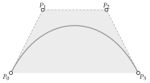

# Quick start

<span id="sec-quickstart"></span>

## A cubic curve

The curve used throughout this manual is the cubic with control points
$(0, 0)$, $(1, 2)$, $(3, 2)$ and $(4, 0)$ ([Cubic with control polygon and hull](quickstart.md#fig-quickstart)).

```python
from bezierkit import BezierCurve, PiecewiseBezier, Point
from bezierkit.bezier import to_cubic
from bezierkit.export.tikz import to_tikz

curve = BezierCurve.cubic(Point(0, 0), Point(1, 2), Point(3, 2), Point(4, 0))
print(curve.at(0.5))                 # Point(coords=(2.0, 1.5))
print(curve.derivative().at(0.5))    # Point(coords=(4.5, 0.0))
left, right = curve.split(0.4)       # two cubics that together trace curve

path = PiecewiseBezier([to_cubic(curve)])
print(to_tikz(path, precision=2, options="thick"))
# \draw[thick] (0.00,0.00) .. controls (1.00,2.00) and (3.00,2.00) .. (4.00,0.00);
```

<span id="fig-quickstart"></span>

<figure class="ev-fig" markdown>

{ .ev-figure-sm }

<div class="ev-downloads"><a class="ev-download" href="../assets/bezierkit/agora/curves/curves.py" download aria-label="Download the source"><svg viewBox="0 0 24 24" aria-hidden="true"><path d="M12 4v11m0 0-4.5-4.5M12 15l4.5-4.5M5 20h14" fill="none" stroke="currentColor" stroke-width="2" stroke-linecap="round" stroke-linejoin="round"/></svg><span>Download the source</span></a></div>

<figcaption markdown>Cubic with control polygon and hull</figcaption>

</figure>

The curve starts at $P_0$ and ends at $P_3$, leaves $P_0$ towards $P_1$ and
arrives at $P_3$ from $P_2$, and never leaves the shaded hull of its control
points ([Convex hull](guides/curves.md#cor-hull)). The last line is the curve as a TikZ path, ready to paste
into a LaTeX document.

## The pieces

- Values: `Point`, `Vector` and `PointSet` are immutable and
  dimension-checked ([Geometry values](guides/geometry.md#sec-geometry)).
- Curves: `BezierCurve` has any degree and dimension;
  `CubicBezierSegment` is the cubic that renderers consume; a
  `PiecewiseBezier` joins cubics into a path ([Bézier curves](guides/curves.md#sec-curves), [Cubic segments and paths](guides/paths.md#sec-paths)).
- Constructions: endpoint conditions, slopes, derivatives or Hermite data
  become control points ([Constructions and Hermite interpolation](guides/construction.md#sec-construction)).
- Approximation: smooth functions, sampled points and level sets
  $F(x, y) = c$ become cubic paths with a stated error ([Fitting](guides/fitting.md#sec-fitting),
  [Level sets](guides/implicit.md#sec-implicit)).
- Output: samples, JSON, SVG path data and TikZ, and Matplotlib paths
  ([Sampling and export](guides/export.md#sec-export)).
