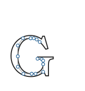

# Outlines, subsets, and portable data

<span id="sec-outlines-embedding"></span>

## Glyph geometry

<!-- api: agora.glyphkit.guides_outlines_embedding_1 -->

An exact glyph outline: ordered path commands, bounds, and units per em.

<!-- api: agora.glyphkit.guides_outlines_embedding_2 -->

Starts a new contour at the given font-space point.

<!-- api: agora.glyphkit.guides_outlines_embedding_3 -->

Adds a straight segment from the current point to its endpoint.

<!-- api: agora.glyphkit.guides_outlines_embedding_4 -->

Adds a quadratic Bézier segment with one control point and one endpoint.

<!-- api: agora.glyphkit.guides_outlines_embedding_5 -->

Adds a cubic Bézier segment with two control points and one endpoint.

<!-- api: agora.glyphkit.guides_outlines_embedding_6 -->

Closes the current contour by connecting it to its starting point.

<!-- api: agora.glyphkit.guides_outlines_embedding_7 -->

Approximates curved outline commands with line segments at a caller-selected tolerance.

<!-- api: agora.glyphkit.guides_outlines_embedding_8 -->

One open or closed sequence of points returned by curve flattening.

```python
glyph = layout.lines[0].runs[0].glyphs[0]
outline = library.outline(glyph)
```

## Permission-aware subsets

<!-- api: agora.glyphkit.guides_outlines_embedding_9 -->

Declares why the subset will be embedded, so font permissions can be enforced for that use.

<!-- api: agora.glyphkit.guides_outlines_embedding_10 -->

Selects the returned font container, such as OpenType or WOFF2.

<!-- api: agora.glyphkit.guides_outlines_embedding_11 -->

The complete subsetting result: portable fonts, source-to-subset mapping, warnings, and metadata.

<!-- api: agora.glyphkit.guides_outlines_embedding_12 -->

One permission-checked font payload with family, format, bytes, covered glyphs, and embedding metadata.

```python
from glyphkit.embedding import EmbeddingUse, FontContainer

bundle = library.subset(
    layout,
    embedding_use=EmbeddingUse.WEB,
    container=FontContainer.WOFF2,
)
```

Restricted fonts are rejected. Unknown permissions are also rejected unless the caller passes an explicit override and records that decision. GlyphKit returns bytes and metadata; the consumer decides whether and where to write them.

## Serialization

<!-- api: agora.glyphkit.guides_outlines_embedding_13 -->

Converts a supported immutable public value into versioned ordinary data suitable for JSON-like storage.

<!-- api: agora.glyphkit.guides_outlines_embedding_14 -->

Validates versioned data and reconstructs the corresponding public value within configured limits.

<span id="fig-glyph-outline"></span>

<figure class="ev-fig" markdown>

{ .ev-figure-sm }

<figcaption markdown>The exact Bézier outline and selected control polygons of a shaped glyph</figcaption>

</figure>
