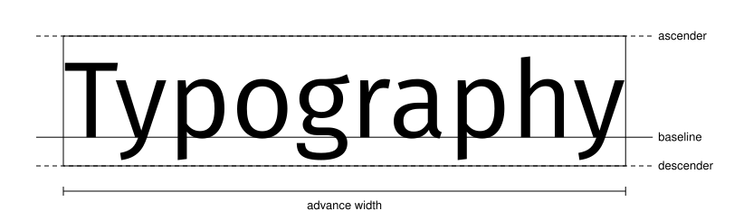

# Quick start

<span id="sec-quickstart"></span>

This example uses explicit font files. GlyphKit reads a font's bytes once, while the library is built, so a later change to the path does not alter the layout.

```python
from glyphkit import FontLibrary, FontSource, Paragraph, TextSpan, TextStyle

library = FontLibrary.from_sources((FontSource.path("fonts/SourceSans3-Regular.ttf"),))
family = library.faces[0].family
paragraph = Paragraph(
    (TextSpan("Utility U(x₁, x₂)", TextStyle((family,), 18)),),
    max_width=360,
)
layout = library.layout(paragraph)

print(layout.logical_bounds)
print(layout.lines[0].runs[0].glyphs[0])
```

<!-- api: glyphkit.quickstart_1 -->

A caller-owned font source: a path, bytes or a stream. Paths and streams are read when a `FontLibrary` is created, and bytes keep the supplied bytes.

<!-- api: glyphkit.quickstart_2 -->

The main typography engine. Its face catalogue, matching rules and source identity are fixed once it is built. `faces` lists the faces, and `library.faces[0].family` is the family name to use in a style.

<!-- api: glyphkit.quickstart_layout -->

Shapes every span, wraps at legal break opportunities and returns an immutable `TextLayout`.

<!-- api: glyphkit.quickstart_3 -->

An immutable sequence of styled text spans, plus optional width, height, alignment, indentation and line settings.

<!-- api: glyphkit.quickstart_4 -->

A fragment of source text paired with one `TextStyle`.

<!-- api: glyphkit.quickstart_5 -->

Font families, size, weight, width, slant, language, direction, spacing and OpenType features for one span.

<!-- api: glyphkit.quickstart_6 -->

The immutable result of laying out a paragraph: lines, runs, positioned glyphs, source ranges, bounds, baselines, overflow and the fonts that were used.

## Coordinates

GlyphKit uses layout units, not pixels tied to a DPI. The consumer decides how those units map to its canvas. A layout is y-up: the first baseline is at `y = 0`, and each later line has a baseline at a smaller, negative `y`. A positioned glyph carries the position `x`, `y` of its origin on its baseline.

<span id="fig-glyph-metrics"></span>

<figure class="ev-fig" markdown>

{ .ev-figure-lg }

<div class="ev-downloads"><a class="ev-download" href="../assets/glyphkit/layout/metrics.py" download aria-label="Download the source"><svg viewBox="0 0 24 24" aria-hidden="true"><path d="M12 4v11m0 0-4.5-4.5M12 15l4.5-4.5M5 20h14" fill="none" stroke="currentColor" stroke-width="2" stroke-linecap="round" stroke-linejoin="round"/></svg><span>Download the source</span></a></div>

<figcaption markdown>Baselines, width, and vertical font metrics</figcaption>

</figure>

Text in more than one script works the same way. The families are tried in the order of the style, and each character takes the first family that covers it. A character that no configured family covers raises `MissingGlyphError`.

<span id="fig-glyph-paragraph"></span>

<figure class="ev-fig" markdown>

{ .ev-figure-sm }

<div class="ev-downloads"><a class="ev-download" href="../assets/glyphkit/layout/paragraph.py" download aria-label="Download the source"><svg viewBox="0 0 24 24" aria-hidden="true"><path d="M12 4v11m0 0-4.5-4.5M12 15l4.5-4.5M5 20h14" fill="none" stroke="currentColor" stroke-width="2" stroke-linecap="round" stroke-linejoin="round"/></svg><span>Download the source</span></a></div>

<figcaption markdown>A mixed Latin and Chinese paragraph wrapped at max_width. Each box is a line's logical bounds and the dotted line is its baseline.</figcaption>

</figure>
