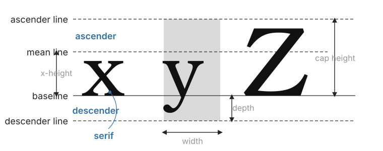

# Quick start

<span id="sec-quickstart"></span>

This example uses an explicit font file. GlyphKit snapshots its contents while the library is built, so later path changes do not alter the layout.

```python
from glyphkit import FontLibrary, FontSource, Paragraph, TextSpan, TextStyle

library = FontLibrary.from_sources(
    (FontSource.path("fonts/SourceSans3-Regular.ttf"),)
)
family = library.faces[0].family
paragraph = Paragraph(
    (TextSpan("Utility U(x₁, x₂)", TextStyle((family,), 18)),),
    max_width=360,
)
layout = library.layout(paragraph)

print(layout.logical_bounds)
print(layout.lines[0].runs[0].glyphs[0])
```

<!-- api: agora.glyphkit.quickstart_1 -->

A caller-owned font source. Paths and streams are read when a `FontLibrary` is created; byte sources keep the supplied bytes.

<!-- api: agora.glyphkit.quickstart_2 -->

The main typography engine. Its face catalog, matching rules, and source identity are fixed after construction.

<!-- api: agora.glyphkit.quickstart_3 -->

An immutable sequence of styled text spans plus optional width, height, alignment, indentation, and line settings.

<!-- api: agora.glyphkit.quickstart_4 -->

A source-text fragment paired with one `TextStyle`.

<!-- api: agora.glyphkit.quickstart_5 -->

Font families, size, weight, width, slant, language, direction, spacing, and OpenType features for a span.

<!-- api: agora.glyphkit.quickstart_6 -->

The immutable result of paragraph layout: lines, shaped runs, positioned glyphs, source ranges, bounds, baselines, overflow, and font uses.

GlyphKit uses logical units, not pixels tied to a particular DPI. The consumer decides how those units map to its canvas.

<span id="fig-glyph-metrics"></span>

<figure class="ev-fig" markdown>

{ .ev-figure-lg }

<figcaption markdown>Baselines, width, and vertical font metrics</figcaption>

</figure>
