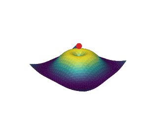

# Scenes and motion

<span id="sec-scenes-motion"></span>

A scene is an immutable collection of nodes with stable ids and a camera. A motion changes node properties over time. Neither one knows about a renderer.

## 2D scenes

```python
from kinetickit import (
    Animation,
    Bounds2D,
    Group2D,
    Line2D,
    Path2D,
    PathNode2D,
    Scene2D,
    Shape2D,
    Transform2D,
    Vec2,
    ease,
)

x_axis = Line2D(id="x-axis", start=Vec2(0, 0), end=Vec2(10, 0), width=1.5, color="#000000")
y_axis = Line2D(id="y-axis", start=Vec2(0, 0), end=Vec2(0, 8), width=1.5, color="#000000")
curve = PathNode2D.polyline(
    "curve", [(0, 7), (2, 4.5), (4, 3), (7, 1.6), (10, 1)], width=3, color="#000000", draw_progress=0.0
)
area = Shape2D(id="area", path=Path2D.rect(0, 0, 4, 3), fill="#bbbbbb", opacity=0.0)
plot = Group2D(id="plot", children=(x_axis, y_axis, area, curve))

scene = Scene2D(plot)
scene = scene.bind({scene.camera.ref("view"): Bounds2D(Vec2(-1, -1), Vec2(12, 9))})

draw = curve.animate.draw_progress.to(1.0, duration=1.5, easing=ease.in_out_cubic)
fade = area.animate.opacity.to(1.0, duration=0.8)
move = plot.animate.transform.to(Transform2D(translate=Vec2(1, 0.6)), duration=0.8)

Animation(scene, draw.then(fade).then(move)).save("scene2d.svg", width=455, height=315)
```

<span id="fig-kinetic-scene2d"></span>

<figure class="ev-fig" markdown>

{ .ev-figure-lg }

<div class="ev-downloads"><a class="ev-download" href="../../assets/kinetickit/scenes/scene2d.py" download aria-label="Download the source"><svg viewBox="0 0 24 24" aria-hidden="true"><path d="M12 4v11m0 0-4.5-4.5M12 15l4.5-4.5M5 20h14" fill="none" stroke="currentColor" stroke-width="2" stroke-linecap="round" stroke-linejoin="round"/></svg><span>Download the source</span></a></div>

<figcaption markdown>A path draws itself, a shape fades in, and the whole group moves; then the motion runs backward.</figcaption>

</figure>

Every node type lists what can be animated: `Point2D.animatable_properties()` returns the property names and their value types, and `node.animate.<property>` builds a motion for one of them. Colours, vectors, angles and transforms interpolate by their own rules ([Interpolation and transforms](interpolation-transforms.md#sec-kinetic-interpolation)).

<!-- api: kinetickit.guides_scenes_motion_1 -->

A stroked segment between two points. Its endpoints, colour, width, dash pattern and drawing progress can be animated.

<!-- api: kinetickit.guides_scenes_motion_2 -->

An open or closed stroked `Path2D`. It keeps line and Bézier commands and supports path morphing. `PathNode2D.polyline(id, points)` is the shortcut for straight segments.

<!-- api: kinetickit.guides_scenes_motion_3 -->

A filled path, optionally with a stroke. Use it for areas, closed outlines and compound shapes.

<!-- api: kinetickit.guides_scenes_motion_4 -->

A node that applies one transform, opacity and clip to an ordered collection of children.

<!-- api: kinetickit.guides_scenes_motion_5 -->

A positioned `TextAsset` from a typography adapter, with animatable scale, transform and opacity ([Typography](typography.md#sec-typography)).

<!-- api: kinetickit.guides_scenes_motion_6 -->

Defines the visible rectangle of the 2D world and how it maps to the output viewport. Set it through `scene.bind({scene.camera.ref("view"): Bounds2D(...)})`. The view keeps its aspect ratio, so an output of another shape shows margins.

## 3D scenes

```python
import numpy as np

from kinetickit import Animation, Camera3D, DirectionalLight3D, Point3D, Scene3D, Surface3D, Vec3
from kinetickit.styles import ColorScale, Material

xs = ys = np.linspace(-2, 2, 28)
X, Y = np.meshgrid(xs, ys)
Z = np.sin(np.hypot(X, Y) * 2.2) / (1 + np.hypot(X, Y))
surface = Surface3D.height_field(
    "surface", xs, ys, Z, colorscale=ColorScale.viridis_like(), material=Material(0.4, 0.6, 0.2, 24)
)
scene = Scene3D(
    surface,
    Point3D(id="peak", position=Vec3(0, 0, 1.0), size=6, color="#d62728"),
    DirectionalLight3D(id="sun"),
    camera=Camera3D(position=Vec3(5.5, -6.5, 4.2), target=Vec3(0, 0, 0.2)),
)
orbit = scene.camera.animate.position.to(Vec3(-6, -5.5, 4.2), duration=2.0)
Animation(scene, orbit).save("surface.gif", width=320, height=240, fps=10)
```

<span id="fig-kinetic-surface"></span>

<figure class="ev-fig" markdown>

{ .ev-figure-sm }

<div class="ev-downloads"><a class="ev-download" href="../../assets/kinetickit/surface/surface.py" download aria-label="Download the source"><svg viewBox="0 0 24 24" aria-hidden="true"><path d="M12 4v11m0 0-4.5-4.5M12 15l4.5-4.5M5 20h14" fill="none" stroke="currentColor" stroke-width="2" stroke-linecap="round" stroke-linejoin="round"/></svg><span>Download the source</span></a></div>

<figcaption markdown>A lit height-field surface while the camera orbits it.</figcaption>

</figure>

<!-- api: kinetickit.guides_scenes_motion_7 -->

An immutable 3D scene with geometry, lights, groups and one camera.

<!-- api: kinetickit.guides_scenes_motion_8 -->

A point marker in 3D with animatable position, size, colour and opacity.

<!-- api: kinetickit.guides_scenes_motion_9 -->

A single 3D segment, projected by the active camera.

<!-- api: kinetickit.guides_scenes_motion_10 -->

An ordered chain of 3D points, drawn as connected segments.

<!-- api: kinetickit.guides_scenes_motion_11 -->

Indexed vertices and faces with validated topology, optional per-face colour and material settings.

<!-- api: kinetickit.guides_scenes_motion_12 -->

A regular height-field surface built from an $x,y$ grid and height values. `Surface3D.height_field(id, xs, ys, zs)` is the usual constructor.

<!-- api: kinetickit.guides_scenes_motion_13 -->

An ordered group of 3D nodes that share a transform and an opacity.

<!-- api: kinetickit.guides_scenes_motion_14 -->

A perspective or orthographic camera with position, target, clipping planes and projection settings. Its properties animate like any node's, so an orbit is one `position` motion.

<!-- api: kinetickit.scenes_vec3 -->

A point or direction in 3D.

<!-- api: kinetickit.scenes_colorscale -->

Maps a value to a colour through ordered stops.

<!-- api: kinetickit.scenes_material -->

Ambient, diffuse and specular response of a surface.

<!-- api: kinetickit.scenes_light -->

A light that shines in one direction, as the sun does.

## Composing time

<!-- api: kinetickit.guides_scenes_motion_15 -->

An immutable description of change over time. Motions can be sequenced, overlapped, delayed, repeated, reversed or trimmed.

<!-- api: kinetickit.guides_scenes_motion_16 -->

The compiled, random-access form of a motion tree. It evaluates property values at any valid time.

<!-- api: kinetickit.guides_scenes_motion_17 -->

One value at one time, optionally carrying the easing rule for the interval that follows. `hold=True` keeps the value until the next keyframe.

<!-- api: kinetickit.guides_scenes_motion_18 -->

A validated sequence of keyframes for one property, with checks for the endpoints and for ordering.

```python
motion = (
    a.animate.position.to(Vec2(5, 5), duration=1.0)
    .then(b.animate.opacity.to(1.0, duration=0.5))
    .with_(c.animate.size.to(9, duration=0.5), offset=1.0)
    .mark("settled")
)
```

`then` starts the next motion when the previous one ends. `with_` starts it at an offset inside the previous one. [Time and easing](time-easing.md#sec-kinetic-time) gives the durations of both.

## Transitions between scenes

<!-- api: kinetickit.guides_scenes_motion_19 -->

Builds a motion between two scenes. Nodes with the same id are matched and their compatible properties are interpolated.

<!-- api: kinetickit.guides_scenes_motion_20 -->

Controls how a node without a partner, or with an incompatible structure, enters, leaves, cross-fades or fails.

Paths, meshes and surfaces have their own morphing tools. When automatic normalization cannot infer the topology you mean, give an explicit correspondence ([Morphing](morphing.md#sec-kinetic-morphing)).
