# Quick start

<span id="sec-quickstart"></span>

```python
from kinetickit import Animation, Bounds2D, Point2D, Scene2D, Vec2, ease

dot = Point2D(id="dot", position=Vec2(1, 1), size=8, color="#e4572e")
scene = Scene2D(dot)
scene = scene.bind(
    {scene.camera.ref("view"): Bounds2D(Vec2(0, 0), Vec2(10, 10))}
)

motion = dot.animate.position.to(
    Vec2(9, 9),
    duration=1.5,
    easing=ease.out_cubic,
)
animation = Animation(scene, motion)

animation.save("dot.svg", width=400, height=400)
animation.save("dot.gif", width=400, height=400, fps=30)
animation.save("dot.html", width=400, height=440)
```

<!-- api: agora.kinetickit.quickstart_1 -->

The facade joining an immutable scene to a motion. `frames()` yields snapshots lazily; `save()` selects an exporter from the destination suffix and returns an `ExportManifest`.

<!-- api: agora.kinetickit.quickstart_2 -->

An immutable collection of 2D nodes plus a camera. `bind()` returns a new scene with initial property bindings instead of mutating the original.

<!-- api: agora.kinetickit.quickstart_3 -->

A circular 2D mark with a stable id, position, size, colour, opacity, and animatable properties.

<!-- api: agora.kinetickit.quickstart_4 -->

An axis-aligned rectangle used for camera views, clipping, layout, and geometric bounds.

<!-- api: agora.kinetickit.quickstart_5 -->

An immutable two-component vector used for positions, directions, sizes, and 2D calculations.

The GIF and HTML lines need their matching optional extras. Capability checks run before a destination is written, so an unsupported combination raises `CapabilityError` without leaving a partial file.

<!-- api: agora.kinetickit.quickstart_6 -->

The top-level easing namespace. It provides linear, polynomial, sine, exponential, circular, back, elastic, bounce, and cubic Bézier easing functions.

<span id="fig-kinetic-motion"></span>

<figure class="ev-fig" markdown>

{ .ev-figure-lg }

<figcaption markdown>The complete route, equal-time samples, and moving point for cubic easing</figcaption>

</figure>
