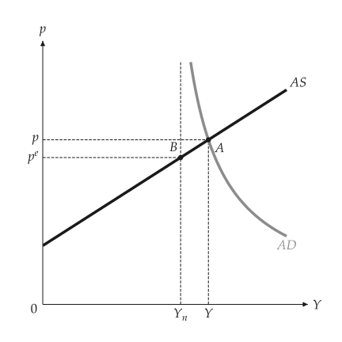
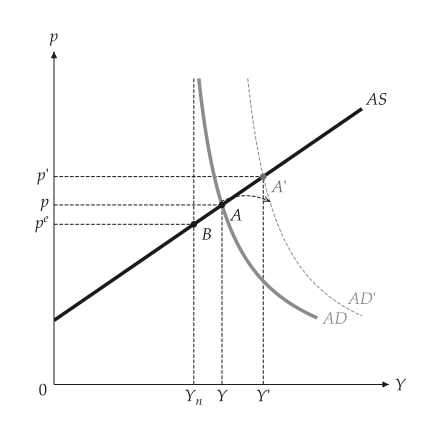
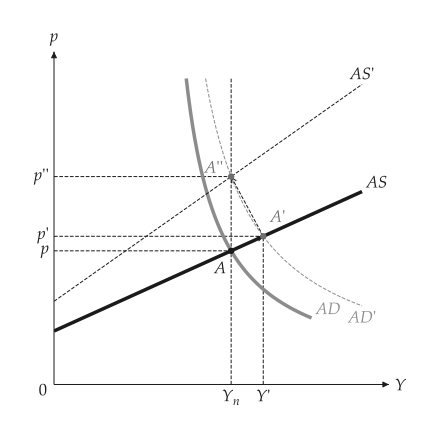

# Aggregate supply and demand

<span id="sec-adas"></span>

`macro_viz.adas` holds the AS-AD model.

- `AggregateSupply` is $p = s \, p^e \, h(Y)$ with $h(Y_n) = 1$; `AggregateSupply.linear(...)`
  or any increasing $h$.
- `AggregateDemand` is $Y = A + k M / p$.
- `ASADModel(supply, demand)`; `equilibrium()` returns output, the price level and the gap
  against natural output (recessionary, inflationary or none).
- `analyze_demand_shock` and `analyze_supply_shock` return the shifted model with directions.
- `employment(Y, A)` gives employment from output and productivity.

Natural output is an input; the wage-setting derivation is a separate model
([Natural rate of unemployment](labor.md#sec-labor)).

```python
from macro_viz.adas import AggregateDemand, AggregateSupply, ASADModel, analyze_demand_shock
from macro_viz.visuals import adas_canvas

supply = AggregateSupply.linear(1.0, 100, 0.6)
demand = AggregateDemand(80, 45, 1)
model = ASADModel(supply, demand)

adas_canvas(model).save("adas_equilibrium.svg")
adas_canvas(analyze_demand_shock(model, autonomous=115)).save("adas_demand_shock.svg")
```

{ .ev-figure-sm }

{ .ev-figure-sm }

`aggregate_supply_canvas` and `aggregate_demand_canvas` draw one curve and its shifts.

## Adjustment

`analyze_adjustment` lists the equilibria as expectations catch up (the expected price becomes
the price just observed) after a demand or supply shock, ending at natural output.
`adas_adjustment_canvas` draws the shifting supply curves and the path A, A', A''.

{ .ev-figure-sm }
