# Aggregate supply and demand

<span id="sec-adas"></span>

Aggregate supply passes through the point where output is at its natural level and the price is the expected one; aggregate demand falls in the price level. Sections follow `adas.py` and `adas_adjustment.py`.

## Models

<!-- api: macro_viz.guides_adas_1 -->

`AggregateSupply.linear(expected_price, natural_output, slope)` is $p = p^e (1 + s (Y / Y_n - 1))$ with `0 < slope < 1`. `AggregateDemand(autonomous, money, multiplier)` is the demand implied by IS-LM. `ASADModel` solves their crossing and classifies the gap (`Gap`). The shock functions return an `ASADShift` with the direction of output and price.

## Aggregate supply

<span id="sec-ex-supply"></span>


<!-- api: macro_viz.guides_adas_2 -->

```python
from macro_viz.adas import AggregateSupply
from macro_viz.visuals import aggregate_supply_canvas

supply = AggregateSupply.linear(1.0, 100, 0.6)
aggregate_supply_canvas(supply).save("aggregate_supply.svg")
aggregate_supply_canvas(
    supply, shifted=supply.with_expected_price(1.2)
).save("aggregate_supply_shift.svg")
```

<span id="fig-aggregate-supply"></span>

<figure class="ev-fig" markdown>

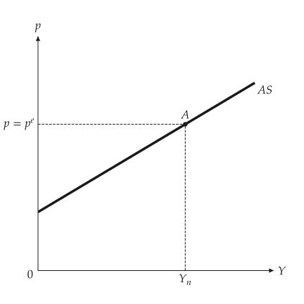{ .ev-figure-sm }

<div class="ev-downloads"><a class="ev-download" href="../../assets/macro-viz/adas/adas.py" download aria-label="Download the source"><svg viewBox="0 0 24 24" aria-hidden="true"><path d="M12 4v11m0 0-4.5-4.5M12 15l4.5-4.5M5 20h14" fill="none" stroke="currentColor" stroke-width="2" stroke-linecap="round" stroke-linejoin="round"/></svg><span>Download the source</span></a></div>

<figcaption markdown>Aggregate supply through A</figcaption>

</figure>

<span id="fig-aggregate-supply-shift"></span>

<figure class="ev-fig" markdown>

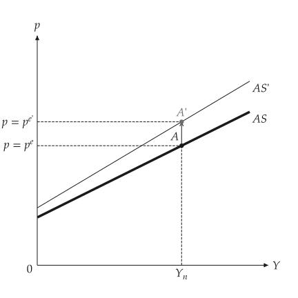{ .ev-figure-sm }

<div class="ev-downloads"><a class="ev-download" href="../../assets/macro-viz/adas/adas.py" download aria-label="Download the source"><svg viewBox="0 0 24 24" aria-hidden="true"><path d="M12 4v11m0 0-4.5-4.5M12 15l4.5-4.5M5 20h14" fill="none" stroke="currentColor" stroke-width="2" stroke-linecap="round" stroke-linejoin="round"/></svg><span>Download the source</span></a></div>

<figcaption markdown>A higher expected price moves AS up to AS'</figcaption>

</figure>


## Aggregate demand

<span id="sec-ex-demand"></span>


<!-- api: macro_viz.guides_adas_3 -->

```python
from macro_viz.adas import AggregateDemand
from macro_viz.visuals import aggregate_demand_canvas

demand = AggregateDemand(80, 45, 1)
aggregate_demand_canvas(
    demand,
    [demand.with_autonomous(100), demand.with_money(30)],
    captions=["Increase in government spending", "Decrease in nominal money"],
    x_max=240,
    y_max=2.2,
).save("aggregate_demand_shifts.svg")
```

<span id="fig-aggregate-demand-shifts"></span>

<figure class="ev-fig" markdown>

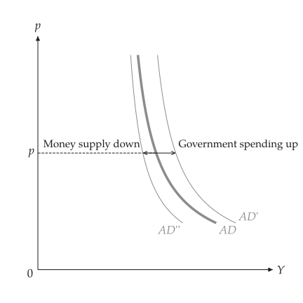{ .ev-figure-sm }

<div class="ev-downloads"><a class="ev-download" href="../../assets/macro-viz/adas/adas.py" download aria-label="Download the source"><svg viewBox="0 0 24 24" aria-hidden="true"><path d="M12 4v11m0 0-4.5-4.5M12 15l4.5-4.5M5 20h14" fill="none" stroke="currentColor" stroke-width="2" stroke-linecap="round" stroke-linejoin="round"/></svg><span>Download the source</span></a></div>

<figcaption markdown>Demand moves right or left at one price level</figcaption>

</figure>


## Equilibrium and shocks

<span id="sec-ex-equilibrium"></span>


<!-- api: macro_viz.guides_adas_4 -->

```python
from macro_viz.adas import (
    ASADModel,
    analyze_demand_shock,
    analyze_supply_shock,
)
from macro_viz.visuals import adas_canvas

model = ASADModel(supply, demand)
adas_canvas(model).save("adas_equilibrium.svg")
adas_canvas(model, productivity=1.0).save("adas_employment.svg")

oil = analyze_supply_shock(model, scale=0.75)
adas_canvas(oil, ambiguous_demand=True).save("adas_productivity.svg")

boom = analyze_demand_shock(model, autonomous=115)
adas_canvas(boom).save("adas_demand_shock.svg")
```

<span id="fig-adas-equilibrium"></span>

<figure class="ev-fig" markdown>

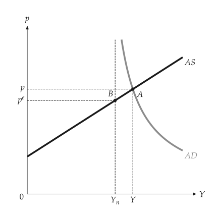{ .ev-figure-sm }

<div class="ev-downloads"><a class="ev-download" href="../../assets/macro-viz/adas/adas.py" download aria-label="Download the source"><svg viewBox="0 0 24 24" aria-hidden="true"><path d="M12 4v11m0 0-4.5-4.5M12 15l4.5-4.5M5 20h14" fill="none" stroke="currentColor" stroke-width="2" stroke-linecap="round" stroke-linejoin="round"/></svg><span>Download the source</span></a></div>

<figcaption markdown>Short-run equilibrium A, with natural output $Y_n$ and the expected price</figcaption>

</figure>

<span id="fig-adas-employment"></span>

<figure class="ev-fig" markdown>

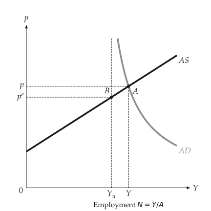{ .ev-figure-sm }

<div class="ev-downloads"><a class="ev-download" href="../../assets/macro-viz/adas/adas.py" download aria-label="Download the source"><svg viewBox="0 0 24 24" aria-hidden="true"><path d="M12 4v11m0 0-4.5-4.5M12 15l4.5-4.5M5 20h14" fill="none" stroke="currentColor" stroke-width="2" stroke-linecap="round" stroke-linejoin="round"/></svg><span>Download the source</span></a></div>

<figcaption markdown>Employment read from output</figcaption>

</figure>

<span id="fig-adas-productivity"></span>

<figure class="ev-fig" markdown>

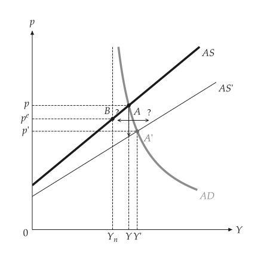{ .ev-figure-sm }

<div class="ev-downloads"><a class="ev-download" href="../../assets/macro-viz/adas/adas.py" download aria-label="Download the source"><svg viewBox="0 0 24 24" aria-hidden="true"><path d="M12 4v11m0 0-4.5-4.5M12 15l4.5-4.5M5 20h14" fill="none" stroke="currentColor" stroke-width="2" stroke-linecap="round" stroke-linejoin="round"/></svg><span>Download the source</span></a></div>

<figcaption markdown>A supply shock: the direction of demand's reaction is ambiguous</figcaption>

</figure>

<span id="fig-adas-demand-shock"></span>

<figure class="ev-fig" markdown>

{ .ev-figure-sm }

<div class="ev-downloads"><a class="ev-download" href="../../assets/macro-viz/adas/adas.py" download aria-label="Download the source"><svg viewBox="0 0 24 24" aria-hidden="true"><path d="M12 4v11m0 0-4.5-4.5M12 15l4.5-4.5M5 20h14" fill="none" stroke="currentColor" stroke-width="2" stroke-linecap="round" stroke-linejoin="round"/></svg><span>Download the source</span></a></div>

<figcaption markdown>A demand shock moves AD to AD'</figcaption>

</figure>


With `ambiguous_demand=True` two arrows, left and right, each marked with a question mark, show that demand may move either way.

## Adjustment to the medium run

<span id="sec-ex-adjustment"></span>


<!-- api: macro_viz.guides_adas_5 -->

```python
from macro_viz.adas import analyze_adjustment
from macro_viz.visuals import adas_adjustment_canvas

money_up = analyze_demand_shock(model, money=70)
path = analyze_adjustment(money_up)
adas_adjustment_canvas(path).save("adjustment_money.svg")
```

<span id="fig-adjustment-money"></span>

<figure class="ev-fig" markdown>

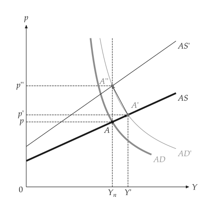{ .ev-figure-sm }

<div class="ev-downloads"><a class="ev-download" href="../../assets/macro-viz/adas/adas_adjustment.py" download aria-label="Download the source"><svg viewBox="0 0 24 24" aria-hidden="true"><path d="M12 4v11m0 0-4.5-4.5M12 15l4.5-4.5M5 20h14" fill="none" stroke="currentColor" stroke-width="2" stroke-linecap="round" stroke-linejoin="round"/></svg><span>Download the source</span></a></div>

<figcaption markdown>After a monetary expansion expectations catch up and output returns to $Y_n$</figcaption>

</figure>

<span id="fig-adjustment-deficit"></span>

<figure class="ev-fig" markdown>

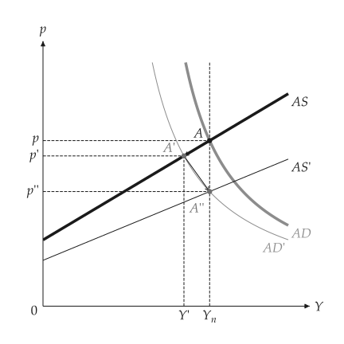{ .ev-figure-sm }

<div class="ev-downloads"><a class="ev-download" href="../../assets/macro-viz/adas/adas_adjustment.py" download aria-label="Download the source"><svg viewBox="0 0 24 24" aria-hidden="true"><path d="M12 4v11m0 0-4.5-4.5M12 15l4.5-4.5M5 20h14" fill="none" stroke="currentColor" stroke-width="2" stroke-linecap="round" stroke-linejoin="round"/></svg><span>Download the source</span></a></div>

<figcaption markdown>Deficit reduction</figcaption>

</figure>

<span id="fig-adjustment-oil"></span>

<figure class="ev-fig" markdown>

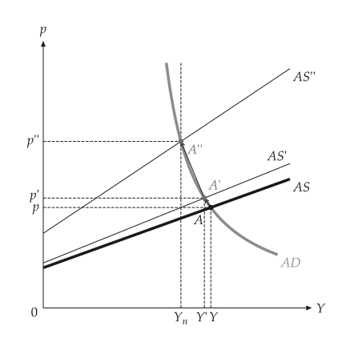{ .ev-figure-sm }

<div class="ev-downloads"><a class="ev-download" href="../../assets/macro-viz/adas/adas_adjustment.py" download aria-label="Download the source"><svg viewBox="0 0 24 24" aria-hidden="true"><path d="M12 4v11m0 0-4.5-4.5M12 15l4.5-4.5M5 20h14" fill="none" stroke="currentColor" stroke-width="2" stroke-linecap="round" stroke-linejoin="round"/></svg><span>Download the source</span></a></div>

<figcaption markdown>An oil-price shock</figcaption>

</figure>

<span id="fig-adjustment-expectations"></span>

<figure class="ev-fig" markdown>

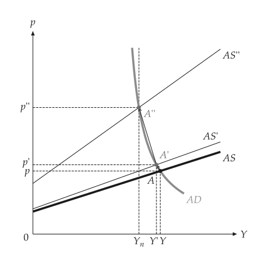{ .ev-figure-sm }

<div class="ev-downloads"><a class="ev-download" href="../../assets/macro-viz/adas/adas_adjustment.py" download aria-label="Download the source"><svg viewBox="0 0 24 24" aria-hidden="true"><path d="M12 4v11m0 0-4.5-4.5M12 15l4.5-4.5M5 20h14" fill="none" stroke="currentColor" stroke-width="2" stroke-linecap="round" stroke-linejoin="round"/></svg><span>Download the source</span></a></div>

<figcaption markdown>Expectations adjusting step by step</figcaption>

</figure>


The equilibria A, A', A'', ... are joined by straight solid arrows that slide along aggregate demand and end at the medium-run equilibrium on the vertical at natural output.

## Animation

<span id="sec-ex-animation"></span>


<span id="fig-adas-animation"></span>

<figure class="ev-fig" markdown>

{ .ev-figure-sm }

<div class="ev-downloads"><a class="ev-download" href="../../assets/macro-viz/animation/adas_animation.py" download aria-label="Download the source"><svg viewBox="0 0 24 24" aria-hidden="true"><path d="M12 4v11m0 0-4.5-4.5M12 15l4.5-4.5M5 20h14" fill="none" stroke="currentColor" stroke-width="2" stroke-linecap="round" stroke-linejoin="round"/></svg><span>Download the source</span></a></div>

<figcaption markdown>The AD curve moves and the economy slides along AS</figcaption>

</figure>

