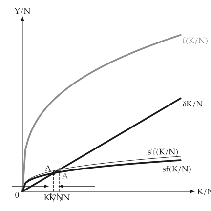

# Animation

<span id="sec-animation"></span>

A figure about a shift or an adjustment animates from the same builder that draws it. It needs the `animation` extra ([Optional dependencies](../installation.md#sec-extras)), which adds `kinetickit`.

A builder here is a function from one number (a shift, a saving rate, a round) to a `mosaickit` canvas: the function that draws the static figure, with every axis range fixed by the caller so the axes stay put.

<!-- api: macro_viz.guides_animation_1 -->

`linear_values(start, stop, frames)` makes the frame values.

<!-- api: macro_viz.guides_animation_2 -->

`save_svg` morphs between the frames' layers, matched by their stable ids, into a native animated SVG, and sets the labels from font files, so `econ-viz.toml` needs the `[font]` and `[fonts]` tables.

<!-- api: macro_viz.guides_animation_3 -->

`save_gif` renders each frame through `mosaickit` and streams the pixels into a GIF; it needs no font files. It also animates builders that return a grid of panels, and pads the frames to one size.

```python
from macro_viz.animation import linear_values, save_svg
from macro_viz.keynesian import (
    ConsumptionFunction,
    KeynesianCross,
    analyze_autonomous_shift,
)
from macro_viz.visuals import multiplier_canvas

model = KeynesianCross(
    ConsumptionFunction(20, 0.6), 20, 30, 20
)
limit = 1.6 * analyze_autonomous_shift(model, 30).post.equilibrium().output


def builder(amount: float):
    shift = analyze_autonomous_shift(model, amount)
    return multiplier_canvas(shift, show_path=False, x_max=limit)


save_svg(
    builder,
    linear_values(5, 30, 6),
    "multiplier_animation.svg",
    step_seconds=0.6,
)
```

<span id="fig-anim-multiplier"></span>

<figure class="ev-fig" markdown>

{ .ev-figure-sm }

<div class="ev-downloads"><a class="ev-download" href="../../assets/macro-viz/keynesian/keynesian_animation.py" download aria-label="Download the source"><svg viewBox="0 0 24 24" aria-hidden="true"><path d="M12 4v11m0 0-4.5-4.5M12 15l4.5-4.5M5 20h14" fill="none" stroke="currentColor" stroke-width="2" stroke-linecap="round" stroke-linejoin="round"/></svg><span>Download the source</span></a></div>

<figcaption markdown>The demand line climbs toward its new position</figcaption>

</figure>

<span id="fig-anim-money"></span>

<figure class="ev-fig" markdown>

{ .ev-figure-sm }

<div class="ev-downloads"><a class="ev-download" href="../../assets/macro-viz/money/money_animation.py" download aria-label="Download the source"><svg viewBox="0 0 24 24" aria-hidden="true"><path d="M12 4v11m0 0-4.5-4.5M12 15l4.5-4.5M5 20h14" fill="none" stroke="currentColor" stroke-width="2" stroke-linecap="round" stroke-linejoin="round"/></svg><span>Download the source</span></a></div>

<figcaption markdown>The money supply grows and the rate falls</figcaption>

</figure>

<span id="fig-anim-adas"></span>

<figure class="ev-fig" markdown>

{ .ev-figure-sm }

<div class="ev-downloads"><a class="ev-download" href="../../assets/macro-viz/adas/adas_animation.py" download aria-label="Download the source"><svg viewBox="0 0 24 24" aria-hidden="true"><path d="M12 4v11m0 0-4.5-4.5M12 15l4.5-4.5M5 20h14" fill="none" stroke="currentColor" stroke-width="2" stroke-linecap="round" stroke-linejoin="round"/></svg><span>Download the source</span></a></div>

<figcaption markdown>AD moves along AS</figcaption>

</figure>

<span id="fig-anim-islm"></span>

<figure class="ev-fig" markdown>

{ .ev-figure-sm }

<div class="ev-downloads"><a class="ev-download" href="../../assets/macro-viz/islm/islm_animation.py" download aria-label="Download the source"><svg viewBox="0 0 24 24" aria-hidden="true"><path d="M12 4v11m0 0-4.5-4.5M12 15l4.5-4.5M5 20h14" fill="none" stroke="currentColor" stroke-width="2" stroke-linecap="round" stroke-linejoin="round"/></svg><span>Download the source</span></a></div>

<figcaption markdown>LM moves as real money grows</figcaption>

</figure>

<span id="fig-anim-solow"></span>

<figure class="ev-fig" markdown>

{ .ev-figure-sm }

<div class="ev-downloads"><a class="ev-download" href="../../assets/macro-viz/growth/growth_animation.py" download aria-label="Download the source"><svg viewBox="0 0 24 24" aria-hidden="true"><path d="M12 4v11m0 0-4.5-4.5M12 15l4.5-4.5M5 20h14" fill="none" stroke="currentColor" stroke-width="2" stroke-linecap="round" stroke-linejoin="round"/></svg><span>Download the source</span></a></div>

<figcaption markdown>The saving rate rises</figcaption>

</figure>


## Status

Animation examples exist for the Keynesian cross, the money market, AS-AD, IS-LM, Solow growth and the linked panels. The other figures have none yet. The animated SVG leaves out movement arrows; the GIF uses `mosaickit`'s placement exactly.

Without `kinetickit` the static figures work unchanged.
