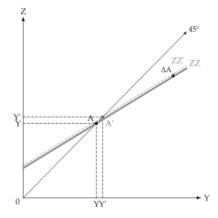

# Animation

<span id="sec-animation"></span>

A figure about a shift or an adjustment animates from the same builder. It needs the `animation`
extra ([Optional dependencies](../installation.md#sec-extras)), which adds `kinetickit`.

A builder is a function from one number (a shift, a saving rate, a round) to a `mosaickit`
canvas: the function that draws the static figure, with every axis range fixed by the caller so
the axes stay put.

- `linear_values(start, stop, frames)` makes the frame values.
- `save_gif(builder, values, path, fps=, dpi=)` renders each frame through `mosaickit` and streams
  the pixels into a GIF.
- `save_svg(builder, values, path, step_seconds=)` morphs between the frames' layers, matched by
  their stable ids, into a native animated SVG, and sets the labels with `glyphkit` in the fonts of
  the active settings.

```python
from macro_viz.animation import linear_values, save_svg
from macro_viz.keynesian import ConsumptionFunction, KeynesianCross, analyze_autonomous_shift
from macro_viz.visuals import multiplier_canvas

model = KeynesianCross(ConsumptionFunction(20, 0.6), investment=20, government=30, taxes=20)
limit = 1.5 * analyze_autonomous_shift(model, 30).post.equilibrium().output


def builder(amount: float):
    return multiplier_canvas(analyze_autonomous_shift(model, amount), show_path=False, x_max=limit)


save_svg(builder, linear_values(5, 30, 6), "multiplier_animation.svg", step_seconds=0.6)
```

{ .ev-figure-sm }

`save_svg` sets the labels from font files, so `econ-viz.toml` needs `[fonts]` and `[font]`
tables; `save_gif` does not.

Without `kinetickit` the static figures work unchanged.
