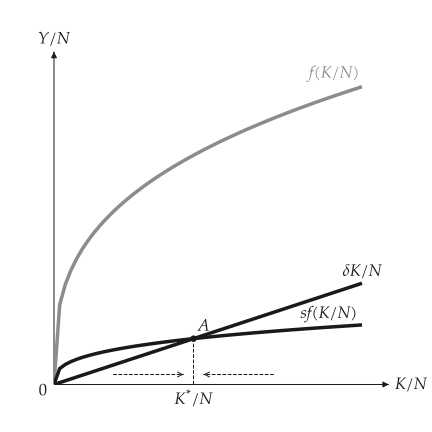
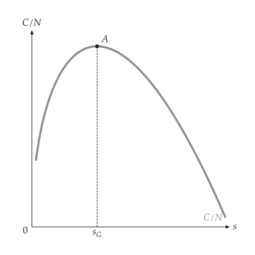
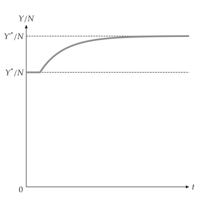

# Solow growth

<span id="sec-growth"></span>

`macro_viz.growth.Solow` takes any increasing concave production function, or
`Solow.cobb_douglas`, with the saving rate, depreciation and population and technology growth. It
gives the steady state, the golden-rule capital and saving rate, and one-period capital
accumulation. `analyze_change` compares steady states; `simulate` returns the discrete transition
after a change as a `SolowPath` (capital, output, growth rates, and log output including the trend
of technology).

```python
from macro_viz.growth import Solow, analyze_change
from macro_viz.visuals import golden_rule_canvas, solow_canvas

model = Solow.cobb_douglas(
    alpha=0.33, saving=0.2, depreciation=0.05, population_growth=0.01, tech_growth=0.02
)
solow_canvas(analyze_change(model, model.with_saving(0.3))).save("solow.svg")
golden_rule_canvas(model).save("golden_rule.svg")
```

{ .ev-figure-sm }

{ .ev-figure-sm }

## Figures

`production_function_canvas`, `solow_canvas` (with convergence arrows), `golden_rule_canvas`,
`solow_level_path_canvas`, `solow_log_path_canvas` and `solow_growth_rate_canvas`.
`effective=True` switches the labels to per effective worker.

{ .ev-figure-sm }
