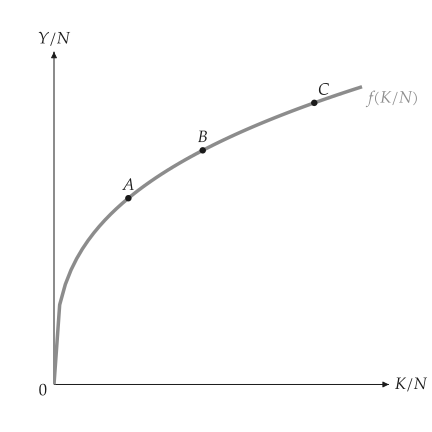
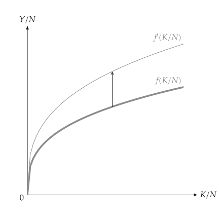
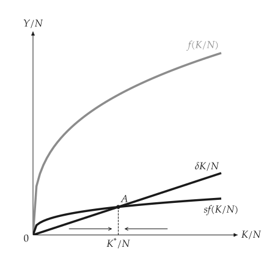
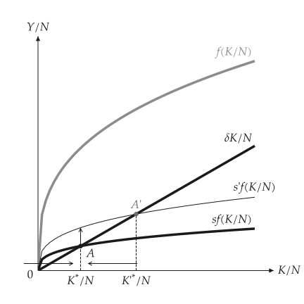
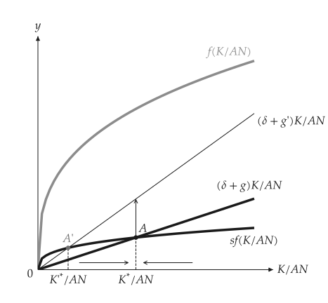
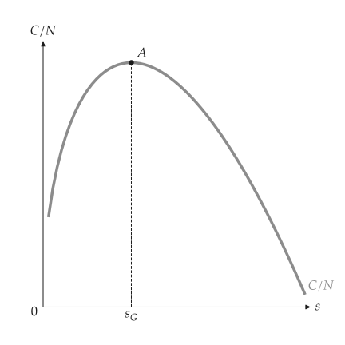
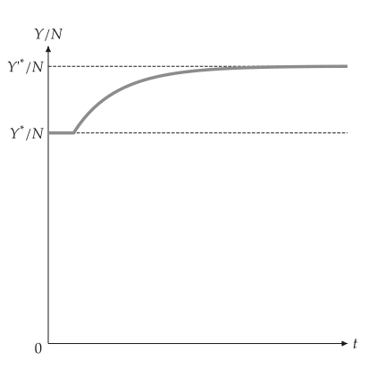
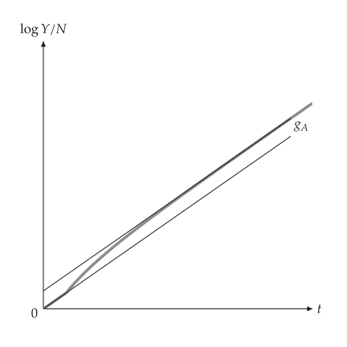
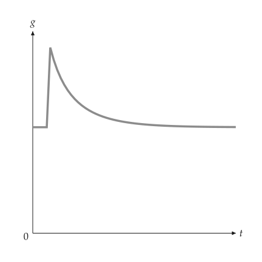
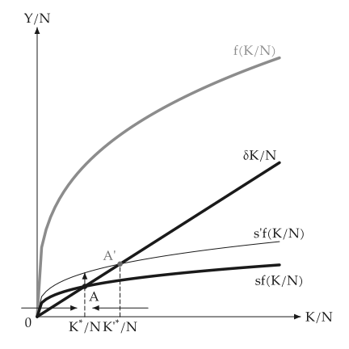

# Solow growth

<span id="sec-growth"></span>

Capital per worker grows while saving $s f(K/N)$ exceeds the capital needed to keep it constant, $(\delta + g_N) K/N$. Sections follow `growth.py`.

## Models

<!-- api: macro_viz.guides_growth_1 -->

`Solow` takes a production function of capital per worker and the saving, depreciation, population-growth and technology-growth rates. Methods answer `steady_state`, `steady_output`, `golden_rule_capital` and `consumption_at`; `with_saving`, `with_population_growth`, `with_tech_growth` and `with_production` return a changed model. `simulate` runs the transition path of a change in a given period.

## The production function

<span id="sec-ex-production"></span>


<!-- api: macro_viz.guides_growth_2 -->

```python
from macro_viz.growth import Solow
from macro_viz.visuals import production_function_canvas

model = Solow.cobb_douglas(0.33, saving=0.2, depreciation=0.1)
better = Solow.cobb_douglas(
    0.33, saving=0.2, depreciation=0.1, productivity=1.4
)
production_function_canvas(model, points=[1.0, 2.0, 3.5]).save(
    "production_function.svg"
)
production_function_canvas(model, shifted=better).save(
    "production_function_shift.svg"
)
```

<span id="fig-production-function"></span>

<figure class="ev-fig" markdown>

{ .ev-figure-sm }

<div class="ev-downloads"><a class="ev-download" href="../../assets/macro-viz/growth/growth.py" download aria-label="Download the source"><svg viewBox="0 0 24 24" aria-hidden="true"><path d="M12 4v11m0 0-4.5-4.5M12 15l4.5-4.5M5 20h14" fill="none" stroke="currentColor" stroke-width="2" stroke-linecap="round" stroke-linejoin="round"/></svg><span>Download the source</span></a></div>

<figcaption markdown>Output per worker rises with capital at a falling rate</figcaption>

</figure>

<span id="fig-production-function-shift"></span>

<figure class="ev-fig" markdown>

{ .ev-figure-sm }

<div class="ev-downloads"><a class="ev-download" href="../../assets/macro-viz/growth/growth.py" download aria-label="Download the source"><svg viewBox="0 0 24 24" aria-hidden="true"><path d="M12 4v11m0 0-4.5-4.5M12 15l4.5-4.5M5 20h14" fill="none" stroke="currentColor" stroke-width="2" stroke-linecap="round" stroke-linejoin="round"/></svg><span>Download the source</span></a></div>

<figcaption markdown>Better technology: f moves up to f' with a straight vertical arrow</figcaption>

</figure>


## The steady state

<span id="sec-ex-steady"></span>


<!-- api: macro_viz.guides_growth_3 -->

```python
from macro_viz.growth import analyze_change
from macro_viz.visuals import solow_canvas

solow_canvas(model).save("solow.svg")
more_saving = model.with_saving(0.35)
solow_canvas(analyze_change(model, more_saving)).save(
    "solow_saving_increase.svg"
)
```

<span id="fig-solow"></span>

<figure class="ev-fig" markdown>

{ .ev-figure-sm }

<div class="ev-downloads"><a class="ev-download" href="../../assets/macro-viz/growth/growth.py" download aria-label="Download the source"><svg viewBox="0 0 24 24" aria-hidden="true"><path d="M12 4v11m0 0-4.5-4.5M12 15l4.5-4.5M5 20h14" fill="none" stroke="currentColor" stroke-width="2" stroke-linecap="round" stroke-linejoin="round"/></svg><span>Download the source</span></a></div>

<figcaption markdown>Saving and depreciation lines cross at the steady state A</figcaption>

</figure>

<span id="fig-solow-saving-increase"></span>

<figure class="ev-fig" markdown>

{ .ev-figure-sm }

<div class="ev-downloads"><a class="ev-download" href="../../assets/macro-viz/growth/growth.py" download aria-label="Download the source"><svg viewBox="0 0 24 24" aria-hidden="true"><path d="M12 4v11m0 0-4.5-4.5M12 15l4.5-4.5M5 20h14" fill="none" stroke="currentColor" stroke-width="2" stroke-linecap="round" stroke-linejoin="round"/></svg><span>Download the source</span></a></div>

<figcaption markdown>A higher saving rate moves $s f$ up and capital to $K^*{}'$</figcaption>

</figure>


`effective=True` uses variables per effective worker, as in the case of population growth.

<span id="fig-solow-population-growth"></span>

<figure class="ev-fig" markdown>

{ .ev-figure-sm }

<div class="ev-downloads"><a class="ev-download" href="../../assets/macro-viz/growth/growth.py" download aria-label="Download the source"><svg viewBox="0 0 24 24" aria-hidden="true"><path d="M12 4v11m0 0-4.5-4.5M12 15l4.5-4.5M5 20h14" fill="none" stroke="currentColor" stroke-width="2" stroke-linecap="round" stroke-linejoin="round"/></svg><span>Download the source</span></a></div>

<figcaption markdown>Faster population growth moves the required-investment line</figcaption>

</figure>


## The golden rule

<span id="sec-ex-golden"></span>


<!-- api: macro_viz.guides_growth_4 -->

<span id="fig-golden-rule"></span>

<figure class="ev-fig" markdown>

{ .ev-figure-sm }

<div class="ev-downloads"><a class="ev-download" href="../../assets/macro-viz/growth/growth.py" download aria-label="Download the source"><svg viewBox="0 0 24 24" aria-hidden="true"><path d="M12 4v11m0 0-4.5-4.5M12 15l4.5-4.5M5 20h14" fill="none" stroke="currentColor" stroke-width="2" stroke-linecap="round" stroke-linejoin="round"/></svg><span>Download the source</span></a></div>

<figcaption markdown>Consumption per worker is highest at the golden-rule saving rate</figcaption>

</figure>


## Transition paths

<span id="sec-ex-paths"></span>


<!-- api: macro_viz.guides_growth_5 -->

```python
from macro_viz.growth import simulate
from macro_viz.visuals import (
    solow_growth_rate_canvas,
    solow_level_path_canvas,
    solow_log_path_canvas,
)

path = simulate(
    model, model.with_saving(0.35), periods=60, change_period=5
)
solow_level_path_canvas(path).save("solow_level_path.svg")
solow_log_path_canvas(path).save("solow_log_path.svg")
solow_growth_rate_canvas(path).save("solow_growth_rate.svg")
```

<span id="fig-solow-level-path"></span>

<figure class="ev-fig" markdown>

{ .ev-figure-sm }

<div class="ev-downloads"><a class="ev-download" href="../../assets/macro-viz/growth/growth.py" download aria-label="Download the source"><svg viewBox="0 0 24 24" aria-hidden="true"><path d="M12 4v11m0 0-4.5-4.5M12 15l4.5-4.5M5 20h14" fill="none" stroke="currentColor" stroke-width="2" stroke-linecap="round" stroke-linejoin="round"/></svg><span>Download the source</span></a></div>

<figcaption markdown>Output per worker after the change in period 5</figcaption>

</figure>

<span id="fig-solow-log-path"></span>

<figure class="ev-fig" markdown>

{ .ev-figure-sm }

<div class="ev-downloads"><a class="ev-download" href="../../assets/macro-viz/growth/growth.py" download aria-label="Download the source"><svg viewBox="0 0 24 24" aria-hidden="true"><path d="M12 4v11m0 0-4.5-4.5M12 15l4.5-4.5M5 20h14" fill="none" stroke="currentColor" stroke-width="2" stroke-linecap="round" stroke-linejoin="round"/></svg><span>Download the source</span></a></div>

<figcaption markdown>The same path in logarithms</figcaption>

</figure>

<span id="fig-solow-growth-rate"></span>

<figure class="ev-fig" markdown>

{ .ev-figure-sm }

<div class="ev-downloads"><a class="ev-download" href="../../assets/macro-viz/growth/growth.py" download aria-label="Download the source"><svg viewBox="0 0 24 24" aria-hidden="true"><path d="M12 4v11m0 0-4.5-4.5M12 15l4.5-4.5M5 20h14" fill="none" stroke="currentColor" stroke-width="2" stroke-linecap="round" stroke-linejoin="round"/></svg><span>Download the source</span></a></div>

<figcaption markdown>The growth rate rises and then falls back</figcaption>

</figure>


## Animation

<span id="sec-ex-animation"></span>


<span id="fig-solow-animation"></span>

<figure class="ev-fig" markdown>

{ .ev-figure-sm }

<div class="ev-downloads"><a class="ev-download" href="../../assets/macro-viz/animation/growth_animation.py" download aria-label="Download the source"><svg viewBox="0 0 24 24" aria-hidden="true"><path d="M12 4v11m0 0-4.5-4.5M12 15l4.5-4.5M5 20h14" fill="none" stroke="currentColor" stroke-width="2" stroke-linecap="round" stroke-linejoin="round"/></svg><span>Download the source</span></a></div>

<figcaption markdown>The saving rate rises and the steady state moves</figcaption>

</figure>

