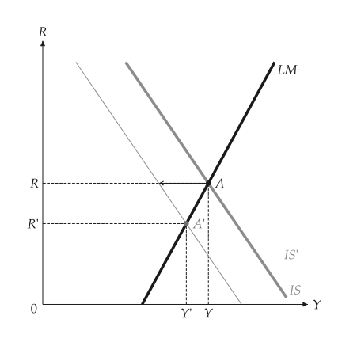
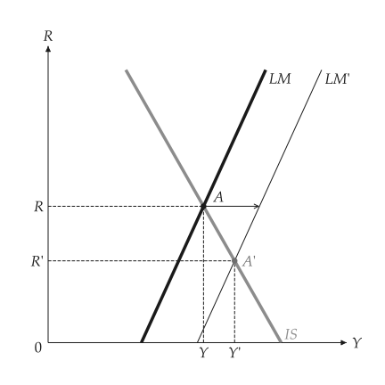
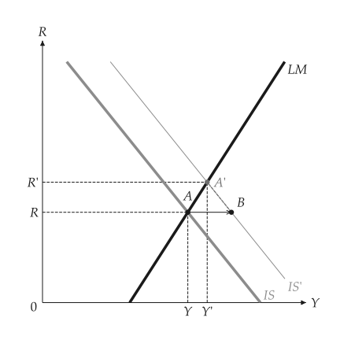
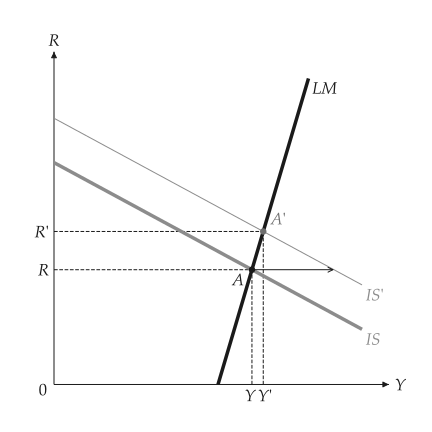
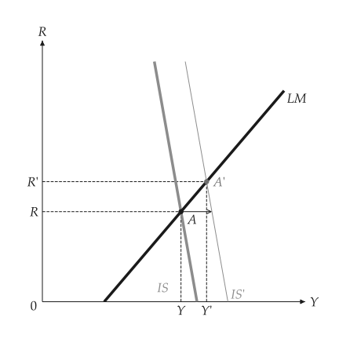
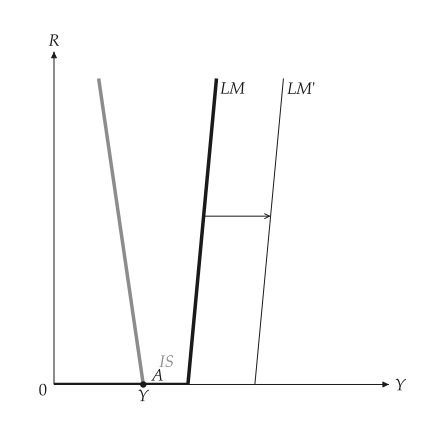
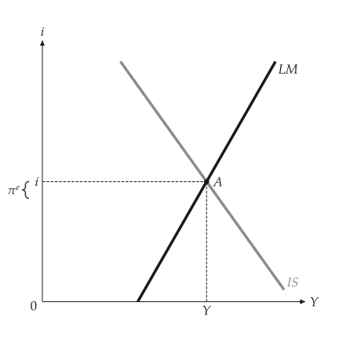
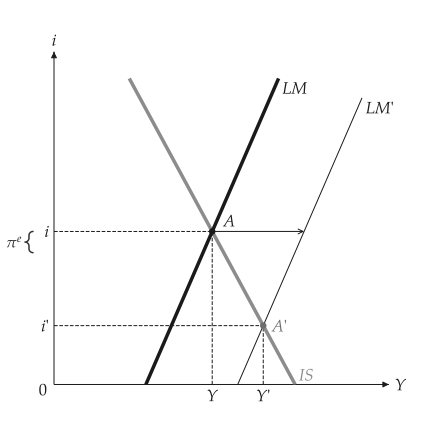
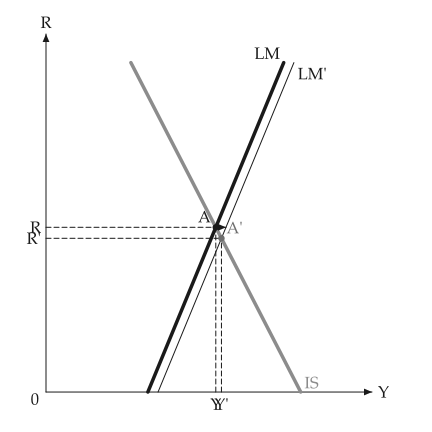

# IS-LM

<span id="sec-islm"></span>

The IS curve gives goods-market equilibrium and the LM curve money-market equilibrium, both in the plane of output $Y$ and the interest rate $R$. Sections follow `islm.py`, `islm_expectations.py` and `liquidity_trap.py`.

## Models

<!-- api: macro_viz.guides_islm_1 -->

IS is $Y = m (X - e R)$ with multiplier `m`, autonomous spending `X` and interest sensitivity `e`; LM is $M/p = k Y - h R$. `ISLM(autonomous, sensitivity, real_money, income_demand, rate_demand, multiplier=1.0, zero_bound=False)` takes these coefficients. `analyze_fiscal_policy` changes `autonomous` and so shifts IS; `analyze_monetary_policy` changes `real_money` and so shifts LM.

## Equilibrium and policy

<span id="sec-ex-equilibrium"></span>


<!-- api: macro_viz.guides_islm_2 -->

```python
from macro_viz.islm import (
    ISLM,
    analyze_fiscal_policy,
    analyze_monetary_policy,
)
from macro_viz.visuals import islm_canvas

model = ISLM(100, 25, 20, 0.5, 10)
islm_canvas(model).save("islm.svg")

tax = analyze_fiscal_policy(model, autonomous=80)
islm_canvas(tax).save("islm_tax_increase.svg")

money = analyze_monetary_policy(model, real_money=32)
islm_canvas(money).save("islm_monetary_expansion.svg")
```

<span id="fig-islm"></span>

<figure class="ev-fig" markdown>

{ .ev-figure-sm }

<div class="ev-downloads"><a class="ev-download" href="../../assets/macro-viz/islm/islm.py" download aria-label="Download the source"><svg viewBox="0 0 24 24" aria-hidden="true"><path d="M12 4v11m0 0-4.5-4.5M12 15l4.5-4.5M5 20h14" fill="none" stroke="currentColor" stroke-width="2" stroke-linecap="round" stroke-linejoin="round"/></svg><span>Download the source</span></a></div>

<figcaption markdown>IS and LM cross at A</figcaption>

</figure>

<span id="fig-islm-tax-increase"></span>

<figure class="ev-fig" markdown>

{ .ev-figure-sm }

<div class="ev-downloads"><a class="ev-download" href="../../assets/macro-viz/islm/islm.py" download aria-label="Download the source"><svg viewBox="0 0 24 24" aria-hidden="true"><path d="M12 4v11m0 0-4.5-4.5M12 15l4.5-4.5M5 20h14" fill="none" stroke="currentColor" stroke-width="2" stroke-linecap="round" stroke-linejoin="round"/></svg><span>Download the source</span></a></div>

<figcaption markdown>A tax increase: IS moves left, the rate and output fall</figcaption>

</figure>

<span id="fig-islm-monetary-expansion"></span>

<figure class="ev-fig" markdown>

{ .ev-figure-sm }

<div class="ev-downloads"><a class="ev-download" href="../../assets/macro-viz/islm/islm.py" download aria-label="Download the source"><svg viewBox="0 0 24 24" aria-hidden="true"><path d="M12 4v11m0 0-4.5-4.5M12 15l4.5-4.5M5 20h14" fill="none" stroke="currentColor" stroke-width="2" stroke-linecap="round" stroke-linejoin="round"/></svg><span>Download the source</span></a></div>

<figcaption markdown>A monetary expansion: LM moves right</figcaption>

</figure>


The arrow starts at A and runs sideways at the old interest rate to the moved curve. The new crossing is A'.

## Crowding out

<span id="sec-ex-crowding"></span>


```python
spending = analyze_fiscal_policy(model, autonomous=120)
islm_canvas(spending, show_crowding=True).save(
    "islm_crowding_out.svg"
)
```

<span id="fig-islm-crowding-out"></span>

<figure class="ev-fig" markdown>

{ .ev-figure-sm }

<div class="ev-downloads"><a class="ev-download" href="../../assets/macro-viz/islm/islm.py" download aria-label="Download the source"><svg viewBox="0 0 24 24" aria-hidden="true"><path d="M12 4v11m0 0-4.5-4.5M12 15l4.5-4.5M5 20h14" fill="none" stroke="currentColor" stroke-width="2" stroke-linecap="round" stroke-linejoin="round"/></svg><span>Download the source</span></a></div>

<figcaption markdown>B marks where the new IS stands at the old rate; B to A' is the output crowded out</figcaption>

</figure>


## Flat and steep curves

<span id="sec-ex-shapes"></span>


```python
steep = ISLM(100, 25, 20, 0.5, 2)
flat = ISLM(100, 25, 20, 0.5, 60)
islm_canvas(analyze_fiscal_policy(steep, 120)).save("islm_steep_lm.svg")
islm_canvas(analyze_fiscal_policy(flat, 120)).save("islm_flat_lm.svg")
```

<span id="fig-islm-steep-lm"></span>

<figure class="ev-fig" markdown>

{ .ev-figure-sm }

<div class="ev-downloads"><a class="ev-download" href="../../assets/macro-viz/islm/islm.py" download aria-label="Download the source"><svg viewBox="0 0 24 24" aria-hidden="true"><path d="M12 4v11m0 0-4.5-4.5M12 15l4.5-4.5M5 20h14" fill="none" stroke="currentColor" stroke-width="2" stroke-linecap="round" stroke-linejoin="round"/></svg><span>Download the source</span></a></div>

<figcaption markdown>A steep LM: fiscal policy moves the rate more than output</figcaption>

</figure>

<span id="fig-islm-flat-lm"></span>

<figure class="ev-fig" markdown>

{ .ev-figure-sm }

<div class="ev-downloads"><a class="ev-download" href="../../assets/macro-viz/islm/islm.py" download aria-label="Download the source"><svg viewBox="0 0 24 24" aria-hidden="true"><path d="M12 4v11m0 0-4.5-4.5M12 15l4.5-4.5M5 20h14" fill="none" stroke="currentColor" stroke-width="2" stroke-linecap="round" stroke-linejoin="round"/></svg><span>Download the source</span></a></div>

<figcaption markdown>A flat LM: fiscal policy moves output more than the rate</figcaption>

</figure>


## The liquidity trap

<span id="sec-ex-trap"></span>


```python
trap = ISLM(80, 25, 60, 0.5, 8, zero_bound=True)
shift = analyze_monetary_policy(trap, real_money=90)
islm_canvas(shift, x_max=300).save("islm_zero_bound.svg")
```

<span id="fig-islm-zero-bound"></span>

<figure class="ev-fig" markdown>

{ .ev-figure-sm }

<div class="ev-downloads"><a class="ev-download" href="../../assets/macro-viz/islm/liquidity_trap.py" download aria-label="Download the source"><svg viewBox="0 0 24 24" aria-hidden="true"><path d="M12 4v11m0 0-4.5-4.5M12 15l4.5-4.5M5 20h14" fill="none" stroke="currentColor" stroke-width="2" stroke-linecap="round" stroke-linejoin="round"/></svg><span>Download the source</span></a></div>

<figcaption markdown>At a zero rate a monetary expansion leaves output unchanged</figcaption>

</figure>


## Expected inflation

<span id="sec-ex-expectations"></span>


<!-- api: macro_viz.guides_islm_3 -->

```python
from macro_viz.islm import ISLMExpectations
from macro_viz.visuals import islm_expectations_canvas

inflation = ISLMExpectations(model, expected_inflation=0.2)
islm_expectations_canvas(inflation).save(
    "islm_expected_inflation.svg"
)
```

<span id="fig-islm-expected-inflation"></span>

<figure class="ev-fig" markdown>

{ .ev-figure-sm }

<div class="ev-downloads"><a class="ev-download" href="../../assets/macro-viz/islm/islm_expectations.py" download aria-label="Download the source"><svg viewBox="0 0 24 24" aria-hidden="true"><path d="M12 4v11m0 0-4.5-4.5M12 15l4.5-4.5M5 20h14" fill="none" stroke="currentColor" stroke-width="2" stroke-linecap="round" stroke-linejoin="round"/></svg><span>Download the source</span></a></div>

<figcaption markdown>The nominal rate on the axis and the real rate as a gap below it</figcaption>

</figure>

<span id="fig-islm-expected-inflation-money"></span>

<figure class="ev-fig" markdown>

{ .ev-figure-sm }

<div class="ev-downloads"><a class="ev-download" href="../../assets/macro-viz/islm/islm_expectations.py" download aria-label="Download the source"><svg viewBox="0 0 24 24" aria-hidden="true"><path d="M12 4v11m0 0-4.5-4.5M12 15l4.5-4.5M5 20h14" fill="none" stroke="currentColor" stroke-width="2" stroke-linecap="round" stroke-linejoin="round"/></svg><span>Download the source</span></a></div>

<figcaption markdown>A monetary expansion with expected inflation given</figcaption>

</figure>


## Animation

<span id="sec-ex-animation"></span>


<span id="fig-islm-animation"></span>

<figure class="ev-fig" markdown>

{ .ev-figure-sm }

<div class="ev-downloads"><a class="ev-download" href="../../assets/macro-viz/islm/islm_animation.py" download aria-label="Download the source"><svg viewBox="0 0 24 24" aria-hidden="true"><path d="M12 4v11m0 0-4.5-4.5M12 15l4.5-4.5M5 20h14" fill="none" stroke="currentColor" stroke-width="2" stroke-linecap="round" stroke-linejoin="round"/></svg><span>Download the source</span></a></div>

<figcaption markdown>LM moves right as real money grows</figcaption>

</figure>

