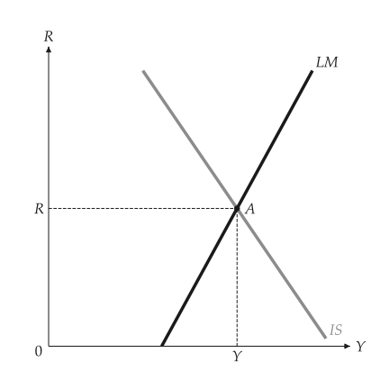
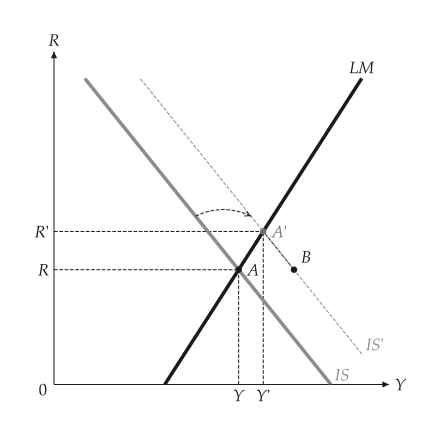
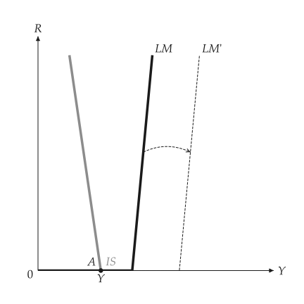

# IS-LM

<span id="sec-islm"></span>

`macro_viz.islm.ISLM` is linear:

$$
\text{IS: } Y = \mu (a - b R), \qquad \text{LM: } m = d Y - h R,
$$

with a vertical LM at $h = 0$ and a nearly horizontal one for a large $h$. `equilibrium()` solves
both. `analyze_fiscal_policy` and `analyze_monetary_policy` return the baseline and post models
with directions and, for fiscal policy, the crowding out.

```python
from macro_viz.islm import ISLM, analyze_fiscal_policy
from macro_viz.visuals import islm_canvas

model = ISLM(100, 25, 20, 0.5, 10, 1.0)
islm_canvas(model).save("islm.svg")
islm_canvas(analyze_fiscal_policy(model, 120), show_crowding=True).save("islm_crowding_out.svg")
```

{ .ev-figure-sm }

{ .ev-figure-sm }

## Zero lower bound

`ISLM(..., zero_bound=True)` makes the LM curve flat up to the output where money demand reaches
zero interest. Extra money or an LM shift on the flat part leaves the equilibrium unchanged.

{ .ev-figure-sm }

Three-panel decompositions and policy mixes are drawn by the [linked panels](panels.md#sec-panels).
