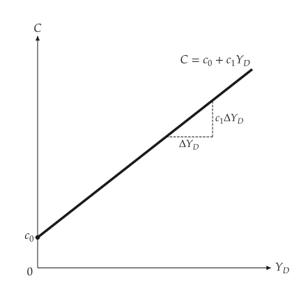
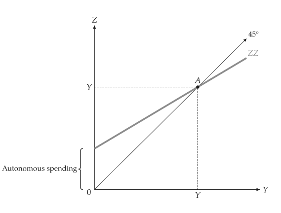
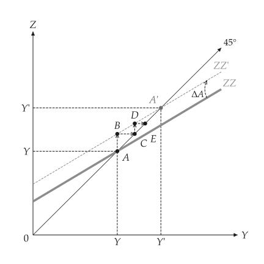

# Keynesian goods market

<span id="sec-keynesian"></span>

`macro_viz.keynesian` holds the renderer-free model.

- `ConsumptionFunction(c0, c1)` is $C = c_0 + c_1 (Y - T)$.
- `KeynesianCross(consumption, investment, government, taxes)` has equilibrium $Y = Z$ and
  multiplier $1 / (1 - c_1)$.
- `CurvedDemand(function, lower, upper)` replaces the straight demand line by any function.
- `analyze_autonomous_shift(model, change)` returns both equilibria, the direction of the
  change and the rounds of the multiplier process.

## Consumption function and cross

```python
from macro_viz.keynesian import ConsumptionFunction, KeynesianCross
from macro_viz.visuals import consumption_function_canvas, keynesian_cross_canvas

function = ConsumptionFunction(20, 0.6)
model = KeynesianCross(function, investment=20, government=30, taxes=20)

consumption_function_canvas(function, income_max=200).save("consumption_function.svg")
keynesian_cross_canvas(model).save("keynesian_cross.svg")
```

{ .ev-figure-sm }

{ .ev-figure-sm }

## Multiplier

```python
from macro_viz.keynesian import analyze_autonomous_shift
from macro_viz.visuals import multiplier_canvas

shift = analyze_autonomous_shift(model, change=30)
multiplier_canvas(shift).save("multiplier.svg")
```

The old position stays heavy; the new one is thin and dashed. Dotted guides run to the marks on
the axes.

{ .ev-figure-sm }
