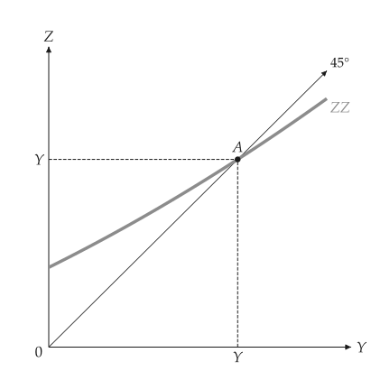
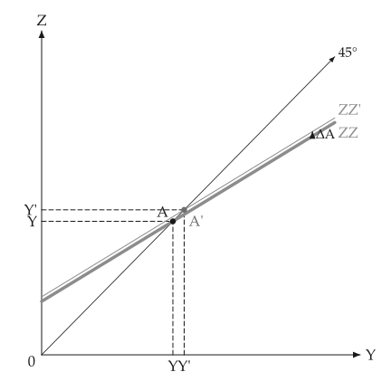

# Keynesian goods market

<span id="sec-keynesian"></span>

The goods market of a closed economy with a fixed price level: demand $Z = C + I + G$ and the multiplier. Each section is one part of `examples/scripts/keynesian.py`.

## Models

<!-- api: macro_viz.guides_keynesian_1 -->

`ConsumptionFunction(autonomous, propensity)` is $C = c_0 + c_1 (Y - T)$. `KeynesianCross` adds investment, government spending and taxes; its equilibrium solves $Y = Z$ and its `multiplier` is $1 / (1 - c_1)$. `CurvedDemand` replaces the straight demand line by any function with a bracket. `analyze_autonomous_shift` returns both equilibria, the `Direction` of the change and the rounds of the multiplier process.

## Consumption function and the cross

<span id="sec-ex-consumption"></span>


<!-- api: macro_viz.guides_keynesian_2 -->

<!-- api: macro_viz.guides_keynesian_3 -->

```python
from macro_viz.keynesian import (
    ConsumptionFunction,
    KeynesianCross,
)
from macro_viz.visuals import (
    consumption_function_canvas,
    keynesian_cross_canvas,
)

function = ConsumptionFunction(20, 0.6)
model = KeynesianCross(
    function, investment=20, government=30, taxes=20
)

consumption_function_canvas(function, 200).save(
    "consumption_function.svg"
)
keynesian_cross_canvas(model).save("keynesian_cross.svg")
```

<span id="fig-consumption-function"></span>

<figure class="ev-fig" markdown>

{ .ev-figure-sm }

<div class="ev-downloads"><a class="ev-download" href="../../assets/macro-viz/keynesian/keynesian.py" download aria-label="Download the source"><svg viewBox="0 0 24 24" aria-hidden="true"><path d="M12 4v11m0 0-4.5-4.5M12 15l4.5-4.5M5 20h14" fill="none" stroke="currentColor" stroke-width="2" stroke-linecap="round" stroke-linejoin="round"/></svg><span>Download the source</span></a></div>

<figcaption markdown>The consumption function with its slope $c_1$</figcaption>

</figure>

<span id="fig-keynesian-cross"></span>

<figure class="ev-fig" markdown>

{ .ev-figure-sm }

<div class="ev-downloads"><a class="ev-download" href="../../assets/macro-viz/keynesian/keynesian.py" download aria-label="Download the source"><svg viewBox="0 0 24 24" aria-hidden="true"><path d="M12 4v11m0 0-4.5-4.5M12 15l4.5-4.5M5 20h14" fill="none" stroke="currentColor" stroke-width="2" stroke-linecap="round" stroke-linejoin="round"/></svg><span>Download the source</span></a></div>

<figcaption markdown>The Keynesian cross: demand ZZ and the 45-degree line</figcaption>

</figure>


Demand is the heavy line, the 45-degree line has an arrowhead and `45°` at its tip, and the equilibrium A is marked on both axes.

## The multiplier

<span id="sec-ex-multiplier"></span>


<!-- api: macro_viz.guides_keynesian_4 -->

```python
from macro_viz.keynesian import analyze_autonomous_shift
from macro_viz.visuals import multiplier_canvas

shift = analyze_autonomous_shift(model, change=30)
multiplier_canvas(shift, rounds=2).save("multiplier.svg")
```

<span id="fig-multiplier"></span>

<figure class="ev-fig" markdown>

{ .ev-figure-sm }

<div class="ev-downloads"><a class="ev-download" href="../../assets/macro-viz/keynesian/keynesian.py" download aria-label="Download the source"><svg viewBox="0 0 24 24" aria-hidden="true"><path d="M12 4v11m0 0-4.5-4.5M12 15l4.5-4.5M5 20h14" fill="none" stroke="currentColor" stroke-width="2" stroke-linecap="round" stroke-linejoin="round"/></svg><span>Download the source</span></a></div>

<figcaption markdown>A rise in autonomous spending: ZZ moves up to ZZ' and output rises by the multiplier</figcaption>

</figure>


The old demand line stays heavy; the new one is thin and solid and named with a prime. A straight vertical arrow shows the shift, and the stairs show the first rounds of the process.

## Curved demand

<span id="sec-ex-curved"></span>


```python
from macro_viz.keynesian import CurvedDemand

curved = CurvedDemand(
    lambda y: 40 + 0.5 * y + 0.0008 * y**2, 0.0, 400
)
keynesian_cross_canvas(curved).save("keynesian_cross_curved.svg")
```

<span id="fig-keynesian-cross-curved"></span>

<figure class="ev-fig" markdown>

{ .ev-figure-sm }

<div class="ev-downloads"><a class="ev-download" href="../../assets/macro-viz/keynesian/keynesian.py" download aria-label="Download the source"><svg viewBox="0 0 24 24" aria-hidden="true"><path d="M12 4v11m0 0-4.5-4.5M12 15l4.5-4.5M5 20h14" fill="none" stroke="currentColor" stroke-width="2" stroke-linecap="round" stroke-linejoin="round"/></svg><span>Download the source</span></a></div>

<figcaption markdown>Demand that curves up</figcaption>

</figure>


A curved demand draws no brace for autonomous spending; `show_autonomous=True` forces it.

## Animation

<span id="sec-ex-animation"></span>


`examples/scripts/keynesian_animation.py` animates the multiplier as the autonomous change grows ([Animation](animation.md#sec-animation)).

<span id="fig-multiplier-animation"></span>

<figure class="ev-fig" markdown>

{ .ev-figure-sm }

<div class="ev-downloads"><a class="ev-download" href="../../assets/macro-viz/keynesian/keynesian_animation.py" download aria-label="Download the source"><svg viewBox="0 0 24 24" aria-hidden="true"><path d="M12 4v11m0 0-4.5-4.5M12 15l4.5-4.5M5 20h14" fill="none" stroke="currentColor" stroke-width="2" stroke-linecap="round" stroke-linejoin="round"/></svg><span>Download the source</span></a></div>

<figcaption markdown>The demand line climbs toward its new position</figcaption>

</figure>

