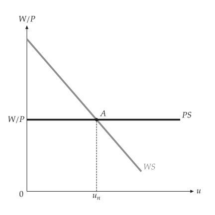
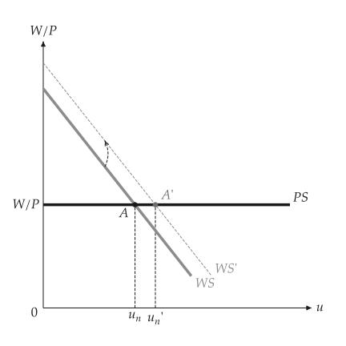

# Natural rate of unemployment

<span id="sec-labor"></span>

`macro_viz.labor.WagePriceSetting` is wage setting against price setting:

$$
\text{WS: } \frac{W}{p} = s \, (\ell + z - \sigma u), \qquad \text{PS: } \frac{W}{p} = \frac{s'}{1 + m}.
$$

`natural_rate()` solves WS = PS. `compare` reports the direction of the natural rate and of the
real wage after a change in benefits $z$, the markup $m$ or productivity. A common shift of both
curves leaves the natural rate unchanged; a differential one moves it.

```python
from macro_viz.labor import WagePriceSetting, compare
from macro_viz.visuals import wsps_canvas

model = WagePriceSetting(1.4, 3.0, 0.3, 0.25)
wsps_canvas(model).save("wsps.svg")
wsps_canvas(compare(model, model.with_benefits(0.5))).save("wsps_benefits.svg")
```

{ .ev-figure-sm }

{ .ev-figure-sm }

`wsps_canvas(model, labor_force=...)` draws the crossing on the employment axis, with braces for
employment and unemployment. Natural output from this model is an input to the AS-AD functions.
