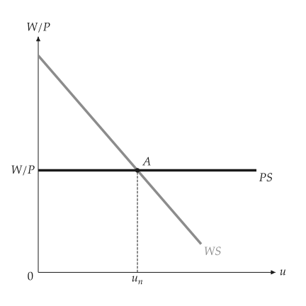
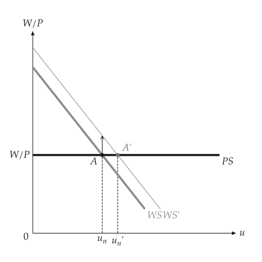
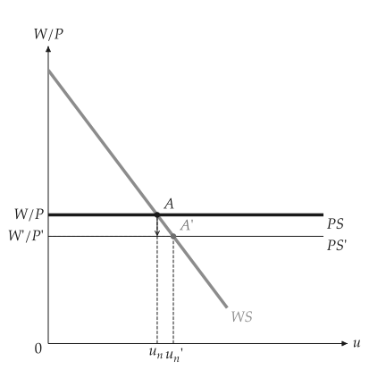
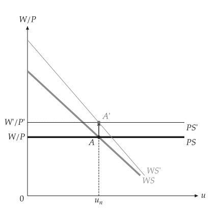
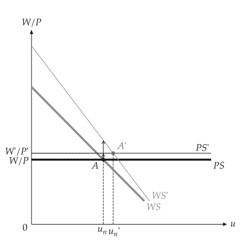

# Natural rate of unemployment

<span id="sec-labor"></span>

Wage setting WS falls with the unemployment rate $u$; price setting PS is a horizontal line set by the markup. The natural rate is where they cross. Sections follow `wsps.py`.

## Models

<!-- api: macro_viz.guides_labor_1 -->

`WagePriceSetting(level, slope, benefits, markup)` is WS: $W/P = F(u, z)$ and PS: $W/P = 1 / (1 + \mu)$. `natural_rate()` and `real_wage()` answer the crossing; `with_benefits`, `with_markup` and `with_productivity` return a changed model, and `compare` the comparison.

## Equilibrium

<span id="sec-ex-equilibrium"></span>


<!-- api: macro_viz.guides_labor_2 -->

```python
from macro_viz.labor import WagePriceSetting, compare
from macro_viz.visuals import wsps_canvas

model = WagePriceSetting(1.4, 3.0, 0.3, 0.25)
wsps_canvas(model).save("wsps.svg")
```

<span id="fig-wsps"></span>

<figure class="ev-fig" markdown>

{ .ev-figure-sm }

<div class="ev-downloads"><a class="ev-download" href="../../assets/macro-viz/labor/wsps.py" download aria-label="Download the source"><svg viewBox="0 0 24 24" aria-hidden="true"><path d="M12 4v11m0 0-4.5-4.5M12 15l4.5-4.5M5 20h14" fill="none" stroke="currentColor" stroke-width="2" stroke-linecap="round" stroke-linejoin="round"/></svg><span>Download the source</span></a></div>

<figcaption markdown>WS and PS cross at the natural rate $u_n$</figcaption>

</figure>


## Shifts of WS and PS

<span id="sec-ex-shifts"></span>


```python
more_benefits = compare(model, model.with_benefits(0.5))
wsps_canvas(more_benefits).save("wsps_benefits.svg")

more_markup = compare(model, model.with_markup(0.5))
wsps_canvas(more_markup).save("wsps_markup.svg")

productive = model.with_productivity(1.25, 1.25)
wsps_canvas(compare(model, productive)).save("wsps_productivity.svg")
```

<span id="fig-wsps-benefits"></span>

<figure class="ev-fig" markdown>

{ .ev-figure-sm }

<div class="ev-downloads"><a class="ev-download" href="../../assets/macro-viz/labor/wsps.py" download aria-label="Download the source"><svg viewBox="0 0 24 24" aria-hidden="true"><path d="M12 4v11m0 0-4.5-4.5M12 15l4.5-4.5M5 20h14" fill="none" stroke="currentColor" stroke-width="2" stroke-linecap="round" stroke-linejoin="round"/></svg><span>Download the source</span></a></div>

<figcaption markdown>Higher unemployment benefits move WS up and raise the natural rate</figcaption>

</figure>

<span id="fig-wsps-markup"></span>

<figure class="ev-fig" markdown>

{ .ev-figure-sm }

<div class="ev-downloads"><a class="ev-download" href="../../assets/macro-viz/labor/wsps.py" download aria-label="Download the source"><svg viewBox="0 0 24 24" aria-hidden="true"><path d="M12 4v11m0 0-4.5-4.5M12 15l4.5-4.5M5 20h14" fill="none" stroke="currentColor" stroke-width="2" stroke-linecap="round" stroke-linejoin="round"/></svg><span>Download the source</span></a></div>

<figcaption markdown>A higher markup moves PS down</figcaption>

</figure>

<span id="fig-wsps-productivity"></span>

<figure class="ev-fig" markdown>

{ .ev-figure-sm }

<div class="ev-downloads"><a class="ev-download" href="../../assets/macro-viz/labor/wsps.py" download aria-label="Download the source"><svg viewBox="0 0 24 24" aria-hidden="true"><path d="M12 4v11m0 0-4.5-4.5M12 15l4.5-4.5M5 20h14" fill="none" stroke="currentColor" stroke-width="2" stroke-linecap="round" stroke-linejoin="round"/></svg><span>Download the source</span></a></div>

<figcaption markdown>Productivity moves WS and PS together</figcaption>

</figure>

<span id="fig-wsps-productivity-split"></span>

<figure class="ev-fig" markdown>

{ .ev-figure-sm }

<div class="ev-downloads"><a class="ev-download" href="../../assets/macro-viz/labor/wsps.py" download aria-label="Download the source"><svg viewBox="0 0 24 24" aria-hidden="true"><path d="M12 4v11m0 0-4.5-4.5M12 15l4.5-4.5M5 20h14" fill="none" stroke="currentColor" stroke-width="2" stroke-linecap="round" stroke-linejoin="round"/></svg><span>Download the source</span></a></div>

<figcaption markdown>Productivity moves them by different amounts</figcaption>

</figure>


## Employment on the axis

<span id="sec-ex-employment"></span>


```python
wsps_canvas(model, labor_force=100).save("wsps_employment.svg")
```

<span id="fig-wsps-employment"></span>

<figure class="ev-fig" markdown>

{ .ev-figure-sm }

<div class="ev-downloads"><a class="ev-download" href="../../assets/macro-viz/labor/wsps.py" download aria-label="Download the source"><svg viewBox="0 0 24 24" aria-hidden="true"><path d="M12 4v11m0 0-4.5-4.5M12 15l4.5-4.5M5 20h14" fill="none" stroke="currentColor" stroke-width="2" stroke-linecap="round" stroke-linejoin="round"/></svg><span>Download the source</span></a></div>

<figcaption markdown>With `labor_force` the axis is employment $N$ and braces show unemployment</figcaption>

</figure>

