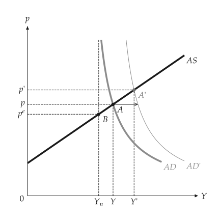

# Model and figure

<span id="sec-model-figure"></span>

## Model first, figure second

Every topic has two layers.

- A *model* is a frozen dataclass with checked inputs and methods that answer questions: `KeynesianCross.equilibrium`, `ISLM.equilibrium`, `Solow.steady_state`. Models never import a renderer and raise `ValidationError` on bad input.
- A *comparison* is what an `analyze_*` function returns: the baseline, the changed model, the sign of each change (`Direction.UP`, `DOWN`, `NONE`) and the new equilibrium. `analyze_autonomous_shift`, `analyze_fiscal_policy`, `analyze_demand_shock`, `analyze_change` and `compare` are the entry points.
- A *builder* in `macro_viz.visuals` turns a model or a comparison into a `mosaickit` `Canvas`: `islm_canvas(shift)`, `adas_canvas(model)`. A builder has no equations in it; it places what the model computed.

```python
from macro_viz.adas import (
    AggregateDemand,
    AggregateSupply,
    ASADModel,
    analyze_demand_shock,
)
from macro_viz.visuals import adas_canvas

supply = AggregateSupply.linear(1.0, 100, 0.6)
demand = AggregateDemand(80, 45, 1)
model = ASADModel(supply, demand)

shock = analyze_demand_shock(model, autonomous=115)
shock.output_direction  # Direction.UP
adas_canvas(shock).save("adas_demand_shock.svg")
```

<span id="fig-model-demand-shock"></span>

<figure class="ev-fig" markdown>

{ .ev-figure-sm }

<div class="ev-downloads"><a class="ev-download" href="../../assets/macro-viz/adas/adas.py" download aria-label="Download the source"><svg viewBox="0 0 24 24" aria-hidden="true"><path d="M12 4v11m0 0-4.5-4.5M12 15l4.5-4.5M5 20h14" fill="none" stroke="currentColor" stroke-width="2" stroke-linecap="round" stroke-linejoin="round"/></svg><span>Download the source</span></a></div>

<figcaption markdown>A demand shock in AS-AD</figcaption>

</figure>

## Common options

<span id="sec-options"></span>

Single-panel builders return a `Canvas` and accept the same keyword options. In the signatures on these pages they appear by name or, where a builder passes them on, as `**options`.

<!-- api: macro_viz.guides_model_figure_1 -->

Linked-panel builders return a `CanvasGrid` and take layout options instead ([Linked panels](panels.md#sec-panels)).

## Package layout

<span id="tab-layout"></span>

| Where | What |
| --- | --- |
| `macro_viz/<topic>/` | Models and comparisons, renderer-free (`keynesian`, `money`, `adas`, `islm`, `growth`, `labor`, `open_economy`, `panels`) |
| `macro_viz/visuals/` | Builders that return a `Canvas`; `_theory.py` and `_kit.py` are the shared kit |
| `macro_viz/locale/labels.json` | Every built-in word, by language and id |
| `macro_viz/themes.py`, `config.py` | The manual theme and the `[macro]` settings schema |
| `macro_viz/animation.py` | Optional GIF and animated SVG over a parameter |
| `examples/scripts/<topic>/` | Scripts, one folder per topic; the figures of these pages |

## Layer ids

A builder gives every layer a stable id such as `macro.islm.is`, `macro.islm.is.shifted` or `macro.islm.equilibrium.shifted.label`. The ids are what the label table and an animation address: an animation matches layers between frames by id ([Animation](animation.md#sec-animation)).

## Relationship to the other packages

- `mosaickit` draws everything: scenes, layers, themes, label placement, grids and rendering.
- `bezierkit` supplies the curve geometry of the rotation markers in linked panels.
- `kinetickit` animates figures and arrives only with the `animation` extra.
