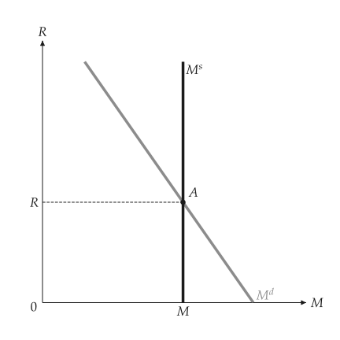
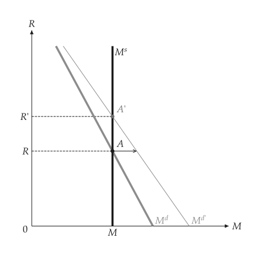
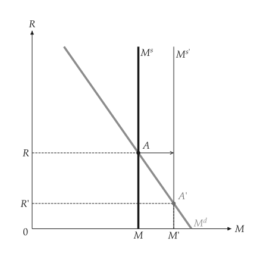
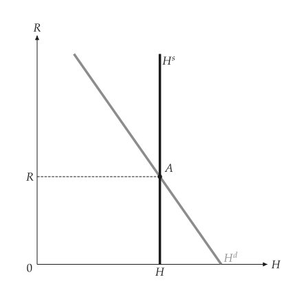
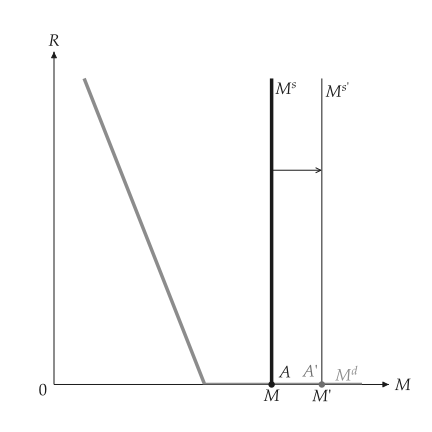
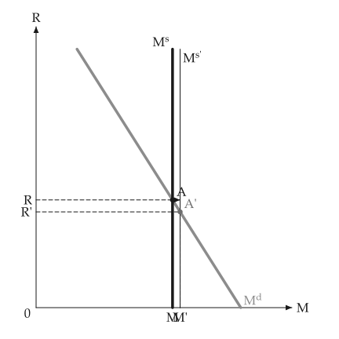

# Money market

<span id="sec-money"></span>

Money demand falls with the interest rate and rises with nominal income; the central bank fixes the supply. Sections follow `money.py`, `central_bank_money.py` and `liquidity_trap.py`.

## Models

<!-- api: macro_viz.guides_money_1 -->

`MoneyDemand(nominal_income, liquidity, rate_max)` is $M^d = Y \, L(R)$ with a function `liquidity` of the rate; `zero_bound=True` makes demand flat at a rate of zero. `MoneyMarket` adds the supply. `analyze_income_shift` and `analyze_supply_shift` return the baseline, the changed market and the direction of the rate and of money.

## Demand, supply and a shift of money demand

<span id="sec-ex-market"></span>


<!-- api: macro_viz.guides_money_2 -->

<!-- api: macro_viz.guides_money_3 -->

```python
from macro_viz.money import (
    MoneyDemand,
    MoneyMarket,
    analyze_income_shift,
    analyze_supply_shift,
)
from macro_viz.visuals import (
    money_demand_canvas,
    money_market_canvas,
)

demand = MoneyDemand(100, lambda r: 0.9 - 0.12 * r, 6)
market = MoneyMarket(demand, supply=60)

income = analyze_income_shift(market, nominal_income=130)
money_market_canvas(market).save("money_market.svg")
money_market_canvas(income).save("money_income_shift.svg")
money_demand_canvas(income).save("money_demand.svg")
```

<span id="fig-money-market"></span>

<figure class="ev-fig" markdown>

{ .ev-figure-sm }

<div class="ev-downloads"><a class="ev-download" href="../../assets/macro-viz/money/money.py" download aria-label="Download the source"><svg viewBox="0 0 24 24" aria-hidden="true"><path d="M12 4v11m0 0-4.5-4.5M12 15l4.5-4.5M5 20h14" fill="none" stroke="currentColor" stroke-width="2" stroke-linecap="round" stroke-linejoin="round"/></svg><span>Download the source</span></a></div>

<figcaption markdown>The money market: demand $M^d$ and supply $M^s$</figcaption>

</figure>

<span id="fig-money-income-shift"></span>

<figure class="ev-fig" markdown>

{ .ev-figure-sm }

<div class="ev-downloads"><a class="ev-download" href="../../assets/macro-viz/money/money.py" download aria-label="Download the source"><svg viewBox="0 0 24 24" aria-hidden="true"><path d="M12 4v11m0 0-4.5-4.5M12 15l4.5-4.5M5 20h14" fill="none" stroke="currentColor" stroke-width="2" stroke-linecap="round" stroke-linejoin="round"/></svg><span>Download the source</span></a></div>

<figcaption markdown>A rise in nominal income shifts demand to the right</figcaption>

</figure>


The arrow starts at A, the old equilibrium, and runs sideways to the new demand curve.

## A change in the money supply

<span id="sec-ex-supply"></span>


```python
supply = analyze_supply_shift(market, supply=80)
money_market_canvas(supply).save("money_supply_shift.svg")
```

<span id="fig-money-supply-shift"></span>

<figure class="ev-fig" markdown>

{ .ev-figure-sm }

<div class="ev-downloads"><a class="ev-download" href="../../assets/macro-viz/money/money.py" download aria-label="Download the source"><svg viewBox="0 0 24 24" aria-hidden="true"><path d="M12 4v11m0 0-4.5-4.5M12 15l4.5-4.5M5 20h14" fill="none" stroke="currentColor" stroke-width="2" stroke-linecap="round" stroke-linejoin="round"/></svg><span>Download the source</span></a></div>

<figcaption markdown>More money lowers the interest rate</figcaption>

</figure>


## Central-bank money

<span id="sec-ex-central"></span>


<!-- api: macro_viz.guides_money_4 -->

```python
from macro_viz.money import MoneyMultiplier
from macro_viz.visuals import central_bank_money_canvas

multiplier = MoneyMultiplier(0.2, 0.1)
central_bank_money_canvas(multiplier, market).save(
    "central_bank_money.svg"
)
```

<span id="fig-central-bank-money"></span>

<figure class="ev-fig" markdown>

{ .ev-figure-sm }

<div class="ev-downloads"><a class="ev-download" href="../../assets/macro-viz/money/central_bank_money.py" download aria-label="Download the source"><svg viewBox="0 0 24 24" aria-hidden="true"><path d="M12 4v11m0 0-4.5-4.5M12 15l4.5-4.5M5 20h14" fill="none" stroke="currentColor" stroke-width="2" stroke-linecap="round" stroke-linejoin="round"/></svg><span>Download the source</span></a></div>

<figcaption markdown>The market for central-bank money</figcaption>

</figure>

<span id="fig-central-bank-money-purchase"></span>

<figure class="ev-fig" markdown>

{ .ev-figure-sm }

<div class="ev-downloads"><a class="ev-download" href="../../assets/macro-viz/money/central_bank_money.py" download aria-label="Download the source"><svg viewBox="0 0 24 24" aria-hidden="true"><path d="M12 4v11m0 0-4.5-4.5M12 15l4.5-4.5M5 20h14" fill="none" stroke="currentColor" stroke-width="2" stroke-linecap="round" stroke-linejoin="round"/></svg><span>Download the source</span></a></div>

<figcaption markdown>An open-market purchase</figcaption>

</figure>


## The zero lower bound

<span id="sec-ex-trap"></span>


```python
demand = MoneyDemand(
    100, lambda r: 0.9 - 0.12 * r, 6, zero_bound=True
)
market = MoneyMarket(demand, supply=130)
shift = analyze_supply_shift(market, supply=160)
money_market_canvas(shift).save("money_zero_bound.svg")
```

<span id="fig-money-zero-bound"></span>

<figure class="ev-fig" markdown>

{ .ev-figure-sm }

<div class="ev-downloads"><a class="ev-download" href="../../assets/macro-viz/money/liquidity_trap.py" download aria-label="Download the source"><svg viewBox="0 0 24 24" aria-hidden="true"><path d="M12 4v11m0 0-4.5-4.5M12 15l4.5-4.5M5 20h14" fill="none" stroke="currentColor" stroke-width="2" stroke-linecap="round" stroke-linejoin="round"/></svg><span>Download the source</span></a></div>

<figcaption markdown>Once the rate is zero, more money leaves it unchanged</figcaption>

</figure>


## Animation

<span id="sec-ex-animation"></span>


<span id="fig-money-animation"></span>

<figure class="ev-fig" markdown>

{ .ev-figure-sm }

<div class="ev-downloads"><a class="ev-download" href="../../assets/macro-viz/money/money_animation.py" download aria-label="Download the source"><svg viewBox="0 0 24 24" aria-hidden="true"><path d="M12 4v11m0 0-4.5-4.5M12 15l4.5-4.5M5 20h14" fill="none" stroke="currentColor" stroke-width="2" stroke-linecap="round" stroke-linejoin="round"/></svg><span>Download the source</span></a></div>

<figcaption markdown>The supply curve moves right and the rate falls</figcaption>

</figure>

