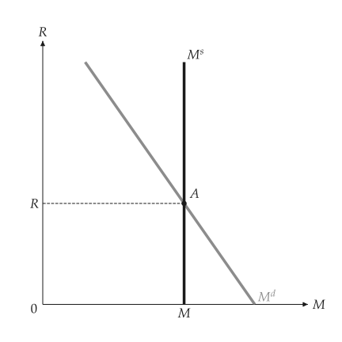
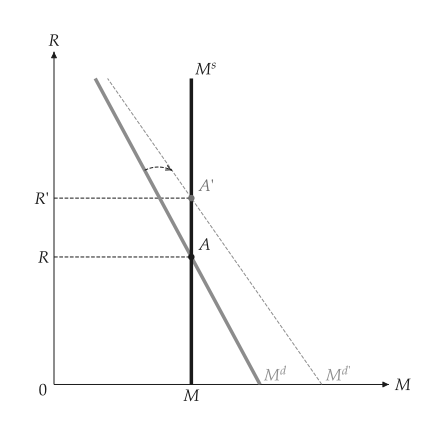
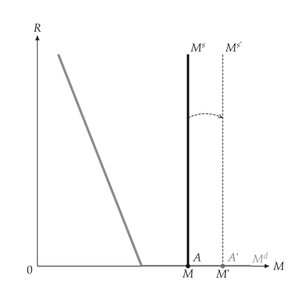
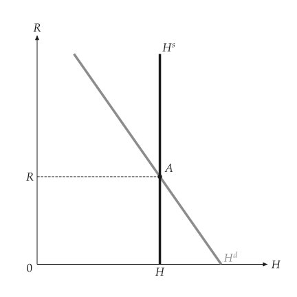

# Money market

<span id="sec-money"></span>

`macro_viz.money` holds the money market.

- `MoneyDemand(nominal_income, liquidity, rate_max)` is $M^d = \$Y \, L(i)$ with a decreasing $L$.
- `MoneyMarket(demand, supply)`; `equilibrium()` solves $\$Y \, L(i) = M$ for the interest rate.
- `analyze_income_shift` and `analyze_supply_shift` return the baseline and the post-change market
  with the direction of the rate and of the money stock.

```python
from macro_viz.money import MoneyDemand, MoneyMarket, analyze_income_shift
from macro_viz.visuals import money_market_canvas

demand = MoneyDemand(100, lambda rate: 0.9 - 0.12 * rate, rate_max=6)
market = MoneyMarket(demand, supply=60)

money_market_canvas(market).save("money_market.svg")
money_market_canvas(analyze_income_shift(market, 130)).save("money_income_shift.svg")
```

{ .ev-figure-sm }

{ .ev-figure-sm }

`money_demand_canvas` shows the demand curve before and after a change in nominal income at one
interest rate.

## Zero lower bound

`MoneyDemand(..., zero_bound=True)` makes money demand flat at a zero rate. Extra money on the
flat part leaves the equilibrium unchanged.

{ .ev-figure-sm }

## Central-bank money

`MoneyMultiplier(c, theta)` gives the money multiplier $1 / (c + \theta (1 - c))$ and turns a
money market into the market for central-bank money; `central_bank_money_canvas` draws it with
$H$ labels.

{ .ev-figure-sm }
