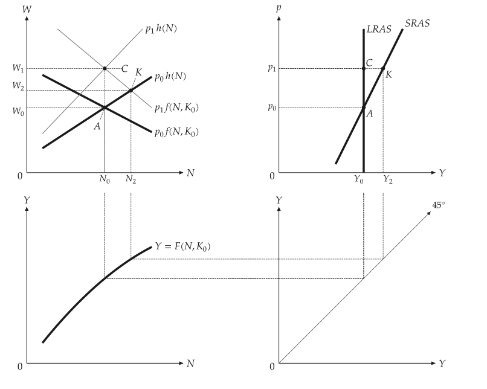
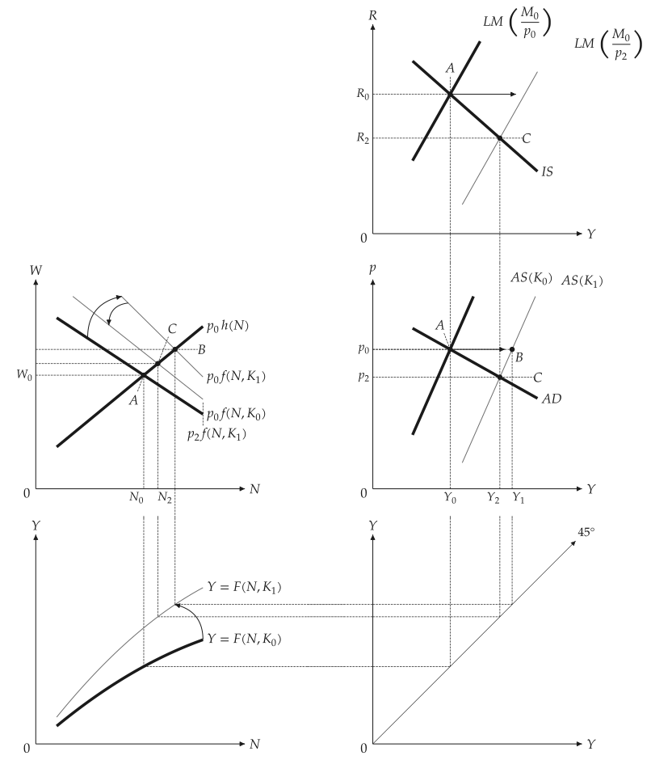
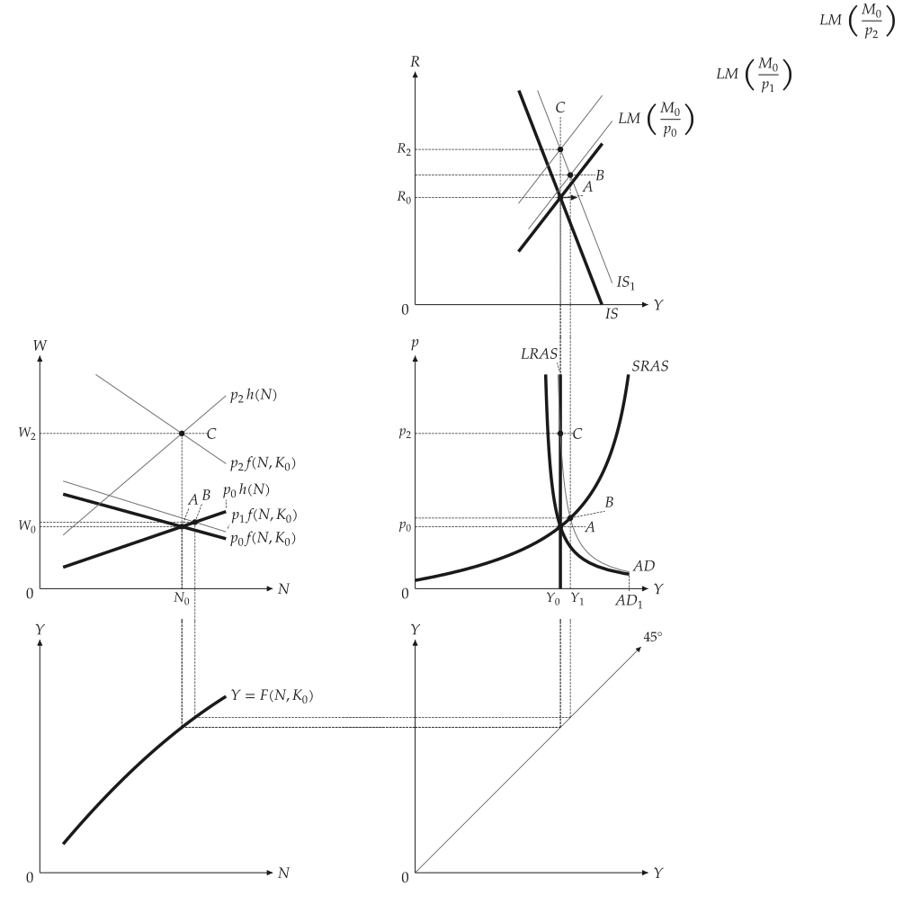
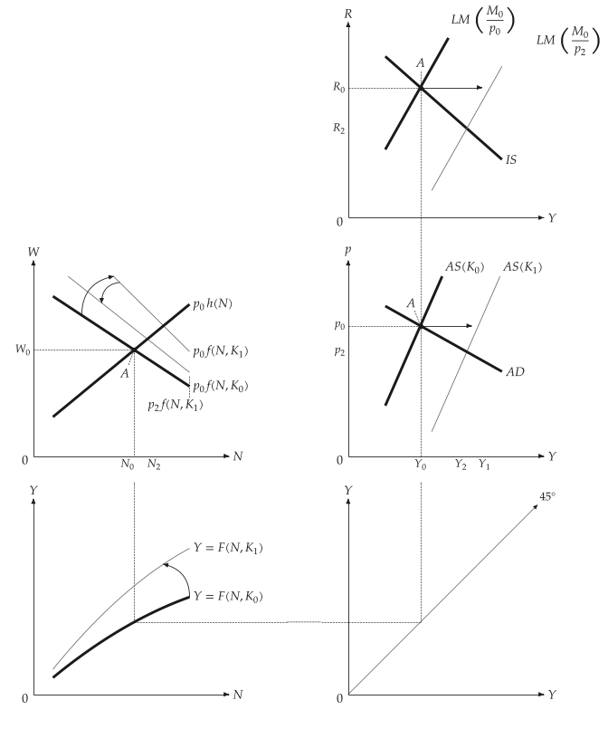

# Linked panels

<span id="sec-panels"></span>

Textbook derivations put several diagrams on one page and link them with dashed lines. The builders draw them on a `mosaickit` grid; a value shared by two panels is one number. The figures follow `four_panel.py` and `five_panel.py`.

- `four_panel_canvas(scenario)` draws the labour market, AD-AS, the production function and the 45-degree line.
- `five_panel_canvas(scenario)` adds IS-LM above AD-AS so that the right column shares one $Y$ axis.

## Model

<!-- api: macro_viz.guides_panels_1 -->

A `Scenario` is a baseline `MacroEconomy` and labelled `Step`s (A, B, C). A step is a `Shock` of parameters (capital, money, expenditure, expected price) at a given or market-clearing price, with optional curve movements. The blocks never import a renderer.

$$
W = p \, f(N, K), \qquad W = p^e h(N), \qquad Y = K^{\theta} \left( a N - \tfrac{b}{2} N^2 \right)
$$

$$
\text{IS: } Y = X - e R, \qquad \text{LM: } M / p = k Y - h R
$$

`Mode.SCHEMATIC` (the default) draws straight lines through the solved points, as in textbook figures; `Mode.DERIVED` draws the curves of the equations. `IsLmSketch` draws the textbook straight-line IS-LM for presets where the derived curves cannot give the textbook ordering of points.

## Money supply with sticky prices

<span id="sec-ex-money"></span>


<!-- api: macro_viz.guides_panels_2 -->

```python
from macro_viz.panels import (
    IsLm,
    LinearFunction,
    MacroEconomy,
    QuadraticProduction,
    Scenario,
    Shock,
    Step,
)
from macro_viz.visuals import four_panel_canvas

economy = MacroEconomy(
    QuadraticProduction(3.0, 0.2, 1.0),
    LinearFunction(0.4, 0.25),
    capital=1.0,
    expected_price=1.0,
    islm=IsLm(0.0, 1.0, 2.0, 0.25, 1.0),
).calibrated(2.0)

scenario = Scenario(
    economy, (Step("A"), Step("B", Shock(money=1.4)))
)
four_panel_canvas(
    scenario, steps=["A", "B"], extent=1.5
).save("four_panel_money_sras.svg")
```

<span id="fig-four-panel-money-sras"></span>

<figure class="ev-fig" markdown>

{ .ev-figure-lg }

<div class="ev-downloads"><a class="ev-download" href="../../assets/macro-viz/panels/four_panel.py" download aria-label="Download the source"><svg viewBox="0 0 24 24" aria-hidden="true"><path d="M12 4v11m0 0-4.5-4.5M12 15l4.5-4.5M5 20h14" fill="none" stroke="currentColor" stroke-width="2" stroke-linecap="round" stroke-linejoin="round"/></svg><span>Download the source</span></a></div>

<figcaption markdown>More money moves the economy along SRAS from A to B</figcaption>

</figure>


## Money illusion

<span id="sec-ex-illusion"></span>


A price rise that workers do not anticipate moves the economy along SRAS (K); anticipated, it returns output to LRAS (C).

<span id="fig-four-panel-money-lras"></span>

<figure class="ev-fig" markdown>

{ .ev-figure-lg }

<div class="ev-downloads"><a class="ev-download" href="../../assets/macro-viz/panels/four_panel.py" download aria-label="Download the source"><svg viewBox="0 0 24 24" aria-hidden="true"><path d="M12 4v11m0 0-4.5-4.5M12 15l4.5-4.5M5 20h14" fill="none" stroke="currentColor" stroke-width="2" stroke-linecap="round" stroke-linejoin="round"/></svg><span>Download the source</span></a></div>

<figcaption markdown>Money illusion</figcaption>

</figure>


## Capital and expenditure

<span id="sec-ex-capital"></span>


<!-- api: macro_viz.guides_panels_3 -->

```python
from macro_viz.panels import (
    Curve,
    RotationDirection,
    ShiftDirection,
)
from macro_viz.visuals import five_panel_canvas

movements = (
    economy.curve(Curve.PRODUCTION).rotate(
        RotationDirection.OUTWARD
    ),
    economy.curve(Curve.LABOR_DEMAND).rotate(
        RotationDirection.OUTWARD
    ),
    economy.curve(Curve.LM).shift(ShiftDirection.RIGHT),
)
```

A curve owns its movements: the caller chooses the curve and the direction, and macro-viz applies a schematic preset and solves the shared equilibrium without inferring a policy or event. A shift is a straight solid arrow, a rotation a gently curved one.

<span id="fig-five-panel-capital"></span>

<figure class="ev-fig" markdown>

{ .ev-figure-lg }

<div class="ev-downloads"><a class="ev-download" href="../../assets/macro-viz/panels/five_panel.py" download aria-label="Download the source"><svg viewBox="0 0 24 24" aria-hidden="true"><path d="M12 4v11m0 0-4.5-4.5M12 15l4.5-4.5M5 20h14" fill="none" stroke="currentColor" stroke-width="2" stroke-linecap="round" stroke-linejoin="round"/></svg><span>Download the source</span></a></div>

<figcaption markdown>A rise in capital moves the production function, labour demand and both supply curves</figcaption>

</figure>

<span id="fig-five-panel-expenditure"></span>

<figure class="ev-fig" markdown>

{ .ev-figure-lg }

<div class="ev-downloads"><a class="ev-download" href="../../assets/macro-viz/panels/five_panel.py" download aria-label="Download the source"><svg viewBox="0 0 24 24" aria-hidden="true"><path d="M12 4v11m0 0-4.5-4.5M12 15l4.5-4.5M5 20h14" fill="none" stroke="currentColor" stroke-width="2" stroke-linecap="round" stroke-linejoin="round"/></svg><span>Download the source</span></a></div>

<figcaption markdown>An expenditure shock is B in the short run and C after expectations adjust</figcaption>

</figure>


The fully derived preset reproduces the equations' answer, not the textbook order of the points.

## Layout parameters

<span id="sec-ex-layout"></span>


<!-- api: macro_viz.guides_panels_4 -->

`linked_panels_canvas` takes the spacing as parameters. The 45-degree panel is exactly 45 degrees in data units. Labels stand beside their points or curve ends and move outward with a thin leader when the neighbourhood is crowded; a test renders every preset and checks that no label touches a curve, link, arrow, dot or another label.

The course scenarios live in `examples/examples.toml` and `examples/scripts/panels_common.py`.

## Animation

<span id="sec-ex-animation"></span>


`examples/scripts/animation/panels_animation.py` reveals the steps one after another with `save_gif`.

<span id="fig-panels-animation"></span>

<figure class="ev-fig" markdown>

{ .ev-figure-lg }

<div class="ev-downloads"><a class="ev-download" href="../../assets/macro-viz/animation/panels_animation.py" download aria-label="Download the source"><svg viewBox="0 0 24 24" aria-hidden="true"><path d="M12 4v11m0 0-4.5-4.5M12 15l4.5-4.5M5 20h14" fill="none" stroke="currentColor" stroke-width="2" stroke-linecap="round" stroke-linejoin="round"/></svg><span>Download the source</span></a></div>

<figcaption markdown>The steps A, B, C of the capital scenario</figcaption>

</figure>
