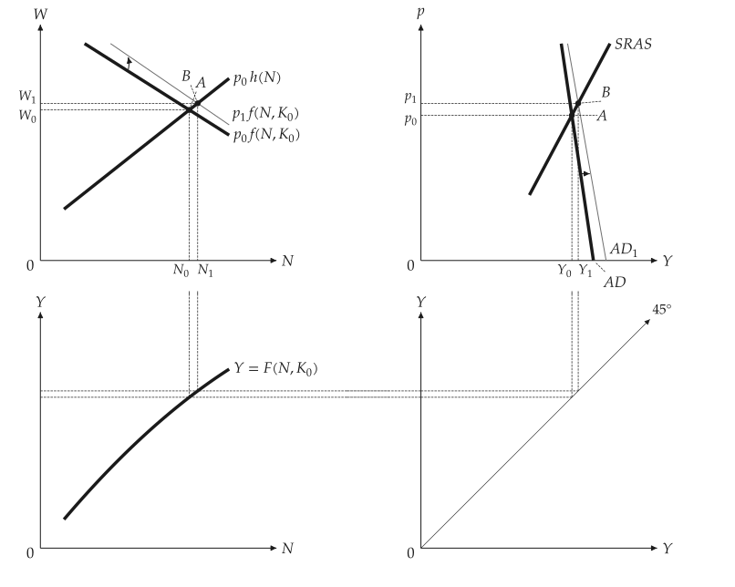
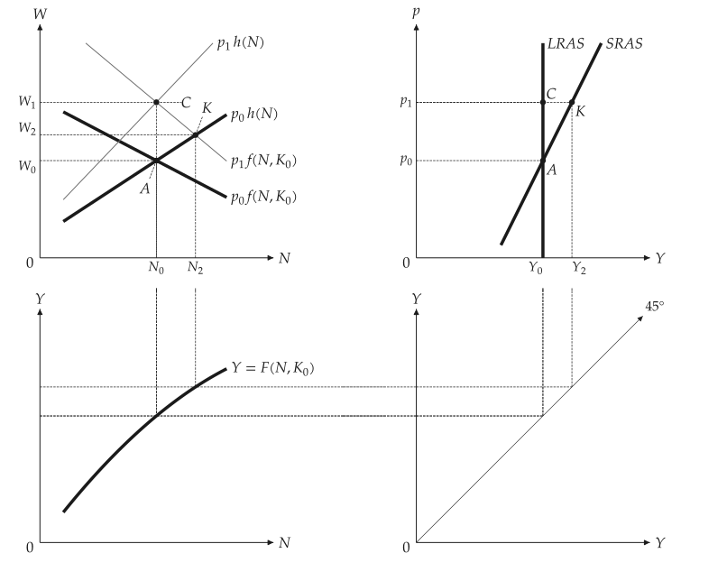
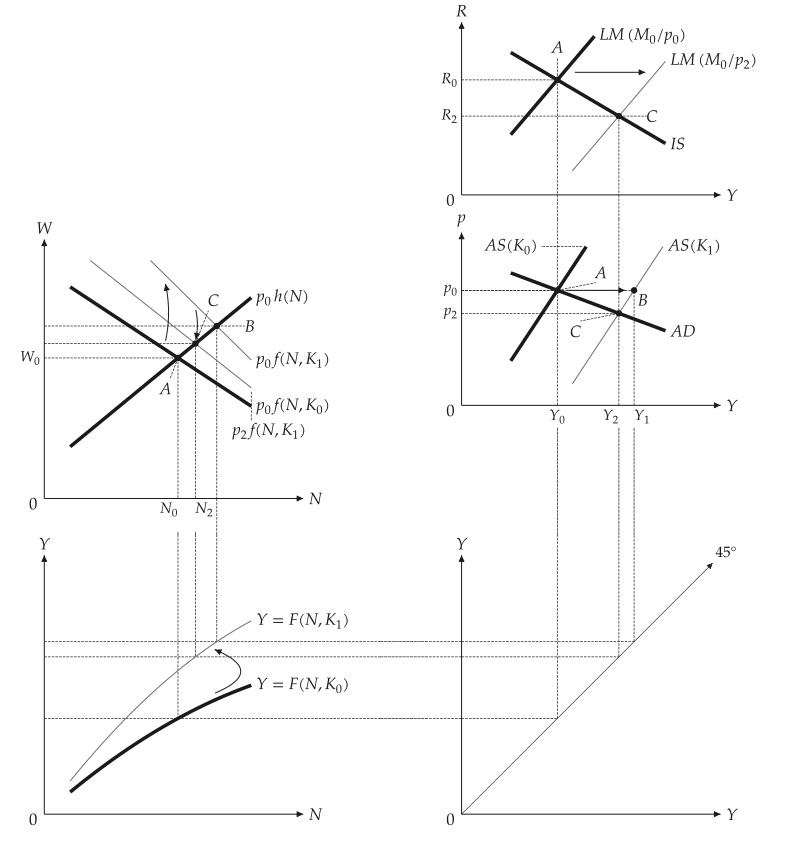
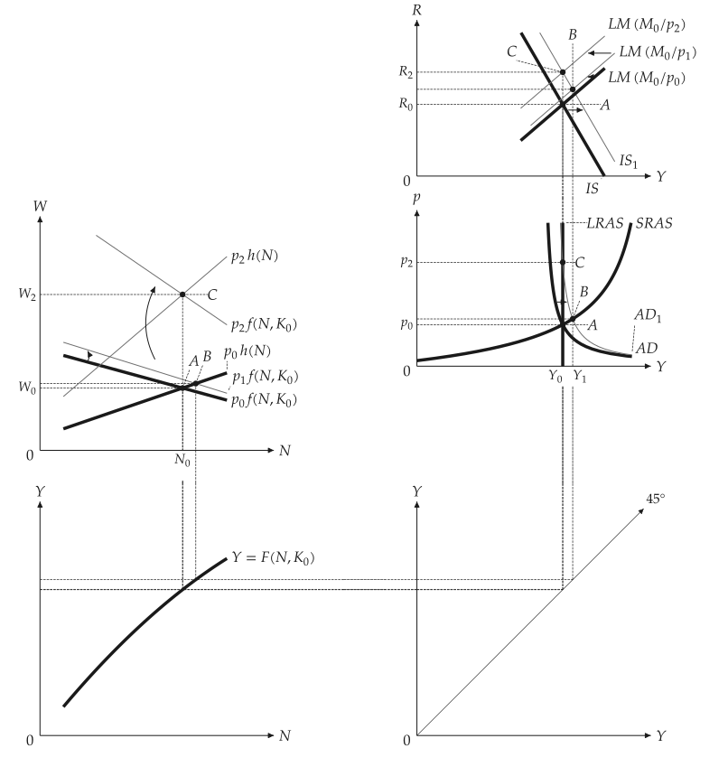

# Linked panels

<span id="sec-panels"></span>

Textbook derivations put several diagrams on one page and link them with dashed lines. The
builders in `macro_viz.visuals` draw them on a `mosaickit` grid.

- `four_panel_canvas(scenario)` draws the labour market, AD-AS, the production function and the
  45-degree line.
- `five_panel_canvas(scenario)` adds IS-LM above AD-AS so the right column shares one $Y$ axis.

## Model

A `Scenario` is a baseline `MacroEconomy` and labelled `Step`s (A, B, C), each a `Shock` of
parameters (capital, money, expenditure, expected price) at a given or market-clearing price
level. The blocks are typed objects in `macro_viz.panels`, which never import a renderer.

$$
W = p \, f(N, K) \quad \text{(labour demand)}, \qquad W = p^e h(N) \quad \text{(labour supply)},
$$

$$
Y = K^{\theta} \left( a N - \tfrac{b}{2} N^2 \right), \qquad f = \partial Y / \partial N,
$$

$$
\text{IS: } Y = X - e R, \qquad \text{LM: } M / p = k Y - h R, \qquad
\text{AD: } Y = \frac{X + (e / h) \, M / p}{1 + e k / h}.
$$

Short-run aggregate supply fixes $p^e$; long-run aggregate supply is vertical at the natural
output $Y_n$, where $K^{\theta}(a - b N) = h(N)$.

`Mode.SCHEMATIC` (the default) draws straight lines through the solved points, as in textbook
figures; `Mode.DERIVED` draws the curves from the equations. `IsLmSketch` draws the textbook
straight-line IS-LM for presets, such as a rise in capital, where the derived curves cannot give
the textbook ordering of the points.

## Money supply with sticky prices

```python
from macro_viz.panels import (
    IsLm, LinearFunction, MacroEconomy, QuadraticProduction, Scenario, Shock, Step,
)
from macro_viz.visuals import four_panel_canvas

economy = MacroEconomy(
    QuadraticProduction(3.0, 0.2, 1.0),   # a, b, theta
    LinearFunction(0.4, 0.25),            # labour supply h(N)
    capital=1.0,
    expected_price=1.0,
    islm=IsLm(0.0, 1.0, 2.0, 0.25, 1.0),  # X, M, e, k, h
).calibrated(2.0)

scenario = Scenario(economy, (Step("A"), Step("B", Shock(money=1.4))))
four_panel_canvas(scenario, steps=["A", "B"], extent=1.5).save("four_panel_money_sras.svg")
```

{ .ev-figure-lg }

## Money illusion

A price rise that workers do not anticipate moves the economy along SRAS (K); anticipated, it
returns output to LRAS (C).

{ .ev-figure-lg }

## Capital and expenditure

```python
from macro_viz.visuals import five_panel_canvas

five_panel_canvas(scenario).save("five_panel.svg")
```

A rise in capital moves the production function, labour demand and both aggregate supply curves
(A to B at the old price, then C at the lower price).

{ .ev-figure-lg }

An expenditure shock is B in the short run and C after expectations adjust back to natural
output. The fully derived preset does not reproduce the textbook order of points, only the
equations' answer.

{ .ev-figure-lg }

## Layout parameters

`linked_panels_canvas` takes the spacing as parameters: `column_gap`, `row_gap`, `outer`,
`top_pad`, `pad` (per variable), `margin` and `placement`. The 45-degree panel is exactly
45 degrees in data units. Labels are placed beside their points or curve ends and move outward
with a thin leader when the neighbourhood is crowded; a test renders every preset and checks that
no label touches a curve, link, arrow, dot or another label.

The course scenarios used here live in `examples/examples.toml` of the repository, read by
`examples/scripts/four_panel.py` and `five_panel.py`.
