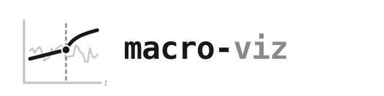
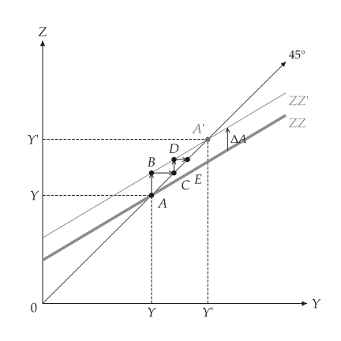

<h1 class="ev-visually-hidden">macro-viz: macroeconomics diagrams in Python</h1>

<p align="center">
  
</p>

<p align="center"><em>Python package for textbook macroeconomic analysis and diagrams.</em></p>

`macro-viz` is for introductory and intermediate macroeconomics models whose equations are given and need to be analysed or drawn. Each model is a typed object that does not know how to draw; each figure is a `mosaickit` canvas built from it. Statistics-style data charts and accounting box diagrams are out of scope.

```python
from macro_viz.keynesian import (
    ConsumptionFunction,
    KeynesianCross,
    analyze_autonomous_shift,
)
from macro_viz.visuals import multiplier_canvas

model = KeynesianCross(
    ConsumptionFunction(20, 0.6),
    investment=20,
    government=30,
    taxes=20,
)
shift = analyze_autonomous_shift(model, change=30)

multiplier_canvas(shift).save("multiplier.svg")
```

<span id="fig-index-multiplier"></span>

<figure class="ev-fig" markdown>

{ .ev-figure-sm }

<div class="ev-downloads"><a class="ev-download" href="../assets/macro-viz/keynesian/keynesian.py" download aria-label="Download the source"><svg viewBox="0 0 24 24" aria-hidden="true"><path d="M12 4v11m0 0-4.5-4.5M12 15l4.5-4.5M5 20h14" fill="none" stroke="currentColor" stroke-width="2" stroke-linecap="round" stroke-linejoin="round"/></svg><span>Download the source</span></a></div>

<figcaption markdown>A rise in autonomous spending</figcaption>

</figure>

## Models and figures

| Models | Modules | Figures |
| --- | --- | --- |
| Consumption function, Keynesian cross, multiplier | `keynesian` | [Keynesian goods market](guides/keynesian.md) |
| Money demand and supply, central-bank money, zero bound | `money` | [Money market](guides/money.md) |
| Aggregate supply and demand, shocks, medium-run adjustment | `adas` | [Aggregate supply and demand](guides/adas.md) |
| IS-LM, fiscal and monetary policy, crowding out, expected inflation | `islm` | [IS-LM](guides/islm.md) |
| Solow growth, golden rule, transition paths | `growth` | [Solow growth](guides/growth.md) |
| Wage setting, price setting, natural rate of unemployment | `labor` | [Natural rate of unemployment](guides/labor.md) |
| Open-economy goods market, interest parity, Mundell-Fleming, devaluation | `open_economy` | [Open economy](guides/open-economy.md) |
| Linked four- and five-panel derivations | `panels` | [Linked panels](guides/panels.md) |

Every builder returns a `mosaickit` `Canvas` and emits stable `macro.*` layer ids. Words come from a locale table in English, Traditional Chinese and Simplified Chinese, and any of them can be replaced with `labels=`. Sizes, widths, colours and fonts come from the theme and the shared `econ-viz.toml`, never from the drawing code.

!!! note "Status"

    `macro-viz` is at `0.2.0.dev0` and is not on PyPI yet; install it from GitHub ([Installation](installation.md#sec-install)).

## Style of the figures

- Black and white on white, as in the printed manuals; there is no dark theme.
- Only the price `p` is lowercase; the other variables ($Y$, $R$, $W$, $N$, $K$) are uppercase italic.
- A curve after a change is thin and solid and named with a prime (`IS'`). A parallel shift is a straight arrow from the old point onto the new curve; a curved arrow means a rotation, a change of slope.
- Curve names stand at the line end and nothing overlaps a line or another label.

## Scope

- `macro-viz` owns short-run and growth models of the closed and open economy.
- Consumer theory and general equilibrium belong to [utility-viz](../utility-viz/index.md).
- Firms and markets belong to [micro-viz](../micro-viz/index.md).
- Statistics charts (real-data scatters, empirical time series) and accounting boxes are not drawn.
