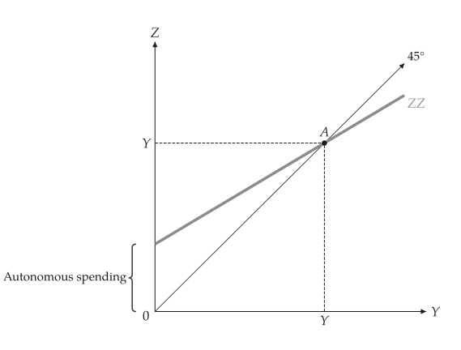

# Quick start

<span id="sec-quickstart"></span>

A figure takes two steps: build a model, then pass it to a builder from `macro_viz.visuals`.

```python
from macro_viz.keynesian import (
    ConsumptionFunction,
    KeynesianCross,
)
from macro_viz.visuals import keynesian_cross_canvas

model = KeynesianCross(
    ConsumptionFunction(20, 0.6),
    investment=20,
    government=30,
    taxes=20,
)
keynesian_cross_canvas(model).save("keynesian_cross.svg")
```

<span id="fig-quick-cross"></span>

<figure class="ev-fig" markdown>

{ .ev-figure-sm }

<div class="ev-downloads"><a class="ev-download" href="../assets/macro-viz/keynesian/keynesian.py" download aria-label="Download the source"><svg viewBox="0 0 24 24" aria-hidden="true"><path d="M12 4v11m0 0-4.5-4.5M12 15l4.5-4.5M5 20h14" fill="none" stroke="currentColor" stroke-width="2" stroke-linecap="round" stroke-linejoin="round"/></svg><span>Download the source</span></a></div>

<figcaption markdown>The Keynesian cross</figcaption>

</figure>

`save()` writes PNG, SVG or PDF according to the extension. Models are immutable and answer questions without drawing:

```python
# equilibrium income
model.equilibrium().output
# 1 / (1 - c1)
model.multiplier
```

## A change in a figure

A comparison of two models draws both: the old curve stays heavy, the new one is thin and solid with a prime, and a straight arrow runs from A to the new curve.

```python
from macro_viz.islm import ISLM, analyze_fiscal_policy
from macro_viz.visuals import islm_canvas

model = ISLM(
    autonomous=100,
    sensitivity=25,
    real_money=20,
    income_demand=0.5,
    rate_demand=10,
)
tax = analyze_fiscal_policy(model, autonomous=80)
islm_canvas(tax).save("islm_tax_increase.svg")
```

<span id="fig-quick-islm"></span>

<figure class="ev-fig" markdown>

{ .ev-figure-sm }

<div class="ev-downloads"><a class="ev-download" href="../assets/macro-viz/islm/islm.py" download aria-label="Download the source"><svg viewBox="0 0 24 24" aria-hidden="true"><path d="M12 4v11m0 0-4.5-4.5M12 15l4.5-4.5M5 20h14" fill="none" stroke="currentColor" stroke-width="2" stroke-linecap="round" stroke-linejoin="round"/></svg><span>Download the source</span></a></div>

<figcaption markdown>A tax increase shifts IS left</figcaption>

</figure>

## Titles, labels and settings

- `title=None` draws no title, and `title="..."` sets one.
- Built-in words (axis titles, curve names, point names) are label ids of a locale table; `labels={"id": "text"}` replaces any of them ([Labels and placement](guides/labels.md#sec-labels)).
- Colours, widths, fonts and sizes come from the theme and the `[macro]` tables of the shared `econ-viz.toml` ([Settings](guides/settings.md#sec-settings)); the drawing code contains none of them.
- Numbers such as axis lengths, sample counts and the canvas size are arguments of the builder.
