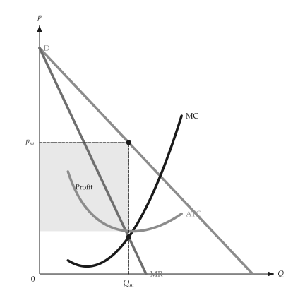

# Animation

<span id="sec-animation"></span>

A figure about a shift, a sweep or an adjustment animates from the same builder that draws it. It
needs the `animation` extra ([Optional dependencies](../installation.md#sec-extras)), which adds
`kinetickit`.

A builder is a function from one number (a shift, a price, an output) to a `mosaickit` canvas: the
function that draws the static figure, with every axis range and the size fixed by the caller so
the axes stay put.

- `save_svg(builder, values, path)` morphs between the frames' layers, matched by their stable
  ids, into a native animated SVG.
- `save_gif(builder, values, path, fps=)` renders each frame through `mosaickit` into a GIF.

```python
from micro_viz.animation import save_svg


def frame(output: float):
    return unit_cost_canvas(analysis, output=output, x_max=12, y_range=(0, 90))


save_svg(frame, [2, 4, 6, 8, 10], "unit_cost_output.svg")
```

`save_svg` sets the labels from font files, so `econ-viz.toml` needs the `[font]` and `[fonts]`
tables; `save_gif` does not.

{ .ev-figure-sm }

{ .ev-figure-sm }

{ .ev-figure-lg }

## Status

Animation examples exist for production (`animate_production.py`), costs (`animate_costs.py`),
monopoly (`animate_monopoly.py`) and monopolistic competition (`animate_monopolistic.py`).
Figures added after these, such as factor markets, long-run competition, oligopoly, uncertainty
and information, have no animation yet. The animated SVG leaves out movement arrows, and it places
text from the layers' anchors without collision avoidance; the GIF uses `mosaickit`'s placement
exactly.

Without `kinetickit` the static figures work unchanged.
