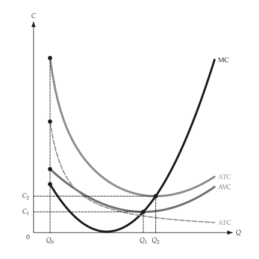
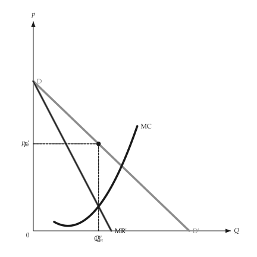

# Animation

<span id="sec-animation"></span>

A figure about a shift, a sweep or an adjustment animates from the same builder that draws it. It needs the `animation` extra ([Optional dependencies](../installation.md#sec-extras)), which adds `kinetickit`.

A builder here is a function from one number (a shift, a price, an output) to a `mosaickit` canvas: the function that draws the static figure, with every axis range and the size fixed by the caller so the axes stay put.

<!-- api: micro_viz.guides_animation_1 -->

`save_svg()` morphs between the frames' layers, matched by their stable ids, into a native animated SVG. `save_gif()` renders each frame through `mosaickit` into a GIF. Both live in `micro_viz.animation` and return the path.

```python
from micro_viz.animation import save_svg


def frame(output: float):
    return unit_cost_canvas(
        analysis, output=output, x_max=12, y_range=(0, 90)
    )


save_svg(frame, [2, 4, 6, 8, 10], "unit_cost_output.svg")
```

`save_svg()` sets the labels from font files, so `econ-viz.toml` needs the `[font]` and `[fonts]` tables; `save_gif()` does not.

<span id="fig-anim-cost"></span>

<figure class="ev-fig" markdown>

{ .ev-figure-sm }

<div class="ev-downloads"><a class="ev-download" href="../../assets/micro-viz/animation/unit_cost_output_animated.py" download aria-label="Download the source"><svg viewBox="0 0 24 24" aria-hidden="true"><path d="M12 4v11m0 0-4.5-4.5M12 15l4.5-4.5M5 20h14" fill="none" stroke="currentColor" stroke-width="2" stroke-linecap="round" stroke-linejoin="round"/></svg><span>Download the source</span></a></div>

<figcaption markdown>Unit costs as output grows</figcaption>

</figure>

<span id="fig-anim-monopoly"></span>

<figure class="ev-fig" markdown>

{ .ev-figure-sm }

<div class="ev-downloads"><a class="ev-download" href="../../assets/micro-viz/animation/monopoly_demand_shift_animated.py" download aria-label="Download the source"><svg viewBox="0 0 24 24" aria-hidden="true"><path d="M12 4v11m0 0-4.5-4.5M12 15l4.5-4.5M5 20h14" fill="none" stroke="currentColor" stroke-width="2" stroke-linecap="round" stroke-linejoin="round"/></svg><span>Download the source</span></a></div>

<figcaption markdown>A demand shift under monopoly</figcaption>

</figure>

<span id="fig-anim-entry"></span>

<figure class="ev-fig" markdown>

{ .ev-figure-sm }

<div class="ev-downloads"><a class="ev-download" href="../../assets/micro-viz/animation/monopolistic_entry_animated.py" download aria-label="Download the source"><svg viewBox="0 0 24 24" aria-hidden="true"><path d="M12 4v11m0 0-4.5-4.5M12 15l4.5-4.5M5 20h14" fill="none" stroke="currentColor" stroke-width="2" stroke-linecap="round" stroke-linejoin="round"/></svg><span>Download the source</span></a></div>

<figcaption markdown>Entry in monopolistic competition</figcaption>

</figure>

## Status

Animation examples exist for production (`animate_production.py`), costs (`animate_costs.py`), monopoly (`animate_monopoly.py`) and monopolistic competition (`animate_monopolistic.py`). Figures added after these, such as factor markets, long-run competition, oligopoly, uncertainty and information, have no animation yet. The animated SVG leaves out movement arrows, and it places text from the layers' anchors without collision avoidance; the GIF uses `mosaickit`'s placement exactly.

Without `kinetickit` the static figures work unchanged.
