# Competition and the long run

<span id="sec-competition"></span>

Price-taking firms, industry supply, long-run costs and entry.

Each section is one example script and the figures it draws. The scripts come in the examples archive; `--help` lists their arguments.

## Perfect competition

<span id="sec-ex-competition"></span>

The price-taking firm produces where the price equals MC. Profit, loss and shutdown follow from where the price lies against ATC and AVC.

<!-- api: micro_viz.guides_competition_1 -->

`solve_competitive_firm()` returns a `CompetitiveOutcome` whose `Regime` says whether the firm earns a profit, takes a loss or shuts down; `FirmSupply` and `IndustrySupply` give the supply of one firm and the horizontal sum of several; `analyze_revenue_cost()` samples revenue, cost and profit.

<!-- api: micro_viz.guides_competition_2 -->

The price-taking firm: ATC, AVC and MC against the price line `P = MR`.

<!-- api: micro_viz.guides_competition_3 -->

MC before and after a cost increase, with the price line and the two outputs.

<!-- api: micro_viz.guides_competition_4 -->

The firm's supply curve: the part of MC above the lowest AVC, drawn solid.

<!-- api: micro_viz.guides_competition_5 -->

Industry supply as the horizontal sum of the firms' supply curves.

<!-- api: micro_viz.guides_competition_6 -->

The firms' supply curves side by side and the industry supply that sums them.

<!-- api: micro_viz.guides_competition_7 -->

The firm beside the market: horizontal demand `d` at the market price, and the downward market demand `D`, with a dashed link carrying the price across.

<!-- api: micro_viz.guides_competition_8 -->

Producer surplus: the area between the price and MC from zero to `q*`.

<!-- api: micro_viz.guides_competition_9 -->

Total revenue, total cost and the profit curve against output.

```python
def competition_examples(
    output_dir: Path,
    theme: PlotTheme,
    *,
    cost: CubicCost,
    profit_price: float,
    loss_price: float,
    shutdown_price: float,
    lost_profit: tuple[float, float],
    supply_prices: tuple[float, float],
    tax: float,
    firms: tuple[CubicCost, ...],
    industry_prices: tuple[float, ...],
    demand: LinearDemand,
    market_price: float,
    min_output: float,
    max_output: float,
    samples: int,
    title: str | None = None,
) -> list[Path]:
    """Write the competition figures into ``output_dir`` and return their paths."""
    output_dir.mkdir(parents=True, exist_ok=True)
    unit = analyze_costs(
        cost,
        output_range=(min_output, max_output),
        samples=samples,
    )
    taxed_cost = cost.with_unit_tax(tax)
    taxed = analyze_costs(
        taxed_cost,
        output_range=(min_output, max_output),
        samples=samples,
    )
    figures = {
        "revenue_cost_profit.svg": revenue_cost_profit_canvas(
            analyze_revenue_cost(
                cost,
                profit_price,
                output_range=(0.0, max_output),
                samples=samples,
            ),
            theme=theme,
            title=title,
        ),
        "market_and_firm.svg": market_and_firm_canvas(
            demand,
            market_price,
            firm_output_max=max_output,
            theme=theme,
            titles=(title, None),
        ),
        "firm_profit.svg": competitive_firm_canvas(
            unit,
            solve_competitive_firm(cost, profit_price),
            theme=theme,
            title=title,
        ),
        "firm_lost_profit.svg": competitive_firm_canvas(
            unit,
            solve_competitive_firm(cost, profit_price),
            lost_profit=lost_profit,
            theme=theme,
            title=title,
        ),
        "firm_loss.svg": competitive_firm_canvas(
            unit,
            solve_competitive_firm(cost, loss_price),
            theme=theme,
            title=title,
        ),
        "firm_shutdown.svg": competitive_firm_canvas(
            unit,
            solve_competitive_firm(cost, shutdown_price),
            theme=theme,
            title=title,
        ),
        "firm_supply.svg": firm_supply_canvas(
            unit, prices=supply_prices, theme=theme, title=title
        ),
        "cost_shift.svg": cost_shift_canvas(
            unit, taxed, profit_price, theme=theme, title=title
        ),
        "unit_tax.svg": cost_shift_canvas(
            unit,
            taxed,
            profit_price,
            tax=tax,
            theme=theme,
            title=title,
        ),
        "industry_supply.svg": industry_supply_panels(
            IndustrySupply(firms),
            prices=industry_prices,
            price_max=max(industry_prices) * 1.1,
            theme=theme,
            titles=(title,),
            size=(4.2, 4.2),
        ),
        "industry_supply_total.svg": industry_supply_canvas(
            IndustrySupply(firms),
            prices=industry_prices,
            price_max=max(industry_prices) * 1.1,
            firm_curves=False,
            theme=theme,
            title=title,
        ),
        "producer_surplus.svg": producer_surplus_canvas(
            unit,
            solve_competitive_firm(cost, profit_price),
            theme=theme,
            title=title,
        ),
    }
    paths = []
    for name, figure in figures.items():
        figure.save(output_dir / name)
        paths.append(output_dir / name)
    return paths
```

<span id="fig-competition-revenue-cost-profit"></span>

<figure class="ev-fig" markdown>

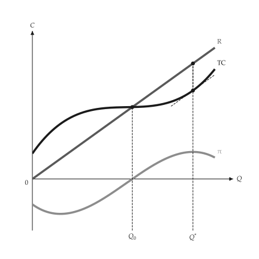{ .ev-figure-sm }

<div class="ev-downloads"><a class="ev-download" href="../../assets/micro-viz/competition/competition.py" download aria-label="Download the source"><svg viewBox="0 0 24 24" aria-hidden="true"><path d="M12 4v11m0 0-4.5-4.5M12 15l4.5-4.5M5 20h14" fill="none" stroke="currentColor" stroke-width="2" stroke-linecap="round" stroke-linejoin="round"/></svg><span>Download the source</span></a></div>

<figcaption markdown>*Revenue, cost and profit.* Profit is largest where total revenue exceeds total cost by the most.</figcaption>

</figure>

<span id="fig-competition-market-and-firm"></span>

<figure class="ev-fig" markdown>

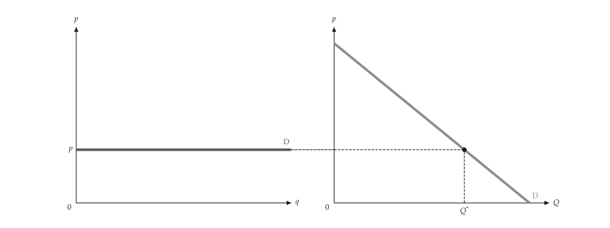{ .ev-figure-lg }

<div class="ev-downloads"><a class="ev-download" href="../../assets/micro-viz/competition/competition.py" download aria-label="Download the source"><svg viewBox="0 0 24 24" aria-hidden="true"><path d="M12 4v11m0 0-4.5-4.5M12 15l4.5-4.5M5 20h14" fill="none" stroke="currentColor" stroke-width="2" stroke-linecap="round" stroke-linejoin="round"/></svg><span>Download the source</span></a></div>

<figcaption markdown>*Market and firm.* The market demand sets the price; the firm faces a horizontal demand.</figcaption>

</figure>

<span id="fig-competition-firm-profit"></span>

<figure class="ev-fig" markdown>

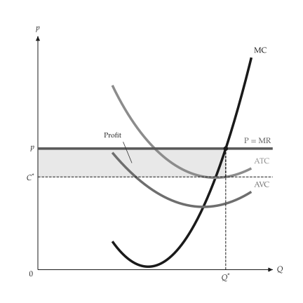{ .ev-figure-sm }

<div class="ev-downloads"><a class="ev-download" href="../../assets/micro-viz/competition/competition.py" download aria-label="Download the source"><svg viewBox="0 0 24 24" aria-hidden="true"><path d="M12 4v11m0 0-4.5-4.5M12 15l4.5-4.5M5 20h14" fill="none" stroke="currentColor" stroke-width="2" stroke-linecap="round" stroke-linejoin="round"/></svg><span>Download the source</span></a></div>

<figcaption markdown>*Firm earning a profit.* With the price above ATC, profit is the rectangle between the price and ATC.</figcaption>

</figure>

<span id="fig-competition-firm-lost-profit"></span>

<figure class="ev-fig" markdown>

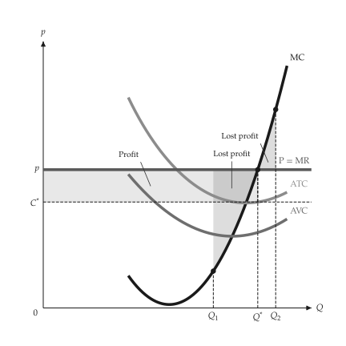{ .ev-figure-sm }

<div class="ev-downloads"><a class="ev-download" href="../../assets/micro-viz/competition/competition.py" download aria-label="Download the source"><svg viewBox="0 0 24 24" aria-hidden="true"><path d="M12 4v11m0 0-4.5-4.5M12 15l4.5-4.5M5 20h14" fill="none" stroke="currentColor" stroke-width="2" stroke-linecap="round" stroke-linejoin="round"/></svg><span>Download the source</span></a></div>

<figcaption markdown>*Profit lost off the optimum.* Any output other than the one where MR = MC loses profit.</figcaption>

</figure>

<span id="fig-competition-firm-loss"></span>

<figure class="ev-fig" markdown>

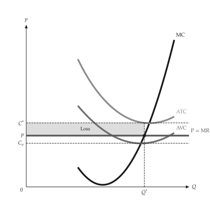{ .ev-figure-sm }

<div class="ev-downloads"><a class="ev-download" href="../../assets/micro-viz/competition/competition.py" download aria-label="Download the source"><svg viewBox="0 0 24 24" aria-hidden="true"><path d="M12 4v11m0 0-4.5-4.5M12 15l4.5-4.5M5 20h14" fill="none" stroke="currentColor" stroke-width="2" stroke-linecap="round" stroke-linejoin="round"/></svg><span>Download the source</span></a></div>

<figcaption markdown>*Firm with a loss.* With the price between AVC and ATC the firm keeps producing at a loss.</figcaption>

</figure>

<span id="fig-competition-firm-shutdown"></span>

<figure class="ev-fig" markdown>

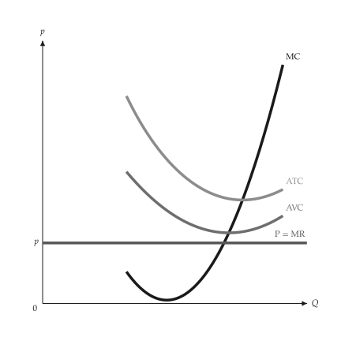{ .ev-figure-sm }

<div class="ev-downloads"><a class="ev-download" href="../../assets/micro-viz/competition/competition.py" download aria-label="Download the source"><svg viewBox="0 0 24 24" aria-hidden="true"><path d="M12 4v11m0 0-4.5-4.5M12 15l4.5-4.5M5 20h14" fill="none" stroke="currentColor" stroke-width="2" stroke-linecap="round" stroke-linejoin="round"/></svg><span>Download the source</span></a></div>

<figcaption markdown>*Shutdown.* With the price below the lowest AVC the firm stops producing.</figcaption>

</figure>

<span id="fig-competition-firm-supply"></span>

<figure class="ev-fig" markdown>

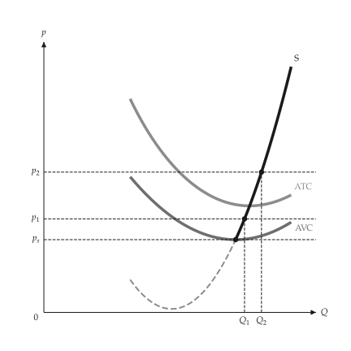{ .ev-figure-sm }

<div class="ev-downloads"><a class="ev-download" href="../../assets/micro-viz/competition/competition.py" download aria-label="Download the source"><svg viewBox="0 0 24 24" aria-hidden="true"><path d="M12 4v11m0 0-4.5-4.5M12 15l4.5-4.5M5 20h14" fill="none" stroke="currentColor" stroke-width="2" stroke-linecap="round" stroke-linejoin="round"/></svg><span>Download the source</span></a></div>

<figcaption markdown>*Firm supply curve.* The supply curve is the part of MC above the lowest AVC.</figcaption>

</figure>

<span id="fig-competition-cost-shift"></span>

<figure class="ev-fig" markdown>

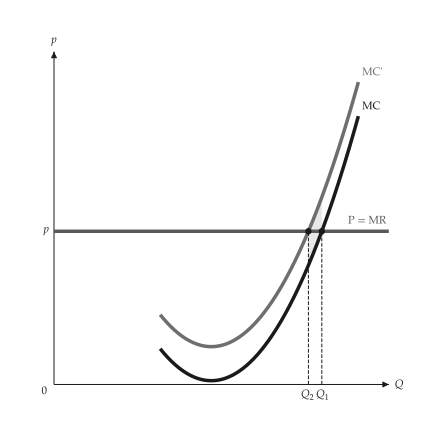{ .ev-figure-sm }

<div class="ev-downloads"><a class="ev-download" href="../../assets/micro-viz/competition/competition.py" download aria-label="Download the source"><svg viewBox="0 0 24 24" aria-hidden="true"><path d="M12 4v11m0 0-4.5-4.5M12 15l4.5-4.5M5 20h14" fill="none" stroke="currentColor" stroke-width="2" stroke-linecap="round" stroke-linejoin="round"/></svg><span>Download the source</span></a></div>

<figcaption markdown>*Cost shift.* Higher costs shift MC and AVC up and output falls.</figcaption>

</figure>

<span id="fig-competition-unit-tax"></span>

<figure class="ev-fig" markdown>

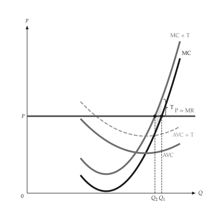{ .ev-figure-sm }

<div class="ev-downloads"><a class="ev-download" href="../../assets/micro-viz/competition/competition.py" download aria-label="Download the source"><svg viewBox="0 0 24 24" aria-hidden="true"><path d="M12 4v11m0 0-4.5-4.5M12 15l4.5-4.5M5 20h14" fill="none" stroke="currentColor" stroke-width="2" stroke-linecap="round" stroke-linejoin="round"/></svg><span>Download the source</span></a></div>

<figcaption markdown>*Per-unit tax.* A per-unit tax shifts MC up by the tax and the firm cuts output.</figcaption>

</figure>

<span id="fig-competition-industry-supply"></span>

<figure class="ev-fig" markdown>

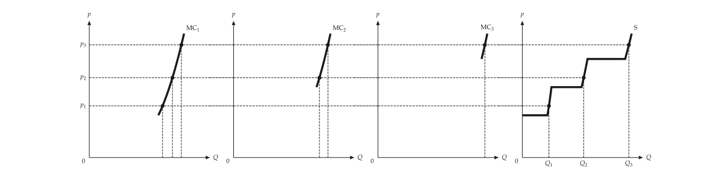{ .ev-figure-lg }

<div class="ev-downloads"><a class="ev-download" href="../../assets/micro-viz/competition/competition.py" download aria-label="Download the source"><svg viewBox="0 0 24 24" aria-hidden="true"><path d="M12 4v11m0 0-4.5-4.5M12 15l4.5-4.5M5 20h14" fill="none" stroke="currentColor" stroke-width="2" stroke-linecap="round" stroke-linejoin="round"/></svg><span>Download the source</span></a></div>

<figcaption markdown>*Industry supply.* Industry supply is the horizontal sum of the firms' supply curves.</figcaption>

</figure>

<span id="fig-competition-industry-supply-total"></span>

<figure class="ev-fig" markdown>

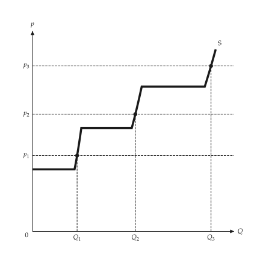{ .ev-figure-sm }

<div class="ev-downloads"><a class="ev-download" href="../../assets/micro-viz/competition/competition.py" download aria-label="Download the source"><svg viewBox="0 0 24 24" aria-hidden="true"><path d="M12 4v11m0 0-4.5-4.5M12 15l4.5-4.5M5 20h14" fill="none" stroke="currentColor" stroke-width="2" stroke-linecap="round" stroke-linejoin="round"/></svg><span>Download the source</span></a></div>

<figcaption markdown>*Industry supply alone.* Only the industry supply curve and the output at each price.</figcaption>

</figure>

<span id="fig-competition-producer-surplus"></span>

<figure class="ev-fig" markdown>

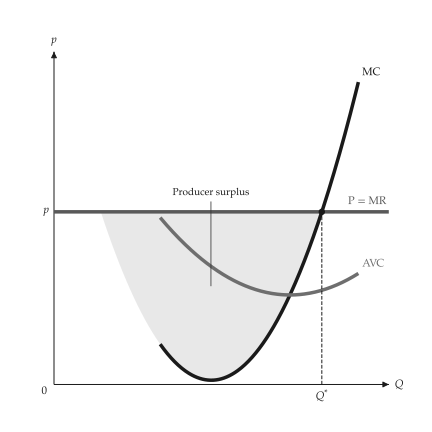{ .ev-figure-sm }

<div class="ev-downloads"><a class="ev-download" href="../../assets/micro-viz/competition/competition.py" download aria-label="Download the source"><svg viewBox="0 0 24 24" aria-hidden="true"><path d="M12 4v11m0 0-4.5-4.5M12 15l4.5-4.5M5 20h14" fill="none" stroke="currentColor" stroke-width="2" stroke-linecap="round" stroke-linejoin="round"/></svg><span>Download the source</span></a></div>

<figcaption markdown>*Producer surplus.* Producer surplus is the area between the price and MC.</figcaption>

</figure>

## Long-run costs

<span id="sec-ex-long-run-costs"></span>

LAC envelops the short-run average cost curves of plants of different size; LMC passes through its lowest point. Sources: [Viner (1931)](../project/references.md#viner1931).

<!-- api: micro_viz.guides_competition_10 -->

`PlantFamily` holds the SAC curves of plants that touch LAC; `EnvelopeFigure` is the textbook envelope with the tangency and lowest-point outputs.

<!-- api: micro_viz.guides_competition_11 -->

LAC enveloping SAC1 to SAC3 as in a textbook figure of long-run cost.

<!-- api: micro_viz.guides_competition_12 -->

U-shaped LAC with LMC cutting it at its lowest point `C_min` (output `Q_e`).

<!-- api: micro_viz.guides_competition_13 -->

SAC curves of the plants in `sizes` touching LAC, with LAC and LMC.

```python
def long_run_examples(
    output_dir: Path,
    theme: PlotTheme,
    *,
    family: PlantFamily,
    sizes: tuple[float, ...],
    output_max: float,
    smc_for: tuple[int, ...],
    envelope: EnvelopeFigure,
    envelope_x_max: float,
    envelope_ceiling: float,
    title: str | None = None,
) -> list[Path]:
    """Write the long-run cost figures into ``output_dir`` and return their paths."""
    output_dir.mkdir(parents=True, exist_ok=True)
    figures = {
        "lac_lmc.svg": lac_lmc_canvas(
            family, output_max, theme=theme, title=title
        ),
        "short_run_envelope.svg": envelope_figure_canvas(
            envelope,
            envelope_x_max,
            envelope_ceiling,
            theme=theme,
            title=title,
        ),
        "plant_family.svg": plant_family_canvas(
            family,
            sizes,
            output_max,
            smc_for=smc_for,
            theme=theme,
            title=title,
        ),
    }
    paths = []
    for name, figure in figures.items():
        figure.save(output_dir / name)
        paths.append(output_dir / name)
    return paths
```

<span id="fig-long-run-costs-lac-lmc"></span>

<figure class="ev-fig" markdown>

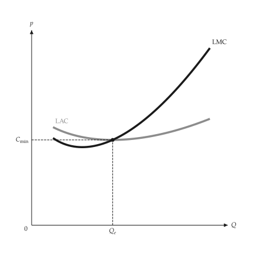{ .ev-figure-sm }

<div class="ev-downloads"><a class="ev-download" href="../../assets/micro-viz/long_run_costs/long_run_costs.py" download aria-label="Download the source"><svg viewBox="0 0 24 24" aria-hidden="true"><path d="M12 4v11m0 0-4.5-4.5M12 15l4.5-4.5M5 20h14" fill="none" stroke="currentColor" stroke-width="2" stroke-linecap="round" stroke-linejoin="round"/></svg><span>Download the source</span></a></div>

<figcaption markdown>*LAC and LMC.* LMC passes through the lowest point of LAC.</figcaption>

</figure>

<span id="fig-long-run-costs-short-run-envelope"></span>

<figure class="ev-fig" markdown>

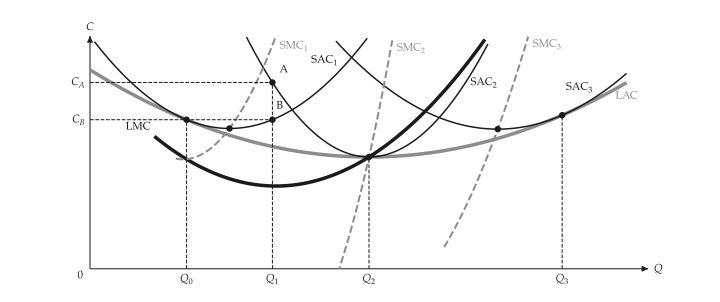{ .ev-figure-lg }

<div class="ev-downloads"><a class="ev-download" href="../../assets/micro-viz/long_run_costs/long_run_costs.py" download aria-label="Download the source"><svg viewBox="0 0 24 24" aria-hidden="true"><path d="M12 4v11m0 0-4.5-4.5M12 15l4.5-4.5M5 20h14" fill="none" stroke="currentColor" stroke-width="2" stroke-linecap="round" stroke-linejoin="round"/></svg><span>Download the source</span></a></div>

<figcaption markdown>*Short-run envelope.* LAC envelops SAC1 to SAC3; each SAC touches LAC and SMC passes through the lowest point of its SAC.</figcaption>

</figure>

<span id="fig-long-run-costs-plant-family"></span>

<figure class="ev-fig" markdown>

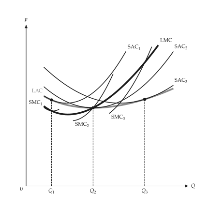{ .ev-figure-sm }

<div class="ev-downloads"><a class="ev-download" href="../../assets/micro-viz/long_run_costs/long_run_costs.py" download aria-label="Download the source"><svg viewBox="0 0 24 24" aria-hidden="true"><path d="M12 4v11m0 0-4.5-4.5M12 15l4.5-4.5M5 20h14" fill="none" stroke="currentColor" stroke-width="2" stroke-linecap="round" stroke-linejoin="round"/></svg><span>Download the source</span></a></div>

<figcaption markdown>*Plant family.* Each plant's SAC touches LAC, and SMC meets LMC at the point of tangency.</figcaption>

</figure>

## Long-run competition

<span id="sec-ex-long-run-competition"></span>

Entry and exit move the industry to zero profit. The long-run supply curve is horizontal, rising or, with a scarce advantage, shows a rent.

<!-- api: micro_viz.guides_competition_14 -->

`IndustryEntry` solves the long-run industry for a demand curve and a firm's cost: the zero-profit price, the number of firms and the points before and after entry.

<!-- api: micro_viz.guides_competition_15 -->

Constant-cost industry: demand rises, price jumps then returns to the same lowest ATC; the long-run supply curve LRS is horizontal.

<!-- api: micro_viz.guides_competition_16 -->

Profit draws entry: the firm (profit rectangle) beside the industry, where more firms shift supply right until the price has fallen to the lowest ATC.

<!-- api: micro_viz.guides_competition_17 -->

Increasing-cost industry: entry raises input prices by `cost_shift` per unit of extra industry output, so every firm's cost curves rise and LRS slopes up.

<!-- api: micro_viz.guides_competition_18 -->

LAC, LMC and the price line: the firm produces where `price = LMC` with the plant whose SAC touches LAC there, and the profit is the rectangle between price and LAC.

<!-- api: micro_viz.guides_competition_19 -->

Zero profit for the marginal firm, and a rent rectangle for a firm with lower costs (a scarce advantage), beside the long-run industry.

```python
def competition_examples(
    output_dir: Path,
    theme: PlotTheme,
    *,
    family: PlantFamily,
    long_run_price: float,
    family_output_max: float,
    cost: CubicCost,
    advantaged: CubicCost,
    demand: LinearDemand,
    higher_demand: LinearDemand,
    firms: float,
    cost_shift: float,
    min_output: float,
    max_output: float,
    title: str | None = None,
) -> list[Path]:
    """Write the long-run competition figures into ``output_dir``."""
    output_dir.mkdir(parents=True, exist_ok=True)
    window = (min_output, max_output)
    industry = IndustryEntry(demand, cost)
    unit = analyze_costs(cost, output_range=window)
    figures = {
        "long_run_firm.svg": long_run_firm_canvas(
            family,
            long_run_price,
            family_output_max,
            theme=theme,
            title=title,
        ),
        "entry.svg": entry_canvas(
            industry, firms, unit, theme=theme
        ),
        "economic_rent.svg": rent_canvas(
            industry,
            advantaged,
            unit,
            analyze_costs(advantaged, output_range=window),
            theme=theme,
        ),
        "constant_cost.svg": constant_cost_canvas(
            industry, higher_demand, unit, theme=theme
        ),
        "increasing_cost.svg": increasing_cost_canvas(
            industry,
            higher_demand,
            cost_shift,
            unit,
            theme=theme,
        ),
    }
    paths = []
    for name, figure in figures.items():
        figure.save(output_dir / name)
        paths.append(output_dir / name)
    return paths
```

<span id="fig-long-run-competition-long-run-firm"></span>

<figure class="ev-fig" markdown>

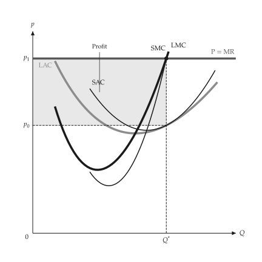{ .ev-figure-sm }

<div class="ev-downloads"><a class="ev-download" href="../../assets/micro-viz/long_run_competition/long_run_competition.py" download aria-label="Download the source"><svg viewBox="0 0 24 24" aria-hidden="true"><path d="M12 4v11m0 0-4.5-4.5M12 15l4.5-4.5M5 20h14" fill="none" stroke="currentColor" stroke-width="2" stroke-linecap="round" stroke-linejoin="round"/></svg><span>Download the source</span></a></div>

<figcaption markdown>*Firm in the long run.* Long-run output is where the price equals LMC; profit is the rectangle between the price and LAC.</figcaption>

</figure>

<span id="fig-long-run-competition-entry"></span>

<figure class="ev-fig" markdown>

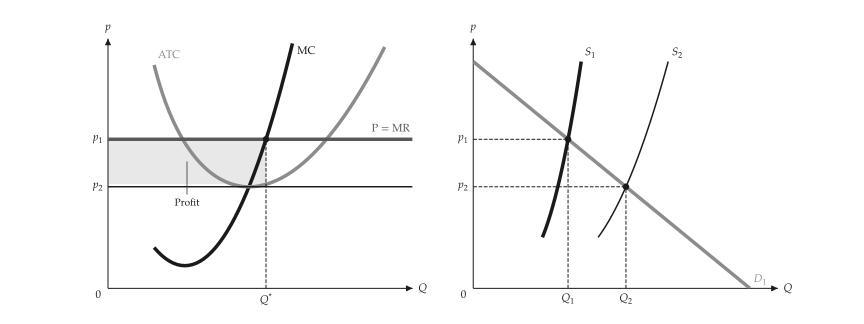{ .ev-figure-lg }

<div class="ev-downloads"><a class="ev-download" href="../../assets/micro-viz/long_run_competition/long_run_competition.py" download aria-label="Download the source"><svg viewBox="0 0 24 24" aria-hidden="true"><path d="M12 4v11m0 0-4.5-4.5M12 15l4.5-4.5M5 20h14" fill="none" stroke="currentColor" stroke-width="2" stroke-linecap="round" stroke-linejoin="round"/></svg><span>Download the source</span></a></div>

<figcaption markdown>*Entry.* Profit draws entry; industry supply shifts right until the price falls to the lowest ATC.</figcaption>

</figure>

<span id="fig-long-run-competition-economic-rent"></span>

<figure class="ev-fig" markdown>

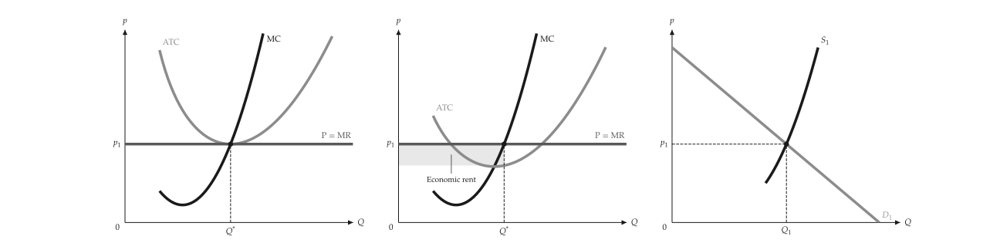{ .ev-figure-lg }

<div class="ev-downloads"><a class="ev-download" href="../../assets/micro-viz/long_run_competition/long_run_competition.py" download aria-label="Download the source"><svg viewBox="0 0 24 24" aria-hidden="true"><path d="M12 4v11m0 0-4.5-4.5M12 15l4.5-4.5M5 20h14" fill="none" stroke="currentColor" stroke-width="2" stroke-linecap="round" stroke-linejoin="round"/></svg><span>Download the source</span></a></div>

<figcaption markdown>*Economic rent.* A firm with lower costs earns an economic rent at the zero-profit price.</figcaption>

</figure>

<span id="fig-long-run-competition-constant-cost"></span>

<figure class="ev-fig" markdown>

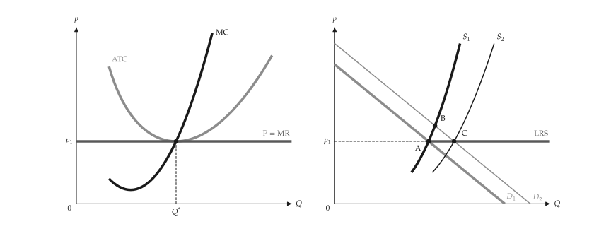{ .ev-figure-lg }

<div class="ev-downloads"><a class="ev-download" href="../../assets/micro-viz/long_run_competition/long_run_competition.py" download aria-label="Download the source"><svg viewBox="0 0 24 24" aria-hidden="true"><path d="M12 4v11m0 0-4.5-4.5M12 15l4.5-4.5M5 20h14" fill="none" stroke="currentColor" stroke-width="2" stroke-linecap="round" stroke-linejoin="round"/></svg><span>Download the source</span></a></div>

<figcaption markdown>*Constant-cost industry.* The long-run supply of a constant-cost industry is horizontal.</figcaption>

</figure>

<span id="fig-long-run-competition-increasing-cost"></span>

<figure class="ev-fig" markdown>

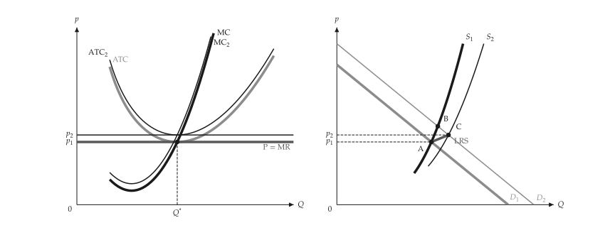{ .ev-figure-lg }

<div class="ev-downloads"><a class="ev-download" href="../../assets/micro-viz/long_run_competition/long_run_competition.py" download aria-label="Download the source"><svg viewBox="0 0 24 24" aria-hidden="true"><path d="M12 4v11m0 0-4.5-4.5M12 15l4.5-4.5M5 20h14" fill="none" stroke="currentColor" stroke-width="2" stroke-linecap="round" stroke-linejoin="round"/></svg><span>Download the source</span></a></div>

<figcaption markdown>*Increasing-cost industry.* The long-run supply of an increasing-cost industry slopes upward.</figcaption>

</figure>
