# Competition and the long run

<span id="sec-competition"></span>

Price-taking firms, industry supply, long-run costs and entry.

Each section is one example script and the figures it writes. The scripts are in `examples/scripts/` of the repository; `--help` lists their arguments.

## Perfect competition

```bash
uv run python examples/scripts/competition.py --output-dir out
```

### Revenue, cost and profit

Setting: p = 18.

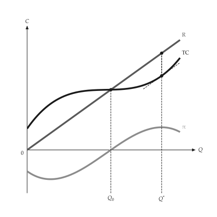{ .ev-figure-sm }

### Market and firm

Setting: p = 4.

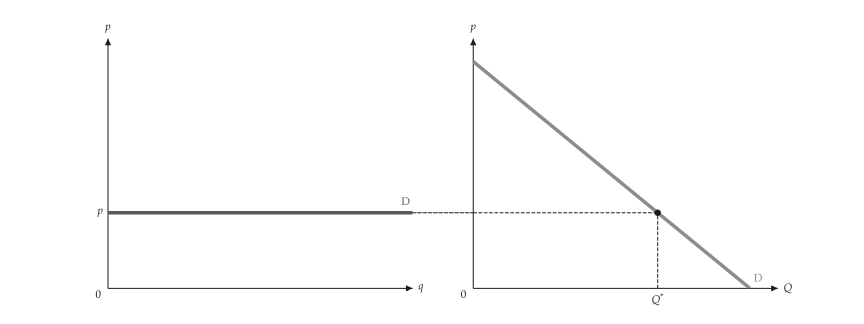{ .ev-figure-lg }

### Firm earning a profit

Setting: p = 18.

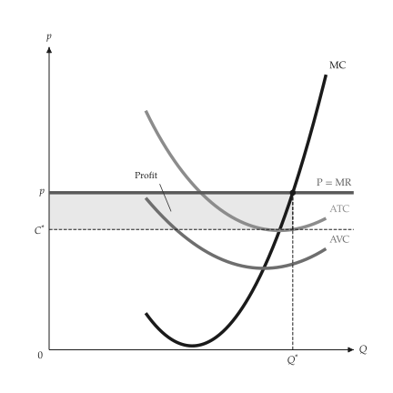{ .ev-figure-sm }

### Profit lost off the optimum

Setting: q1 and q2.

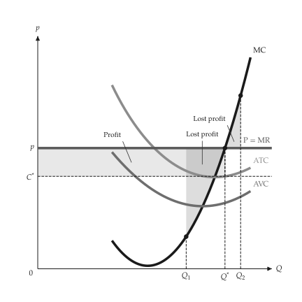{ .ev-figure-sm }

### Firm with a loss

Setting: p = 11.

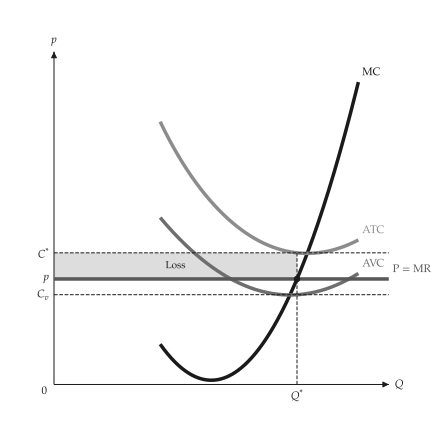{ .ev-figure-sm }

### Shutdown

Setting: p = 8.

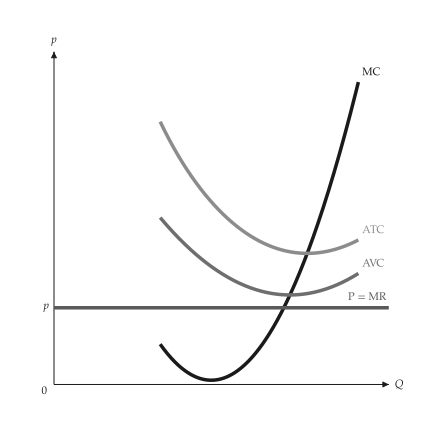{ .ev-figure-sm }

### Firm supply curve

Setting: two prices.

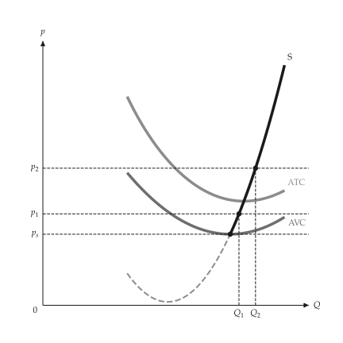{ .ev-figure-sm }

### Cost shift

Setting: MC up.

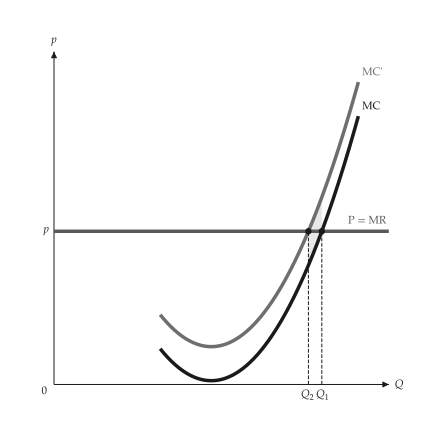{ .ev-figure-sm }

### Per-unit tax

Setting: T = 4.

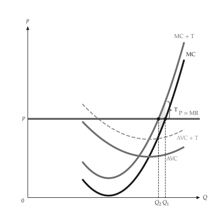{ .ev-figure-sm }

### Industry supply

Setting: three firms.

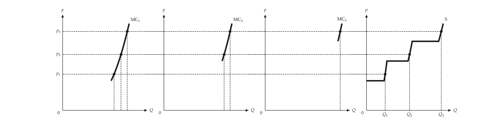{ .ev-figure-lg }

### Industry supply alone

Setting: three firms.

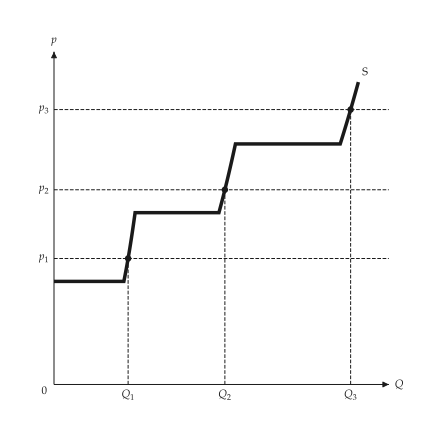{ .ev-figure-sm }

### Producer surplus

Setting: p = 18.

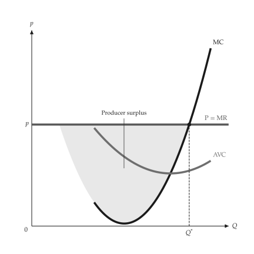{ .ev-figure-sm }

## Long-run costs

```bash
uv run python examples/scripts/long_run_costs.py --output-dir out
```

### LAC and LMC

Setting: U-shaped.

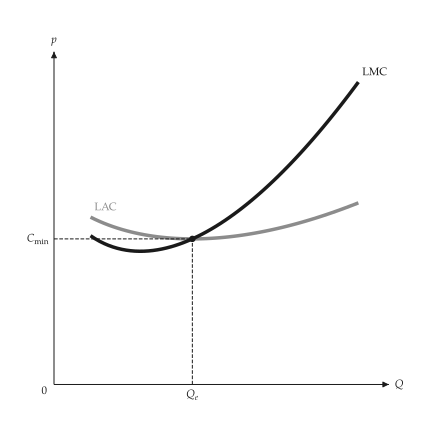{ .ev-figure-sm }

### Short-run envelope

Setting: three plants.

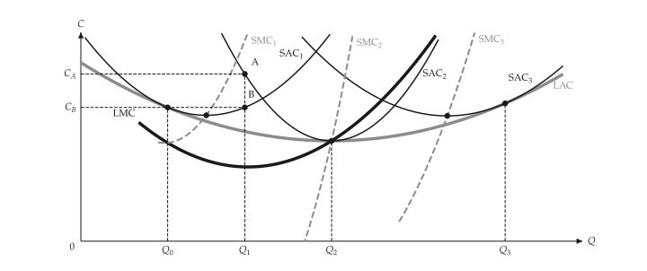{ .ev-figure-lg }

### Plant family

Setting: three plants.

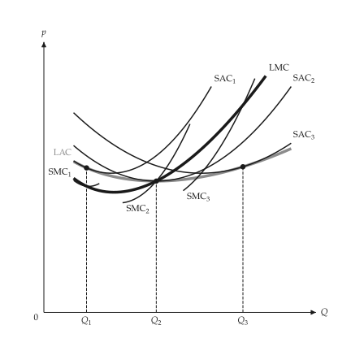{ .ev-figure-sm }

## Long-run competition

```bash
uv run python examples/scripts/long_run_competition.py --output-dir out
```

### Firm in the long run

Setting: p above LAC.

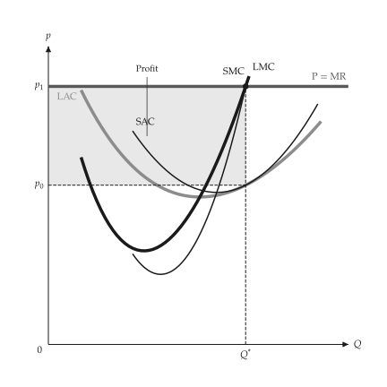{ .ev-figure-sm }

### Entry

Setting: profit draws firms.

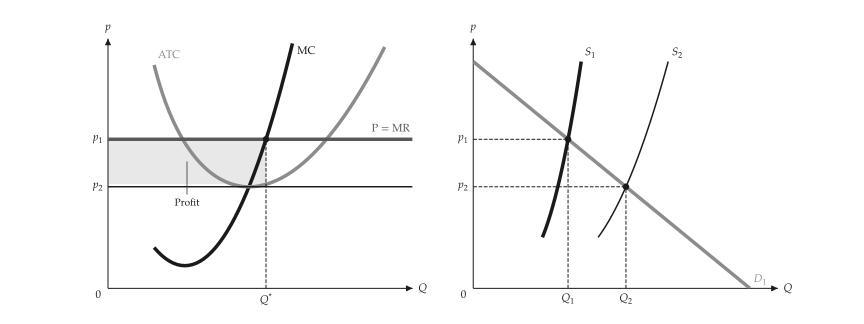{ .ev-figure-lg }

### Economic rent

Setting: low-cost firm.

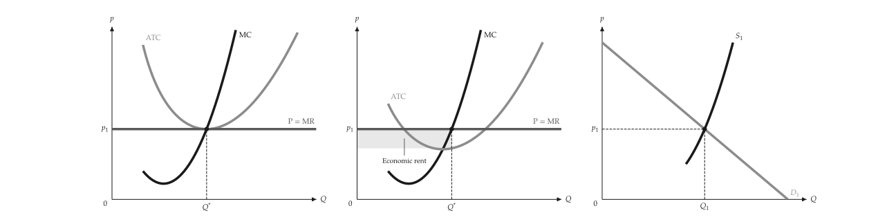{ .ev-figure-lg }

### Constant-cost industry

Setting: demand up.

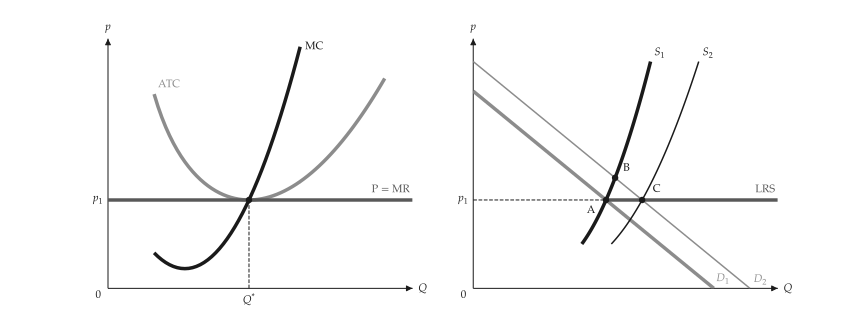{ .ev-figure-lg }

### Increasing-cost industry

Setting: demand up.

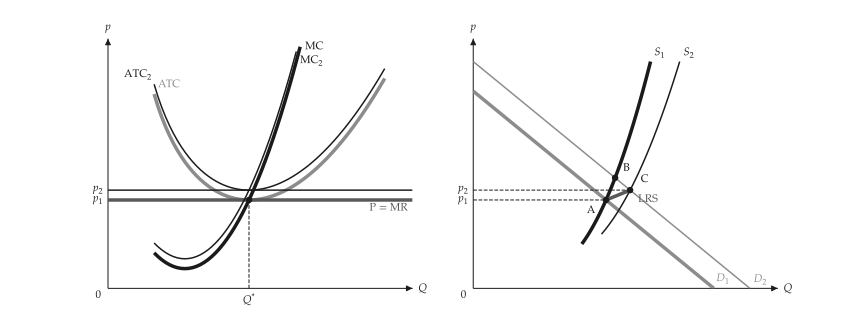{ .ev-figure-lg }
