# Inputs and technology

<span id="sec-inputs"></span>

Long-run technology, the choice of inputs, and factor markets.

Each section is one example script and the figures it writes. The scripts are in `examples/scripts/` of the repository; `--help` lists their arguments.

## Isoquants

```bash
uv run python examples/scripts/isoquants.py --output-dir out
```

### Isoquant map

Setting: Cobb-Douglas.

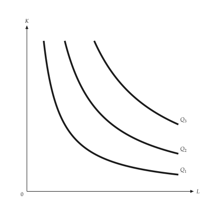{ .ev-figure-sm }

### Diminishing MRTS

Setting: four points.

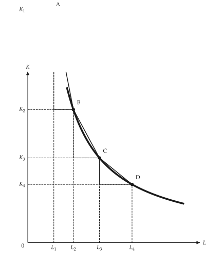{ .ev-figure-sm }

### MRTS triangle

Setting: ΔK and ΔL.

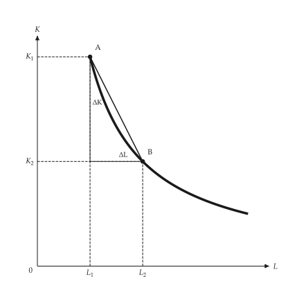{ .ev-figure-sm }

### Perfect substitutes

Setting: straight isoquants.

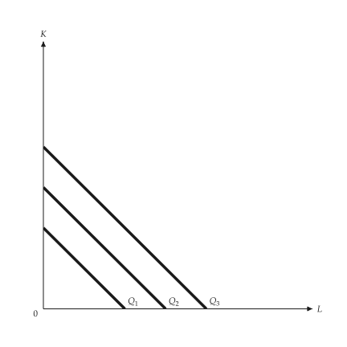{ .ev-figure-sm }

### Fixed proportions

Setting: L-shaped isoquants.

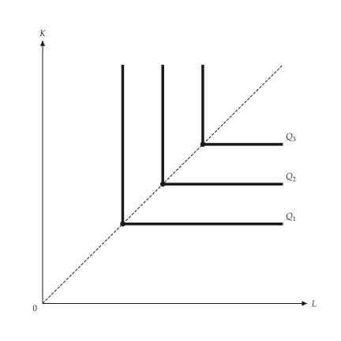{ .ev-figure-sm }

### Returns to scale

Setting: constant and increasing.

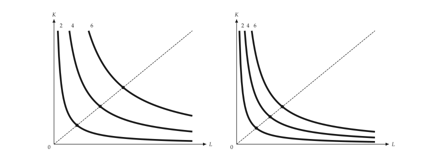{ .ev-figure-lg }

## Cost minimization

```bash
uv run python examples/scripts/cost_minimization.py --output-dir out
```

### Cost minimization

Setting: tangency.

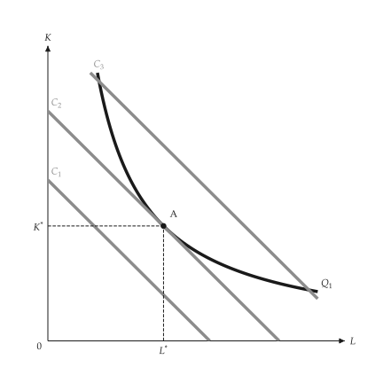{ .ev-figure-sm }

### Dearer labor

Setting: wage up.

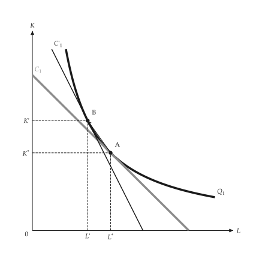{ .ev-figure-sm }

### Technical change

Setting: isoquant inward.

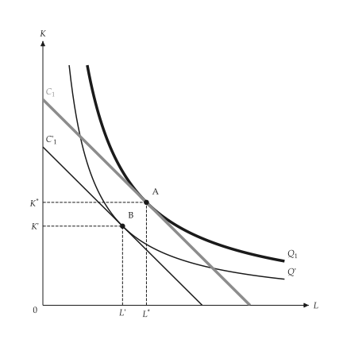{ .ev-figure-sm }

### Expansion path

Setting: three outputs.

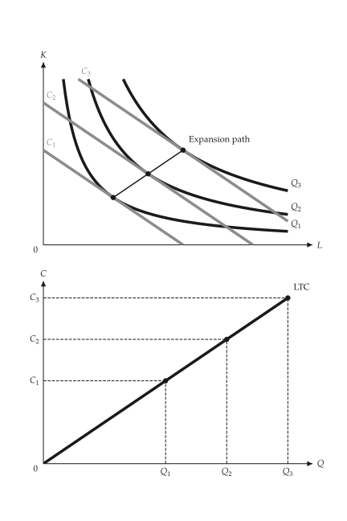{ .ev-figure-sm }

### Fixed capital

Setting: K0.

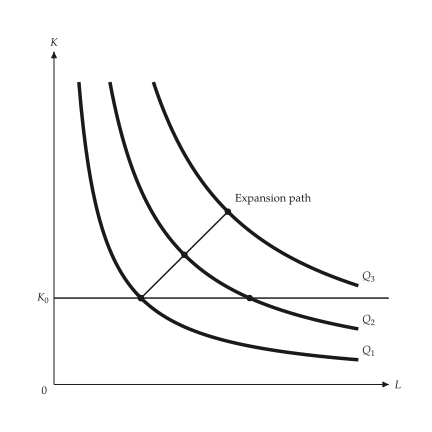{ .ev-figure-sm }

## Learning, scope and frontier

```bash
uv run python examples/scripts/production_extensions.py --output-dir out
```

### Learning curve

Setting: A + B N^-beta.

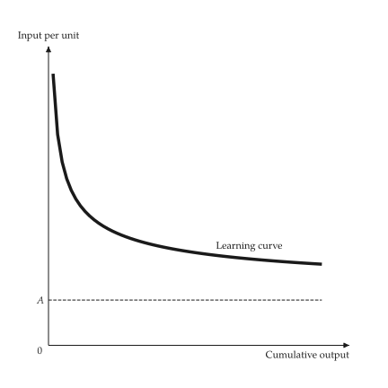{ .ev-figure-sm }

### Scale versus learning

Setting: A to B to C.

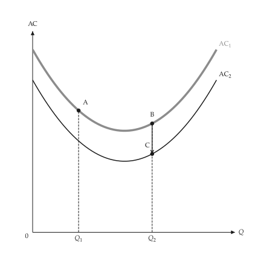{ .ev-figure-sm }

### Product transformation curve

Setting: bow 2.

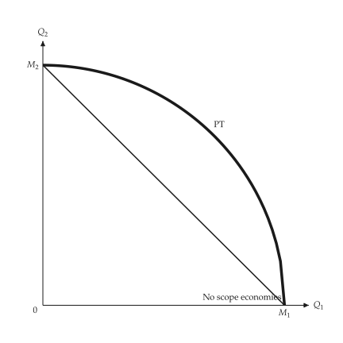{ .ev-figure-sm }

### Technical progress

Setting: three technologies.

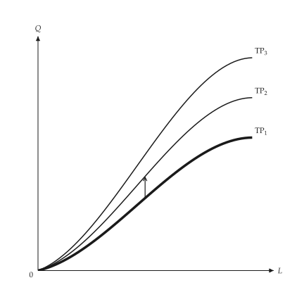{ .ev-figure-sm }

### Production frontier

Setting: two inefficient points.

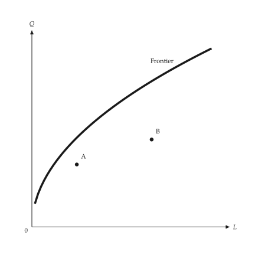{ .ev-figure-sm }

## Factor markets

```bash
uv run python examples/scripts/factor_markets.py --output-dir out
```

### VMP and MRP

Setting: monopoly output market.

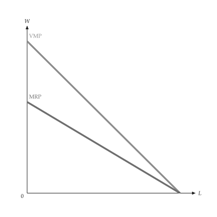{ .ev-figure-sm }

### Firm hiring

Setting: flat supply.

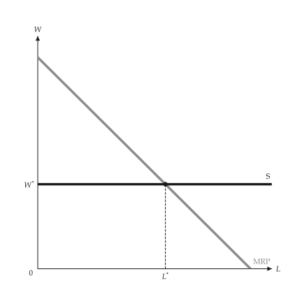{ .ev-figure-sm }

### A lower market wage

Setting: supply shifts down.

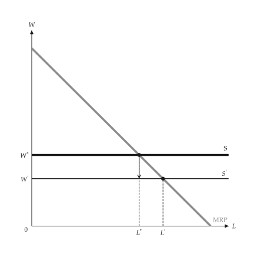{ .ev-figure-sm }

### MRP as capital adjusts

Setting: three capital levels.

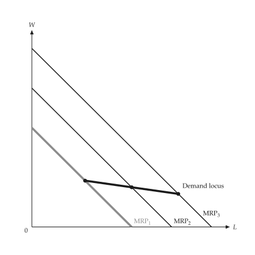{ .ev-figure-sm }

### Firm and industry demand

Setting: price effect.

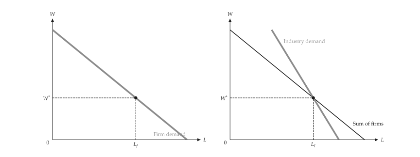{ .ev-figure-lg }

### Short- and long-run input demand

Setting: one anchor.

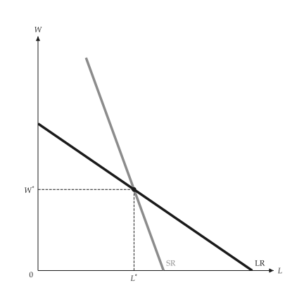{ .ev-figure-sm }

### Market and firm supply

Setting: two panels.

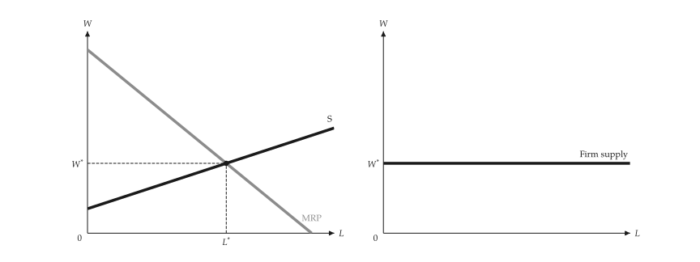{ .ev-figure-lg }

### Factor-market equilibrium

Setting: competitive and monopoly output.

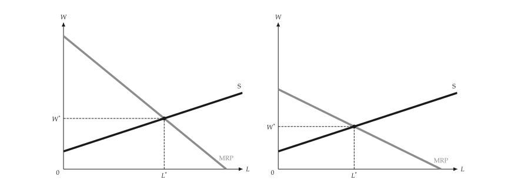{ .ev-figure-lg }

### Economic rent of labor

Setting: supply curve.

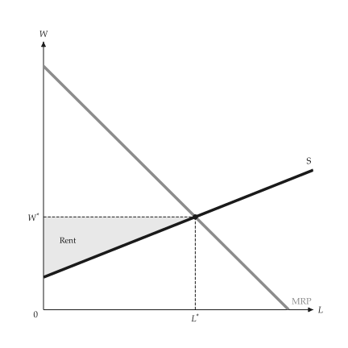{ .ev-figure-sm }

### Land rent

Setting: vertical supply.

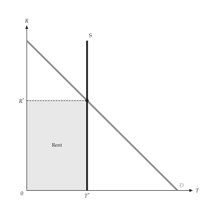{ .ev-figure-sm }

## Monopsony and unions

```bash
uv run python examples/scripts/monopsony.py --output-dir out
```

### Competitive buyer and seller

Setting: p = 12.

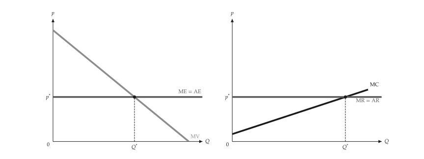{ .ev-figure-lg }

### Monopsony

Setting: linear.

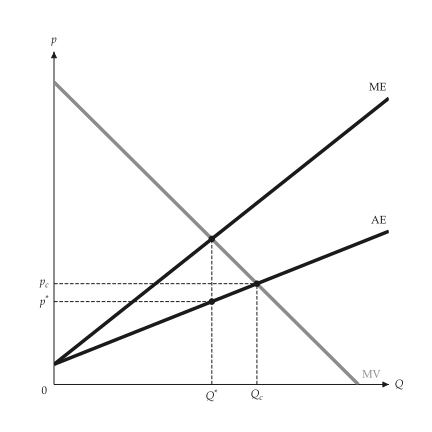{ .ev-figure-sm }

### Monopoly and monopsony

Setting: side by side.

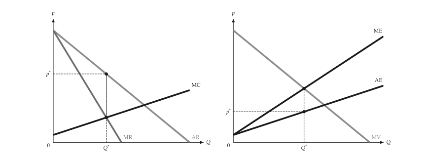{ .ev-figure-lg }

### Supply elasticity

Setting: elastic and inelastic.

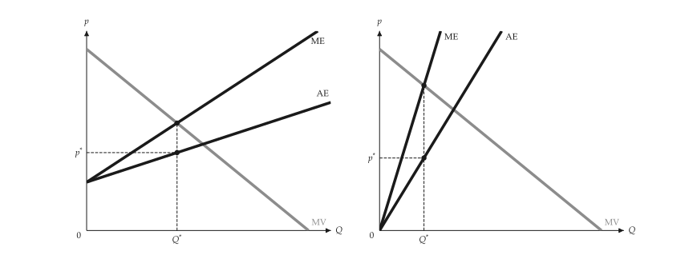{ .ev-figure-lg }

### Monopsony deadweight loss

Setting: A, B, C.

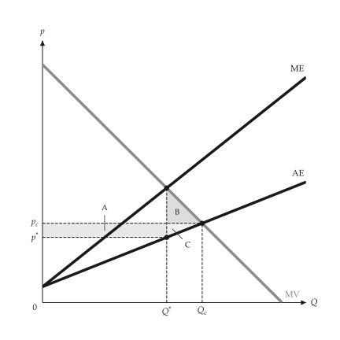{ .ev-figure-sm }

### Labor monopsony

Setting: MRP, ME, S.

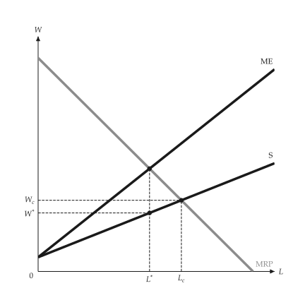{ .ev-figure-sm }

### Union wage setting

Setting: wage bill maximising.

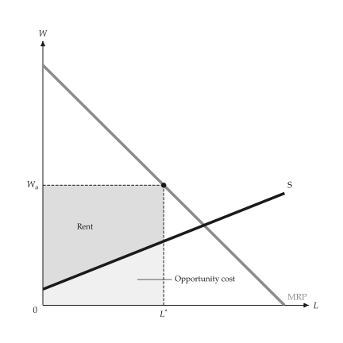{ .ev-figure-sm }

### Two-sector labor market

Setting: union wage in sector 1.

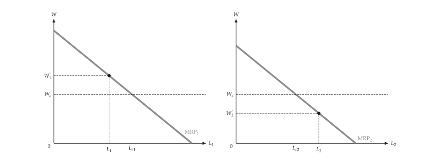{ .ev-figure-lg }
