# Inputs and technology

<span id="sec-inputs"></span>

Long-run technology, the choice of inputs, and factor markets.

Each section is one example script and the figures it draws. The scripts come in the examples archive; `--help` lists their arguments.

## Isoquants

<span id="sec-ex-isoquants"></span>

Isoquants of Cobb-Douglas, perfect-substitute and fixed-proportion technologies, with the MRTS and returns to scale.

<!-- api: micro_viz.guides_inputs_1 -->

Each technology is a `Technology`: it gives output at an input bundle, the capital needed for an output, the MRTS and the `Returns` to scale.

<!-- api: micro_viz.guides_inputs_2 -->

Isoquants of the given `outputs` inside the box `bounds = (L_max, K_max)`.

<!-- api: micro_viz.guides_inputs_3 -->

One isoquant with points at the given `labors`; between neighbours the chord and the right triangle of `ΔK` and `ΔL` whose ratio is the (average) MRTS, flatter step by step.

<!-- api: micro_viz.guides_inputs_4 -->

One panel per technology: isoquants of the listed outputs cut by a ray with direction `(L, K)`; they are evenly spaced under constant returns and closer under increasing.

```python
def isoquant_examples(
    output_dir: Path,
    theme: PlotTheme,
    *,
    technology: CobbDouglas,
    outputs: list[float],
    bounds: tuple[float, float],
    steps: list[float],
    triangle: list[float],
    substitutes: PerfectSubstitutes,
    proportions: FixedProportions,
    increasing: CobbDouglas,
    scale_outputs: list[float],
    direction: tuple[float, float],
    title: str | None = None,
) -> list[Path]:
    """Write the isoquant figures into ``output_dir`` and return their paths."""
    output_dir.mkdir(parents=True, exist_ok=True)
    middle = outputs[len(outputs) // 2]
    figures = {
        "isoquant_map.svg": isoquant_map_canvas(
            technology,
            outputs,
            bounds,
            theme=theme,
            title=title,
        ),
        "mrts_steps.svg": mrts_steps_canvas(
            technology,
            middle,
            steps,
            bounds,
            theme=theme,
            title=title,
        ),
        "mrts_triangle.svg": mrts_steps_canvas(
            technology,
            middle,
            triangle,
            bounds,
            delta_labels=True,
            theme=theme,
            title=title,
        ),
        "perfect_substitutes.svg": isoquant_map_canvas(
            substitutes,
            outputs,
            bounds,
            theme=theme,
            title=title,
        ),
        "fixed_proportions.svg": isoquant_map_canvas(
            proportions,
            outputs,
            bounds,
            ray=True,
            theme=theme,
            title=title,
        ),
        "returns_to_scale.svg": returns_to_scale_grid(
            (technology, increasing),
            (scale_outputs, scale_outputs),
            bounds,
            direction,
            theme=theme,
        ),
    }
    paths = []
    for name, figure in figures.items():
        figure.save(output_dir / name)
        paths.append(output_dir / name)
    return paths
```

<span id="fig-isoquants-isoquant-map"></span>

<figure class="ev-fig" markdown>

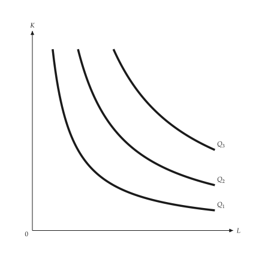{ .ev-figure-sm }

<div class="ev-downloads"><a class="ev-download" href="../../assets/micro-viz/isoquants/isoquants.py" download aria-label="Download the source"><svg viewBox="0 0 24 24" aria-hidden="true"><path d="M12 4v11m0 0-4.5-4.5M12 15l4.5-4.5M5 20h14" fill="none" stroke="currentColor" stroke-width="2" stroke-linecap="round" stroke-linejoin="round"/></svg><span>Download the source</span></a></div>

<figcaption markdown>*Isoquant map.* Isoquants: the farther from the origin, the larger the output.</figcaption>

</figure>

<span id="fig-isoquants-mrts-steps"></span>

<figure class="ev-fig" markdown>

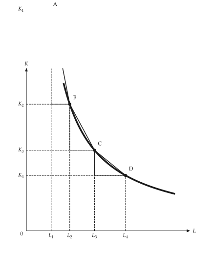{ .ev-figure-sm }

<div class="ev-downloads"><a class="ev-download" href="../../assets/micro-viz/isoquants/isoquants.py" download aria-label="Download the source"><svg viewBox="0 0 24 24" aria-hidden="true"><path d="M12 4v11m0 0-4.5-4.5M12 15l4.5-4.5M5 20h14" fill="none" stroke="currentColor" stroke-width="2" stroke-linecap="round" stroke-linejoin="round"/></svg><span>Download the source</span></a></div>

<figcaption markdown>*Diminishing MRTS.* The MRTS falls along an isoquant to the right.</figcaption>

</figure>

<span id="fig-isoquants-mrts-triangle"></span>

<figure class="ev-fig" markdown>

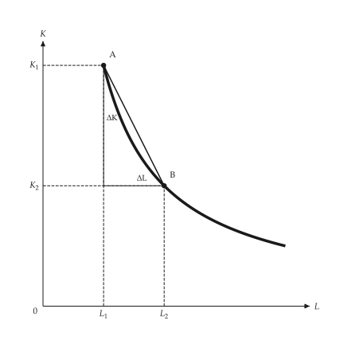{ .ev-figure-sm }

<div class="ev-downloads"><a class="ev-download" href="../../assets/micro-viz/isoquants/isoquants.py" download aria-label="Download the source"><svg viewBox="0 0 24 24" aria-hidden="true"><path d="M12 4v11m0 0-4.5-4.5M12 15l4.5-4.5M5 20h14" fill="none" stroke="currentColor" stroke-width="2" stroke-linecap="round" stroke-linejoin="round"/></svg><span>Download the source</span></a></div>

<figcaption markdown>*MRTS triangle.* The ratio of the changes in K and L between two points defines the MRTS.</figcaption>

</figure>

<span id="fig-isoquants-perfect-substitutes"></span>

<figure class="ev-fig" markdown>

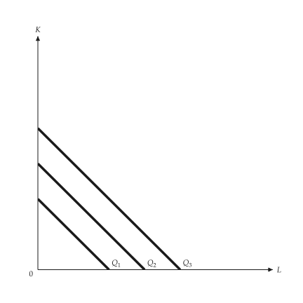{ .ev-figure-sm }

<div class="ev-downloads"><a class="ev-download" href="../../assets/micro-viz/isoquants/isoquants.py" download aria-label="Download the source"><svg viewBox="0 0 24 24" aria-hidden="true"><path d="M12 4v11m0 0-4.5-4.5M12 15l4.5-4.5M5 20h14" fill="none" stroke="currentColor" stroke-width="2" stroke-linecap="round" stroke-linejoin="round"/></svg><span>Download the source</span></a></div>

<figcaption markdown>*Perfect substitutes.* Isoquants of perfect substitutes are straight and the MRTS is constant.</figcaption>

</figure>

<span id="fig-isoquants-fixed-proportions"></span>

<figure class="ev-fig" markdown>

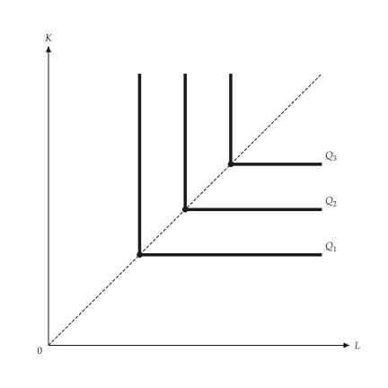{ .ev-figure-sm }

<div class="ev-downloads"><a class="ev-download" href="../../assets/micro-viz/isoquants/isoquants.py" download aria-label="Download the source"><svg viewBox="0 0 24 24" aria-hidden="true"><path d="M12 4v11m0 0-4.5-4.5M12 15l4.5-4.5M5 20h14" fill="none" stroke="currentColor" stroke-width="2" stroke-linecap="round" stroke-linejoin="round"/></svg><span>Download the source</span></a></div>

<figcaption markdown>*Fixed proportions.* Isoquants of fixed proportions are L-shaped, with corners on one ray.</figcaption>

</figure>

<span id="fig-isoquants-returns-to-scale"></span>

<figure class="ev-fig" markdown>

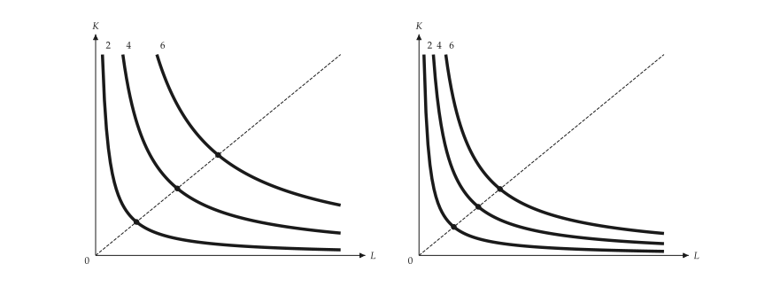{ .ev-figure-lg }

<div class="ev-downloads"><a class="ev-download" href="../../assets/micro-viz/isoquants/isoquants.py" download aria-label="Download the source"><svg viewBox="0 0 24 24" aria-hidden="true"><path d="M12 4v11m0 0-4.5-4.5M12 15l4.5-4.5M5 20h14" fill="none" stroke="currentColor" stroke-width="2" stroke-linecap="round" stroke-linejoin="round"/></svg><span>Download the source</span></a></div>

<figcaption markdown>*Returns to scale.* Along a ray, isoquants are evenly spaced under constant returns and closer under increasing returns.</figcaption>

</figure>

## Cost minimization

<span id="sec-ex-cost-minimization"></span>

The isocost line touches the isoquant at the cheapest bundle; the figures move input prices, technology and a fixed capital stock.

<!-- api: micro_viz.guides_inputs_5 -->

`cost_minimizing_bundle()` returns the cheapest `Bundle` for an output at the input prices; `expansion_path()` gives the cheapest bundle of each output, whose cost is long-run total cost.

<!-- api: micro_viz.guides_inputs_6 -->

The isoquant of `output` with the isocost line that touches it at the cheapest bundle, and a lower and a higher isocost line (scaled by `cost_offsets`): the lower one cannot reach the output, the higher one costs more than needed.

<!-- api: micro_viz.guides_inputs_7 -->

Above: isoquants with tangent isocost lines and the expansion path through the tangencies; below: the long-run total cost `C` plotted against output `Q`.

<!-- api: micro_viz.guides_inputs_8 -->

With capital fixed at `K_0` output can only grow along the horizontal line; the long-run expansion path through the tangencies is cheaper beyond the design output.

<!-- api: micro_viz.guides_inputs_9 -->

Labour becomes dearer (`new_wage`): the isocost line steepens, its new tangency uses less labour and more capital. With `along` an arrow runs along the isoquant between the two tangencies.

<!-- api: micro_viz.guides_inputs_10 -->

Technical change: the isoquant of the same `output` moves inward (thin `Q'`) and the cheapest bundle falls onto a lower isocost line.

```python
def cost_examples(
    output_dir: Path,
    theme: PlotTheme,
    *,
    technology: CobbDouglas,
    improved: CobbDouglas,
    outputs: list[float],
    output: float,
    wage: float,
    rent: float,
    new_wage: float,
    capital: float,
    bounds: tuple[float, float],
    title: str | None = None,
) -> list[Path]:
    """Write the cost-minimization figures into ``output_dir`` and return their paths."""
    output_dir.mkdir(parents=True, exist_ok=True)
    figures = {
        "cost_minimization.svg": cost_minimization_canvas(
            technology,
            output,
            wage,
            rent,
            bounds,
            theme=theme,
            title=title,
        ),
        "input_price_change.svg": input_price_change_canvas(
            technology,
            output,
            wage,
            rent,
            new_wage,
            bounds,
            along=True,
            theme=theme,
            title=title,
        ),
        "technical_change.svg": technical_change_canvas(
            technology,
            improved,
            output,
            wage,
            rent,
            bounds,
            theme=theme,
            title=title,
        ),
        "expansion_path.svg": expansion_path_canvas(
            technology, outputs, wage, rent, bounds, theme=theme
        ),
        "fixed_capital.svg": fixed_capital_canvas(
            technology,
            outputs,
            capital,
            wage,
            rent,
            bounds,
            theme=theme,
            title=title,
        ),
    }
    paths = []
    for name, figure in figures.items():
        figure.save(output_dir / name)
        paths.append(output_dir / name)
    return paths
```

<span id="fig-cost-minimization-cost-minimization"></span>

<figure class="ev-fig" markdown>

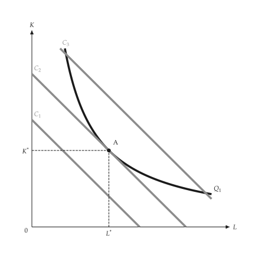{ .ev-figure-sm }

<div class="ev-downloads"><a class="ev-download" href="../../assets/micro-viz/cost_minimization/cost_minimization.py" download aria-label="Download the source"><svg viewBox="0 0 24 24" aria-hidden="true"><path d="M12 4v11m0 0-4.5-4.5M12 15l4.5-4.5M5 20h14" fill="none" stroke="currentColor" stroke-width="2" stroke-linecap="round" stroke-linejoin="round"/></svg><span>Download the source</span></a></div>

<figcaption markdown>*Cost minimization.* The cheapest bundle is where the isocost line touches the isoquant.</figcaption>

</figure>

<span id="fig-cost-minimization-input-price-change"></span>

<figure class="ev-fig" markdown>

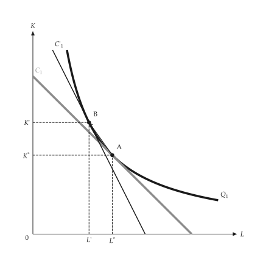{ .ev-figure-sm }

<div class="ev-downloads"><a class="ev-download" href="../../assets/micro-viz/cost_minimization/cost_minimization.py" download aria-label="Download the source"><svg viewBox="0 0 24 24" aria-hidden="true"><path d="M12 4v11m0 0-4.5-4.5M12 15l4.5-4.5M5 20h14" fill="none" stroke="currentColor" stroke-width="2" stroke-linecap="round" stroke-linejoin="round"/></svg><span>Download the source</span></a></div>

<figcaption markdown>*Dearer labor.* A dearer labour input steepens the isocost line; the new tangency uses less labour.</figcaption>

</figure>

<span id="fig-cost-minimization-technical-change"></span>

<figure class="ev-fig" markdown>

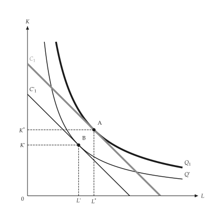{ .ev-figure-sm }

<div class="ev-downloads"><a class="ev-download" href="../../assets/micro-viz/cost_minimization/cost_minimization.py" download aria-label="Download the source"><svg viewBox="0 0 24 24" aria-hidden="true"><path d="M12 4v11m0 0-4.5-4.5M12 15l4.5-4.5M5 20h14" fill="none" stroke="currentColor" stroke-width="2" stroke-linecap="round" stroke-linejoin="round"/></svg><span>Download the source</span></a></div>

<figcaption markdown>*Technical change.* Technical change moves the isoquant inward and lowers cost.</figcaption>

</figure>

<span id="fig-cost-minimization-expansion-path"></span>

<figure class="ev-fig" markdown>

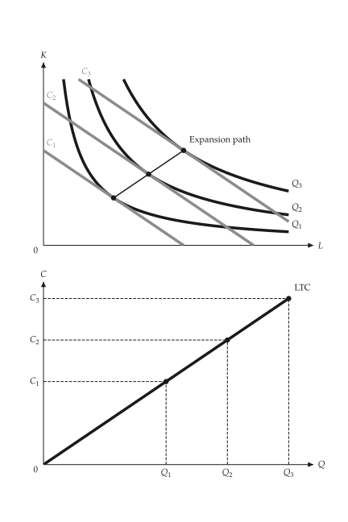{ .ev-figure-sm }

<div class="ev-downloads"><a class="ev-download" href="../../assets/micro-viz/cost_minimization/cost_minimization.py" download aria-label="Download the source"><svg viewBox="0 0 24 24" aria-hidden="true"><path d="M12 4v11m0 0-4.5-4.5M12 15l4.5-4.5M5 20h14" fill="none" stroke="currentColor" stroke-width="2" stroke-linecap="round" stroke-linejoin="round"/></svg><span>Download the source</span></a></div>

<figcaption markdown>*Expansion path.* The expansion path joins the tangencies and gives the long-run total cost curve.</figcaption>

</figure>

<span id="fig-cost-minimization-fixed-capital"></span>

<figure class="ev-fig" markdown>

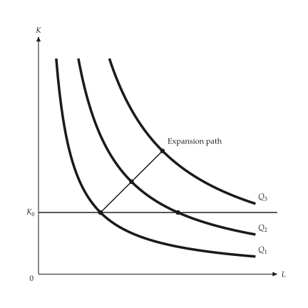{ .ev-figure-sm }

<div class="ev-downloads"><a class="ev-download" href="../../assets/micro-viz/cost_minimization/cost_minimization.py" download aria-label="Download the source"><svg viewBox="0 0 24 24" aria-hidden="true"><path d="M12 4v11m0 0-4.5-4.5M12 15l4.5-4.5M5 20h14" fill="none" stroke="currentColor" stroke-width="2" stroke-linecap="round" stroke-linejoin="round"/></svg><span>Download the source</span></a></div>

<figcaption markdown>*Fixed capital.* With capital fixed, output grows only along a horizontal line; the long-run path is cheaper.</figcaption>

</figure>

## Learning, scope and frontier

<span id="sec-ex-production-extensions"></span>

Learning lowers input per unit as cumulative output grows; scope, technology shifts and the production frontier extend the production model. Sources: [Wright (1936)](../project/references.md#wright1936), [Arrow (1962)](../project/references.md#arrow1962).

<!-- api: micro_viz.guides_inputs_11 -->

`LearningCurve` and `LearningAverageCost` give input and cost per unit against cumulative output; `ProductTransformation`, `TechnologyShift` and `ProductionFrontier` are the matching models.

<!-- api: micro_viz.guides_inputs_12 -->

Input per unit of output against cumulative output: it falls toward the floor `A`.

<!-- api: micro_viz.guides_inputs_13 -->

The product transformation curve `PT`; `reference` adds the straight line joining the two maxima (no gains from joint production) so the outward bow reads as economies of scope.

<!-- api: micro_viz.guides_inputs_14 -->

Production frontier with diminishing returns; interior points lie strictly below it (inefficient use of inputs). `names` labels the points in order.

<!-- api: micro_viz.guides_inputs_15 -->

Two average-cost curves: moving from `A` to `B` along `AC_1` is a gain from scale; the vertical shift from `B` onto `AC_2` (`C`) is learning.

<!-- api: micro_viz.guides_inputs_16 -->

Total-product curves shifted upward by better technology; the base curve is thick, the others thin and solid. `arrow_input` draws a vertical arrow from the base curve.

```python
def extension_examples(
    output_dir: Path,
    theme: PlotTheme,
    *,
    learning: LearningCurve,
    cumulative_max: float,
    cost: LearningAverageCost,
    learning_gain: float,
    scale_range: tuple[float, float],
    transformation: ProductTransformation,
    production: ShortRunProductionFunction,
    factors: tuple[float, ...],
    input_max: float,
    frontier: ProductionFrontier,
    point_names: tuple[str, ...],
    title: str | None = None,
) -> list[Path]:
    """Write the production-extension figures into ``output_dir`` and return their paths."""
    output_dir.mkdir(parents=True, exist_ok=True)
    figures = {
        "learning_curve.svg": learning_curve_canvas(
            learning, cumulative_max, theme=theme, title=title
        ),
        "scale_vs_learning.svg": scale_vs_learning_canvas(
            cost,
            learning_gain,
            scale_range[0],
            scale_range[1],
            theme=theme,
            title=title,
        ),
        "product_transformation.svg": product_transformation_canvas(
            transformation, theme=theme, title=title
        ),
        "technology_shift.svg": technology_shift_canvas(
            TechnologyShift(production, factors),
            input_max,
            input_max / 2,
            theme=theme,
            title=title,
        ),
        "production_frontier.svg": production_frontier_canvas(
            frontier,
            input_max,
            point_names,
            theme=theme,
            title=title,
        ),
    }
    paths = []
    for name, figure in figures.items():
        figure.save(output_dir / name)
        paths.append(output_dir / name)
    return paths
```

<span id="fig-production-extensions-learning-curve"></span>

<figure class="ev-fig" markdown>

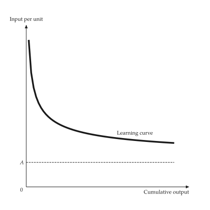{ .ev-figure-sm }

<div class="ev-downloads"><a class="ev-download" href="../../assets/micro-viz/production_extensions/production_extensions.py" download aria-label="Download the source"><svg viewBox="0 0 24 24" aria-hidden="true"><path d="M12 4v11m0 0-4.5-4.5M12 15l4.5-4.5M5 20h14" fill="none" stroke="currentColor" stroke-width="2" stroke-linecap="round" stroke-linejoin="round"/></svg><span>Download the source</span></a></div>

<figcaption markdown>*Learning curve.* Input per unit of output falls toward a floor as cumulative output grows.</figcaption>

</figure>

<span id="fig-production-extensions-scale-vs-learning"></span>

<figure class="ev-fig" markdown>

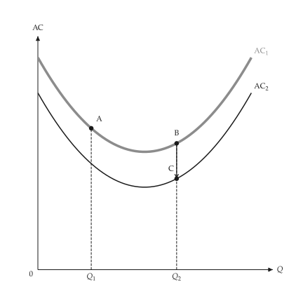{ .ev-figure-sm }

<div class="ev-downloads"><a class="ev-download" href="../../assets/micro-viz/production_extensions/production_extensions.py" download aria-label="Download the source"><svg viewBox="0 0 24 24" aria-hidden="true"><path d="M12 4v11m0 0-4.5-4.5M12 15l4.5-4.5M5 20h14" fill="none" stroke="currentColor" stroke-width="2" stroke-linecap="round" stroke-linejoin="round"/></svg><span>Download the source</span></a></div>

<figcaption markdown>*Scale versus learning.* Moving along an AC curve is scale; dropping to another AC curve is learning.</figcaption>

</figure>

<span id="fig-production-extensions-product-transformation"></span>

<figure class="ev-fig" markdown>

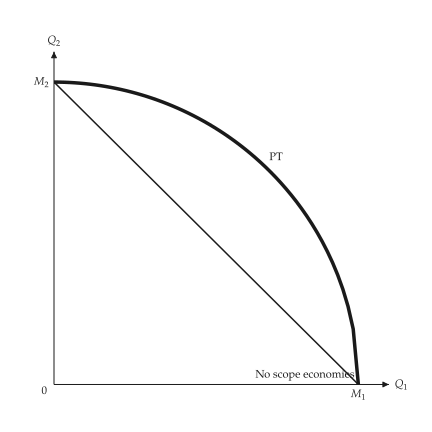{ .ev-figure-sm }

<div class="ev-downloads"><a class="ev-download" href="../../assets/micro-viz/production_extensions/production_extensions.py" download aria-label="Download the source"><svg viewBox="0 0 24 24" aria-hidden="true"><path d="M12 4v11m0 0-4.5-4.5M12 15l4.5-4.5M5 20h14" fill="none" stroke="currentColor" stroke-width="2" stroke-linecap="round" stroke-linejoin="round"/></svg><span>Download the source</span></a></div>

<figcaption markdown>*Product transformation curve.* A bowed-out transformation curve means economies of scope.</figcaption>

</figure>

<span id="fig-production-extensions-technology-shift"></span>

<figure class="ev-fig" markdown>

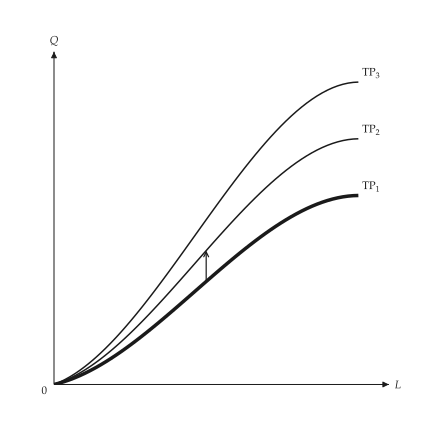{ .ev-figure-sm }

<div class="ev-downloads"><a class="ev-download" href="../../assets/micro-viz/production_extensions/production_extensions.py" download aria-label="Download the source"><svg viewBox="0 0 24 24" aria-hidden="true"><path d="M12 4v11m0 0-4.5-4.5M12 15l4.5-4.5M5 20h14" fill="none" stroke="currentColor" stroke-width="2" stroke-linecap="round" stroke-linejoin="round"/></svg><span>Download the source</span></a></div>

<figcaption markdown>*Technical progress.* Better technology shifts the total-product curve up.</figcaption>

</figure>

<span id="fig-production-extensions-production-frontier"></span>

<figure class="ev-fig" markdown>

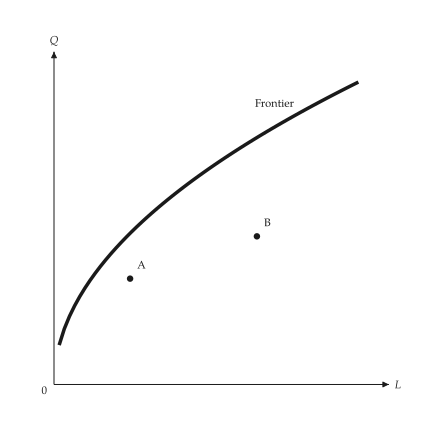{ .ev-figure-sm }

<div class="ev-downloads"><a class="ev-download" href="../../assets/micro-viz/production_extensions/production_extensions.py" download aria-label="Download the source"><svg viewBox="0 0 24 24" aria-hidden="true"><path d="M12 4v11m0 0-4.5-4.5M12 15l4.5-4.5M5 20h14" fill="none" stroke="currentColor" stroke-width="2" stroke-linecap="round" stroke-linejoin="round"/></svg><span>Download the source</span></a></div>

<figcaption markdown>*Production frontier.* Points below the frontier use inputs inefficiently.</figcaption>

</figure>

## Factor markets

<span id="sec-ex-factor-markets"></span>

A firm hires where MRP equals the factor price; the figures compare competitive and monopoly output markets, short and long run, and economic rent.

<!-- api: micro_viz.guides_inputs_17 -->

`LinearValue` is a marginal value product and `LinearSupply` a factor supply; `FactorMarket` solves the equilibrium, `DerivedDemand` compares VMP and MRP, and `LandMarket` has vertical supply.

<!-- api: micro_viz.guides_inputs_18 -->

MRP curves for increasing capital with one hiring point per curve at the matching entry of `wages` (a falling wage prompts the firm to add capital), joined by the demand locus.

<!-- api: micro_viz.guides_inputs_19 -->

`VMP` (competitive output market) above `MRP` (monopoly output market): both are the marginal product valued at the price, the monopolist's marginal revenue being lower.

<!-- api: micro_viz.guides_inputs_20 -->

Economic rent: the triangle between the market wage and the supply curve up to employment.

<!-- api: micro_viz.guides_inputs_21 -->

Labour-market equilibrium with a competitive output market (`MRP = VMP`) beside one with a monopoly output market (lower MRP: lower wage and employment).

<!-- api: micro_viz.guides_inputs_22 -->

A firm facing the flat supply `W*` hires where `MRP = W*`. With `lower_wage` the flat supply shifts down (a thin solid line) and hiring moves along the MRP curve.

<!-- api: micro_viz.guides_inputs_23 -->

A firm's demand beside the industry's: the right panel shows the horizontal sum of the firm demands (thin line) and the steeper industry demand through the same anchor point.

<!-- api: micro_viz.guides_inputs_24 -->

Vertical land supply at `supply` with demand setting the rent `R*`; the whole rectangle under the rent is economic rent.

<!-- api: micro_viz.guides_inputs_25 -->

Upward market supply of an input beside the flat supply one firm faces at the market wage.

<!-- api: micro_viz.guides_inputs_26 -->

Short- and long-run input demand through one point, the long run flatter.

```python
def factor_examples(
    output_dir: Path,
    theme: PlotTheme,
    *,
    product: LinearValue,
    price: float,
    mr_share: float,
    supply: LinearSupply,
    wage: float,
    lower_wage: float,
    firms: int,
    price_effect: float,
    capital: tuple[float, ...],
    wages: tuple[float, ...],
    land: tuple[float, float, float],
    title: str | None = None,
) -> list[Path]:
    """Write the factor-market figures into ``output_dir`` and return their paths."""
    output_dir.mkdir(parents=True, exist_ok=True)
    competitive = DerivedDemand(product, price)
    monopoly = DerivedDemand(product, price, mr_share)
    market = FactorMarket(competitive.demand, supply)
    anchor = market.equilibrium()
    firm = FactorMarket(competitive.demand, supply)
    industry = IndustryFactorDemand(
        competitive.demand, firms, price_effect
    )
    adjustment = InputAdjustment(
        anchor[0],
        anchor[1],
        competitive.demand.slope * 2,
        competitive.demand.slope / 2,
    )
    figures = {
        "derived_demand.svg": derived_demand_canvas(
            monopoly, theme=theme, title=title
        ),
        "firm_hiring.svg": firm_hiring_canvas(
            firm, wage, theme=theme, title=title
        ),
        "wage_decline.svg": firm_hiring_canvas(
            firm, wage, lower_wage, theme=theme, title=title
        ),
        "capital_adjustment.svg": capital_adjustment_canvas(
            CapitalAdjustment(competitive.demand, capital),
            wages,
            theme=theme,
            title=title,
        ),
        "industry_demand.svg": industry_factor_demand_canvas(
            industry, anchor[1], theme=theme
        ),
        "short_long_run.svg": short_long_run_canvas(
            adjustment,
            competitive.demand.intercept,
            theme=theme,
            title=title,
        ),
        "market_supply.svg": market_supply_canvas(
            market, theme=theme
        ),
        "factor_equilibrium.svg": factor_equilibrium_canvas(
            market,
            FactorMarket(monopoly.demand, supply),
            theme=theme,
        ),
        "economic_rent.svg": economic_rent_canvas(
            market, theme=theme, title=title
        ),
        "land_rent.svg": land_rent_canvas(
            LandMarket(LinearValue(land[0], land[1]), land[2]),
            theme=theme,
            title=title,
        ),
    }
    paths = []
    for name, figure in figures.items():
        figure.save(output_dir / name)
        paths.append(output_dir / name)
    return paths
```

<span id="fig-factor-markets-derived-demand"></span>

<figure class="ev-fig" markdown>

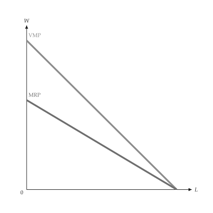{ .ev-figure-sm }

<div class="ev-downloads"><a class="ev-download" href="../../assets/micro-viz/factor_markets/factor_markets.py" download aria-label="Download the source"><svg viewBox="0 0 24 24" aria-hidden="true"><path d="M12 4v11m0 0-4.5-4.5M12 15l4.5-4.5M5 20h14" fill="none" stroke="currentColor" stroke-width="2" stroke-linecap="round" stroke-linejoin="round"/></svg><span>Download the source</span></a></div>

<figcaption markdown>*VMP and MRP.* VMP under a competitive output market lies above MRP under a monopoly output market.</figcaption>

</figure>

<span id="fig-factor-markets-firm-hiring"></span>

<figure class="ev-fig" markdown>

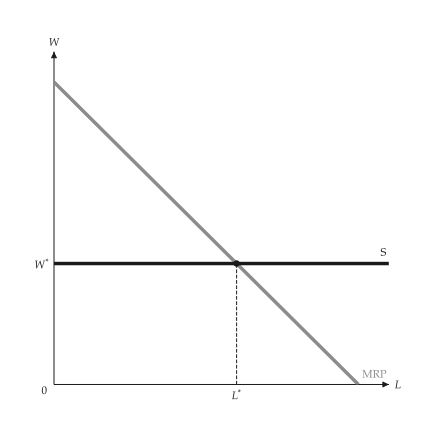{ .ev-figure-sm }

<div class="ev-downloads"><a class="ev-download" href="../../assets/micro-viz/factor_markets/factor_markets.py" download aria-label="Download the source"><svg viewBox="0 0 24 24" aria-hidden="true"><path d="M12 4v11m0 0-4.5-4.5M12 15l4.5-4.5M5 20h14" fill="none" stroke="currentColor" stroke-width="2" stroke-linecap="round" stroke-linejoin="round"/></svg><span>Download the source</span></a></div>

<figcaption markdown>*Firm hiring.* The firm faces a flat supply and hires where MRP = W.</figcaption>

</figure>

<span id="fig-factor-markets-wage-decline"></span>

<figure class="ev-fig" markdown>

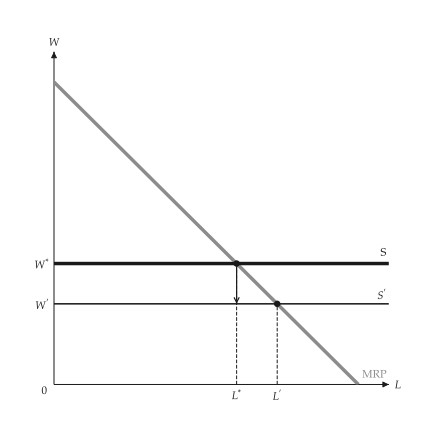{ .ev-figure-sm }

<div class="ev-downloads"><a class="ev-download" href="../../assets/micro-viz/factor_markets/factor_markets.py" download aria-label="Download the source"><svg viewBox="0 0 24 24" aria-hidden="true"><path d="M12 4v11m0 0-4.5-4.5M12 15l4.5-4.5M5 20h14" fill="none" stroke="currentColor" stroke-width="2" stroke-linecap="round" stroke-linejoin="round"/></svg><span>Download the source</span></a></div>

<figcaption markdown>*A lower market wage.* A lower wage shifts the flat supply down; hiring rises along MRP.</figcaption>

</figure>

<span id="fig-factor-markets-capital-adjustment"></span>

<figure class="ev-fig" markdown>

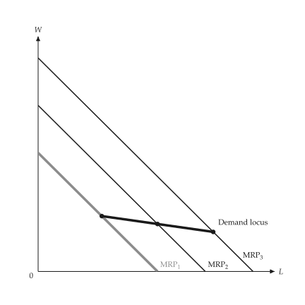{ .ev-figure-sm }

<div class="ev-downloads"><a class="ev-download" href="../../assets/micro-viz/factor_markets/factor_markets.py" download aria-label="Download the source"><svg viewBox="0 0 24 24" aria-hidden="true"><path d="M12 4v11m0 0-4.5-4.5M12 15l4.5-4.5M5 20h14" fill="none" stroke="currentColor" stroke-width="2" stroke-linecap="round" stroke-linejoin="round"/></svg><span>Download the source</span></a></div>

<figcaption markdown>*MRP as capital adjusts.* More capital shifts MRP right; the hiring points trace the long-run demand.</figcaption>

</figure>

<span id="fig-factor-markets-industry-demand"></span>

<figure class="ev-fig" markdown>

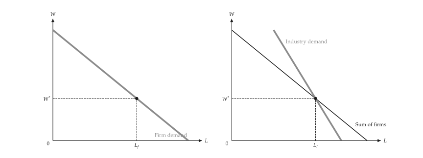{ .ev-figure-lg }

<div class="ev-downloads"><a class="ev-download" href="../../assets/micro-viz/factor_markets/factor_markets.py" download aria-label="Download the source"><svg viewBox="0 0 24 24" aria-hidden="true"><path d="M12 4v11m0 0-4.5-4.5M12 15l4.5-4.5M5 20h14" fill="none" stroke="currentColor" stroke-width="2" stroke-linecap="round" stroke-linejoin="round"/></svg><span>Download the source</span></a></div>

<figcaption markdown>*Firm and industry demand.* Industry demand is steeper than the horizontal sum of firm demands.</figcaption>

</figure>

<span id="fig-factor-markets-short-long-run"></span>

<figure class="ev-fig" markdown>

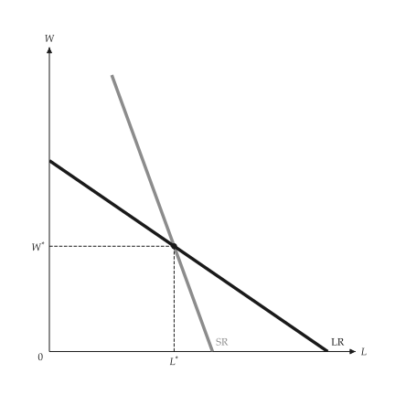{ .ev-figure-sm }

<div class="ev-downloads"><a class="ev-download" href="../../assets/micro-viz/factor_markets/factor_markets.py" download aria-label="Download the source"><svg viewBox="0 0 24 24" aria-hidden="true"><path d="M12 4v11m0 0-4.5-4.5M12 15l4.5-4.5M5 20h14" fill="none" stroke="currentColor" stroke-width="2" stroke-linecap="round" stroke-linejoin="round"/></svg><span>Download the source</span></a></div>

<figcaption markdown>*Short- and long-run input demand.* Long-run input demand is flatter than short-run demand.</figcaption>

</figure>

<span id="fig-factor-markets-market-supply"></span>

<figure class="ev-fig" markdown>

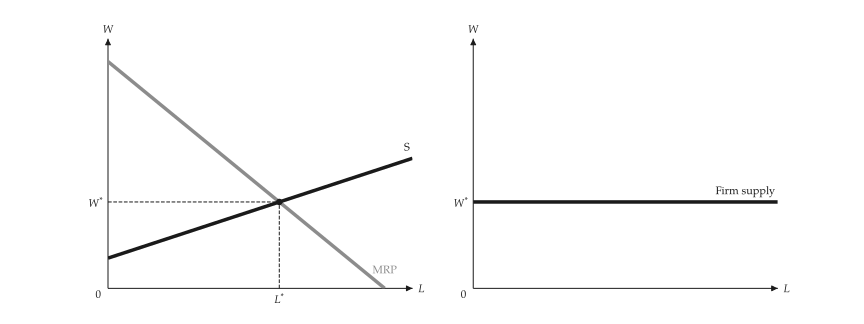{ .ev-figure-lg }

<div class="ev-downloads"><a class="ev-download" href="../../assets/micro-viz/factor_markets/factor_markets.py" download aria-label="Download the source"><svg viewBox="0 0 24 24" aria-hidden="true"><path d="M12 4v11m0 0-4.5-4.5M12 15l4.5-4.5M5 20h14" fill="none" stroke="currentColor" stroke-width="2" stroke-linecap="round" stroke-linejoin="round"/></svg><span>Download the source</span></a></div>

<figcaption markdown>*Market and firm supply.* Upward market supply beside the flat supply one firm faces.</figcaption>

</figure>

<span id="fig-factor-markets-factor-equilibrium"></span>

<figure class="ev-fig" markdown>

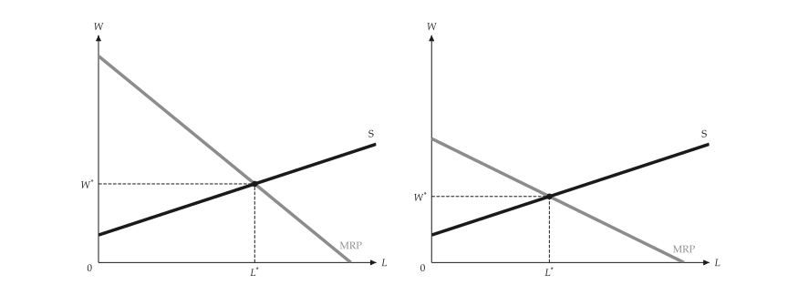{ .ev-figure-lg }

<div class="ev-downloads"><a class="ev-download" href="../../assets/micro-viz/factor_markets/factor_markets.py" download aria-label="Download the source"><svg viewBox="0 0 24 24" aria-hidden="true"><path d="M12 4v11m0 0-4.5-4.5M12 15l4.5-4.5M5 20h14" fill="none" stroke="currentColor" stroke-width="2" stroke-linecap="round" stroke-linejoin="round"/></svg><span>Download the source</span></a></div>

<figcaption markdown>*Factor-market equilibrium.* A monopoly output market lowers MRP, and with it the wage and employment.</figcaption>

</figure>

<span id="fig-factor-markets-economic-rent"></span>

<figure class="ev-fig" markdown>

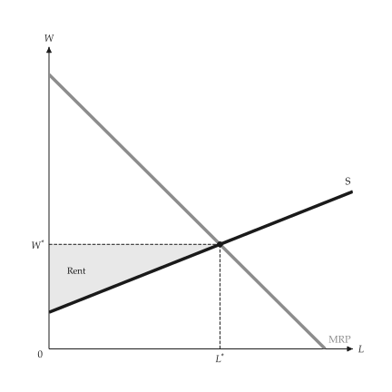{ .ev-figure-sm }

<div class="ev-downloads"><a class="ev-download" href="../../assets/micro-viz/factor_markets/factor_markets.py" download aria-label="Download the source"><svg viewBox="0 0 24 24" aria-hidden="true"><path d="M12 4v11m0 0-4.5-4.5M12 15l4.5-4.5M5 20h14" fill="none" stroke="currentColor" stroke-width="2" stroke-linecap="round" stroke-linejoin="round"/></svg><span>Download the source</span></a></div>

<figcaption markdown>*Economic rent of labor.* The area between the wage and the supply curve is the economic rent of labour.</figcaption>

</figure>

<span id="fig-factor-markets-land-rent"></span>

<figure class="ev-fig" markdown>

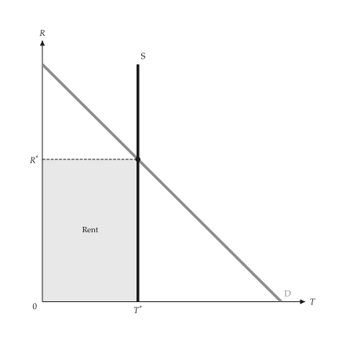{ .ev-figure-sm }

<div class="ev-downloads"><a class="ev-download" href="../../assets/micro-viz/factor_markets/factor_markets.py" download aria-label="Download the source"><svg viewBox="0 0 24 24" aria-hidden="true"><path d="M12 4v11m0 0-4.5-4.5M12 15l4.5-4.5M5 20h14" fill="none" stroke="currentColor" stroke-width="2" stroke-linecap="round" stroke-linejoin="round"/></svg><span>Download the source</span></a></div>

<figcaption markdown>*Land rent.* Land supply is vertical and demand sets the rent.</figcaption>

</figure>

## Monopsony and unions

<span id="sec-ex-monopsony"></span>

A single buyer hires where ME = MV and pays the supply price; a union picks a point on labour demand.

<!-- api: micro_viz.guides_inputs_27 -->

`Monopsonist` solves the buyer's choice and the deadweight loss; `UnionWageSetting` and `TwoSectorLabor` solve the union cases.

<!-- api: micro_viz.guides_inputs_28 -->

A competitive buyer (flat `ME = AE` at `price` against `MV`) beside a competitive seller (flat `MR = AR` at `price` against `MC`).

<!-- api: micro_viz.guides_inputs_29 -->

Monopoly (`AR`, `MR`, `MC`) beside monopsony (`MV`, `ME`, `AE`) built from the same pair of linear curves: the monopolist's demand is the value curve and its cost the supply curve.

<!-- api: micro_viz.guides_inputs_30 -->

Monopsony: the buyer hires where `ME = MV` (`MRP` for labour) and pays the supply price at that quantity, below the competitive quantity and price. `labor` switches the text to `L`, `W` and `MRP`.

<!-- api: micro_viz.guides_inputs_31 -->

Monopsony against the competitive outcome: the rectangle `A` is the transfer from sellers to the buyer and the triangles `B` and `C` (above and below the competitive price) together are the deadweight loss.

<!-- api: micro_viz.guides_inputs_32 -->

One monopsony panel per supply curve, on common axes: the flatter (more elastic) the supply, the closer `ME` lies to `AE`.

<!-- api: micro_viz.guides_inputs_33 -->

Two sectors: a union wage above the competitive wage `W_c` cuts employment in sector 1, the displaced workers crowd into sector 2 and lower its wage.

<!-- api: micro_viz.guides_inputs_34 -->

A union picks a point on the firm's labour demand: employment `L`, the wage-bill rectangle and the rent above members' supply price.

```python
def monopsony_examples(
    output_dir: Path,
    theme: PlotTheme,
    *,
    value: LinearValue,
    supply: LinearSupply,
    elastic: LinearSupply,
    inelastic: LinearSupply,
    price: float,
    sector_2: LinearValue,
    total: float,
    union_wage: float,
    title: str | None = None,
) -> list[Path]:
    """Write the monopsony figures into ``output_dir`` and return their paths."""
    output_dir.mkdir(parents=True, exist_ok=True)
    model = Monopsonist(supply, value)
    figures = {
        "competitive_pair.svg": competitive_pair_canvas(
            value, supply, price, theme=theme
        ),
        "monopsony.svg": monopsony_canvas(
            model, theme=theme, title=title
        ),
        "monopoly_monopsony.svg": monopoly_monopsony_pair_canvas(
            model, theme=theme
        ),
        "supply_elasticity.svg": supply_elasticity_canvas(
            value, (elastic, inelastic), theme=theme
        ),
        "monopsony_dwl.svg": monopsony_dwl_canvas(
            model, theme=theme, title=title
        ),
        "labor_monopsony.svg": monopsony_canvas(
            model, labor=True, theme=theme, title=title
        ),
        "union.svg": union_wage_canvas(
            UnionWageSetting(value, supply),
            theme=theme,
            title=title,
        ),
        "two_sector.svg": two_sector_labor_canvas(
            TwoSectorLabor(value, sector_2, total),
            union_wage,
            theme=theme,
        ),
    }
    paths = []
    for name, figure in figures.items():
        figure.save(output_dir / name)
        paths.append(output_dir / name)
    return paths
```

<span id="fig-monopsony-competitive-pair"></span>

<figure class="ev-fig" markdown>

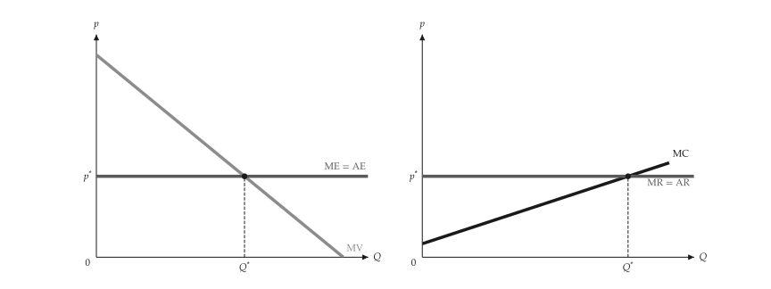{ .ev-figure-lg }

<div class="ev-downloads"><a class="ev-download" href="../../assets/micro-viz/monopsony/monopsony.py" download aria-label="Download the source"><svg viewBox="0 0 24 24" aria-hidden="true"><path d="M12 4v11m0 0-4.5-4.5M12 15l4.5-4.5M5 20h14" fill="none" stroke="currentColor" stroke-width="2" stroke-linecap="round" stroke-linejoin="round"/></svg><span>Download the source</span></a></div>

<figcaption markdown>*Competitive buyer and seller.* A competitive buyer faces a flat ME = AE; a competitive seller faces a flat MR = AR.</figcaption>

</figure>

<span id="fig-monopsony-monopsony"></span>

<figure class="ev-fig" markdown>

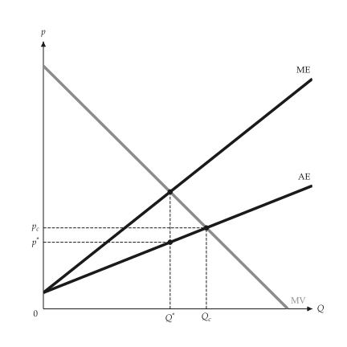{ .ev-figure-sm }

<div class="ev-downloads"><a class="ev-download" href="../../assets/micro-viz/monopsony/monopsony.py" download aria-label="Download the source"><svg viewBox="0 0 24 24" aria-hidden="true"><path d="M12 4v11m0 0-4.5-4.5M12 15l4.5-4.5M5 20h14" fill="none" stroke="currentColor" stroke-width="2" stroke-linecap="round" stroke-linejoin="round"/></svg><span>Download the source</span></a></div>

<figcaption markdown>*Monopsony.* The monopsonist buys where ME = MV and pays the price on AE.</figcaption>

</figure>

<span id="fig-monopsony-monopoly-monopsony"></span>

<figure class="ev-fig" markdown>

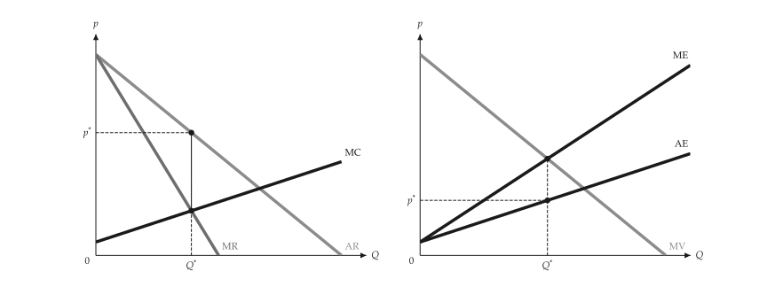{ .ev-figure-lg }

<div class="ev-downloads"><a class="ev-download" href="../../assets/micro-viz/monopsony/monopsony.py" download aria-label="Download the source"><svg viewBox="0 0 24 24" aria-hidden="true"><path d="M12 4v11m0 0-4.5-4.5M12 15l4.5-4.5M5 20h14" fill="none" stroke="currentColor" stroke-width="2" stroke-linecap="round" stroke-linejoin="round"/></svg><span>Download the source</span></a></div>

<figcaption markdown>*Monopoly and monopsony.* Monopoly (AR, MR, MC) beside monopsony (MV, ME, AE).</figcaption>

</figure>

<span id="fig-monopsony-supply-elasticity"></span>

<figure class="ev-fig" markdown>

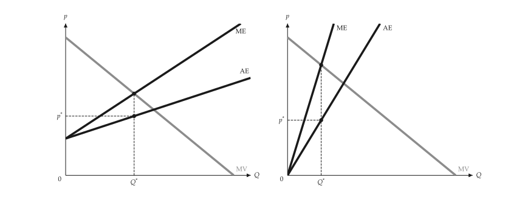{ .ev-figure-lg }

<div class="ev-downloads"><a class="ev-download" href="../../assets/micro-viz/monopsony/monopsony.py" download aria-label="Download the source"><svg viewBox="0 0 24 24" aria-hidden="true"><path d="M12 4v11m0 0-4.5-4.5M12 15l4.5-4.5M5 20h14" fill="none" stroke="currentColor" stroke-width="2" stroke-linecap="round" stroke-linejoin="round"/></svg><span>Download the source</span></a></div>

<figcaption markdown>*Supply elasticity.* The more elastic supply is, the closer ME lies to AE.</figcaption>

</figure>

<span id="fig-monopsony-monopsony-dwl"></span>

<figure class="ev-fig" markdown>

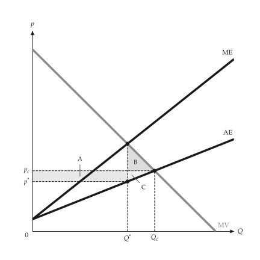{ .ev-figure-sm }

<div class="ev-downloads"><a class="ev-download" href="../../assets/micro-viz/monopsony/monopsony.py" download aria-label="Download the source"><svg viewBox="0 0 24 24" aria-hidden="true"><path d="M12 4v11m0 0-4.5-4.5M12 15l4.5-4.5M5 20h14" fill="none" stroke="currentColor" stroke-width="2" stroke-linecap="round" stroke-linejoin="round"/></svg><span>Download the source</span></a></div>

<figcaption markdown>*Monopsony deadweight loss.* The transfer rectangle A and the deadweight-loss triangles B and C.</figcaption>

</figure>

<span id="fig-monopsony-labor-monopsony"></span>

<figure class="ev-fig" markdown>

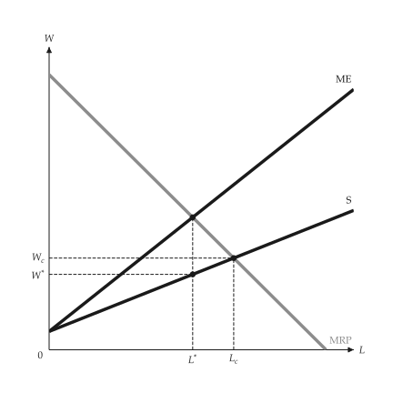{ .ev-figure-sm }

<div class="ev-downloads"><a class="ev-download" href="../../assets/micro-viz/monopsony/monopsony.py" download aria-label="Download the source"><svg viewBox="0 0 24 24" aria-hidden="true"><path d="M12 4v11m0 0-4.5-4.5M12 15l4.5-4.5M5 20h14" fill="none" stroke="currentColor" stroke-width="2" stroke-linecap="round" stroke-linejoin="round"/></svg><span>Download the source</span></a></div>

<figcaption markdown>*Labor monopsony.* In the labour market both employment and the wage fall below the competitive level.</figcaption>

</figure>

<span id="fig-monopsony-union"></span>

<figure class="ev-fig" markdown>

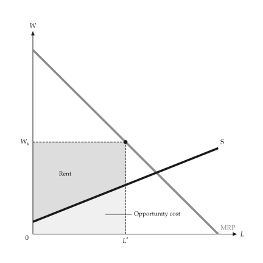{ .ev-figure-sm }

<div class="ev-downloads"><a class="ev-download" href="../../assets/micro-viz/monopsony/monopsony.py" download aria-label="Download the source"><svg viewBox="0 0 24 24" aria-hidden="true"><path d="M12 4v11m0 0-4.5-4.5M12 15l4.5-4.5M5 20h14" fill="none" stroke="currentColor" stroke-width="2" stroke-linecap="round" stroke-linejoin="round"/></svg><span>Download the source</span></a></div>

<figcaption markdown>*Union wage setting.* A union picks a point on labour demand: employment, rent and opportunity cost.</figcaption>

</figure>

<span id="fig-monopsony-two-sector"></span>

<figure class="ev-fig" markdown>

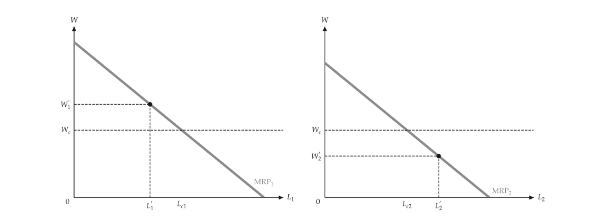{ .ev-figure-lg }

<div class="ev-downloads"><a class="ev-download" href="../../assets/micro-viz/monopsony/monopsony.py" download aria-label="Download the source"><svg viewBox="0 0 24 24" aria-hidden="true"><path d="M12 4v11m0 0-4.5-4.5M12 15l4.5-4.5M5 20h14" fill="none" stroke="currentColor" stroke-width="2" stroke-linecap="round" stroke-linejoin="round"/></svg><span>Download the source</span></a></div>

<figcaption markdown>*Two-sector labor market.* A union wage cuts employment in sector 1; displaced workers lower the wage in sector 2.</figcaption>

</figure>
