# Monopoly and pricing

<span id="sec-monopoly"></span>

Each section is one example script and the figures it draws. The scripts come in the examples archive; `--help` lists their arguments.

## Monopoly

<span id="sec-ex-monopoly"></span>

The monopolist produces where MR = MC and reads the price off demand. Totals, taxes, demand shifts, several plants and the Lerner index are variations on that figure. Sources: [Lerner (1934)](../project/references.md#lerner1934).

<!-- api: micro_viz.guides_monopoly_1 -->

`Monopolist.solve()` returns a `MonopolyOutcome` with the output, price and profit; `MultiplantMonopoly` splits output across plants; `elasticity()` is the price elasticity of linear demand.

<!-- api: micro_viz.guides_monopoly_2 -->

One panel per demand: a brace on `p - MC` shows the markup, small with elastic demand and large with inelastic demand (the Lerner index is `1 / |e|`).

<!-- api: micro_viz.guides_monopoly_3 -->

The monopolist: demand `D` (= AR), `MR`, and the cost curves in `curves`.

<!-- api: micro_viz.guides_monopoly_4 -->

Demand moves (thin solid `D'` and `MR'`): a parallel shift or, with `rotate`, a change of slope around the quantity-axis end. A monopolist has no supply curve, so the same price can go with different outputs, and the new optimum is read off `MR' = MC`.

<!-- api: micro_viz.guides_monopoly_5 -->

Monopoly against the competitive outcome `p = MC`: a transfer rectangle and the deadweight-loss triangle between demand and MC from `Q_m` to `Q_c`.

<!-- api: micro_viz.guides_monopoly_6 -->

A per-unit tax lifts MC (thin solid `MC'`); the arrow rises from the old MC at `Q_m` to the new one and the price moves from `p_m` to `p'`.

<!-- api: micro_viz.guides_monopoly_7 -->

Total revenue `R`, total cost `TC` and profit against output, with the maximum profit at `Q_m` where the slopes of `R` and `TC` are equal.

<!-- api: micro_viz.guides_monopoly_8 -->

Totals above, unit curves with the profit rectangle below, sharing the optimum `Q_m`.

<!-- api: micro_viz.guides_monopoly_9 -->

Each plant's MC beside the horizontally summed `MC_T` against `D` and `MR`.

```python
def monopoly_examples(
    output_dir: Path,
    theme: PlotTheme,
    *,
    demand: LinearDemand,
    shifted: LinearDemand,
    rotated: LinearDemand,
    cost: CubicCost,
    plants: tuple[CubicCost, CubicCost],
    plant_demand: LinearDemand,
    elastic: LinearDemand,
    inelastic: LinearDemand,
    tax: float,
    lost_profit: tuple[float, float],
    min_output: float,
    max_output: float,
    samples: int,
    title: str | None = None,
) -> list[Path]:
    """Write the monopoly figures into ``output_dir`` and return their paths."""
    output_dir.mkdir(parents=True, exist_ok=True)
    window = (min_output, max_output)

    unit = analyze_costs(
        cost, output_range=window, samples=samples
    )
    firm = Monopolist(demand, cost)
    outcome = firm.solve()
    taxed_cost = cost.with_unit_tax(tax)
    taxed = analyze_costs(
        taxed_cost, output_range=window, samples=samples
    )
    taxed_outcome = Monopolist(demand, taxed_cost).solve()
    shifted_outcome = firm.with_demand(shifted).solve()
    rotated_outcome = firm.with_demand(rotated).solve()
    multi = MultiplantMonopoly(plant_demand, plants)
    elastic_outcome = Monopolist(elastic, cost).solve()
    inelastic_outcome = Monopolist(inelastic, cost).solve()
    figures = {
        "monopoly.svg": monopoly_canvas(
            outcome,
            unit,
            curves=("mc",),
            title=title,
            theme=theme,
        ),
        "monopoly_lost_profit.svg": monopoly_canvas(
            outcome,
            unit,
            curves=("mc",),
            lost_profit=lost_profit,
            title=title,
            theme=theme,
        ),
        "monopoly_profit.svg": monopoly_canvas(
            outcome, unit, profit=True, title=title, theme=theme
        ),
        "monopoly_totals.svg": monopoly_totals_canvas(
            outcome,
            output_range=window,
            title=title,
            theme=theme,
        ),
        "monopoly_totals_grid.svg": monopoly_totals_grid(
            outcome, unit, theme=theme
        ),
        "monopoly_dwl.svg": monopoly_dwl_canvas(
            outcome, unit, title=title, theme=theme
        ),
        "monopoly_tax.svg": monopoly_tax_canvas(
            outcome,
            taxed_outcome,
            unit,
            taxed,
            title=title,
            theme=theme,
        ),
        "monopoly_demand_shift.svg": monopoly_demand_shift_canvas(
            outcome,
            shifted_outcome,
            unit,
            title=title,
            theme=theme,
        ),
        "monopoly_demand_rotate.svg": monopoly_demand_shift_canvas(
            outcome,
            rotated_outcome,
            unit,
            rotate=True,
            title=title,
            theme=theme,
        ),
        "multiplant.svg": multiplant_canvas(
            multi, multi.solve(), theme=theme
        ),
        "lerner_markup.svg": lerner_markup_canvas(
            (elastic_outcome, inelastic_outcome),
            (unit, unit),
            theme=theme,
        ),
    }
    paths = []
    for name, figure in figures.items():
        figure.save(output_dir / name)
        paths.append(output_dir / name)
    return paths
```

<span id="fig-monopoly-monopoly"></span>

<figure class="ev-fig" markdown>

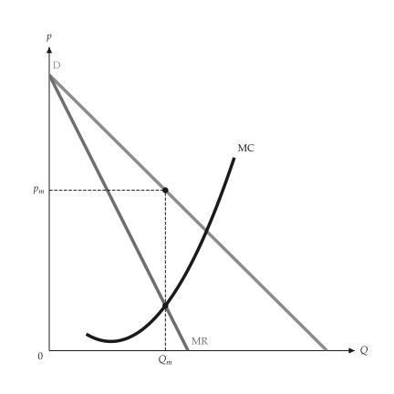{ .ev-figure-sm }

<div class="ev-downloads"><a class="ev-download" href="../../assets/micro-viz/monopoly/monopoly.py" download aria-label="Download the source"><svg viewBox="0 0 24 24" aria-hidden="true"><path d="M12 4v11m0 0-4.5-4.5M12 15l4.5-4.5M5 20h14" fill="none" stroke="currentColor" stroke-width="2" stroke-linecap="round" stroke-linejoin="round"/></svg><span>Download the source</span></a></div>

<figcaption markdown>*Monopoly: MR = MC.* The monopolist produces where MR = MC and the price is read off demand.</figcaption>

</figure>

<span id="fig-monopoly-monopoly-lost-profit"></span>

<figure class="ev-fig" markdown>

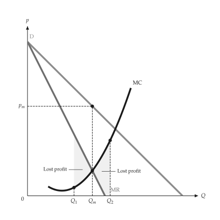{ .ev-figure-sm }

<div class="ev-downloads"><a class="ev-download" href="../../assets/micro-viz/monopoly/monopoly.py" download aria-label="Download the source"><svg viewBox="0 0 24 24" aria-hidden="true"><path d="M12 4v11m0 0-4.5-4.5M12 15l4.5-4.5M5 20h14" fill="none" stroke="currentColor" stroke-width="2" stroke-linecap="round" stroke-linejoin="round"/></svg><span>Download the source</span></a></div>

<figcaption markdown>*Monopoly: profit lost off the optimum.* Any output other than the one where MR = MC lowers profit.</figcaption>

</figure>

<span id="fig-monopoly-monopoly-profit"></span>

<figure class="ev-fig" markdown>

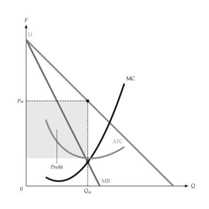{ .ev-figure-sm }

<div class="ev-downloads"><a class="ev-download" href="../../assets/micro-viz/monopoly/monopoly.py" download aria-label="Download the source"><svg viewBox="0 0 24 24" aria-hidden="true"><path d="M12 4v11m0 0-4.5-4.5M12 15l4.5-4.5M5 20h14" fill="none" stroke="currentColor" stroke-width="2" stroke-linecap="round" stroke-linejoin="round"/></svg><span>Download the source</span></a></div>

<figcaption markdown>*Monopoly profit.* Profit is the rectangle between the price and ATC.</figcaption>

</figure>

<span id="fig-monopoly-monopoly-totals"></span>

<figure class="ev-fig" markdown>

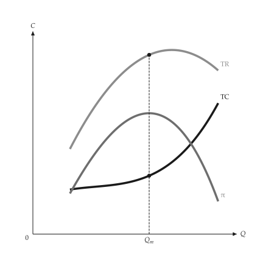{ .ev-figure-sm }

<div class="ev-downloads"><a class="ev-download" href="../../assets/micro-viz/monopoly/monopoly.py" download aria-label="Download the source"><svg viewBox="0 0 24 24" aria-hidden="true"><path d="M12 4v11m0 0-4.5-4.5M12 15l4.5-4.5M5 20h14" fill="none" stroke="currentColor" stroke-width="2" stroke-linecap="round" stroke-linejoin="round"/></svg><span>Download the source</span></a></div>

<figcaption markdown>*Revenue, cost and profit.* TR, TC and profit; the slopes are equal where profit is largest.</figcaption>

</figure>

<span id="fig-monopoly-monopoly-totals-grid"></span>

<figure class="ev-fig" markdown>

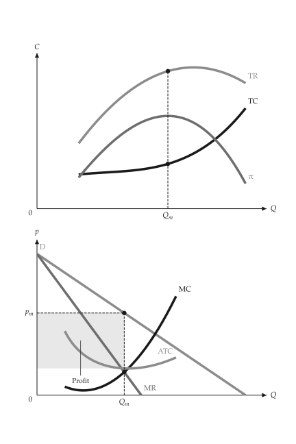{ .ev-figure-sm }

<div class="ev-downloads"><a class="ev-download" href="../../assets/micro-viz/monopoly/monopoly.py" download aria-label="Download the source"><svg viewBox="0 0 24 24" aria-hidden="true"><path d="M12 4v11m0 0-4.5-4.5M12 15l4.5-4.5M5 20h14" fill="none" stroke="currentColor" stroke-width="2" stroke-linecap="round" stroke-linejoin="round"/></svg><span>Download the source</span></a></div>

<figcaption markdown>*Totals and unit curves.* Totals above, unit curves with the profit rectangle below.</figcaption>

</figure>

<span id="fig-monopoly-monopoly-dwl"></span>

<figure class="ev-fig" markdown>

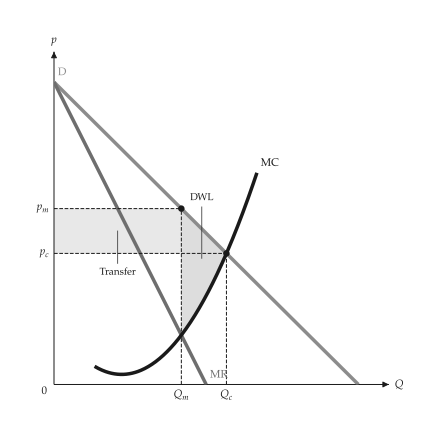{ .ev-figure-sm }

<div class="ev-downloads"><a class="ev-download" href="../../assets/micro-viz/monopoly/monopoly.py" download aria-label="Download the source"><svg viewBox="0 0 24 24" aria-hidden="true"><path d="M12 4v11m0 0-4.5-4.5M12 15l4.5-4.5M5 20h14" fill="none" stroke="currentColor" stroke-width="2" stroke-linecap="round" stroke-linejoin="round"/></svg><span>Download the source</span></a></div>

<figcaption markdown>*Deadweight loss of monopoly.* The transfer rectangle and deadweight-loss triangle against perfect competition.</figcaption>

</figure>

<span id="fig-monopoly-monopoly-tax"></span>

<figure class="ev-fig" markdown>

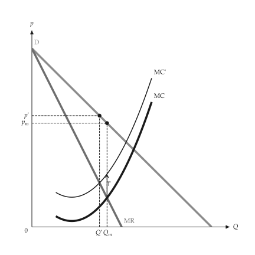{ .ev-figure-sm }

<div class="ev-downloads"><a class="ev-download" href="../../assets/micro-viz/monopoly/monopoly.py" download aria-label="Download the source"><svg viewBox="0 0 24 24" aria-hidden="true"><path d="M12 4v11m0 0-4.5-4.5M12 15l4.5-4.5M5 20h14" fill="none" stroke="currentColor" stroke-width="2" stroke-linecap="round" stroke-linejoin="round"/></svg><span>Download the source</span></a></div>

<figcaption markdown>*Per-unit tax on a monopolist.* A per-unit tax lifts MC; price and output adjust.</figcaption>

</figure>

<span id="fig-monopoly-monopoly-demand-shift"></span>

<figure class="ev-fig" markdown>

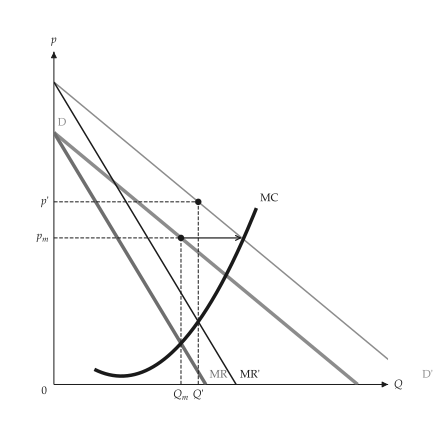{ .ev-figure-sm }

<div class="ev-downloads"><a class="ev-download" href="../../assets/micro-viz/monopoly/monopoly.py" download aria-label="Download the source"><svg viewBox="0 0 24 24" aria-hidden="true"><path d="M12 4v11m0 0-4.5-4.5M12 15l4.5-4.5M5 20h14" fill="none" stroke="currentColor" stroke-width="2" stroke-linecap="round" stroke-linejoin="round"/></svg><span>Download the source</span></a></div>

<figcaption markdown>*Demand shift.* A parallel demand shift; a monopolist has no supply curve, so output and price follow MR' = MC.</figcaption>

</figure>

<span id="fig-monopoly-monopoly-demand-rotate"></span>

<figure class="ev-fig" markdown>

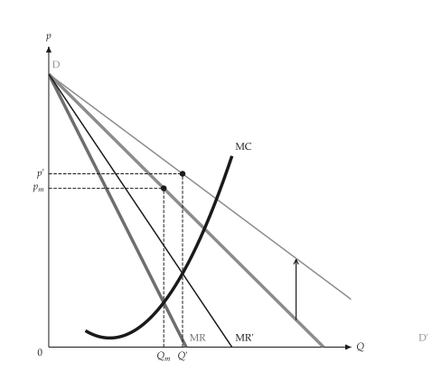{ .ev-figure-sm }

<div class="ev-downloads"><a class="ev-download" href="../../assets/micro-viz/monopoly/monopoly.py" download aria-label="Download the source"><svg viewBox="0 0 24 24" aria-hidden="true"><path d="M12 4v11m0 0-4.5-4.5M12 15l4.5-4.5M5 20h14" fill="none" stroke="currentColor" stroke-width="2" stroke-linecap="round" stroke-linejoin="round"/></svg><span>Download the source</span></a></div>

<figcaption markdown>*Demand rotation.* When demand rotates, the direction of the price change depends on how.</figcaption>

</figure>

<span id="fig-monopoly-multiplant"></span>

<figure class="ev-fig" markdown>

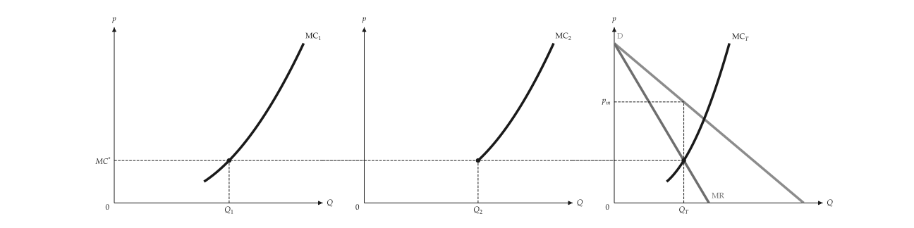{ .ev-figure-lg }

<div class="ev-downloads"><a class="ev-download" href="../../assets/micro-viz/monopoly/monopoly.py" download aria-label="Download the source"><svg viewBox="0 0 24 24" aria-hidden="true"><path d="M12 4v11m0 0-4.5-4.5M12 15l4.5-4.5M5 20h14" fill="none" stroke="currentColor" stroke-width="2" stroke-linecap="round" stroke-linejoin="round"/></svg><span>Download the source</span></a></div>

<figcaption markdown>*Multiplant monopoly.* The plants' MC curves sum horizontally and meet MR, which fixes each plant's output.</figcaption>

</figure>

<span id="fig-monopoly-lerner-markup"></span>

<figure class="ev-fig" markdown>

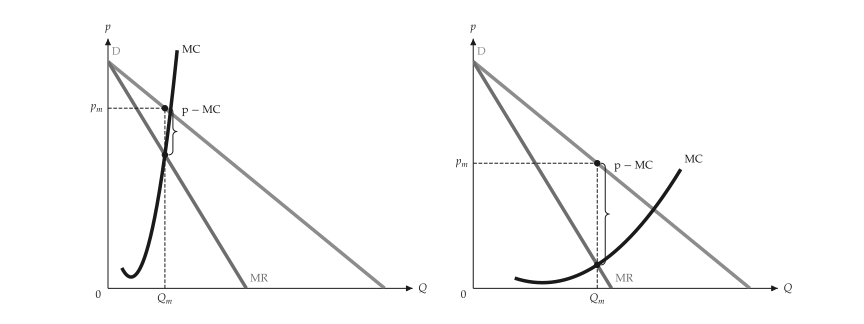{ .ev-figure-lg }

<div class="ev-downloads"><a class="ev-download" href="../../assets/micro-viz/monopoly/monopoly.py" download aria-label="Download the source"><svg viewBox="0 0 24 24" aria-hidden="true"><path d="M12 4v11m0 0-4.5-4.5M12 15l4.5-4.5M5 20h14" fill="none" stroke="currentColor" stroke-width="2" stroke-linecap="round" stroke-linejoin="round"/></svg><span>Download the source</span></a></div>

<figcaption markdown>*Lerner markup.* The less elastic demand is, the larger the markup (p - MC).</figcaption>

</figure>

## Monopolistic competition

<span id="sec-ex-monopolistic-competition"></span>

Each firm faces a downward demand. Entry shifts demand left until it is tangent to ATC, leaving the price above MC and capacity unused. Sources: [Chamberlin (1933)](../project/references.md#chamberlin1933).

<!-- api: micro_viz.guides_monopoly_10 -->

`solve_monopolistic_competition()` returns the short-run optimum and the long-run tangency after entry; `long_run_demand()` builds the demand curve of equal slope that is tangent to ATC.

<!-- api: micro_viz.guides_monopoly_11 -->

Monopolistic competition (price above MC, excess capacity) beside perfect competition (`p = MC` at minimum ATC).

<!-- api: micro_viz.guides_monopoly_12 -->

The long run: demand tangent to ATC at the output where `MR = MC`, price above MC.

<!-- api: micro_viz.guides_monopoly_13 -->

The short run: the monopoly optimum with the profit rectangle before entry.

```python
def monopolistic_examples(
    output_dir: Path,
    theme: PlotTheme,
    *,
    cost: CubicCost,
    demand: LinearDemand,
    min_output: float,
    max_output: float,
    samples: int,
    title: str | None = None,
) -> list[Path]:
    """Write the monopolistic-competition figures into ``output_dir``."""
    output_dir.mkdir(parents=True, exist_ok=True)
    unit = analyze_costs(
        cost,
        output_range=(min_output, max_output),
        samples=samples,
    )
    outcome = solve_monopolistic_competition(demand, cost)
    figures = {
        "short_run.svg": monopolistic_short_run_canvas(
            outcome, unit, theme=theme, title=title
        ),
        "long_run.svg": monopolistic_long_run_canvas(
            outcome, unit, theme=theme, title=title
        ),
        "excess_capacity.svg": excess_capacity_grid(
            outcome, unit, theme=theme
        ),
    }
    paths = []
    for name, figure in figures.items():
        figure.save(output_dir / name)
        paths.append(output_dir / name)
    return paths
```

<span id="fig-monopolistic-competition-short-run"></span>

<figure class="ev-fig" markdown>

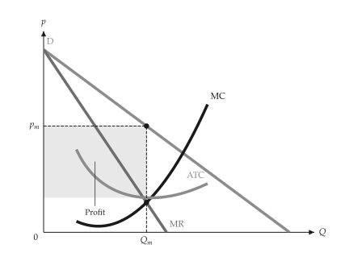{ .ev-figure-sm }

<div class="ev-downloads"><a class="ev-download" href="../../assets/micro-viz/monopolistic_competition/monopolistic_competition.py" download aria-label="Download the source"><svg viewBox="0 0 24 24" aria-hidden="true"><path d="M12 4v11m0 0-4.5-4.5M12 15l4.5-4.5M5 20h14" fill="none" stroke="currentColor" stroke-width="2" stroke-linecap="round" stroke-linejoin="round"/></svg><span>Download the source</span></a></div>

<figcaption markdown>*Short run.* In the short run there is a profit: output times the gap between price and ATC.</figcaption>

</figure>

<span id="fig-monopolistic-competition-long-run"></span>

<figure class="ev-fig" markdown>

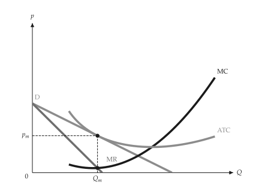{ .ev-figure-sm }

<div class="ev-downloads"><a class="ev-download" href="../../assets/micro-viz/monopolistic_competition/monopolistic_competition.py" download aria-label="Download the source"><svg viewBox="0 0 24 24" aria-hidden="true"><path d="M12 4v11m0 0-4.5-4.5M12 15l4.5-4.5M5 20h14" fill="none" stroke="currentColor" stroke-width="2" stroke-linecap="round" stroke-linejoin="round"/></svg><span>Download the source</span></a></div>

<figcaption markdown>*Long-run tangency.* Long-run equilibrium: demand is tangent to ATC at the output where MR = MC, with the price above MC.</figcaption>

</figure>

<span id="fig-monopolistic-competition-excess-capacity"></span>

<figure class="ev-fig" markdown>

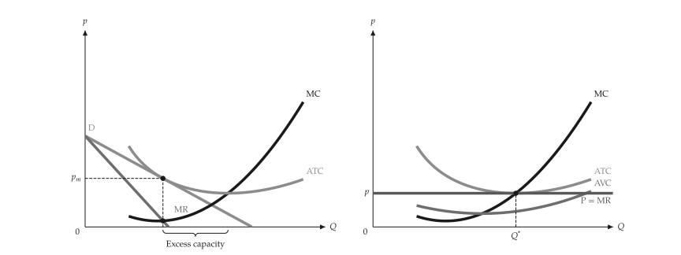{ .ev-figure-lg }

<div class="ev-downloads"><a class="ev-download" href="../../assets/micro-viz/monopolistic_competition/monopolistic_competition.py" download aria-label="Download the source"><svg viewBox="0 0 24 24" aria-hidden="true"><path d="M12 4v11m0 0-4.5-4.5M12 15l4.5-4.5M5 20h14" fill="none" stroke="currentColor" stroke-width="2" stroke-linecap="round" stroke-linejoin="round"/></svg><span>Download the source</span></a></div>

<figcaption markdown>*Excess capacity.* Output falls short of the lowest-ATC output; the gap is excess capacity.</figcaption>

</figure>

## Regulation

<span id="sec-ex-regulation"></span>

A price ceiling flattens a monopolist's average revenue; a natural monopoly with falling ATC compares unregulated, marginal-cost and average-cost pricing.

<!-- api: micro_viz.guides_monopoly_14 -->

`price_ceiling_outcome()` finds the best output under a ceiling; `natural_monopoly_pricing()` returns the three prices as `PricingPoint` values.

<!-- api: micro_viz.guides_monopoly_15 -->

A natural monopoly with falling ATC: the unregulated price, `P = MC` (with the loss shaded) and `P = ATC` (no profit).

<!-- api: micro_viz.guides_monopoly_16 -->

A price ceiling: average revenue is flat at the ceiling up to `Q_max` and marginal revenue equals the ceiling there, then jumps down to the unregulated `MR`.

```python
def regulation_examples(
    output_dir: Path,
    theme: PlotTheme,
    *,
    cost: CubicCost,
    demand: LinearDemand,
    ceiling: float,
    natural_demand: LinearDemand,
    fixed_cost: float,
    marginal_cost: float,
    min_output: float,
    max_output: float,
    samples: int,
    title: str | None = None,
) -> list[Path]:
    """Write the regulation figures into ``output_dir`` and return their paths."""
    output_dir.mkdir(parents=True, exist_ok=True)
    unit = analyze_costs(
        cost,
        output_range=(min_output, max_output),
        samples=samples,
    )
    capped = price_ceiling_outcome(
        Monopolist(demand, cost), ceiling
    )
    natural_cost = PiecewiseCost(
        (
            CostSegment(
                natural_demand.quantity_intercept * 1.05,
                marginal_cost,
            ),
        ),
        fixed_cost=fixed_cost,
    )
    natural = analyze_costs(
        natural_cost,
        output_range=(
            min_output,
            natural_demand.quantity_intercept,
        ),
        samples=samples,
    )
    pricing = natural_monopoly_pricing(
        Monopolist(natural_demand, natural_cost)
    )
    figures = {
        "price_ceiling.svg": price_ceiling_canvas(
            capped, unit, theme=theme, title=title
        ),
        "natural_monopoly.svg": natural_monopoly_canvas(
            pricing, natural, theme=theme, title=title
        ),
    }
    paths = []
    for name, figure in figures.items():
        figure.save(output_dir / name)
        paths.append(output_dir / name)
    return paths
```

<span id="fig-regulation-price-ceiling"></span>

<figure class="ev-fig" markdown>

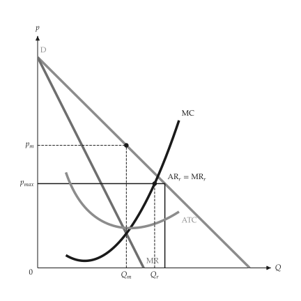{ .ev-figure-sm }

<div class="ev-downloads"><a class="ev-download" href="../../assets/micro-viz/regulation/regulation.py" download aria-label="Download the source"><svg viewBox="0 0 24 24" aria-hidden="true"><path d="M12 4v11m0 0-4.5-4.5M12 15l4.5-4.5M5 20h14" fill="none" stroke="currentColor" stroke-width="2" stroke-linecap="round" stroke-linejoin="round"/></svg><span>Download the source</span></a></div>

<figcaption markdown>*Price ceiling on a monopolist.* A price ceiling flattens average revenue at the ceiling; marginal revenue drops at that point.</figcaption>

</figure>

<span id="fig-regulation-natural-monopoly"></span>

<figure class="ev-fig" markdown>

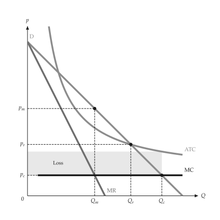{ .ev-figure-sm }

<div class="ev-downloads"><a class="ev-download" href="../../assets/micro-viz/regulation/regulation.py" download aria-label="Download the source"><svg viewBox="0 0 24 24" aria-hidden="true"><path d="M12 4v11m0 0-4.5-4.5M12 15l4.5-4.5M5 20h14" fill="none" stroke="currentColor" stroke-width="2" stroke-linecap="round" stroke-linejoin="round"/></svg><span>Download the source</span></a></div>

<figcaption markdown>*Natural monopoly pricing.* The unregulated price, marginal-cost pricing (a loss) and average-cost pricing.</figcaption>

</figure>

## Price discrimination

<span id="sec-ex-price-discrimination"></span>

Perfect, block and third-degree discrimination, against the single monopoly price.

<!-- api: micro_viz.guides_monopoly_17 -->

The functions `first_degree()`, `block_pricing()` and `third_degree()` return the matching outcome objects with the quantities, prices and profit.

<!-- api: micro_viz.guides_monopoly_18 -->

Equal blocks each sold at the price of its last buyer: a staircase under demand ending at `D = MC`. `average_cost` adds the (declining) ATC of the cost function.

<!-- api: micro_viz.guides_monopoly_19 -->

Perfect discrimination: price follows demand to `D = MC`; the profit is the area between demand and MC, with the extra gain over the single monopoly price shaded darker.

<!-- api: micro_viz.guides_monopoly_20 -->

One monopoly price (`MR = MC`): the consumer surplus above it and the surplus left uncaptured between demand and MC beyond `Q^*`; `groups` also marks the buyers who pay far less than they would and those who are priced out.

<!-- api: micro_viz.guides_monopoly_21 -->

One panel per market (`D_i`, `MR_i`, the common level `MC*`) and a last panel with the summed `MR_T` meeting MC. A market whose demand starts below `MC*` is not served.

```python
def discrimination_examples(
    output_dir: Path,
    theme: PlotTheme,
    *,
    demand: LinearDemand,
    marginal_cost: float,
    fixed_cost: float,
    blocks: int,
    markets: tuple[LinearDemand, ...],
    skipped_market: LinearDemand,
    rising_cost: CubicCost,
    capacity: float,
    title: str | None = None,
) -> list[Path]:
    """Write the price-discrimination figures into ``output_dir``."""
    output_dir.mkdir(parents=True, exist_ok=True)
    flat: CostFunction = PiecewiseCost(
        (CostSegment(capacity, marginal_cost),)
    )
    with_fixed = PiecewiseCost(
        (CostSegment(capacity, marginal_cost),),
        fixed_cost=fixed_cost,
    )
    figures = {
        "single_price.svg": single_price_canvas(
            demand, flat, groups=True, theme=theme, title=title
        ),
        "first_degree.svg": first_degree_canvas(
            first_degree(demand, flat), theme=theme, title=title
        ),
        "block_pricing_three.svg": block_pricing_canvas(
            block_pricing(demand, flat, 3),
            theme=theme,
            title=title,
        ),
        "block_pricing.svg": block_pricing_canvas(
            block_pricing(demand, with_fixed, blocks),
            average_cost=True,
            theme=theme,
            title=title,
        ),
        "third_degree.svg": third_degree_canvas(
            third_degree(markets, flat), theme=theme
        ),
        "third_degree_corner.svg": third_degree_canvas(
            third_degree(
                (markets[0], skipped_market), rising_cost
            ),
            theme=theme,
        ),
    }
    paths = []
    for name, figure in figures.items():
        figure.save(output_dir / name)
        paths.append(output_dir / name)
    return paths
```

<span id="fig-price-discrimination-single-price"></span>

<figure class="ev-fig" markdown>

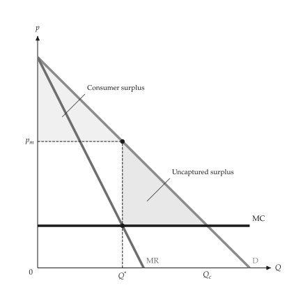{ .ev-figure-sm }

<div class="ev-downloads"><a class="ev-download" href="../../assets/micro-viz/price_discrimination/price_discrimination.py" download aria-label="Download the source"><svg viewBox="0 0 24 24" aria-hidden="true"><path d="M12 4v11m0 0-4.5-4.5M12 15l4.5-4.5M5 20h14" fill="none" stroke="currentColor" stroke-width="2" stroke-linecap="round" stroke-linejoin="round"/></svg><span>Download the source</span></a></div>

<figcaption markdown>*One monopoly price.* At one price some surplus is left uncaptured.</figcaption>

</figure>

<span id="fig-price-discrimination-first-degree"></span>

<figure class="ev-fig" markdown>

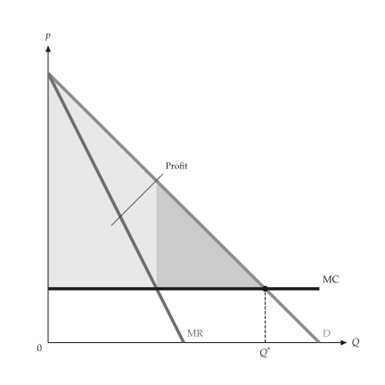{ .ev-figure-sm }

<div class="ev-downloads"><a class="ev-download" href="../../assets/micro-viz/price_discrimination/price_discrimination.py" download aria-label="Download the source"><svg viewBox="0 0 24 24" aria-hidden="true"><path d="M12 4v11m0 0-4.5-4.5M12 15l4.5-4.5M5 20h14" fill="none" stroke="currentColor" stroke-width="2" stroke-linecap="round" stroke-linejoin="round"/></svg><span>Download the source</span></a></div>

<figcaption markdown>*Perfect discrimination.* Price follows demand; profit is the area between demand and MC.</figcaption>

</figure>

<span id="fig-price-discrimination-block-pricing-three"></span>

<figure class="ev-fig" markdown>

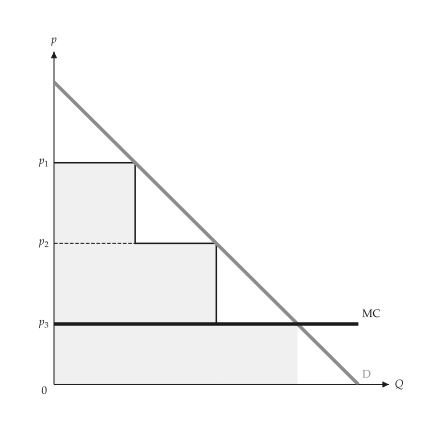{ .ev-figure-sm }

<div class="ev-downloads"><a class="ev-download" href="../../assets/micro-viz/price_discrimination/price_discrimination.py" download aria-label="Download the source"><svg viewBox="0 0 24 24" aria-hidden="true"><path d="M12 4v11m0 0-4.5-4.5M12 15l4.5-4.5M5 20h14" fill="none" stroke="currentColor" stroke-width="2" stroke-linecap="round" stroke-linejoin="round"/></svg><span>Download the source</span></a></div>

<figcaption markdown>*Block pricing.* Three-block pricing is an imperfect form of first-degree discrimination.</figcaption>

</figure>

<span id="fig-price-discrimination-block-pricing"></span>

<figure class="ev-fig" markdown>

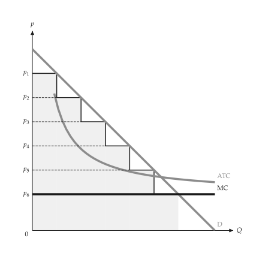{ .ev-figure-sm }

<div class="ev-downloads"><a class="ev-download" href="../../assets/micro-viz/price_discrimination/price_discrimination.py" download aria-label="Download the source"><svg viewBox="0 0 24 24" aria-hidden="true"><path d="M12 4v11m0 0-4.5-4.5M12 15l4.5-4.5M5 20h14" fill="none" stroke="currentColor" stroke-width="2" stroke-linecap="round" stroke-linejoin="round"/></svg><span>Download the source</span></a></div>

<figcaption markdown>*Block pricing with falling ATC.* Block pricing when demand lies above a falling ATC.</figcaption>

</figure>

<span id="fig-price-discrimination-third-degree"></span>

<figure class="ev-fig" markdown>

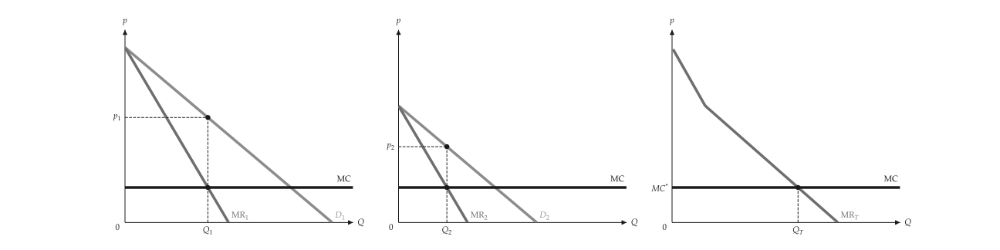{ .ev-figure-lg }

<div class="ev-downloads"><a class="ev-download" href="../../assets/micro-viz/price_discrimination/price_discrimination.py" download aria-label="Download the source"><svg viewBox="0 0 24 24" aria-hidden="true"><path d="M12 4v11m0 0-4.5-4.5M12 15l4.5-4.5M5 20h14" fill="none" stroke="currentColor" stroke-width="2" stroke-linecap="round" stroke-linejoin="round"/></svg><span>Download the source</span></a></div>

<figcaption markdown>*Third-degree discrimination.* MR1 = MR2 = MC; the summed marginal revenue fixes total output.</figcaption>

</figure>

<span id="fig-price-discrimination-third-degree-corner"></span>

<figure class="ev-fig" markdown>

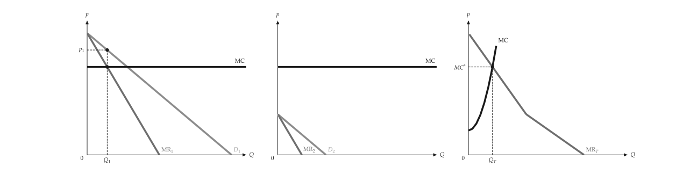{ .ev-figure-lg }

<div class="ev-downloads"><a class="ev-download" href="../../assets/micro-viz/price_discrimination/price_discrimination.py" download aria-label="Download the source"><svg viewBox="0 0 24 24" aria-hidden="true"><path d="M12 4v11m0 0-4.5-4.5M12 15l4.5-4.5M5 20h14" fill="none" stroke="currentColor" stroke-width="2" stroke-linecap="round" stroke-linejoin="round"/></svg><span>Download the source</span></a></div>

<figcaption markdown>*Third degree, corner.* With rising marginal cost a small market may go unserved.</figcaption>

</figure>

## Two-part tariffs

<span id="sec-ex-two-part-tariff"></span>

An entry fee plus a usage fee. The fee that takes the surplus of the least-surplus buyer served gives the profit. Sources: [Oi (1971)](../project/references.md#oi1971).

<!-- api: micro_viz.guides_monopoly_22 -->

`BuyerType` is a demand curve with a weight; `best_tariff()` searches the usage fees, and `evaluate_tariff()` gives the profit of a given pair of fees.

<!-- api: micro_viz.guides_monopoly_23 -->

Profit from entry fees, from sales and in total against the entry fee `T` at a fixed usage fee: it steps down each time a buyer type is priced out.

<!-- api: micro_viz.guides_monopoly_24 -->

Demand of each buyer type, the constant `MC` and the usage fee `p^*`. The entry fee is the shaded consumer-surplus triangle of the buyer with the least surplus served; when the usage fee is above MC the rectangle `(p^* - MC) Q` is the sales profit.

```python
def tariff_examples(
    output_dir: Path,
    theme: PlotTheme,
    *,
    single: BuyerType,
    buyers: tuple[BuyerType, ...],
    marginal_cost: float,
    usage_fee: float,
    fee_max: float,
    title: str | None = None,
) -> list[Path]:
    """Write the tariff figures into ``output_dir`` and return their paths."""
    output_dir.mkdir(parents=True, exist_ok=True)
    flat = evaluate_tariff(
        (single,),
        marginal_cost,
        marginal_cost,
        single.surplus(marginal_cost),
    )
    best = best_tariff(buyers, marginal_cost)
    figures = {
        "single_buyer.svg": two_part_tariff_canvas(
            (single,), flat, theme=theme, title=title
        ),
        "two_buyers.svg": two_part_tariff_canvas(
            buyers, best, theme=theme, title=title
        ),
        "tariff_profit.svg": tariff_profit_canvas(
            buyers,
            marginal_cost,
            usage_fee,
            fee_max,
            theme=theme,
            title=title,
        ),
    }
    paths = []
    for name, figure in figures.items():
        figure.save(output_dir / name)
        paths.append(output_dir / name)
    return paths
```

<span id="fig-two-part-tariff-single-buyer"></span>

<figure class="ev-fig" markdown>

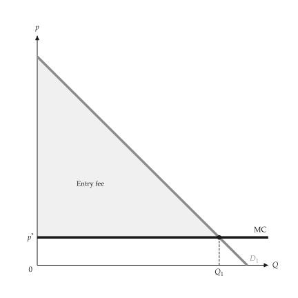{ .ev-figure-sm }

<div class="ev-downloads"><a class="ev-download" href="../../assets/micro-viz/two_part_tariff/two_part_tariff.py" download aria-label="Download the source"><svg viewBox="0 0 24 24" aria-hidden="true"><path d="M12 4v11m0 0-4.5-4.5M12 15l4.5-4.5M5 20h14" fill="none" stroke="currentColor" stroke-width="2" stroke-linecap="round" stroke-linejoin="round"/></svg><span>Download the source</span></a></div>

<figcaption markdown>*Two-part tariff, one buyer.* The usage fee equals MC and the entry fee takes all consumer surplus.</figcaption>

</figure>

<span id="fig-two-part-tariff-two-buyers"></span>

<figure class="ev-fig" markdown>

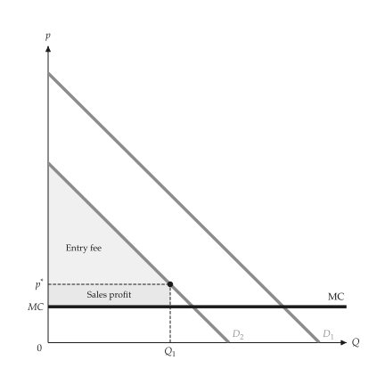{ .ev-figure-sm }

<div class="ev-downloads"><a class="ev-download" href="../../assets/micro-viz/two_part_tariff/two_part_tariff.py" download aria-label="Download the source"><svg viewBox="0 0 24 24" aria-hidden="true"><path d="M12 4v11m0 0-4.5-4.5M12 15l4.5-4.5M5 20h14" fill="none" stroke="currentColor" stroke-width="2" stroke-linecap="round" stroke-linejoin="round"/></svg><span>Download the source</span></a></div>

<figcaption markdown>*Two-part tariff, two buyer types.* The usage fee exceeds MC; the entry fee equals the surplus of the smaller buyer.</figcaption>

</figure>

<span id="fig-two-part-tariff-tariff-profit"></span>

<figure class="ev-fig" markdown>

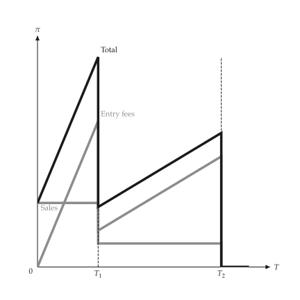{ .ev-figure-sm }

<div class="ev-downloads"><a class="ev-download" href="../../assets/micro-viz/two_part_tariff/two_part_tariff.py" download aria-label="Download the source"><svg viewBox="0 0 24 24" aria-hidden="true"><path d="M12 4v11m0 0-4.5-4.5M12 15l4.5-4.5M5 20h14" fill="none" stroke="currentColor" stroke-width="2" stroke-linecap="round" stroke-linejoin="round"/></svg><span>Download the source</span></a></div>

<figcaption markdown>*Profit against the entry fee.* Profit from fees, from sales and in total, against the entry fee.</figcaption>

</figure>

## Bundling

<span id="sec-ex-bundling"></span>

Consumers sit in a space of reservation prices. Separate selling, pure bundling and mixed bundling cut that space into purchase regions. Sources: [Adams (1976)](../project/references.md#adamsyellen1976).

<!-- api: micro_viz.guides_monopoly_25 -->

`ValuationProfile` holds the consumers' reservation prices; `best_separate()`, `best_pure()` and `best_mixed()` search for the profit-maximising prices; `choice_regions()` gives the purchase regions as polygons.

<!-- api: micro_viz.guides_monopoly_26 -->

Regions of mixed bundling (goods at `P1`, `P2` and the bundle at `P_B`). With positive costs the cost lines are marked; `numbered` labels the regions I to IV.

<!-- api: micro_viz.guides_monopoly_27 -->

Valuation space split by the diagonal `r1 + r2 = P_B`: consumers above it buy.

<!-- api: micro_viz.guides_monopoly_28 -->

The four purchase regions cut by `r1 = P1` and `r2 = P2` (goods sold apart).

<!-- api: micro_viz.guides_monopoly_29 -->

Consumers as points `(r1, r2)` in valuation space; `names` labels the first points.

```python
def bundling_examples(
    output_dir: Path,
    theme: PlotTheme,
    *,
    consumers: tuple[tuple[float, float], ...],
    count: int,
    low: float,
    high: float,
    spread: float,
    cost_1: float,
    cost_2: float,
    title: str | None = None,
) -> list[Path]:
    """Write the bundling figures into ``output_dir`` and return their paths."""
    output_dir.mkdir(parents=True, exist_ok=True)
    few = ValuationProfile(consumers)
    negative = ValuationProfile.correlated(
        count, low=low, high=high, direction=-1.0, spread=spread
    )
    costly = ValuationProfile.correlated(
        count,
        low=low,
        high=high,
        direction=-1.0,
        spread=spread,
        cost_1=cost_1,
        cost_2=cost_2,
    )
    positive = ValuationProfile.correlated(
        count, low=low, high=high, direction=1.0, spread=spread
    )
    separate = best_separate(negative).offer
    figures = {
        "valuation_points.svg": valuation_scatter_canvas(
            few, theme=theme, title=title
        ),
        "separate_regions.svg": separate_selling_regions_canvas(
            negative, separate, theme=theme, title=title
        ),
        "pure_bundling.svg": pure_bundling_canvas(
            negative,
            best_pure(negative).offer.price_bundle or 0.0,
            theme=theme,
            title=title,
        ),
        "mixed_bundling.svg": mixed_bundling_canvas(
            negative,
            best_mixed(negative).offer,
            theme=theme,
            title=title,
        ),
        "mixed_with_costs.svg": mixed_bundling_canvas(
            costly,
            best_mixed(costly).offer,
            theme=theme,
            title=title,
        ),
        "regions_numbered.svg": mixed_bundling_canvas(
            positive,
            best_mixed(positive).offer,
            numbered=True,
            theme=theme,
            title=title,
        ),
    }
    paths = []
    for name, figure in figures.items():
        figure.save(output_dir / name)
        paths.append(output_dir / name)
    return paths
```

<span id="fig-bundling-valuation-points"></span>

<figure class="ev-fig" markdown>

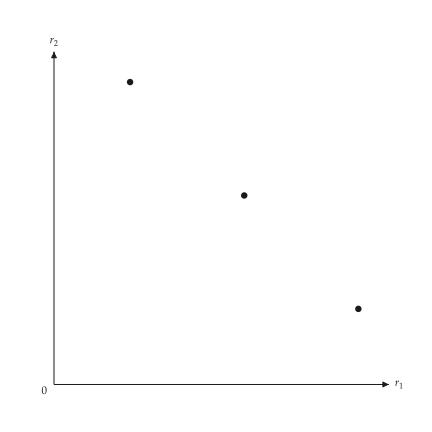{ .ev-figure-sm }

<div class="ev-downloads"><a class="ev-download" href="../../assets/micro-viz/bundling/bundling.py" download aria-label="Download the source"><svg viewBox="0 0 24 24" aria-hidden="true"><path d="M12 4v11m0 0-4.5-4.5M12 15l4.5-4.5M5 20h14" fill="none" stroke="currentColor" stroke-width="2" stroke-linecap="round" stroke-linejoin="round"/></svg><span>Download the source</span></a></div>

<figcaption markdown>*Valuation space.* Consumers placed by their reservation prices r1 and r2.</figcaption>

</figure>

<span id="fig-bundling-separate-regions"></span>

<figure class="ev-fig" markdown>

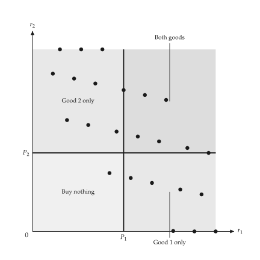{ .ev-figure-sm }

<div class="ev-downloads"><a class="ev-download" href="../../assets/micro-viz/bundling/bundling.py" download aria-label="Download the source"><svg viewBox="0 0 24 24" aria-hidden="true"><path d="M12 4v11m0 0-4.5-4.5M12 15l4.5-4.5M5 20h14" fill="none" stroke="currentColor" stroke-width="2" stroke-linecap="round" stroke-linejoin="round"/></svg><span>Download the source</span></a></div>

<figcaption markdown>*Separate selling.* The prices P1 and P2 cut the valuation space into four purchase regions.</figcaption>

</figure>

<span id="fig-bundling-pure-bundling"></span>

<figure class="ev-fig" markdown>

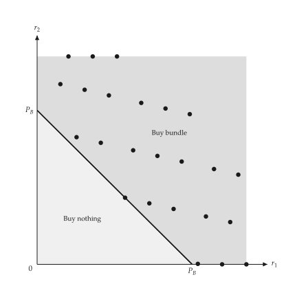{ .ev-figure-sm }

<div class="ev-downloads"><a class="ev-download" href="../../assets/micro-viz/bundling/bundling.py" download aria-label="Download the source"><svg viewBox="0 0 24 24" aria-hidden="true"><path d="M12 4v11m0 0-4.5-4.5M12 15l4.5-4.5M5 20h14" fill="none" stroke="currentColor" stroke-width="2" stroke-linecap="round" stroke-linejoin="round"/></svg><span>Download the source</span></a></div>

<figcaption markdown>*Pure bundling.* Consumers above the diagonal r1 + r2 = PB buy the bundle.</figcaption>

</figure>

<span id="fig-bundling-mixed-bundling"></span>

<figure class="ev-fig" markdown>

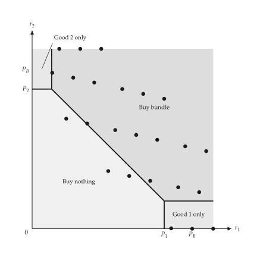{ .ev-figure-sm }

<div class="ev-downloads"><a class="ev-download" href="../../assets/micro-viz/bundling/bundling.py" download aria-label="Download the source"><svg viewBox="0 0 24 24" aria-hidden="true"><path d="M12 4v11m0 0-4.5-4.5M12 15l4.5-4.5M5 20h14" fill="none" stroke="currentColor" stroke-width="2" stroke-linecap="round" stroke-linejoin="round"/></svg><span>Download the source</span></a></div>

<figcaption markdown>*Mixed bundling.* The four purchase regions under mixed bundling.</figcaption>

</figure>

<span id="fig-bundling-mixed-with-costs"></span>

<figure class="ev-fig" markdown>

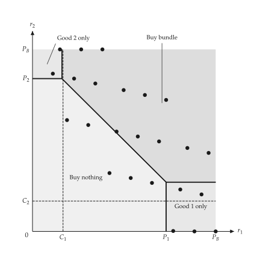{ .ev-figure-sm }

<div class="ev-downloads"><a class="ev-download" href="../../assets/micro-viz/bundling/bundling.py" download aria-label="Download the source"><svg viewBox="0 0 24 24" aria-hidden="true"><path d="M12 4v11m0 0-4.5-4.5M12 15l4.5-4.5M5 20h14" fill="none" stroke="currentColor" stroke-width="2" stroke-linecap="round" stroke-linejoin="round"/></svg><span>Download the source</span></a></div>

<figcaption markdown>*Mixed bundling with costs.* Mixed-bundling regions when marginal costs are positive.</figcaption>

</figure>

<span id="fig-bundling-regions-numbered"></span>

<figure class="ev-fig" markdown>

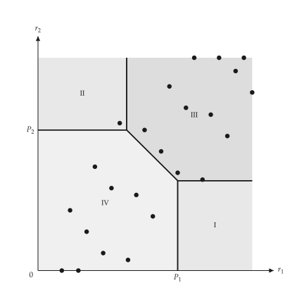{ .ev-figure-sm }

<div class="ev-downloads"><a class="ev-download" href="../../assets/micro-viz/bundling/bundling.py" download aria-label="Download the source"><svg viewBox="0 0 24 24" aria-hidden="true"><path d="M12 4v11m0 0-4.5-4.5M12 15l4.5-4.5M5 20h14" fill="none" stroke="currentColor" stroke-width="2" stroke-linecap="round" stroke-linejoin="round"/></svg><span>Download the source</span></a></div>

<figcaption markdown>*Regions I to IV.* The regions of mixed bundling numbered I to IV.</figcaption>

</figure>

## Intertemporal and peak-load pricing

<span id="sec-ex-time-pricing"></span>

Two groups of buyers are charged different prices over time, or two periods share a capacity cost.

<!-- api: micro_viz.guides_monopoly_30 -->

`IntertemporalPricing` and `PeakLoadPricing` solve the two markets and return the matching outcome objects.

<!-- api: micro_viz.guides_monopoly_31 -->

Two demands and their marginal revenues against a constant `MC`: the high price is charged to the early group, the lower price to the later one.

<!-- api: micro_viz.guides_monopoly_32 -->

Peak and off-peak demands with their marginal revenues; running cost `MC` for both periods and `MC + MC_K` (the capacity cost) for the peak.

```python
def time_pricing_examples(
    output_dir: Path,
    theme: PlotTheme,
    *,
    first: LinearDemand,
    second: LinearDemand,
    peak: LinearDemand,
    off_peak: LinearDemand,
    marginal_cost: float,
    capacity_cost: float,
    title: str | None = None,
) -> list[Path]:
    """Write the time-pricing figures into ``output_dir`` and return their paths."""
    output_dir.mkdir(parents=True, exist_ok=True)
    figures = {
        "intertemporal.svg": intertemporal_pricing_canvas(
            IntertemporalPricing(first, second, marginal_cost),
            theme=theme,
            title=title,
        ),
        "peak_load.svg": peak_load_canvas(
            PeakLoadPricing(
                peak, off_peak, marginal_cost, capacity_cost
            ),
            theme=theme,
            title=title,
        ),
    }
    paths = []
    for name, figure in figures.items():
        figure.save(output_dir / name)
        paths.append(output_dir / name)
    return paths
```

<span id="fig-time-pricing-intertemporal"></span>

<figure class="ev-fig" markdown>

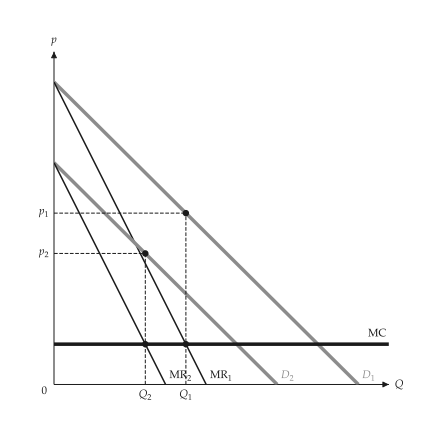{ .ev-figure-sm }

<div class="ev-downloads"><a class="ev-download" href="../../assets/micro-viz/time_pricing/time_pricing.py" download aria-label="Download the source"><svg viewBox="0 0 24 24" aria-hidden="true"><path d="M12 4v11m0 0-4.5-4.5M12 15l4.5-4.5M5 20h14" fill="none" stroke="currentColor" stroke-width="2" stroke-linecap="round" stroke-linejoin="round"/></svg><span>Download the source</span></a></div>

<figcaption markdown>*Intertemporal pricing.* The high-valuation group pays a high price first; the price is cut later.</figcaption>

</figure>

<span id="fig-time-pricing-peak-load"></span>

<figure class="ev-fig" markdown>

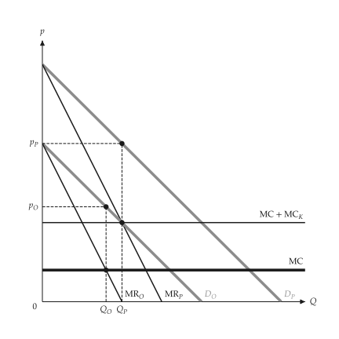{ .ev-figure-sm }

<div class="ev-downloads"><a class="ev-download" href="../../assets/micro-viz/time_pricing/time_pricing.py" download aria-label="Download the source"><svg viewBox="0 0 24 24" aria-hidden="true"><path d="M12 4v11m0 0-4.5-4.5M12 15l4.5-4.5M5 20h14" fill="none" stroke="currentColor" stroke-width="2" stroke-linecap="round" stroke-linejoin="round"/></svg><span>Download the source</span></a></div>

<figcaption markdown>*Peak-load pricing.* Peak and off-peak demands are priced apart; the peak bears the capacity cost.</figcaption>

</figure>

## Advertising

<span id="sec-ex-advertising"></span>

Advertising shifts average revenue out and raises average cost; the figure compares profit before and after.

<!-- api: micro_viz.guides_monopoly_33 -->

`AdvertisingDecision` compares the profit with and without advertising and returns an `AdvertisingOutcome`.

<!-- api: micro_viz.guides_monopoly_34 -->

`AR` shifts out to `AR'` and average cost up to `AC'`; the rectangles show profit before (lighter) and after (darker). Changed curves are thin and solid.

```python
def advertising_examples(
    output_dir: Path,
    theme: PlotTheme,
    *,
    decision: AdvertisingDecision,
    title: str | None = None,
) -> list[Path]:
    """Write the advertising figure into ``output_dir`` and return its path."""
    output_dir.mkdir(parents=True, exist_ok=True)
    path = output_dir / "advertising.svg"
    advertising_effect_canvas(
        decision, theme=theme, title=title
    ).save(path)
    return [path]
```

<span id="fig-advertising-advertising"></span>

<figure class="ev-fig" markdown>

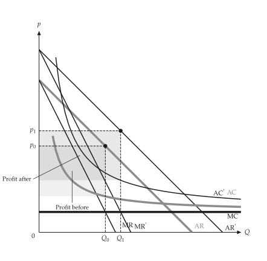{ .ev-figure-sm }

<div class="ev-downloads"><a class="ev-download" href="../../assets/micro-viz/advertising/advertising.py" download aria-label="Download the source"><svg viewBox="0 0 24 24" aria-hidden="true"><path d="M12 4v11m0 0-4.5-4.5M12 15l4.5-4.5M5 20h14" fill="none" stroke="currentColor" stroke-width="2" stroke-linecap="round" stroke-linejoin="round"/></svg><span>Download the source</span></a></div>

<figcaption markdown>*Advertising.* Advertising shifts AR out and raises average cost; profit before and after is compared.</figcaption>

</figure>

## Exhaustible resources

<span id="sec-ex-exhaustible-resource"></span>

The price net of marginal extraction cost rises at the rate of interest until the choke price at the date the stock runs out. Sources: [Hotelling (1931)](../project/references.md#hotelling1931).

<!-- api: micro_viz.guides_monopoly_35 -->

`ExhaustibleResourcePath` gives the price path $p(t)$ and the matching static view of demand and the stock.

<!-- api: micro_viz.guides_monopoly_36 -->

Left, the price path `p(t)` rising from `p_0` to the choke price at `T` above the marginal extraction cost `c`; right, the matching static view: demand `D` with the quantities extracted at the start and at `T / 2`, moving up the demand curve.

```python
def resource_examples(
    output_dir: Path,
    theme: PlotTheme,
    *,
    path: ExhaustibleResourcePath,
    title: str | None = None,
) -> list[Path]:
    """Write the resource figure into ``output_dir`` and return its path."""
    output_dir.mkdir(parents=True, exist_ok=True)
    target = output_dir / "resource_price_path.svg"
    resource_price_path_canvas(
        path, titles=(title, None), theme=theme
    ).save(target)
    return [target]
```

<span id="fig-exhaustible-resource-resource-price-path"></span>

<figure class="ev-fig" markdown>

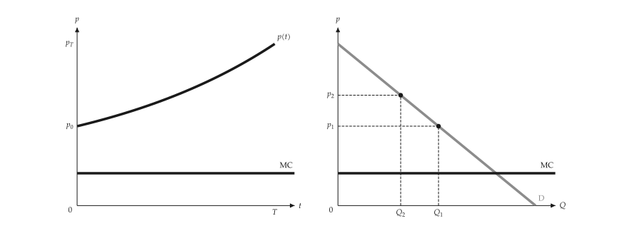{ .ev-figure-lg }

<div class="ev-downloads"><a class="ev-download" href="../../assets/micro-viz/exhaustible_resource/exhaustible_resource.py" download aria-label="Download the source"><svg viewBox="0 0 24 24" aria-hidden="true"><path d="M12 4v11m0 0-4.5-4.5M12 15l4.5-4.5M5 20h14" fill="none" stroke="currentColor" stroke-width="2" stroke-linecap="round" stroke-linejoin="round"/></svg><span>Download the source</span></a></div>

<figcaption markdown>*Exhaustible resource.* Price less marginal extraction cost grows at the interest rate; the static view is beside it.</figcaption>

</figure>
