# Monopoly and pricing

<span id="sec-monopoly"></span>

Market power: the single-price monopoly, its regulation, and pricing beyond one price.

Each section is one example script and the figures it writes. The scripts are in `examples/scripts/` of the repository; `--help` lists their arguments.

## Monopoly

```bash
uv run python examples/scripts/monopoly.py --output-dir out
```

### Monopoly: MR = MC

Setting: linear demand.

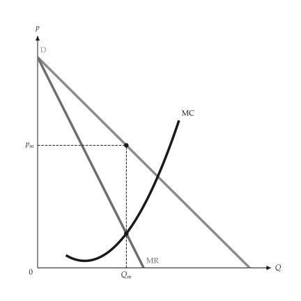{ .ev-figure-sm }

### Monopoly: profit lost off the optimum

Setting: Q1 and Q2.

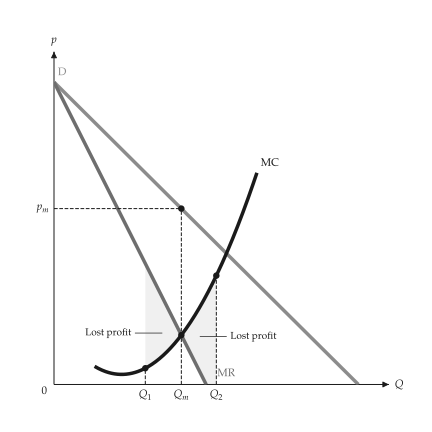{ .ev-figure-sm }

### Monopoly profit

Setting: linear demand.

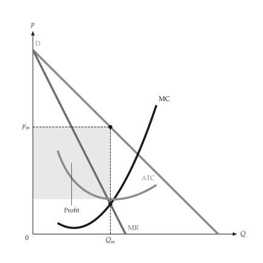{ .ev-figure-sm }

### Revenue, cost and profit

Setting: linear demand.

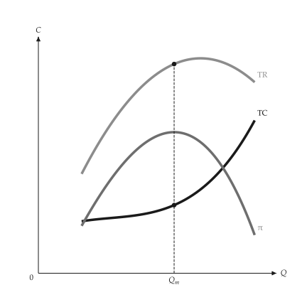{ .ev-figure-sm }

### Totals and unit curves

Setting: two panels.

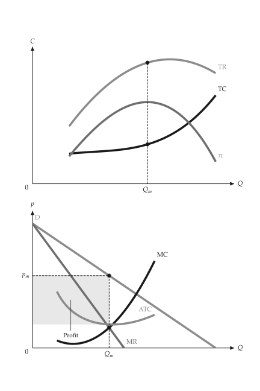{ .ev-figure-sm }

### Deadweight loss of monopoly

Setting: linear demand.

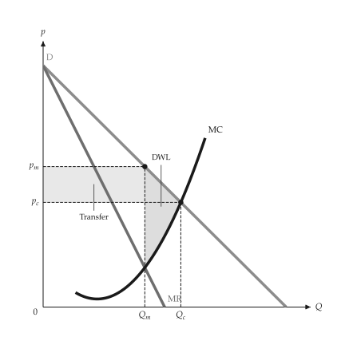{ .ev-figure-sm }

### Per-unit tax on a monopolist

Setting: T = 4.

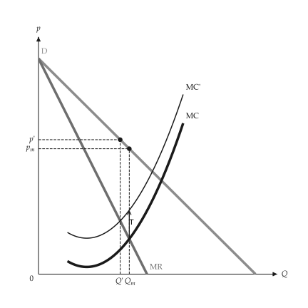{ .ev-figure-sm }

### Demand shift

Setting: intercept 30 to 36.

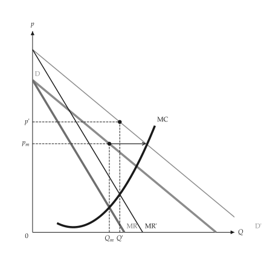{ .ev-figure-sm }

### Demand rotation

Setting: slope 2 to 1.5.

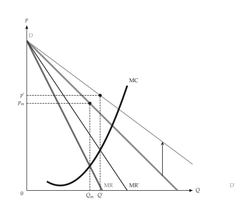{ .ev-figure-sm }

### Multiplant monopoly

Setting: two plants.

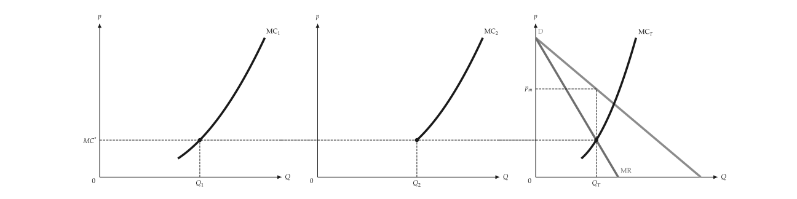{ .ev-figure-lg }

### Lerner markup

Setting: elastic and inelastic.

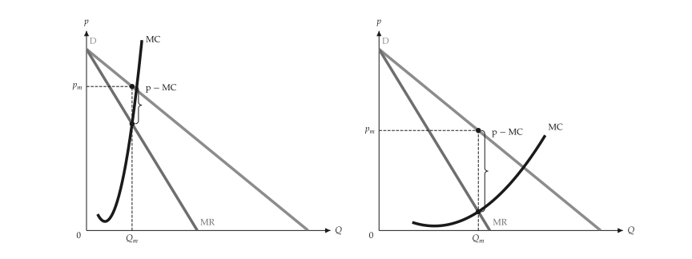{ .ev-figure-lg }

## Monopolistic competition

```bash
uv run python examples/scripts/monopolistic_competition.py --output-dir out
```

### Short run

Setting: profit before entry.

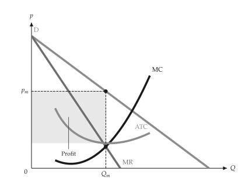{ .ev-figure-sm }

### Long-run tangency

Setting: profit zero.

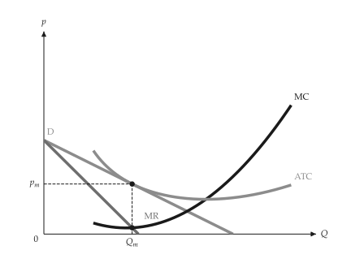{ .ev-figure-sm }

### Excess capacity

Setting: versus perfect competition.

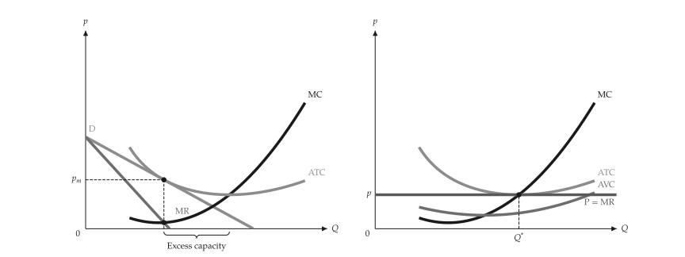{ .ev-figure-lg }

## Regulation

```bash
uv run python examples/scripts/regulation.py --output-dir out
```

### Price ceiling on a monopolist

Setting: ceiling 12.

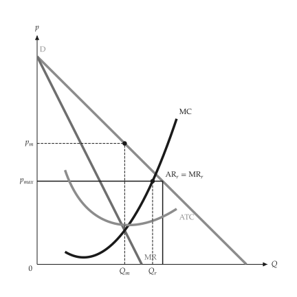{ .ev-figure-sm }

### Natural monopoly pricing

Setting: falling ATC.

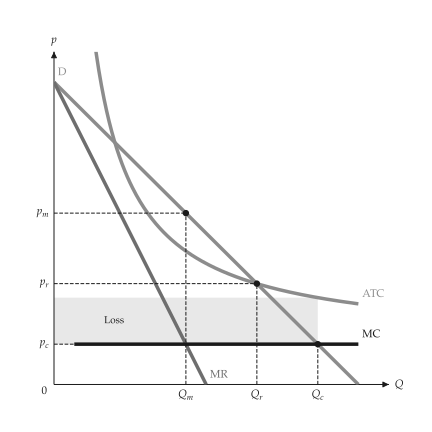{ .ev-figure-sm }

## Price discrimination

```bash
uv run python examples/scripts/price_discrimination.py --output-dir out
```

### One monopoly price

Setting: MR = MC.

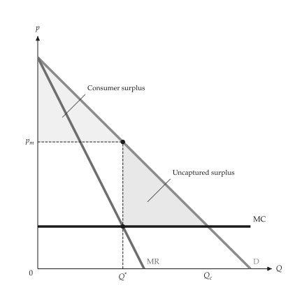{ .ev-figure-sm }

### Perfect discrimination

Setting: price follows demand.

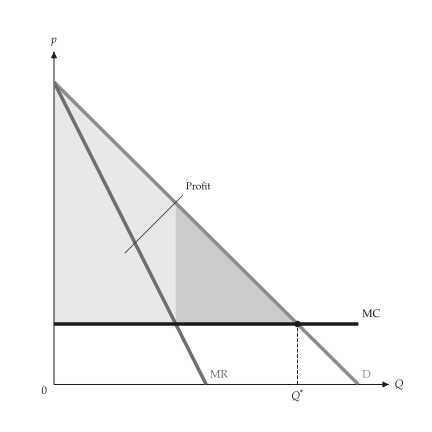{ .ev-figure-sm }

### Block pricing

Setting: three blocks.

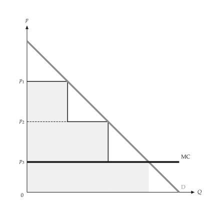{ .ev-figure-sm }

### Block pricing with falling ATC

Setting: six blocks.

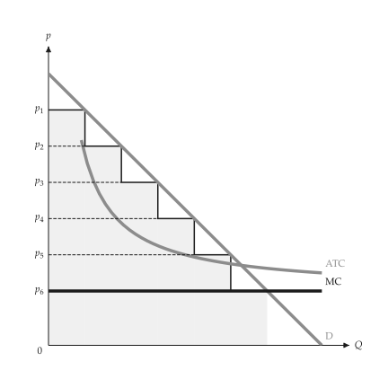{ .ev-figure-sm }

### Third-degree discrimination

Setting: two markets.

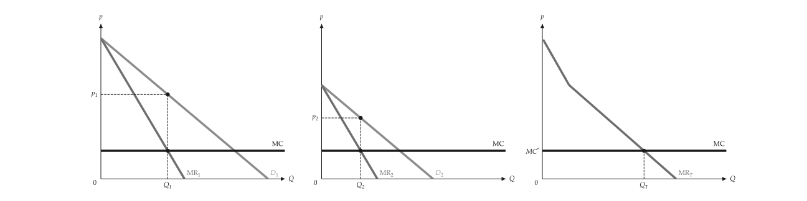{ .ev-figure-lg }

### Third degree, corner

Setting: rising MC.

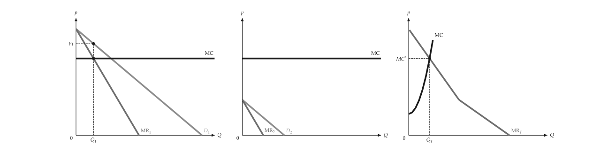{ .ev-figure-lg }

## Two-part tariffs

```bash
uv run python examples/scripts/two_part_tariff.py --output-dir out
```

### Two-part tariff, one buyer

Setting: usage fee = MC.

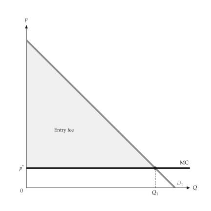{ .ev-figure-sm }

### Two-part tariff, two buyer types

Setting: usage fee above MC.

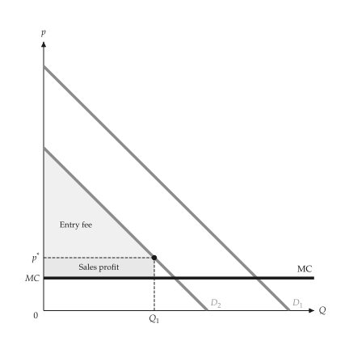{ .ev-figure-sm }

### Profit against the entry fee

Setting: usage fee fixed.

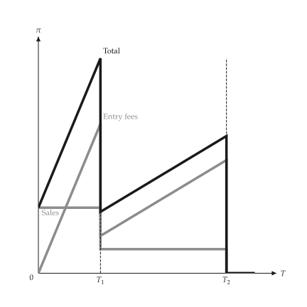{ .ev-figure-sm }

## Bundling

```bash
uv run python examples/scripts/bundling.py --output-dir out
```

### Valuation space

Setting: three consumers.

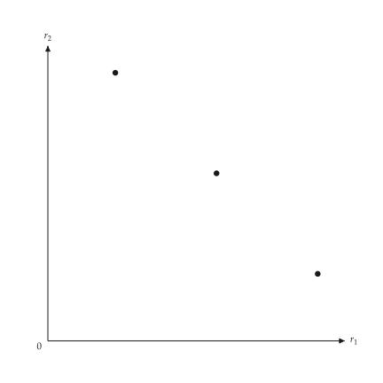{ .ev-figure-sm }

### Separate selling

Setting: P1, P2.

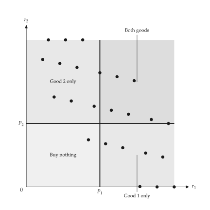{ .ev-figure-sm }

### Pure bundling

Setting: r1 + r2 = PB.

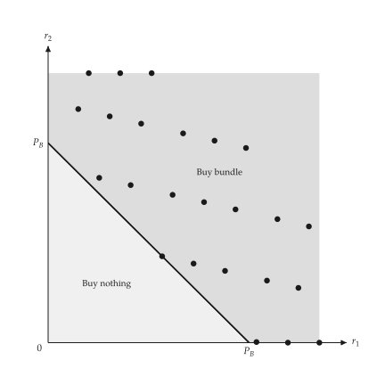{ .ev-figure-sm }

### Mixed bundling

Setting: negative correlation.

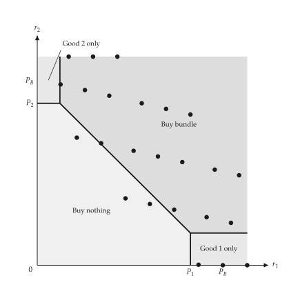{ .ev-figure-sm }

### Mixed bundling with costs

Setting: C1, C2 > 0.

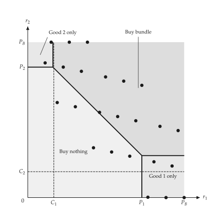{ .ev-figure-sm }

### Regions I to IV

Setting: positive correlation.

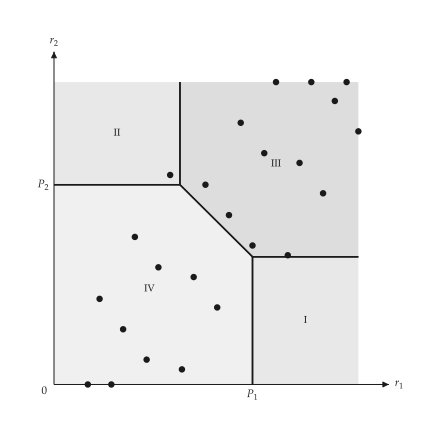{ .ev-figure-sm }

## Intertemporal and peak-load pricing

```bash
uv run python examples/scripts/time_pricing.py --output-dir out
```

### Intertemporal pricing

Setting: high price first.

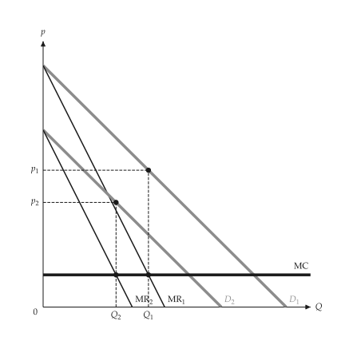{ .ev-figure-sm }

### Peak-load pricing

Setting: capacity cost on the peak.

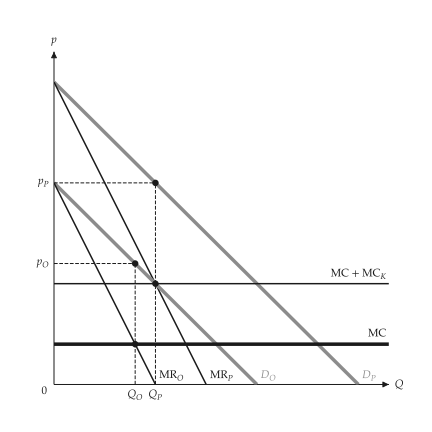{ .ev-figure-sm }

## Advertising

```bash
uv run python examples/scripts/advertising.py --output-dir out
```

### Advertising

Setting: AR out, AC up.

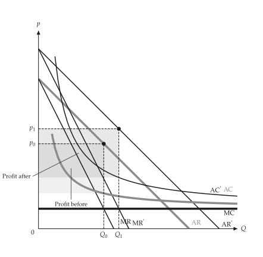{ .ev-figure-sm }

## Exhaustible resources

```bash
uv run python examples/scripts/exhaustible_resource.py --output-dir out
```

### Exhaustible resource

Setting: Hotelling path.

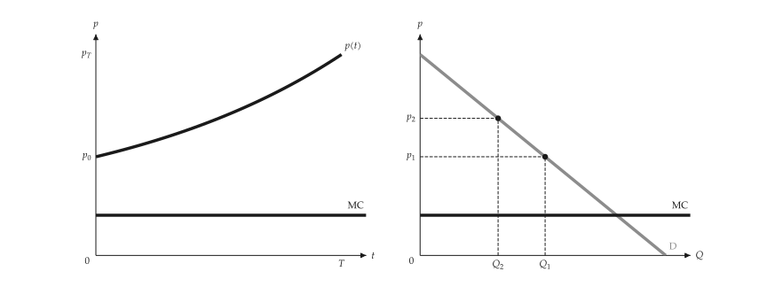{ .ev-figure-lg }
