# Oligopoly and vertical chains

<span id="sec-oligopoly"></span>

A few firms, and firms at different stages of one chain.

Each section is one example script and the figures it draws. The scripts come in the examples archive; `--help` lists their arguments.

## Duopoly

<span id="sec-ex-oligopoly"></span>

Reaction curves in output and in price give the Cournot, Stackelberg, Bertrand and collusive outcomes. Sources: [Cournot (1838)](../project/references.md#cournot1838), [von Stackelberg (1934)](../project/references.md#stackelberg1934), [Bertrand (1883)](../project/references.md#bertrand1883).

<!-- api: micro_viz.guides_oligopoly_1 -->

`Duopoly` has `cournot()`, `stackelberg()`, `competitive_total()` and `collusive_total()`; `DifferentiatedDuopoly` has `bertrand()` for price competition.

<!-- api: micro_viz.guides_oligopoly_2 -->

Upward-sloping price reaction curves `R1` and `R2` in `(p1, p2)` space, the Nash prices `N` and (optionally) the joint-profit-maximising prices `M`.

<!-- api: micro_viz.guides_oligopoly_3 -->

Reaction curves `R1` and `R2` in `(Q1, Q2)` space meeting at the Cournot-Nash point `N`. `competitive` and `collusive` add the constant-total-output lines and their symmetric points `C` and `M`; `leader` adds the Stackelberg point `S`.

<!-- api: micro_viz.guides_oligopoly_4 -->

Firm 1's residual demand `D1(q2)` and `MR1(q2)` for each guess of the rival's output, with its marginal cost. Each guess shifts both curves left by `q2`.

The function of the script that draws the figures follows.

```python
def oligopoly_examples(
    output_dir: Path,
    theme: PlotTheme,
    *,
    duopoly: Duopoly,
    guesses: tuple[float, ...],
    differentiated: DifferentiatedDuopoly,
    title: str | None = None,
) -> list[Path]:
    """Write the oligopoly figures into ``output_dir`` and return their paths."""
    output_dir.mkdir(parents=True, exist_ok=True)
    figures = {
        "residual_demand.svg": residual_demand_canvas(
            duopoly, guesses, theme=theme, title=title
        ),
        "cournot.svg": reaction_curves_canvas(
            duopoly, theme=theme, title=title
        ),
        "cournot_points.svg": reaction_curves_canvas(
            duopoly,
            competitive=True,
            collusive=True,
            theme=theme,
            title=title,
        ),
        "stackelberg.svg": reaction_curves_canvas(
            duopoly, leader=1, theme=theme, title=title
        ),
        "price_reaction.svg": price_reaction_canvas(
            differentiated, theme=theme, title=title
        ),
    }
    paths = []
    for name, figure in figures.items():
        figure.save(output_dir / name)
        paths.append(output_dir / name)
    return paths
```

<span id="fig-oligopoly-residual-demand"></span>

<figure class="ev-fig" markdown>

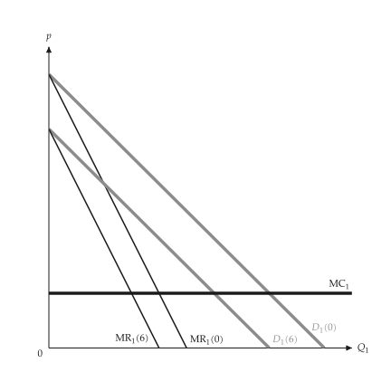{ .ev-figure-sm }

<div class="ev-downloads"><a class="ev-download" href="../../assets/micro-viz/oligopoly/oligopoly.py" download aria-label="Download the source"><svg viewBox="0 0 24 24" aria-hidden="true"><path d="M12 4v11m0 0-4.5-4.5M12 15l4.5-4.5M5 20h14" fill="none" stroke="currentColor" stroke-width="2" stroke-linecap="round" stroke-linejoin="round"/></svg><span>Download the source</span></a></div>

<figcaption markdown>*Residual demand.* Residual demand and marginal revenue for each guess of the rival's output.</figcaption>

</figure>

<span id="fig-oligopoly-cournot"></span>

<figure class="ev-fig" markdown>

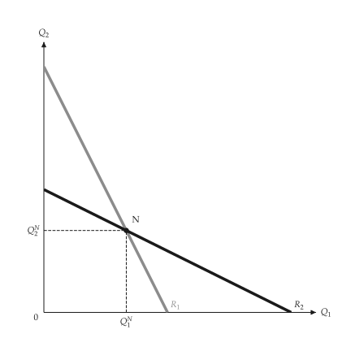{ .ev-figure-sm }

<div class="ev-downloads"><a class="ev-download" href="../../assets/micro-viz/oligopoly/oligopoly.py" download aria-label="Download the source"><svg viewBox="0 0 24 24" aria-hidden="true"><path d="M12 4v11m0 0-4.5-4.5M12 15l4.5-4.5M5 20h14" fill="none" stroke="currentColor" stroke-width="2" stroke-linecap="round" stroke-linejoin="round"/></svg><span>Download the source</span></a></div>

<figcaption markdown>*Reaction curves.* The reaction curves meet at the Cournot equilibrium N.</figcaption>

</figure>

<span id="fig-oligopoly-cournot-points"></span>

<figure class="ev-fig" markdown>

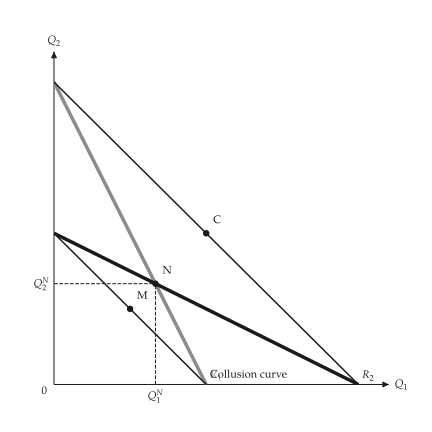{ .ev-figure-sm }

<div class="ev-downloads"><a class="ev-download" href="../../assets/micro-viz/oligopoly/oligopoly.py" download aria-label="Download the source"><svg viewBox="0 0 24 24" aria-hidden="true"><path d="M12 4v11m0 0-4.5-4.5M12 15l4.5-4.5M5 20h14" fill="none" stroke="currentColor" stroke-width="2" stroke-linecap="round" stroke-linejoin="round"/></svg><span>Download the source</span></a></div>

<figcaption markdown>*Competitive, Cournot and collusive.* The competitive, Cournot and collusive points, and the collusion line.</figcaption>

</figure>

<span id="fig-oligopoly-stackelberg"></span>

<figure class="ev-fig" markdown>

{ .ev-figure-sm }

<div class="ev-downloads"><a class="ev-download" href="../../assets/micro-viz/oligopoly/oligopoly.py" download aria-label="Download the source"><svg viewBox="0 0 24 24" aria-hidden="true"><path d="M12 4v11m0 0-4.5-4.5M12 15l4.5-4.5M5 20h14" fill="none" stroke="currentColor" stroke-width="2" stroke-linecap="round" stroke-linejoin="round"/></svg><span>Download the source</span></a></div>

<figcaption markdown>*Stackelberg.* The leader picks output along the follower's reaction curve.</figcaption>

</figure>

<span id="fig-oligopoly-price-reaction"></span>

<figure class="ev-fig" markdown>

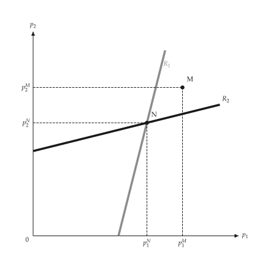{ .ev-figure-sm }

<div class="ev-downloads"><a class="ev-download" href="../../assets/micro-viz/oligopoly/oligopoly.py" download aria-label="Download the source"><svg viewBox="0 0 24 24" aria-hidden="true"><path d="M12 4v11m0 0-4.5-4.5M12 15l4.5-4.5M5 20h14" fill="none" stroke="currentColor" stroke-width="2" stroke-linecap="round" stroke-linejoin="round"/></svg><span>Download the source</span></a></div>

<figcaption markdown>*Price reaction curves.* Price reaction curves of differentiated products, with the Nash and collusive prices.</figcaption>

</figure>

## Kinked demand, dominant firm and cartel

<span id="sec-ex-dominant-firm"></span>

Rivals that follow price cuts but not rises give a kink; a firm with a competitive fringe faces the residual demand. Sources: [Sweezy (1939)](../project/references.md#sweezy1939).

<!-- api: micro_viz.guides_oligopoly_5 -->

`KinkedDemand` gives the kink and the gap in marginal revenue; `DominantFirm` solves the residual demand against a competitive fringe.

<!-- api: micro_viz.guides_oligopoly_6 -->

The cartel-with-fringe diagram for inelastic demand beside elastic demand (little market power).

<!-- api: micro_viz.guides_oligopoly_7 -->

Market demand `D`, fringe supply `S_F` and the residual demand `D_D = D - S_F` with its marginal revenue and the firm's marginal cost; the firm sets `MR = MC` and the fringe supplies the rest at the same price. `cartel` switches the names to the cartel's.

<!-- api: micro_viz.guides_oligopoly_8 -->

Kinked demand and its marginal revenue with the vertical gap at the kink. Each marginal cost in `marginal_costs` is drawn flat; the first is the thick curve and the rest thin and solid. Those inside the gap leave price and quantity at the kink.

The function of the script that draws the figures follows.

```python
def dominant_examples(
    output_dir: Path,
    theme: PlotTheme,
    *,
    kinked: KinkedDemand,
    costs: tuple[float, ...],
    firm: DominantFirm,
    inelastic: DominantFirm,
    elastic: DominantFirm,
    title: str | None = None,
) -> list[Path]:
    """Write the dominant-firm figures into ``output_dir`` and return their paths."""
    output_dir.mkdir(parents=True, exist_ok=True)
    figures = {
        "kinked_demand.svg": kinked_demand_canvas(
            kinked, costs, theme=theme, title=title
        ),
        "dominant_firm.svg": dominant_firm_canvas(
            firm, theme=theme, title=title
        ),
        "cartel_fringe.svg": dominant_firm_canvas(
            firm,
            cartel=True,
            theme=theme,
            title=title,
            prefix="oligopoly.cartel",
        ),
        "cartel_elasticity.svg": cartel_elasticity_canvas(
            inelastic, elastic, theme=theme
        ),
    }
    paths = []
    for name, figure in figures.items():
        figure.save(output_dir / name)
        paths.append(output_dir / name)
    return paths
```

<span id="fig-dominant-firm-kinked-demand"></span>

<figure class="ev-fig" markdown>

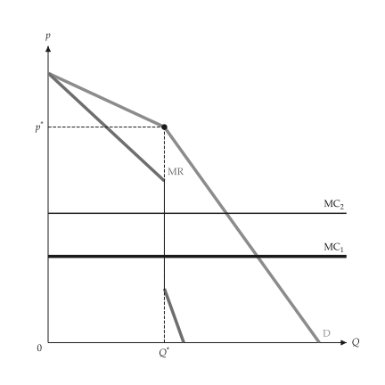{ .ev-figure-sm }

<div class="ev-downloads"><a class="ev-download" href="../../assets/micro-viz/dominant_firm/dominant_firm.py" download aria-label="Download the source"><svg viewBox="0 0 24 24" aria-hidden="true"><path d="M12 4v11m0 0-4.5-4.5M12 15l4.5-4.5M5 20h14" fill="none" stroke="currentColor" stroke-width="2" stroke-linecap="round" stroke-linejoin="round"/></svg><span>Download the source</span></a></div>

<figcaption markdown>*Kinked demand.* Kinked demand and the gap in MR; MC changes within the gap leave the price unchanged.</figcaption>

</figure>

<span id="fig-dominant-firm-dominant-firm"></span>

<figure class="ev-fig" markdown>

{ .ev-figure-sm }

<div class="ev-downloads"><a class="ev-download" href="../../assets/micro-viz/dominant_firm/dominant_firm.py" download aria-label="Download the source"><svg viewBox="0 0 24 24" aria-hidden="true"><path d="M12 4v11m0 0-4.5-4.5M12 15l4.5-4.5M5 20h14" fill="none" stroke="currentColor" stroke-width="2" stroke-linecap="round" stroke-linejoin="round"/></svg><span>Download the source</span></a></div>

<figcaption markdown>*Dominant firm.* Market demand less fringe supply is the dominant firm's residual demand.</figcaption>

</figure>

<span id="fig-dominant-firm-cartel-fringe"></span>

<figure class="ev-fig" markdown>

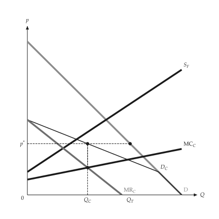{ .ev-figure-sm }

<div class="ev-downloads"><a class="ev-download" href="../../assets/micro-viz/dominant_firm/dominant_firm.py" download aria-label="Download the source"><svg viewBox="0 0 24 24" aria-hidden="true"><path d="M12 4v11m0 0-4.5-4.5M12 15l4.5-4.5M5 20h14" fill="none" stroke="currentColor" stroke-width="2" stroke-linecap="round" stroke-linejoin="round"/></svg><span>Download the source</span></a></div>

<figcaption markdown>*Cartel with a competitive fringe.* The cartel faces total demand less the fringe's supply.</figcaption>

</figure>

<span id="fig-dominant-firm-cartel-elasticity"></span>

<figure class="ev-fig" markdown>

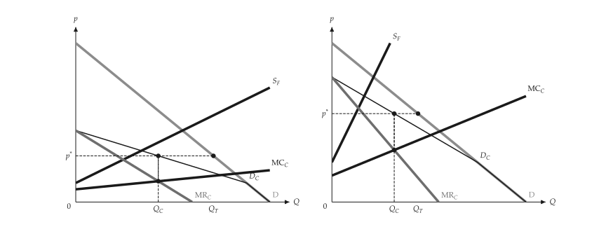{ .ev-figure-sm }

<div class="ev-downloads"><a class="ev-download" href="../../assets/micro-viz/dominant_firm/dominant_firm.py" download aria-label="Download the source"><svg viewBox="0 0 24 24" aria-hidden="true"><path d="M12 4v11m0 0-4.5-4.5M12 15l4.5-4.5M5 20h14" fill="none" stroke="currentColor" stroke-width="2" stroke-linecap="round" stroke-linejoin="round"/></svg><span>Download the source</span></a></div>

<figcaption markdown>*Cartel, inelastic and elastic demand.* The more elastic demand is, the less market power the cartel has.</figcaption>

</figure>

## Vertical chains

<span id="sec-ex-vertical"></span>

Two stacked monopolies mark up twice. An integrated firm sets one margin; an outside market fixes the transfer price. Sources: [Spengler (1950)](../project/references.md#spengler1950).

<!-- api: micro_viz.guides_oligopoly_9 -->

`VerticalChain` solves the stacked and the integrated outcome; `transfer_pricing()` gives the optimal transfer price when an outside market exists.

<!-- api: micro_viz.guides_oligopoly_10 -->

Two stacked monopolies: `D` (final demand), `NMR` (the upstream firm's demand), the upstream marginal revenue `MR_u` and `MC_u`. Quantity `Q_s` is set where `MR_u = MC_u`; the transfer price `W_s` is read on `NMR` and the final price `p_s` on `D`.

<!-- api: micro_viz.guides_oligopoly_11 -->

An integrated firm sets `NMR = MC_u`: output `Q_i` exceeds the stacked output `Q_s` (drawn as a mark) and the final price `p_i` is lower.

<!-- api: micro_viz.guides_oligopoly_12 -->

With an outside market at `P_m` the firm's effective marginal cost is `MC_u` up to the quantity `Q_u` where it meets `P_m` and flat at `P_m` beyond (`kinked`); without it, the figure shows the optimal transfer price `P_m` with downstream use `Q_d` and the surplus `Q_u - Q_d` sold outside.

The function of the script that draws the figures follows.

```python
def vertical_examples(
    output_dir: Path,
    theme: PlotTheme,
    *,
    chain: VerticalChain,
    market_price: float,
    title: str | None = None,
) -> list[Path]:
    """Write the vertical-chain figures into ``output_dir`` and return their paths."""
    output_dir.mkdir(parents=True, exist_ok=True)
    figures = {
        "double_marginalization.svg": double_marginalization_canvas(
            chain, theme=theme, title=title
        ),
        "integrated_firm.svg": integrated_firm_canvas(
            chain, theme=theme, title=title
        ),
        "transfer_kinked.svg": transfer_price_outside_market_canvas(
            chain, market_price, theme=theme, title=title
        ),
        "transfer_price.svg": transfer_price_outside_market_canvas(
            chain,
            market_price,
            kinked=False,
            theme=theme,
            title=title,
        ),
    }
    paths = []
    for name, figure in figures.items():
        figure.save(output_dir / name)
        paths.append(output_dir / name)
    return paths
```

<span id="fig-vertical-double-marginalization"></span>

<figure class="ev-fig" markdown>

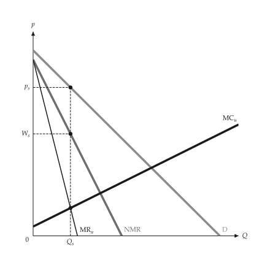{ .ev-figure-sm }

<div class="ev-downloads"><a class="ev-download" href="../../assets/micro-viz/vertical/vertical.py" download aria-label="Download the source"><svg viewBox="0 0 24 24" aria-hidden="true"><path d="M12 4v11m0 0-4.5-4.5M12 15l4.5-4.5M5 20h14" fill="none" stroke="currentColor" stroke-width="2" stroke-linecap="round" stroke-linejoin="round"/></svg><span>Download the source</span></a></div>

<figcaption markdown>*Double marginalization.* Downstream NMR is the upstream demand; two markups make output lower.</figcaption>

</figure>

<span id="fig-vertical-integrated-firm"></span>

<figure class="ev-fig" markdown>

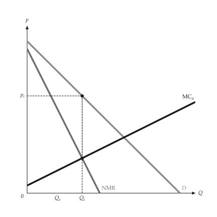{ .ev-figure-sm }

<div class="ev-downloads"><a class="ev-download" href="../../assets/micro-viz/vertical/vertical.py" download aria-label="Download the source"><svg viewBox="0 0 24 24" aria-hidden="true"><path d="M12 4v11m0 0-4.5-4.5M12 15l4.5-4.5M5 20h14" fill="none" stroke="currentColor" stroke-width="2" stroke-linecap="round" stroke-linejoin="round"/></svg><span>Download the source</span></a></div>

<figcaption markdown>*Integrated firm.* The integrated firm sets NMR = upstream MC: more output at a lower price.</figcaption>

</figure>

<span id="fig-vertical-transfer-kinked"></span>

<figure class="ev-fig" markdown>

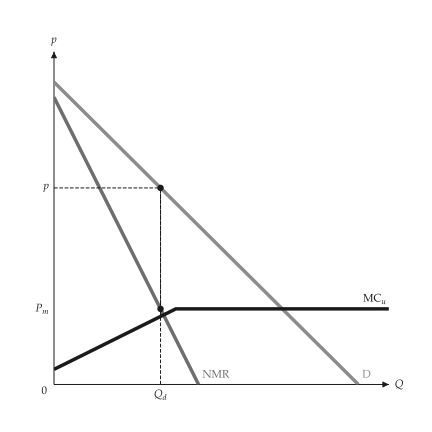{ .ev-figure-sm }

<div class="ev-downloads"><a class="ev-download" href="../../assets/micro-viz/vertical/vertical.py" download aria-label="Download the source"><svg viewBox="0 0 24 24" aria-hidden="true"><path d="M12 4v11m0 0-4.5-4.5M12 15l4.5-4.5M5 20h14" fill="none" stroke="currentColor" stroke-width="2" stroke-linecap="round" stroke-linejoin="round"/></svg><span>Download the source</span></a></div>

<figcaption markdown>*Transfer price, kinked MC.* With an outside market MC kinks at the market price.</figcaption>

</figure>

<span id="fig-vertical-transfer-price"></span>

<figure class="ev-fig" markdown>

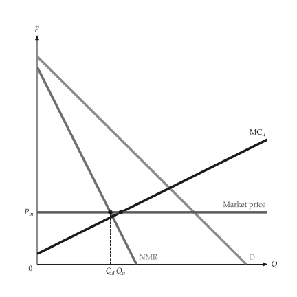{ .ev-figure-sm }

<div class="ev-downloads"><a class="ev-download" href="../../assets/micro-viz/vertical/vertical.py" download aria-label="Download the source"><svg viewBox="0 0 24 24" aria-hidden="true"><path d="M12 4v11m0 0-4.5-4.5M12 15l4.5-4.5M5 20h14" fill="none" stroke="currentColor" stroke-width="2" stroke-linecap="round" stroke-linejoin="round"/></svg><span>Download the source</span></a></div>

<figcaption markdown>*Optimal transfer price.* The optimal internal transfer price is the market price; the rest is sold outside.</figcaption>

</figure>
