# Oligopoly and vertical chains

<span id="sec-oligopoly"></span>

A few firms, and firms at different stages of one chain.

Each section is one example script and the figures it writes. The scripts are in `examples/scripts/` of the repository; `--help` lists their arguments.

## Duopoly

```bash
uv run python examples/scripts/oligopoly.py --output-dir out
```

### Residual demand

Setting: rival output guesses.

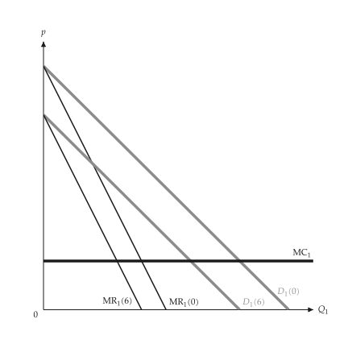{ .ev-figure-sm }

### Reaction curves

Setting: Cournot.

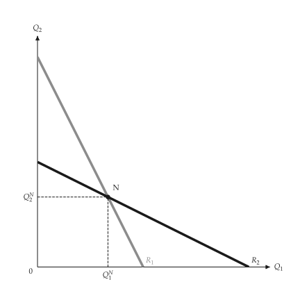{ .ev-figure-sm }

### Competitive, Cournot and collusive

Setting: symmetric.

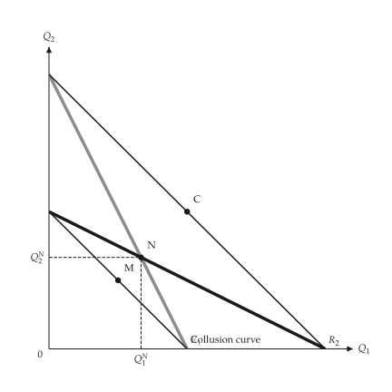{ .ev-figure-sm }

### Stackelberg

Setting: firm 1 leads.

{ .ev-figure-sm }

### Price reaction curves

Setting: differentiated.

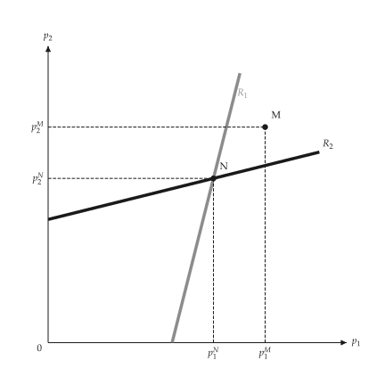{ .ev-figure-sm }

## Kinked demand, dominant firm and cartel

```bash
uv run python examples/scripts/dominant_firm.py --output-dir out
```

### Kinked demand

Setting: two cost levels.

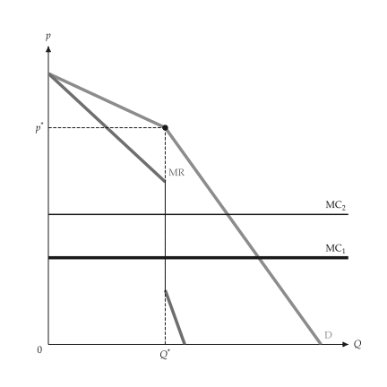{ .ev-figure-sm }

### Dominant firm

Setting: fringe supply.

{ .ev-figure-sm }

### Cartel with a competitive fringe

Setting: same model.

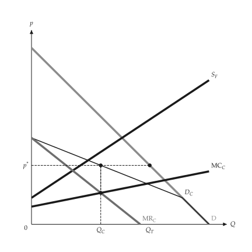{ .ev-figure-sm }

### Cartel, inelastic and elastic demand

Setting: two panels.

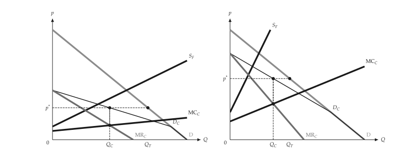{ .ev-figure-lg }

## Vertical chains

```bash
uv run python examples/scripts/vertical.py --output-dir out
```

### Double marginalization

Setting: stacked monopolies.

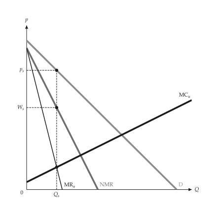{ .ev-figure-sm }

### Integrated firm

Setting: NMR = MC.

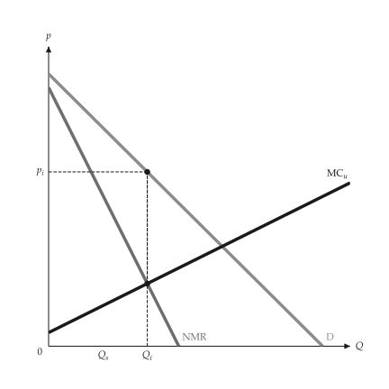{ .ev-figure-sm }

### Transfer price, kinked MC

Setting: outside market.

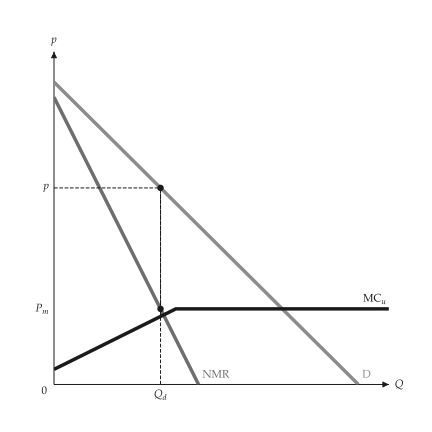{ .ev-figure-sm }

### Optimal transfer price

Setting: equals market price.

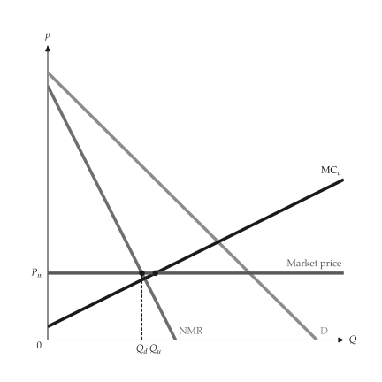{ .ev-figure-sm }
