# Production and costs

<span id="sec-production-costs"></span>

Short-run production and the cost curves that follow from it.

Each section is one example script and the figures it writes. The scripts are in `examples/scripts/` of the repository; `--help` lists their arguments.

## Short-run production

```bash
uv run python examples/scripts/production.py --output-dir out
```

### Total product

Setting: cubic.

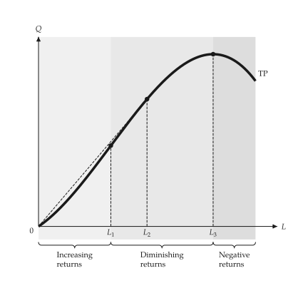{ .ev-figure-sm }

### Average and marginal product

Setting: cubic.

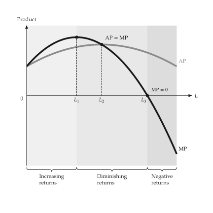{ .ev-figure-sm }

### Total product, shade under the curve

Setting: cubic.

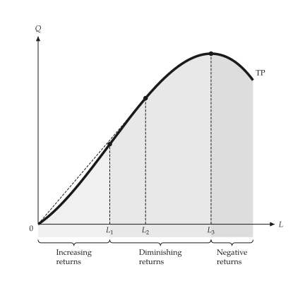{ .ev-figure-sm }

### Average and marginal product, shade under the curve

Setting: cubic.

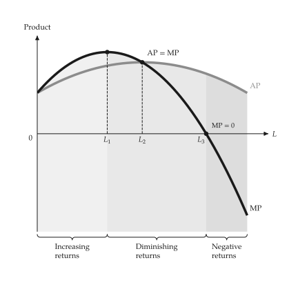{ .ev-figure-sm }

## Short-run costs

```bash
uv run python examples/scripts/costs.py --output-dir out
```

### Total, variable and fixed cost

Setting: cubic.

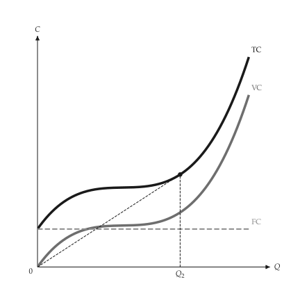{ .ev-figure-sm }

### Unit costs

Setting: cubic.

{ .ev-figure-sm }

### AVC and MC of a cubic cost

Setting: cubic.

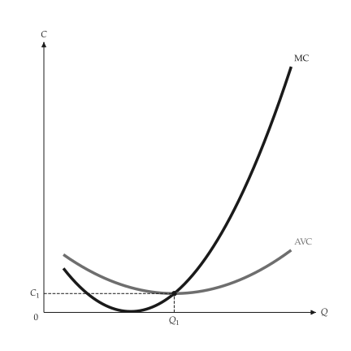{ .ev-figure-sm }

### Cost curves

Setting: cubic, two panels.

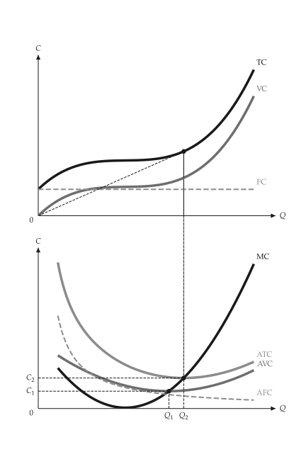{ .ev-figure-sm }

### Total cost panel

Setting: cubic.

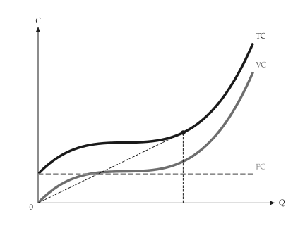{ .ev-figure-sm }

### Unit cost panel

Setting: cubic.

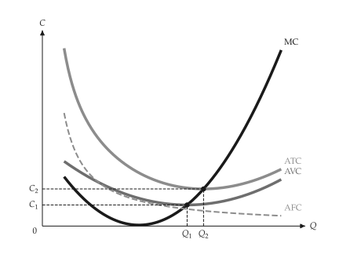{ .ev-figure-sm }

## Stepped and kinked cost

```bash
uv run python examples/scripts/piecewise_costs.py --output-dir out
```

### Stepped marginal cost

Setting: two plants.

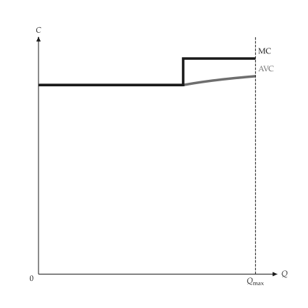{ .ev-figure-sm }

### Stepped cost and output

Setting: two prices.

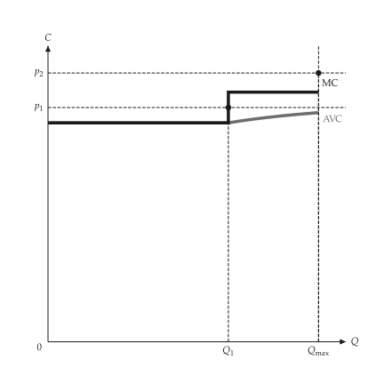{ .ev-figure-sm }

### Kinked marginal cost

Setting: capacity.

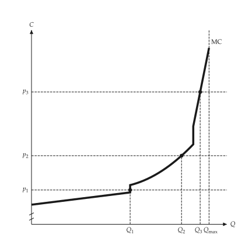{ .ev-figure-sm }
