# Production and costs

<span id="sec-production-costs"></span>

Short-run production and the cost curves that follow from it.

Each section is one example script and the figures it draws. The scripts come in the examples archive; `--help` lists their arguments.

## Short-run production

<span id="sec-ex-production"></span>

One variable input and one fixed input give total, average and marginal product. The marginal-return regions are classified from the model and shaded in the figure.

<!-- api: micro_viz.guides_production_costs_1 -->

`ShortRunProductionFunction` is the cubic production function $Q = a L + b L^2 + c L^3$; `analyze_production()` samples TP, AP and MP and classifies the range into regions of increasing, diminishing and negative marginal returns.

<!-- api: micro_viz.guides_production_costs_2 -->

An AP/MP diagram with the marginal-return regions and the AP = MP and MP = 0 points.

<!-- api: micro_viz.guides_production_costs_3 -->

A TP diagram: the curve, its three marginal-return regions and the boundary guides.

The function of the script that draws the figures follows.

```python
def production_examples(
    output_dir: Path,
    theme: PlotTheme,
    *,
    function: ShortRunProductionFunction,
    input_range: tuple[float, float],
    samples: int,
    region_colors: dict[str, str] | None = None,
    title: str | None = None,
) -> tuple[Path, Path]:
    """Write the two production examples into ``output_dir`` and return their paths."""
    analysis = analyze_production(
        function, input_range=input_range, samples=samples
    )
    output_dir.mkdir(parents=True, exist_ok=True)
    total_output = output_dir / "total_product.svg"
    products_output = (
        output_dir / "average_marginal_product.svg"
    )
    total_product_canvas(
        analysis,
        theme=theme,
        title=title,
        region_colors=region_colors,
    ).save(total_output)
    average_marginal_product_canvas(
        analysis,
        theme=theme,
        title=title,
        region_colors=region_colors,
    ).save(products_output)
    # The same figures with the shade stopping at the curve instead of reaching the top.
    under = replace(theme, region_extent="curve")
    total_product_canvas(
        analysis,
        theme=under,
        title=title,
        region_colors=region_colors,
    ).save(output_dir / "total_product_under_curve.svg")
    average_marginal_product_canvas(
        analysis,
        theme=under,
        title=title,
        region_colors=region_colors,
    ).save(
        output_dir / "average_marginal_product_under_curve.svg"
    )
    return total_output, products_output
```

<span id="fig-production-total-product"></span>

<figure class="ev-fig" markdown>

{ .ev-figure-sm }

<div class="ev-downloads"><a class="ev-download" href="../../assets/micro-viz/production/production.py" download aria-label="Download the source"><svg viewBox="0 0 24 24" aria-hidden="true"><path d="M12 4v11m0 0-4.5-4.5M12 15l4.5-4.5M5 20h14" fill="none" stroke="currentColor" stroke-width="2" stroke-linecap="round" stroke-linejoin="round"/></svg><span>Download the source</span></a></div>

<figcaption markdown>*Total product.* Short-run total product, with the regions of increasing and diminishing marginal returns marked.</figcaption>

</figure>

<span id="fig-production-average-marginal-product"></span>

<figure class="ev-fig" markdown>

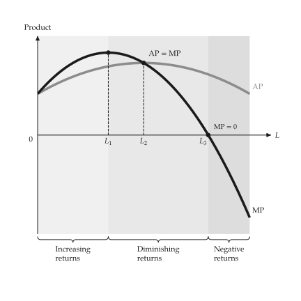{ .ev-figure-sm }

<div class="ev-downloads"><a class="ev-download" href="../../assets/micro-viz/production/production.py" download aria-label="Download the source"><svg viewBox="0 0 24 24" aria-hidden="true"><path d="M12 4v11m0 0-4.5-4.5M12 15l4.5-4.5M5 20h14" fill="none" stroke="currentColor" stroke-width="2" stroke-linecap="round" stroke-linejoin="round"/></svg><span>Download the source</span></a></div>

<figcaption markdown>*Average and marginal product.* Average and marginal product; MP crosses AP at the top of AP.</figcaption>

</figure>

<span id="fig-production-total-product-under-curve"></span>

<figure class="ev-fig" markdown>

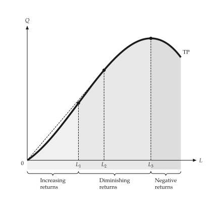{ .ev-figure-sm }

<div class="ev-downloads"><a class="ev-download" href="../../assets/micro-viz/production/production.py" download aria-label="Download the source"><svg viewBox="0 0 24 24" aria-hidden="true"><path d="M12 4v11m0 0-4.5-4.5M12 15l4.5-4.5M5 20h14" fill="none" stroke="currentColor" stroke-width="2" stroke-linecap="round" stroke-linejoin="round"/></svg><span>Download the source</span></a></div>

<figcaption markdown>*Total product, shade under the curve.* The same regions, shaded only down to the curve.</figcaption>

</figure>

<span id="fig-production-average-marginal-product-under-curve"></span>

<figure class="ev-fig" markdown>

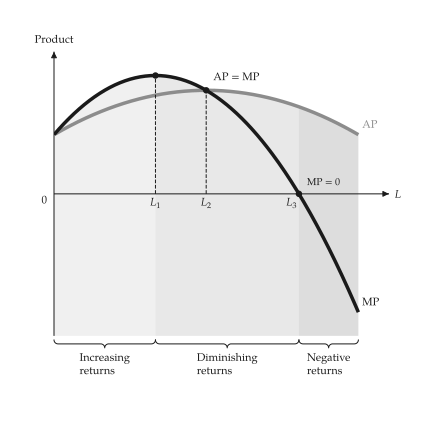{ .ev-figure-sm }

<div class="ev-downloads"><a class="ev-download" href="../../assets/micro-viz/production/production.py" download aria-label="Download the source"><svg viewBox="0 0 24 24" aria-hidden="true"><path d="M12 4v11m0 0-4.5-4.5M12 15l4.5-4.5M5 20h14" fill="none" stroke="currentColor" stroke-width="2" stroke-linecap="round" stroke-linejoin="round"/></svg><span>Download the source</span></a></div>

<figcaption markdown>*Average and marginal product, shade under the curve.* The same regions, shaded only down to the AP and MP curves.</figcaption>

</figure>

## Short-run costs

<span id="sec-ex-costs"></span>

A cubic cost function gives total, variable and fixed cost and the four unit costs. MC passes through the lowest points of AVC and ATC.

<!-- api: micro_viz.guides_production_costs_4 -->

`CubicCost` is $\text{TC} = \text{FC} + b Q + c Q^2 + d Q^3$; `analyze_costs()` evaluates every cost measure over an output range and finds the minima of AVC and ATC.

<!-- api: micro_viz.guides_production_costs_5 -->

The total-cost panel above the per-unit panel, sharing the output axis.

<!-- api: micro_viz.guides_production_costs_6 -->

The two panels of `cost_curves_grid` as separate canvases: total cost, then unit costs, on the same output axis. Each stands alone as a figure.

<!-- api: micro_viz.guides_production_costs_7 -->

TC, VC and FC against output.

<!-- api: micro_viz.guides_production_costs_8 -->

MC, ATC, AVC and AFC against output (choose a subset with `curves`).

The function of the script that draws the figures follows.

```python
def cost_examples(
    output_dir: Path,
    theme: PlotTheme,
    *,
    cost: CubicCost,
    min_output: float,
    max_output: float,
    samples: int,
    avc_reach: float = 1.15,
    title: str | None = None,
) -> list[Path]:
    """Write the cost-curve examples for ``cost`` into ``output_dir`` and return the paths."""
    analysis = analyze_costs(
        cost,
        output_range=(min_output, max_output),
        samples=samples,
    )
    no_fixed = analyze_costs(
        CubicCost(
            fixed_cost=0.0,
            linear=cost.linear,
            quadratic=cost.quadratic,
            cubic=cost.cubic,
            output_symbol=cost.output_symbol,
        ),
        output_range=(min_output, max_output * avc_reach),
        samples=samples,
    )
    total_panel, unit_panel = cost_curves_panels(
        analysis, theme=theme, titles=(title, None)
    )
    output_dir.mkdir(parents=True, exist_ok=True)
    figures = {
        "total_cost.svg": total_cost_canvas(
            analysis, theme=theme, title=title
        ),
        "unit_cost.svg": unit_cost_canvas(
            analysis, theme=theme, title=title
        ),
        "cubic_avc_mc.svg": unit_cost_canvas(
            no_fixed,
            curves=("mc", "avc"),
            theme=theme,
            title=title,
        ),
        "cost_curves_total.svg": total_panel,
        "cost_curves_unit.svg": unit_panel,
        "cost_curves.svg": cost_curves_grid(
            analysis, theme=theme, titles=(title, None)
        ),
    }
    paths = []
    for name, figure in figures.items():
        figure.save(output_dir / name)
        paths.append(output_dir / name)
    return paths
```

<span id="fig-costs-total-cost"></span>

<figure class="ev-fig" markdown>

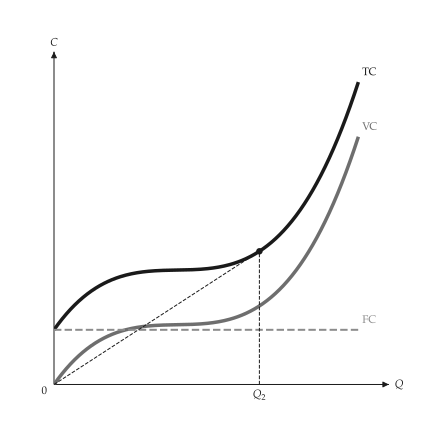{ .ev-figure-sm }

<div class="ev-downloads"><a class="ev-download" href="../../assets/micro-viz/costs/costs.py" download aria-label="Download the source"><svg viewBox="0 0 24 24" aria-hidden="true"><path d="M12 4v11m0 0-4.5-4.5M12 15l4.5-4.5M5 20h14" fill="none" stroke="currentColor" stroke-width="2" stroke-linecap="round" stroke-linejoin="round"/></svg><span>Download the source</span></a></div>

<figcaption markdown>*Total, variable and fixed cost.* Total, variable and fixed cost.</figcaption>

</figure>

<span id="fig-costs-unit-cost"></span>

<figure class="ev-fig" markdown>

{ .ev-figure-sm }

<div class="ev-downloads"><a class="ev-download" href="../../assets/micro-viz/costs/costs.py" download aria-label="Download the source"><svg viewBox="0 0 24 24" aria-hidden="true"><path d="M12 4v11m0 0-4.5-4.5M12 15l4.5-4.5M5 20h14" fill="none" stroke="currentColor" stroke-width="2" stroke-linecap="round" stroke-linejoin="round"/></svg><span>Download the source</span></a></div>

<figcaption markdown>*Unit costs.* MC, ATC, AVC and AFC; MC passes through the lowest points of AVC and ATC.</figcaption>

</figure>

<span id="fig-costs-cubic-avc-mc"></span>

<figure class="ev-fig" markdown>

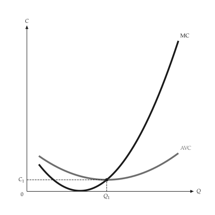{ .ev-figure-sm }

<div class="ev-downloads"><a class="ev-download" href="../../assets/micro-viz/costs/costs.py" download aria-label="Download the source"><svg viewBox="0 0 24 24" aria-hidden="true"><path d="M12 4v11m0 0-4.5-4.5M12 15l4.5-4.5M5 20h14" fill="none" stroke="currentColor" stroke-width="2" stroke-linecap="round" stroke-linejoin="round"/></svg><span>Download the source</span></a></div>

<figcaption markdown>*AVC and MC of a cubic cost.* AVC and MC of a cubic cost function.</figcaption>

</figure>

<span id="fig-costs-cost-curves"></span>

<figure class="ev-fig" markdown>

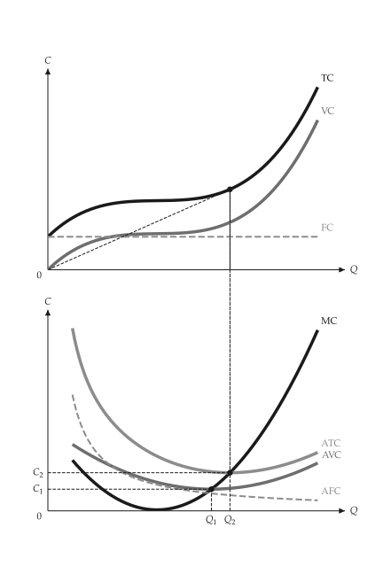{ .ev-figure-sm }

<div class="ev-downloads"><a class="ev-download" href="../../assets/micro-viz/costs/costs.py" download aria-label="Download the source"><svg viewBox="0 0 24 24" aria-hidden="true"><path d="M12 4v11m0 0-4.5-4.5M12 15l4.5-4.5M5 20h14" fill="none" stroke="currentColor" stroke-width="2" stroke-linecap="round" stroke-linejoin="round"/></svg><span>Download the source</span></a></div>

<figcaption markdown>*Cost curves.* Total cost above unit costs on a shared output axis.</figcaption>

</figure>

<span id="fig-costs-cost-curves-total"></span>

<figure class="ev-fig" markdown>

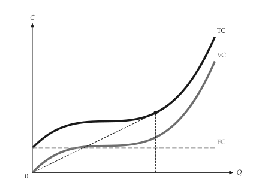{ .ev-figure-sm }

<div class="ev-downloads"><a class="ev-download" href="../../assets/micro-viz/costs/costs.py" download aria-label="Download the source"><svg viewBox="0 0 24 24" aria-hidden="true"><path d="M12 4v11m0 0-4.5-4.5M12 15l4.5-4.5M5 20h14" fill="none" stroke="currentColor" stroke-width="2" stroke-linecap="round" stroke-linejoin="round"/></svg><span>Download the source</span></a></div>

<figcaption markdown>*Total cost panel.* The total-cost panel of the two-panel figure, usable on its own.</figcaption>

</figure>

<span id="fig-costs-cost-curves-unit"></span>

<figure class="ev-fig" markdown>

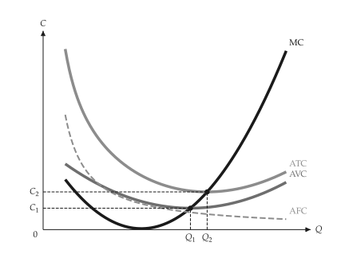{ .ev-figure-sm }

<div class="ev-downloads"><a class="ev-download" href="../../assets/micro-viz/costs/costs.py" download aria-label="Download the source"><svg viewBox="0 0 24 24" aria-hidden="true"><path d="M12 4v11m0 0-4.5-4.5M12 15l4.5-4.5M5 20h14" fill="none" stroke="currentColor" stroke-width="2" stroke-linecap="round" stroke-linejoin="round"/></svg><span>Download the source</span></a></div>

<figcaption markdown>*Unit cost panel.* The unit-cost panel of the two-panel figure, usable on its own.</figcaption>

</figure>

## Stepped and kinked cost

<span id="sec-ex-piecewise-costs"></span>

Several plants of fixed capacity give a stepped marginal cost; one plant with a capacity limit gives a kinked one.

<!-- api: micro_viz.guides_production_costs_9 -->

`PiecewiseCost` joins `CostSegment` pieces, each with its own capacity and marginal cost; it is a `CostFunction`, so `analyze_costs()` accepts it.

<!-- api: micro_viz.guides_production_costs_10 -->

Stepped or kinked marginal cost with its capacity and price bands.

The function of the script that draws the figures follows.

```python
def piecewise_examples(
    output_dir: Path,
    theme: PlotTheme,
    *,
    stepped: PiecewiseCost,
    kinked: PiecewiseCost,
    prices: tuple[float, ...],
    kinked_prices: tuple[float, ...],
    kinked_y_min: float,
    samples: int,
    title: str | None = None,
) -> list[Path]:
    """Write the stepped and kinked marginal-cost examples into ``output_dir``."""
    output_dir.mkdir(parents=True, exist_ok=True)
    step_analysis = analyze_costs(
        stepped,
        output_range=(0.0, stepped.capacity),
        samples=samples,
    )
    kink_analysis = analyze_costs(
        kinked,
        output_range=(0.0, kinked.capacity),
        samples=samples,
    )
    kink_top = max(
        value for _, value in kink_analysis.marginal_cost_path
    )
    figures = {
        "stepped_cost.svg": piecewise_cost_canvas(
            step_analysis, theme=theme, title=title
        ),
        "stepped_cost_prices.svg": piecewise_cost_canvas(
            step_analysis,
            prices=prices,
            theme=theme,
            title=title,
        ),
        "kinked_marginal_cost.svg": piecewise_cost_canvas(
            kink_analysis,
            prices=kinked_prices,
            average=False,
            y_range=(
                kinked_y_min,
                kink_top + (kink_top - kinked_y_min) * 0.1,
            ),
            theme=theme,
            title=title,
        ),
    }
    for name, figure in figures.items():
        figure.save(output_dir / name)
    return [output_dir / name for name in figures]
```

<span id="fig-piecewise-costs-stepped-cost"></span>

<figure class="ev-fig" markdown>

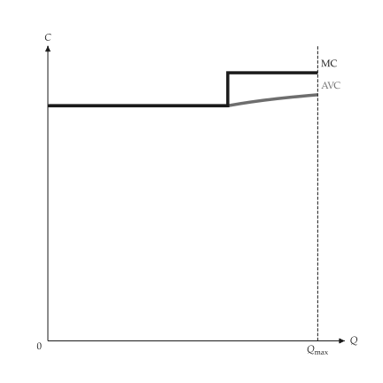{ .ev-figure-sm }

<div class="ev-downloads"><a class="ev-download" href="../../assets/micro-viz/piecewise_costs/piecewise_costs.py" download aria-label="Download the source"><svg viewBox="0 0 24 24" aria-hidden="true"><path d="M12 4v11m0 0-4.5-4.5M12 15l4.5-4.5M5 20h14" fill="none" stroke="currentColor" stroke-width="2" stroke-linecap="round" stroke-linejoin="round"/></svg><span>Download the source</span></a></div>

<figcaption markdown>*Stepped marginal cost.* Stepped marginal cost of several plants.</figcaption>

</figure>

<span id="fig-piecewise-costs-stepped-cost-prices"></span>

<figure class="ev-fig" markdown>

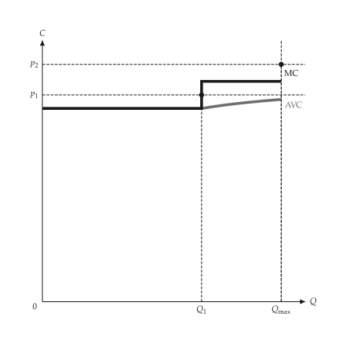{ .ev-figure-sm }

<div class="ev-downloads"><a class="ev-download" href="../../assets/micro-viz/piecewise_costs/piecewise_costs.py" download aria-label="Download the source"><svg viewBox="0 0 24 24" aria-hidden="true"><path d="M12 4v11m0 0-4.5-4.5M12 15l4.5-4.5M5 20h14" fill="none" stroke="currentColor" stroke-width="2" stroke-linecap="round" stroke-linejoin="round"/></svg><span>Download the source</span></a></div>

<figcaption markdown>*Stepped cost and output.* Output jumps as the price crosses a step.</figcaption>

</figure>

<span id="fig-piecewise-costs-kinked-marginal-cost"></span>

<figure class="ev-fig" markdown>

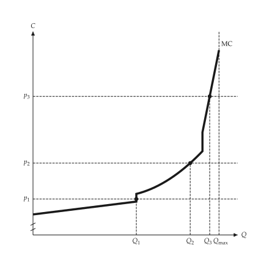{ .ev-figure-sm }

<div class="ev-downloads"><a class="ev-download" href="../../assets/micro-viz/piecewise_costs/piecewise_costs.py" download aria-label="Download the source"><svg viewBox="0 0 24 24" aria-hidden="true"><path d="M12 4v11m0 0-4.5-4.5M12 15l4.5-4.5M5 20h14" fill="none" stroke="currentColor" stroke-width="2" stroke-linecap="round" stroke-linejoin="round"/></svg><span>Download the source</span></a></div>

<figcaption markdown>*Kinked marginal cost.* Kinked marginal cost with a capacity limit.</figcaption>

</figure>
