# Uncertainty and information

<span id="sec-uncertainty"></span>

Risk, auctions and asymmetric information.

Each section is one example script and the figures it writes. The scripts are in `examples/scripts/` of the repository; `--help` lists their arguments.

## Choice under uncertainty

```bash
uv run python examples/scripts/uncertainty.py --output-dir out
```

### Utility of income

Setting: concave, convex, linear.

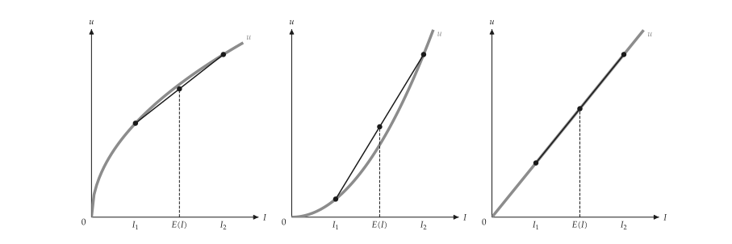{ .ev-figure-lg }

### Risk premium

Setting: concave utility.

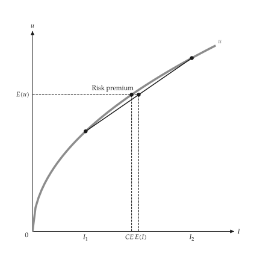{ .ev-figure-sm }

### Risk attitude

Setting: steep and flat.

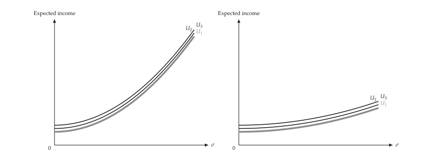{ .ev-figure-lg }

### Risk-return choice

Setting: one investor.

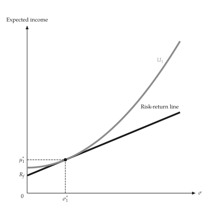{ .ev-figure-sm }

### Two investors

Setting: different tangencies.

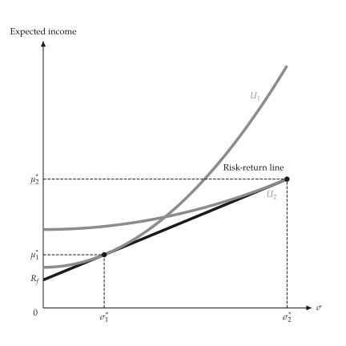{ .ev-figure-sm }

### State claims, fair premium

Setting: full insurance.

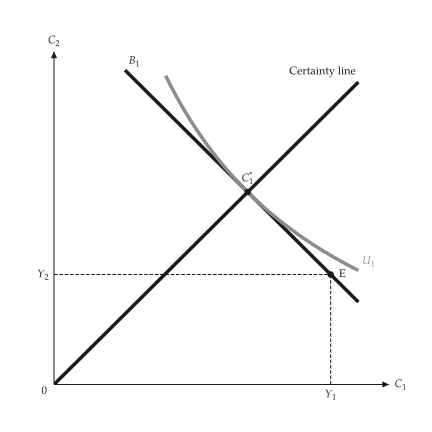{ .ev-figure-sm }

### State claims, unfair premium

Setting: partial insurance.

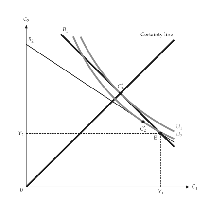{ .ev-figure-sm }

### First-order dominance

Setting: CDF comparison.

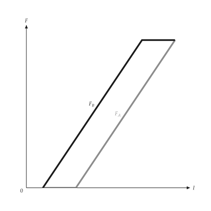{ .ev-figure-sm }

### Second-order dominance

Setting: integrated CDF.

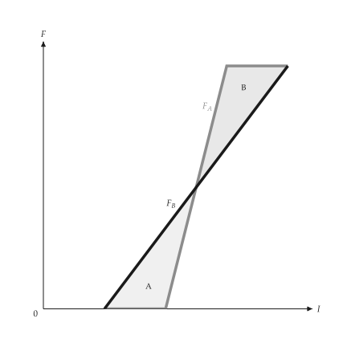{ .ev-figure-sm }

### Mean-variance frontier

Setting: two assets.

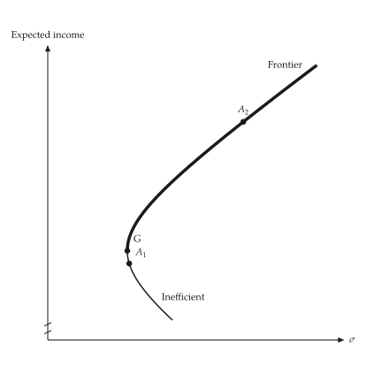{ .ev-figure-sm }

### Borrowing

Setting: beyond the market portfolio.

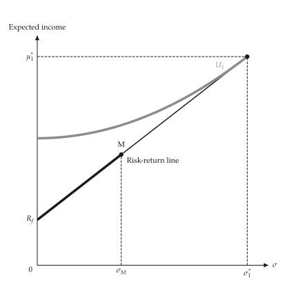{ .ev-figure-sm }

## Auctions

```bash
uv run python examples/scripts/auctions.py --output-dir out
```

### Bid functions

Setting: first and second price.

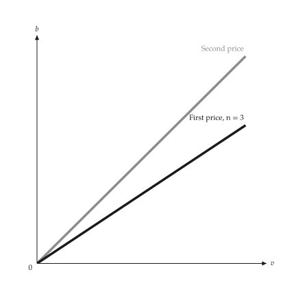{ .ev-figure-sm }

### Bid shading

Setting: by number of bidders.

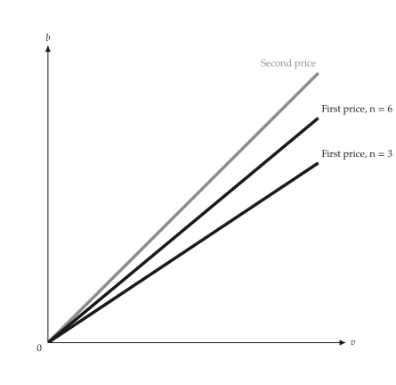{ .ev-figure-sm }

### Revenue equivalence

Setting: expected revenue.

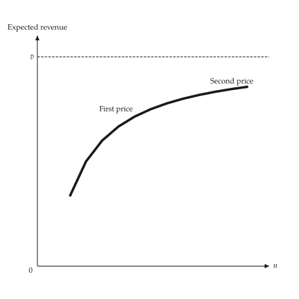{ .ev-figure-sm }

## Information

```bash
uv run python examples/scripts/information.py --output-dir out
```

### Pooling signal

Setting: cheap signal.

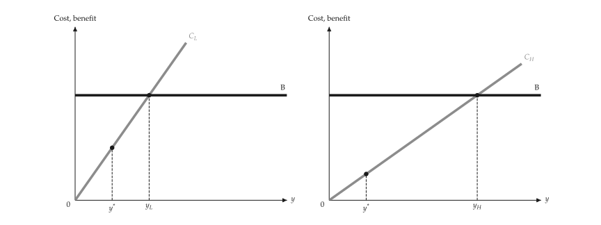{ .ev-figure-lg }

### Lemons market

Setting: two shares.

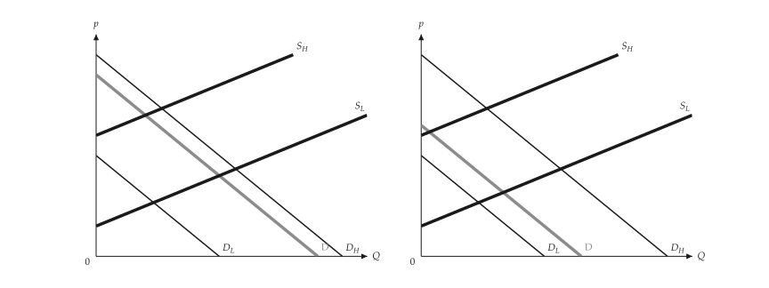{ .ev-figure-lg }

### Signaling

Setting: separating signal.

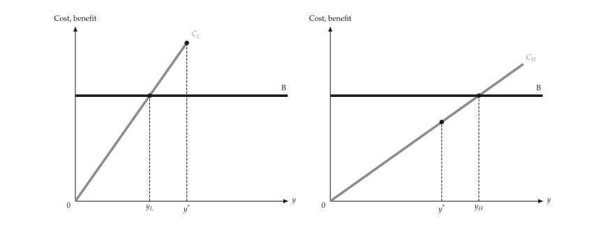{ .ev-figure-lg }

### Moral hazard

Setting: insurance.

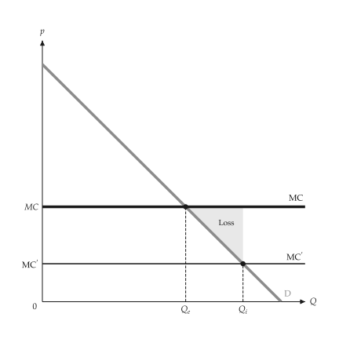{ .ev-figure-sm }

### Bonus schedule

Setting: truthful report.

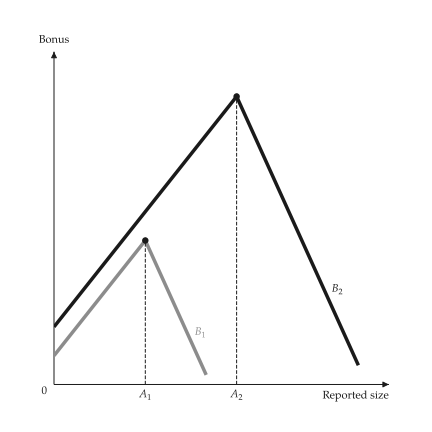{ .ev-figure-sm }

### Efficiency wage

Setting: no-shirking constraint.

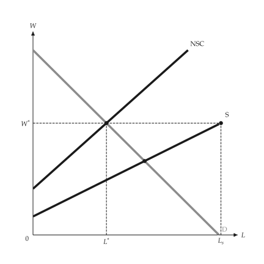{ .ev-figure-sm }
