# Uncertainty and information

<span id="sec-uncertainty"></span>

Risk, auctions and asymmetric information.

Each section is one example script and the figures it draws. The scripts come in the examples archive; `--help` lists their arguments.

## Choice under uncertainty

<span id="sec-ex-uncertainty"></span>

Expected utility and risk attitude, mean-variance choice, state-contingent claims and stochastic dominance. Sources: [Pratt (1964)](../project/references.md#pratt1964), [Rothschild (1970)](../project/references.md#rothschildstiglitz1970), [Markowitz (1952)](../project/references.md#markowitz1952).

<!-- api: micro_viz.guides_uncertainty_1 -->

`Gamble` and `IncomeUtility` give expected utility, the certainty equivalent and the risk premium; `MeanVarianceInvestor` and `RiskReturnLine` solve the risk-return choice; `StateClaims`, `UniformLottery` and `TwoAssetFrontier` cover insurance, dominance and the frontier.

<!-- api: micro_viz.guides_uncertainty_2 -->

The frontier of portfolios of two assets in the standard-deviation-mean plane: the efficient part above the minimum-variance portfolio `G` is thick, the inefficient part thin and solid.

<!-- api: micro_viz.guides_uncertainty_3 -->

One panel of indifference curves per investor in the standard-deviation-income plane: the more risk averse, the steeper the curves.

<!-- api: micro_viz.guides_uncertainty_4 -->

Concave `u` with the chord: the certainty equivalent `CE` has the utility `EU` of the gamble and the risk premium is the gap between `E(I)` and `CE` at that height.

<!-- api: micro_viz.guides_uncertainty_5 -->

The risk-return line with each investor's indifference curve tangent to it. With `market_sd` the market portfolio `M` is marked and the part beyond it (borrowing to hold more risk) is a thin solid segment.

<!-- api: micro_viz.guides_uncertainty_6 -->

State-contingent claims: the 45-degree certainty line, the endowment `E`, one budget line per premium rate (the first thick; a fair rate leads to full insurance on the certainty line, an unfair one to partial insurance) and the indifference curve through each choice.

<!-- api: micro_viz.guides_uncertainty_7 -->

The CDFs `F_A` and `F_B` of two lotteries. `kind="first"` shows `F_A` lying everywhere below `F_B` (A first-order dominates B); `kind="second"` shades the two areas enclosed where the CDFs cross, the larger one lying under the dominated lottery's CDF.

<!-- api: micro_viz.guides_uncertainty_8 -->

One small panel per utility function: `u(I)`, the chord between the two outcomes and the expected utility on it above expected income.

The function of the script that draws the figures follows.

```python
def uncertainty_examples(
    output_dir: Path,
    theme: PlotTheme,
    *,
    gamble: Gamble,
    exponents: tuple[float, float, float],
    averse: float,
    flat: float,
    level: float,
    line: RiskReturnLine,
    sd_max: float,
    market_sd: float,
    claims: StateClaims,
    premiums: tuple[float, float],
    lotteries: tuple[
        UniformLottery,
        UniformLottery,
        UniformLottery,
        UniformLottery,
    ],
    frontier: TwoAssetFrontier,
    title: str | None = None,
) -> list[Path]:
    """Write the uncertainty figures into ``output_dir`` and return their paths."""
    output_dir.mkdir(parents=True, exist_ok=True)
    concave, convex, linear = (
        IncomeUtility(e) for e in exponents
    )
    steep, shallow = (
        MeanVarianceInvestor(averse),
        MeanVarianceInvestor(flat),
    )
    figures = {
        "utility_of_income.svg": utility_of_income_canvas(
            gamble, (concave, convex, linear), theme=theme
        ),
        "risk_premium.svg": risk_premium_canvas(
            gamble, concave, theme=theme, title=title
        ),
        "risk_attitude.svg": risk_attitude_canvas(
            (steep, shallow), level, sd_max, theme=theme
        ),
        "risk_return_choice.svg": risk_return_choice_canvas(
            line,
            (steep,),
            level,
            sd_max,
            theme=theme,
            title=title,
        ),
        "risk_return_two_investors.svg": risk_return_choice_canvas(
            line,
            (steep, shallow),
            level,
            sd_max,
            theme=theme,
            title=title,
        ),
        "state_claims_fair.svg": state_claims_canvas(
            claims, premiums[:1], theme=theme, title=title
        ),
        "state_claims_unfair.svg": state_claims_canvas(
            claims, premiums, theme=theme, title=title
        ),
        "first_order_dominance.svg": stochastic_dominance_canvas(
            lotteries[0],
            lotteries[1],
            "first",
            theme=theme,
            title=title,
        ),
        "second_order_dominance.svg": stochastic_dominance_canvas(
            lotteries[2],
            lotteries[3],
            "second",
            theme=theme,
            title=title,
        ),
        "mean_variance_frontier.svg": mean_variance_frontier_canvas(
            frontier, theme=theme, title=title
        ),
        "risk_return_borrowing.svg": risk_return_choice_canvas(
            line,
            (shallow,),
            level,
            sd_max,
            market_sd,
            theme=theme,
            title=title,
        ),
    }
    paths = []
    for name, figure in figures.items():
        figure.save(output_dir / name)
        paths.append(output_dir / name)
    return paths
```

<span id="fig-uncertainty-utility-of-income"></span>

<figure class="ev-fig" markdown>

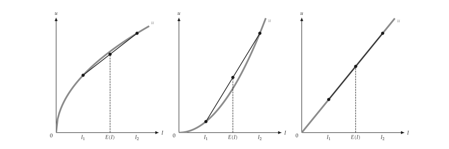{ .ev-figure-sm }

<div class="ev-downloads"><a class="ev-download" href="../../assets/micro-viz/uncertainty/uncertainty.py" download aria-label="Download the source"><svg viewBox="0 0 24 24" aria-hidden="true"><path d="M12 4v11m0 0-4.5-4.5M12 15l4.5-4.5M5 20h14" fill="none" stroke="currentColor" stroke-width="2" stroke-linecap="round" stroke-linejoin="round"/></svg><span>Download the source</span></a></div>

<figcaption markdown>*Utility of income.* Utility of income and the expected-utility chord for three risk attitudes.</figcaption>

</figure>

<span id="fig-uncertainty-risk-premium"></span>

<figure class="ev-fig" markdown>

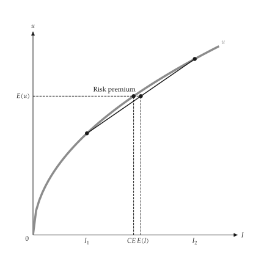{ .ev-figure-sm }

<div class="ev-downloads"><a class="ev-download" href="../../assets/micro-viz/uncertainty/uncertainty.py" download aria-label="Download the source"><svg viewBox="0 0 24 24" aria-hidden="true"><path d="M12 4v11m0 0-4.5-4.5M12 15l4.5-4.5M5 20h14" fill="none" stroke="currentColor" stroke-width="2" stroke-linecap="round" stroke-linejoin="round"/></svg><span>Download the source</span></a></div>

<figcaption markdown>*Risk premium.* The certainty equivalent and the risk premium.</figcaption>

</figure>

<span id="fig-uncertainty-risk-attitude"></span>

<figure class="ev-fig" markdown>

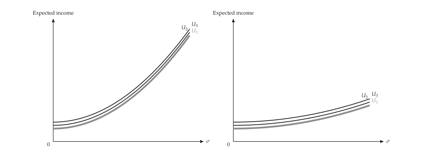{ .ev-figure-sm }

<div class="ev-downloads"><a class="ev-download" href="../../assets/micro-viz/uncertainty/uncertainty.py" download aria-label="Download the source"><svg viewBox="0 0 24 24" aria-hidden="true"><path d="M12 4v11m0 0-4.5-4.5M12 15l4.5-4.5M5 20h14" fill="none" stroke="currentColor" stroke-width="2" stroke-linecap="round" stroke-linejoin="round"/></svg><span>Download the source</span></a></div>

<figcaption markdown>*Risk attitude.* The more risk averse, the steeper the indifference curves.</figcaption>

</figure>

<span id="fig-uncertainty-risk-return-choice"></span>

<figure class="ev-fig" markdown>

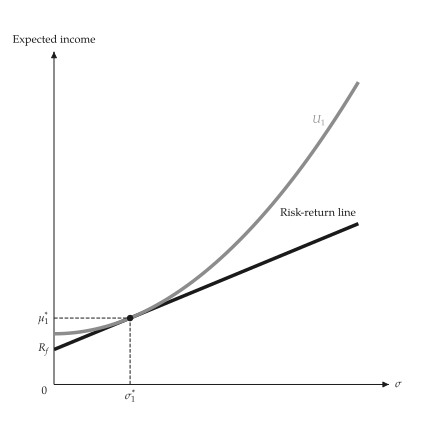{ .ev-figure-sm }

<div class="ev-downloads"><a class="ev-download" href="../../assets/micro-viz/uncertainty/uncertainty.py" download aria-label="Download the source"><svg viewBox="0 0 24 24" aria-hidden="true"><path d="M12 4v11m0 0-4.5-4.5M12 15l4.5-4.5M5 20h14" fill="none" stroke="currentColor" stroke-width="2" stroke-linecap="round" stroke-linejoin="round"/></svg><span>Download the source</span></a></div>

<figcaption markdown>*Risk-return choice.* The indifference curve touches the risk-return line.</figcaption>

</figure>

<span id="fig-uncertainty-risk-return-two-investors"></span>

<figure class="ev-fig" markdown>

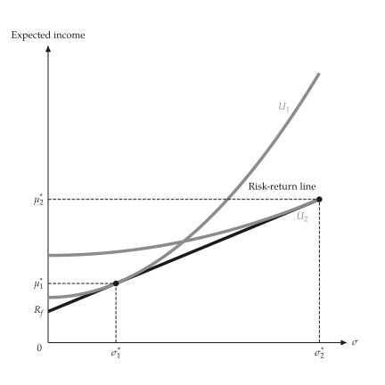{ .ev-figure-sm }

<div class="ev-downloads"><a class="ev-download" href="../../assets/micro-viz/uncertainty/uncertainty.py" download aria-label="Download the source"><svg viewBox="0 0 24 24" aria-hidden="true"><path d="M12 4v11m0 0-4.5-4.5M12 15l4.5-4.5M5 20h14" fill="none" stroke="currentColor" stroke-width="2" stroke-linecap="round" stroke-linejoin="round"/></svg><span>Download the source</span></a></div>

<figcaption markdown>*Two investors.* Investors with different risk aversion pick different tangencies.</figcaption>

</figure>

<span id="fig-uncertainty-state-claims-fair"></span>

<figure class="ev-fig" markdown>

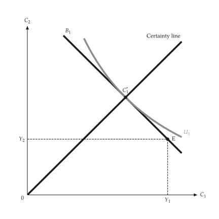{ .ev-figure-sm }

<div class="ev-downloads"><a class="ev-download" href="../../assets/micro-viz/uncertainty/uncertainty.py" download aria-label="Download the source"><svg viewBox="0 0 24 24" aria-hidden="true"><path d="M12 4v11m0 0-4.5-4.5M12 15l4.5-4.5M5 20h14" fill="none" stroke="currentColor" stroke-width="2" stroke-linecap="round" stroke-linejoin="round"/></svg><span>Download the source</span></a></div>

<figcaption markdown>*State claims, fair premium.* At a fair premium the consumer chooses full insurance, equal income in both states.</figcaption>

</figure>

<span id="fig-uncertainty-state-claims-unfair"></span>

<figure class="ev-fig" markdown>

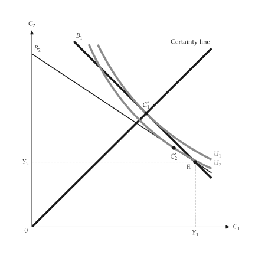{ .ev-figure-sm }

<div class="ev-downloads"><a class="ev-download" href="../../assets/micro-viz/uncertainty/uncertainty.py" download aria-label="Download the source"><svg viewBox="0 0 24 24" aria-hidden="true"><path d="M12 4v11m0 0-4.5-4.5M12 15l4.5-4.5M5 20h14" fill="none" stroke="currentColor" stroke-width="2" stroke-linecap="round" stroke-linejoin="round"/></svg><span>Download the source</span></a></div>

<figcaption markdown>*State claims, unfair premium.* At an unfair premium the consumer buys only partial insurance.</figcaption>

</figure>

<span id="fig-uncertainty-first-order-dominance"></span>

<figure class="ev-fig" markdown>

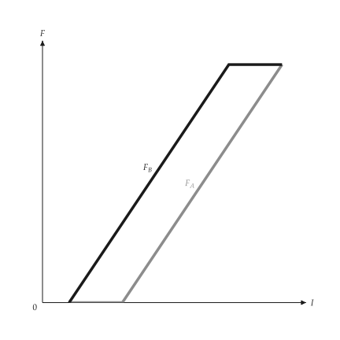{ .ev-figure-sm }

<div class="ev-downloads"><a class="ev-download" href="../../assets/micro-viz/uncertainty/uncertainty.py" download aria-label="Download the source"><svg viewBox="0 0 24 24" aria-hidden="true"><path d="M12 4v11m0 0-4.5-4.5M12 15l4.5-4.5M5 20h14" fill="none" stroke="currentColor" stroke-width="2" stroke-linecap="round" stroke-linejoin="round"/></svg><span>Download the source</span></a></div>

<figcaption markdown>*First-order dominance.* One CDF lies everywhere below the other: first-order dominance.</figcaption>

</figure>

<span id="fig-uncertainty-second-order-dominance"></span>

<figure class="ev-fig" markdown>

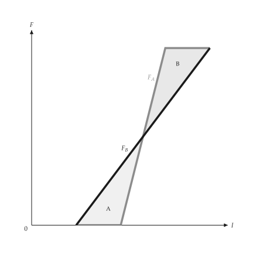{ .ev-figure-sm }

<div class="ev-downloads"><a class="ev-download" href="../../assets/micro-viz/uncertainty/uncertainty.py" download aria-label="Download the source"><svg viewBox="0 0 24 24" aria-hidden="true"><path d="M12 4v11m0 0-4.5-4.5M12 15l4.5-4.5M5 20h14" fill="none" stroke="currentColor" stroke-width="2" stroke-linecap="round" stroke-linejoin="round"/></svg><span>Download the source</span></a></div>

<figcaption markdown>*Second-order dominance.* With equal means the less spread lottery dominates at second order.</figcaption>

</figure>

<span id="fig-uncertainty-mean-variance-frontier"></span>

<figure class="ev-fig" markdown>

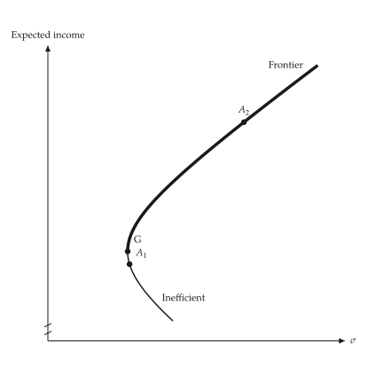{ .ev-figure-sm }

<div class="ev-downloads"><a class="ev-download" href="../../assets/micro-viz/uncertainty/uncertainty.py" download aria-label="Download the source"><svg viewBox="0 0 24 24" aria-hidden="true"><path d="M12 4v11m0 0-4.5-4.5M12 15l4.5-4.5M5 20h14" fill="none" stroke="currentColor" stroke-width="2" stroke-linecap="round" stroke-linejoin="round"/></svg><span>Download the source</span></a></div>

<figcaption markdown>*Mean-variance frontier.* The efficient frontier of two assets and its inefficient part.</figcaption>

</figure>

<span id="fig-uncertainty-risk-return-borrowing"></span>

<figure class="ev-fig" markdown>

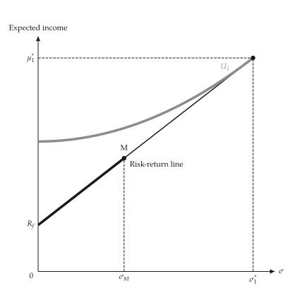{ .ev-figure-sm }

<div class="ev-downloads"><a class="ev-download" href="../../assets/micro-viz/uncertainty/uncertainty.py" download aria-label="Download the source"><svg viewBox="0 0 24 24" aria-hidden="true"><path d="M12 4v11m0 0-4.5-4.5M12 15l4.5-4.5M5 20h14" fill="none" stroke="currentColor" stroke-width="2" stroke-linecap="round" stroke-linejoin="round"/></svg><span>Download the source</span></a></div>

<figcaption markdown>*Borrowing.* Borrowing allows more risk than the market portfolio.</figcaption>

</figure>

## Auctions

<span id="sec-ex-auctions"></span>

First- and second-price sealed-bid auctions with independent uniform values: the bid functions and revenue equivalence. Sources: [Vickrey (1961)](../project/references.md#vickrey1961).

<!-- api: micro_viz.guides_uncertainty_9 -->

`Auction` gives the bid at a value and the expected revenue under both formats.

<!-- api: micro_viz.guides_uncertainty_10 -->

Bid against value: the 45-degree second-price bid `b = v` and, for each auction in `auctions`, the first-price bid `b = (n - 1) v / n` below it (the gap is the shading, smaller with more bidders).

<!-- api: micro_viz.guides_uncertainty_11 -->

Expected seller revenue against the number of bidders under both formats: the curves coincide (revenue equivalence), rising toward the largest possible value.

The function of the script that draws the figures follows.

```python
def auction_examples(
    output_dir: Path,
    theme: PlotTheme,
    *,
    bidders: tuple[int, ...],
    max_value: float,
    title: str | None = None,
) -> list[Path]:
    """Write the auction figures into ``output_dir`` and return their paths."""
    output_dir.mkdir(parents=True, exist_ok=True)
    figures = {
        "bid_functions.svg": bid_functions_canvas(
            (Auction(bidders[0], max_value),),
            theme=theme,
            title=title,
        ),
        "bid_functions_by_bidders.svg": bid_functions_canvas(
            tuple(Auction(n, max_value) for n in bidders),
            theme=theme,
            title=title,
        ),
        "revenue_equivalence.svg": revenue_equivalence_canvas(
            tuple(range(2, max(bidders) + 8)),
            max_value,
            theme=theme,
            title=title,
        ),
    }
    paths = []
    for name, figure in figures.items():
        figure.save(output_dir / name)
        paths.append(output_dir / name)
    return paths
```

<span id="fig-auctions-bid-functions"></span>

<figure class="ev-fig" markdown>

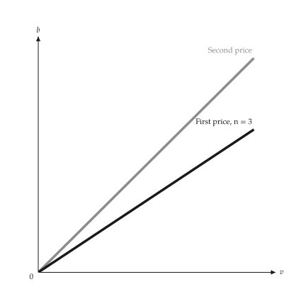{ .ev-figure-sm }

<div class="ev-downloads"><a class="ev-download" href="../../assets/micro-viz/auctions/auctions.py" download aria-label="Download the source"><svg viewBox="0 0 24 24" aria-hidden="true"><path d="M12 4v11m0 0-4.5-4.5M12 15l4.5-4.5M5 20h14" fill="none" stroke="currentColor" stroke-width="2" stroke-linecap="round" stroke-linejoin="round"/></svg><span>Download the source</span></a></div>

<figcaption markdown>*Bid functions.* The second-price bid equals value; the first-price bid is below value.</figcaption>

</figure>

<span id="fig-auctions-bid-functions-by-bidders"></span>

<figure class="ev-fig" markdown>

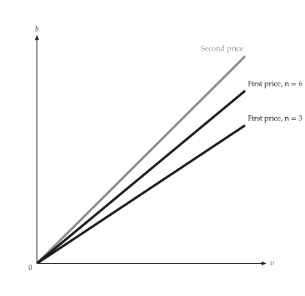{ .ev-figure-sm }

<div class="ev-downloads"><a class="ev-download" href="../../assets/micro-viz/auctions/auctions.py" download aria-label="Download the source"><svg viewBox="0 0 24 24" aria-hidden="true"><path d="M12 4v11m0 0-4.5-4.5M12 15l4.5-4.5M5 20h14" fill="none" stroke="currentColor" stroke-width="2" stroke-linecap="round" stroke-linejoin="round"/></svg><span>Download the source</span></a></div>

<figcaption markdown>*Bid shading.* With more bidders the first-price bid is closer to value.</figcaption>

</figure>

<span id="fig-auctions-revenue-equivalence"></span>

<figure class="ev-fig" markdown>

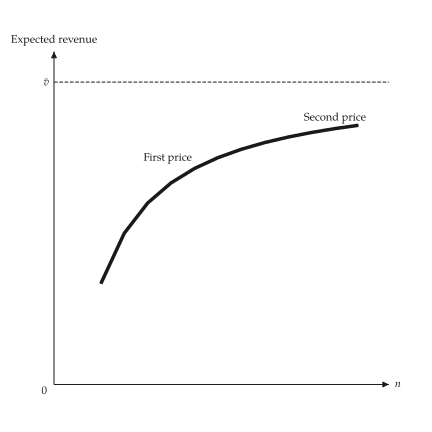{ .ev-figure-sm }

<div class="ev-downloads"><a class="ev-download" href="../../assets/micro-viz/auctions/auctions.py" download aria-label="Download the source"><svg viewBox="0 0 24 24" aria-hidden="true"><path d="M12 4v11m0 0-4.5-4.5M12 15l4.5-4.5M5 20h14" fill="none" stroke="currentColor" stroke-width="2" stroke-linecap="round" stroke-linejoin="round"/></svg><span>Download the source</span></a></div>

<figcaption markdown>*Revenue equivalence.* Both formats give the same expected revenue, rising with the number of bidders.</figcaption>

</figure>

## Information

<span id="sec-ex-information"></span>

Adverse selection, signalling, moral hazard, incentive-compatible bonuses and efficiency wages. Sources: [Akerlof (1970)](../project/references.md#akerlof1970), [Spence (1973)](../project/references.md#spence1973), [Shapiro (1984)](../project/references.md#shapirostiglitz1984).

<!-- api: micro_viz.guides_uncertainty_12 -->

Each model solves one asymmetric-information case; `Signaling` has a separating and a pooling signal.

<!-- api: micro_viz.guides_uncertainty_13 -->

Bonus against the reported plant size `R` for each true capacity: every schedule peaks where the report equals the capacity, so truthful reporting is incentive compatible.

<!-- api: micro_viz.guides_uncertainty_14 -->

Labor demand `D`, supply `S` and the no-shirking constraint `NSC`: equilibrium is where `NSC` meets `D`, at a wage above the competitive one, so `L_s - L*` workers are unemployed.

<!-- api: micro_viz.guides_uncertainty_15 -->

One panel per high-quality share: demands for high (`D_H`) and low (`D_L`) quality, the sellers' reservation lines `S_H` and `S_L` and the demand `D` of buyers who cannot tell them apart. When `D` starts below `S_H` high quality is driven out.

<!-- api: micro_viz.guides_uncertainty_16 -->

Demand `D` against the true marginal cost `MC` and the lower price `MC'` an insured patient faces: use rises from `Q_e` to `Q_i` and the triangle between is the loss.

<!-- api: micro_viz.guides_uncertainty_17 -->

Education cost against the wage benefit for the low-ability group (left) and the high-ability group (right): at a separating signal `y*` only the high group's cost lies below the benefit.

The function of the script that draws the figures follows.

```python
def information_examples(
    output_dir: Path,
    theme: PlotTheme,
    *,
    lemons: LemonsMarket,
    shares: tuple[float, ...],
    signaling: Signaling,
    hazard: MoralHazard,
    bonus: BonusSchedule,
    capacities: tuple[float, ...],
    reach: float,
    efficiency: EfficiencyWage,
    title: str | None = None,
) -> list[Path]:
    """Write the information figures into ``output_dir`` and return their paths."""
    output_dir.mkdir(parents=True, exist_ok=True)
    figures = {
        "lemons.svg": lemons_market_canvas(
            lemons, shares, theme=theme
        ),
        "signaling.svg": signaling_canvas(
            signaling, theme=theme
        ),
        "pooling.svg": signaling_canvas(
            signaling, signaling.low_ceiling / 2, theme=theme
        ),
        "moral_hazard.svg": moral_hazard_canvas(
            hazard, theme=theme, title=title
        ),
        "bonus_schedule.svg": bonus_schedule_canvas(
            bonus, capacities, reach, theme=theme, title=title
        ),
        "efficiency_wage.svg": efficiency_wage_canvas(
            efficiency, theme=theme, title=title
        ),
    }
    paths = []
    for name, figure in figures.items():
        figure.save(output_dir / name)
        paths.append(output_dir / name)
    return paths
```

<span id="fig-information-pooling"></span>

<figure class="ev-fig" markdown>

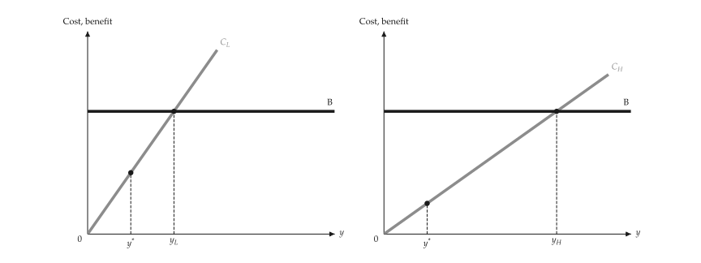{ .ev-figure-sm }

<div class="ev-downloads"><a class="ev-download" href="../../assets/micro-viz/information/information.py" download aria-label="Download the source"><svg viewBox="0 0 24 24" aria-hidden="true"><path d="M12 4v11m0 0-4.5-4.5M12 15l4.5-4.5M5 20h14" fill="none" stroke="currentColor" stroke-width="2" stroke-linecap="round" stroke-linejoin="round"/></svg><span>Download the source</span></a></div>

<figcaption markdown>*Pooling signal.* When the signal is cheap both types buy it, a pooling equilibrium.</figcaption>

</figure>

<span id="fig-information-lemons"></span>

<figure class="ev-fig" markdown>

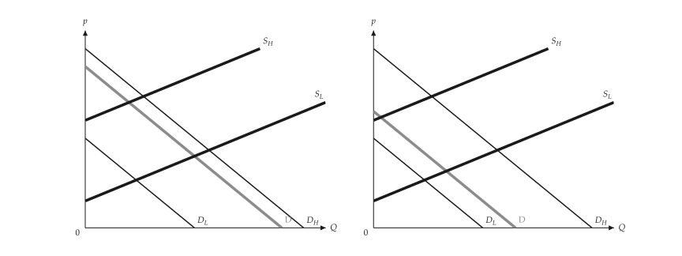{ .ev-figure-sm }

<div class="ev-downloads"><a class="ev-download" href="../../assets/micro-viz/information/information.py" download aria-label="Download the source"><svg viewBox="0 0 24 24" aria-hidden="true"><path d="M12 4v11m0 0-4.5-4.5M12 15l4.5-4.5M5 20h14" fill="none" stroke="currentColor" stroke-width="2" stroke-linecap="round" stroke-linejoin="round"/></svg><span>Download the source</span></a></div>

<figcaption markdown>*Lemons market.* When the share of high quality is too low, it is driven out of the market.</figcaption>

</figure>

<span id="fig-information-signaling"></span>

<figure class="ev-fig" markdown>

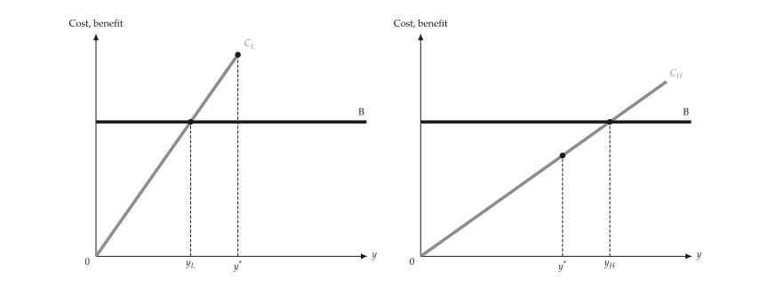{ .ev-figure-sm }

<div class="ev-downloads"><a class="ev-download" href="../../assets/micro-viz/information/information.py" download aria-label="Download the source"><svg viewBox="0 0 24 24" aria-hidden="true"><path d="M12 4v11m0 0-4.5-4.5M12 15l4.5-4.5M5 20h14" fill="none" stroke="currentColor" stroke-width="2" stroke-linecap="round" stroke-linejoin="round"/></svg><span>Download the source</span></a></div>

<figcaption markdown>*Signaling.* At a separating signal only the high-ability type buys it.</figcaption>

</figure>

<span id="fig-information-moral-hazard"></span>

<figure class="ev-fig" markdown>

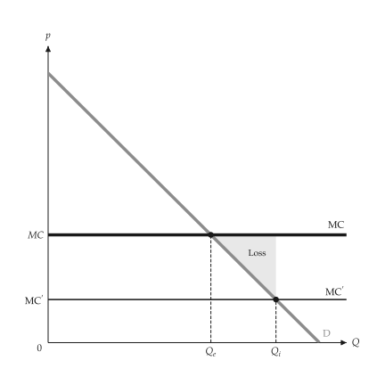{ .ev-figure-sm }

<div class="ev-downloads"><a class="ev-download" href="../../assets/micro-viz/information/information.py" download aria-label="Download the source"><svg viewBox="0 0 24 24" aria-hidden="true"><path d="M12 4v11m0 0-4.5-4.5M12 15l4.5-4.5M5 20h14" fill="none" stroke="currentColor" stroke-width="2" stroke-linecap="round" stroke-linejoin="round"/></svg><span>Download the source</span></a></div>

<figcaption markdown>*Moral hazard.* Insurance lowers the price and causes overuse.</figcaption>

</figure>

<span id="fig-information-bonus-schedule"></span>

<figure class="ev-fig" markdown>

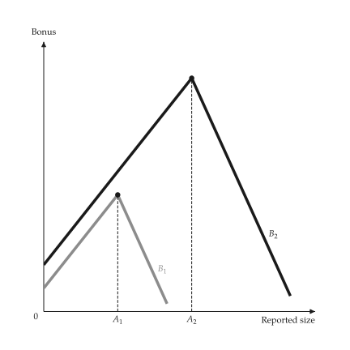{ .ev-figure-sm }

<div class="ev-downloads"><a class="ev-download" href="../../assets/micro-viz/information/information.py" download aria-label="Download the source"><svg viewBox="0 0 24 24" aria-hidden="true"><path d="M12 4v11m0 0-4.5-4.5M12 15l4.5-4.5M5 20h14" fill="none" stroke="currentColor" stroke-width="2" stroke-linecap="round" stroke-linejoin="round"/></svg><span>Download the source</span></a></div>

<figcaption markdown>*Bonus schedule.* The bonus is largest when the report is truthful: incentive compatible.</figcaption>

</figure>

<span id="fig-information-efficiency-wage"></span>

<figure class="ev-fig" markdown>

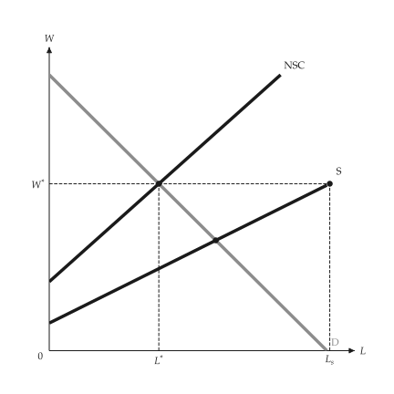{ .ev-figure-sm }

<div class="ev-downloads"><a class="ev-download" href="../../assets/micro-viz/information/information.py" download aria-label="Download the source"><svg viewBox="0 0 24 24" aria-hidden="true"><path d="M12 4v11m0 0-4.5-4.5M12 15l4.5-4.5M5 20h14" fill="none" stroke="currentColor" stroke-width="2" stroke-linecap="round" stroke-linejoin="round"/></svg><span>Download the source</span></a></div>

<figcaption markdown>*Efficiency wage.* The no-shirking condition puts the wage above equilibrium and creates unemployment.</figcaption>

</figure>
