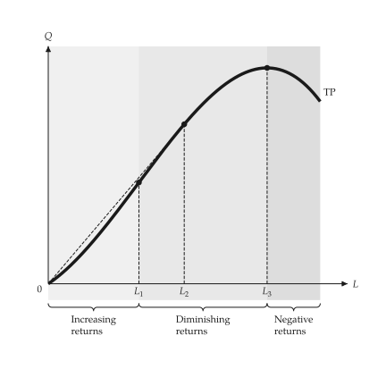

<h1 class="ev-visually-hidden">micro-viz: Python library for firm and market diagrams</h1>

<p align="center">
  
</p>

<p align="center"><em>A Python toolkit for textbook diagrams of firms and markets.</em></p>

<p align="center">
  <a href="https://github.com/EconViz/micro-viz"></a>
  
  
</p>

!!! warning "micro-viz is in development"

    micro-viz 0.2.0.dev0 is not on PyPI yet. Install it from GitHub; the API can still change before the first release.

```python
from micro_viz import (
    ShortRunProductionFunction,
    analyze_production,
    total_product_canvas,
)

production = ShortRunProductionFunction(
    linear=6, quadratic=3, cubic=-0.5
)
result = analyze_production(production, input_range=(0, 6))

total_product_canvas(result).save("total_product.svg")
```

{ .ev-figure-sm }

## Features

<div class="grid cards" markdown>

-   :material-chart-bell-curve: **Production and costs**

    Short-run total, average and marginal product, cost functions, and stepped or kinked cost.

    [:octicons-arrow-right-24: Production and costs](guides/production-costs.md)

-   :material-store-outline: **Competition**

    Price-taking firms, industry supply, long-run costs, entry and economic rent.

    [:octicons-arrow-right-24: Competition](guides/competition.md)

-   :material-crown-outline: **Monopoly and pricing**

    Monopoly, regulation, price discrimination, tariffs, bundling and advertising.

    [:octicons-arrow-right-24: Monopoly and pricing](guides/monopoly.md)

-   :material-account-group-outline: **Oligopoly and vertical chains**

    Cournot, Stackelberg and Bertrand duopoly, kinked demand, dominant firm and double marginalization.

    [:octicons-arrow-right-24: Oligopoly and vertical chains](guides/oligopoly.md)

-   :material-factory: **Inputs and technology**

    Isoquants, cost minimization, factor markets, monopsony and unions.

    [:octicons-arrow-right-24: Inputs and technology](guides/inputs.md)

-   :material-dice-multiple-outline: **Uncertainty and information**

    Expected utility, risk, auctions, lemons, signaling and moral hazard.

    [:octicons-arrow-right-24: Uncertainty and information](guides/uncertainty.md)

-   :material-label-outline: **Labels and placement**

    Replace any built-in word, move label groups, and keep text clear of lines.

    [:octicons-arrow-right-24: Labels and placement](guides/labels.md)

-   :material-tune: **Settings**

    Colours, widths, fonts and region shading from the shared econ-viz.toml.

    [:octicons-arrow-right-24: Settings](guides/settings.md)

-   :material-play-box-multiple-outline: **Animation**

    Animate a figure over a price, an output or a shift as SVG or GIF.

    [:octicons-arrow-right-24: Animation](guides/animation.md)

</div>

## Install

```bash
uv add --prerelease allow "micro-viz @ git+https://github.com/EconViz/micro-viz"
```

Requires Python 3.10 or later. See [Installation](installation.md) for uv and optional extras.

## Examples

Every figure in this documentation comes with the script that draws it, sorted into folders by topic. Download them all in one file, with `econ-viz.toml`, the settings the scripts load (`base = "manual"`).

[Download all examples](../assets/micro-viz/micro-viz-examples.zip){ .md-button download="" }
