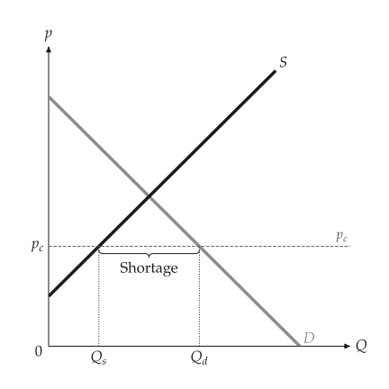
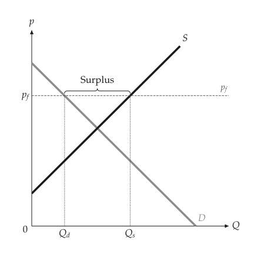
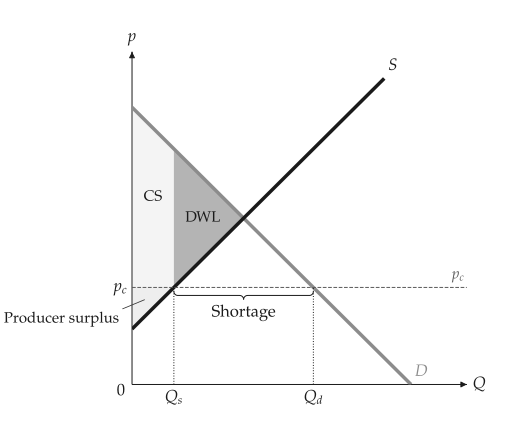

# Price controls

<span id="sec-controls"></span>

A price ceiling below the equilibrium price, or a floor above it, binds: the
market does not clear, and the quantity traded is the smaller of the
quantities demanded and supplied at the controlled price.

<!-- api: agora.principle_viz.guides_controls_1 -->

A `CEILING` or `FLOOR` at `control_price`, from
`principle_viz.core.controls`.

<!-- api: agora.principle_viz.guides_controls_2 -->

The controlled market, as a `PriceControlResult`:

```python
from principle_viz import evaluate_price_control
from principle_viz.core.controls import (
    PriceControlScenario,
    PriceControlType,
)

scenario = PriceControlScenario(PriceControlType.CEILING, 4.0)
ceiling = evaluate_price_control(demand, supply, scenario)
print(
    ceiling.is_binding,
    ceiling.traded_quantity,
    ceiling.shortage,
)
# True 2.0 4.0
```

A ceiling above the equilibrium price (for example 7) leaves `is_binding`
`False`.

<!-- api: agora.principle_viz.guides_controls_3 -->

Draw the control line, named "Price ceiling" or "Price floor", with $p_c$
on the price axis. A binding control also marks $Q_d$ and $Q_s$ and
braces the gap: "Shortage" below a ceiling, "Surplus" above a floor.
`gap_brace="axis"` braces it under the quantity axis instead (see
[A binding price ceiling.](controls.md#fig-ceiling) and [A binding price floor.](controls.md#fig-floor)).

<span id="fig-ceiling"></span>

<figure class="ev-fig" markdown>

{ .ev-figure-sm }

<div class="ev-downloads"><a class="ev-download" href="../../assets/principle-viz/agora/controls/controls.py" download aria-label="Download the source"><svg viewBox="0 0 24 24" aria-hidden="true"><path d="M12 4v11m0 0-4.5-4.5M12 15l4.5-4.5M5 20h14" fill="none" stroke="currentColor" stroke-width="2" stroke-linecap="round" stroke-linejoin="round"/></svg><span>Download the source</span></a></div>

<figcaption markdown>A binding price ceiling.</figcaption>

</figure>

<span id="fig-floor"></span>

<figure class="ev-fig" markdown>

{ .ev-figure-sm }

<div class="ev-downloads"><a class="ev-download" href="../../assets/principle-viz/agora/controls/controls.py" download aria-label="Download the source"><svg viewBox="0 0 24 24" aria-hidden="true"><path d="M12 4v11m0 0-4.5-4.5M12 15l4.5-4.5M5 20h14" fill="none" stroke="currentColor" stroke-width="2" stroke-linecap="round" stroke-linejoin="round"/></svg><span>Download the source</span></a></div>

<figcaption markdown>A binding price floor.</figcaption>

</figure>

`outcome_from_control()` turns the result into a market outcome for the
welfare functions of [Welfare](welfare.md#sec-welfare) (see [Welfare under a price ceiling of 3.5.](controls.md#fig-ceiling-welfare)):

```python
from principle_viz.welfare.surplus import (
    compare_surplus,
    outcome_from_control,
    outcome_from_equilibrium,
)

eq = solve_equilibrium(demand, supply)
baseline = outcome_from_equilibrium(eq)
controlled = outcome_from_control(ceiling)
delta = compare_surplus(demand, supply, baseline, controlled)
fig.add_price_control(ceiling)
fig.add_welfare(delta.policy)
```

<span id="fig-ceiling-welfare"></span>

<figure class="ev-fig" markdown>

{ .ev-figure-sm }

<div class="ev-downloads"><a class="ev-download" href="../../assets/principle-viz/agora/controls/controls.py" download aria-label="Download the source"><svg viewBox="0 0 24 24" aria-hidden="true"><path d="M12 4v11m0 0-4.5-4.5M12 15l4.5-4.5M5 20h14" fill="none" stroke="currentColor" stroke-width="2" stroke-linecap="round" stroke-linejoin="round"/></svg><span>Download the source</span></a></div>

<figcaption markdown>Welfare under a price ceiling of 3.5.</figcaption>

</figure>

Under a price ceiling, the deadweight loss is the surplus of the units that
are no longer traded, and part of the remaining surplus transfers from
sellers to buyers.
