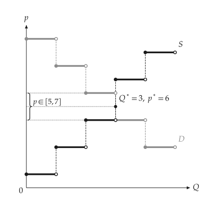

# Discrete markets

<span id="sec-discrete"></span>

A discrete market lists units one at a time: each buyer's willingness to pay
for one more unit, and each seller's cost of one more unit. Demand and
supply are step functions; the equilibrium is a whole number of units,
supported by a range of prices.

## Schedules

<!-- api: agora.principle_viz.guides_discrete_1 -->

A demand schedule holds marginal willingness-to-pay values, weakly
decreasing from the first unit to the last; a supply schedule holds
marginal costs, weakly increasing. Values out of order raise
`DiscreteMarketError`.

## Equilibrium

<!-- api: agora.principle_viz.guides_discrete_2 -->

Trade every unit whose value is at least its cost, and find the interval
of prices at which exactly that many units are bought and sold. The
result has these fields:

`solve_discrete_market(demand_values, supply_values)` builds both schedules
from plain tuples and solves in one call. The demand values must descend
and the supply values ascend so that units pair up in order.

```python
from principle_viz import (
    DiscreteDemand,
    DiscreteSupply,
    solve_discrete_equilibrium,
)

demand = DiscreteDemand((11, 9, 7, 5, 3))
supply = DiscreteSupply((1, 3, 5, 8, 10))
eq = solve_discrete_equilibrium(demand, supply)
print(eq.q_star, eq.price_low, eq.price_high, eq.price)
# 3 5.0 7.0 6.0
print(eq.gains_from_trade)
# (10.0, 6.0, 2.0)
```

Three units trade at a price interval of 5 to 7, and the midpoint rule
reports 6. The gains from trade total $10 + 6 + 2 = 18$.

<!-- api: agora.principle_viz.guides_discrete_3 -->

Consumer and producer surplus at the chosen price, in total and unit by
unit (`consumer_surplus_by_unit`, `producer_surplus_by_unit`). In the
example above, both are $5 + 3 + 1 = 9$ at a price of 6.

## Figure

<!-- api: agora.principle_viz.guides_discrete_4 -->

Draw each unit as a step $[q, q + 1)$: a filled point where the step
starts (included) and an open point where it ends (excluded), joined to
the next step by a dashed riser. Pass one schedule or both. The
equilibrium marks $Q^*$ and the price interval on the axes.

```python
fig = MarketFigure(
    x_max=5.5,
    y_max=12,
    title="Discrete Demand and Supply",
)
fig.add_discrete_curves(demand, supply)
fig.add_discrete_equilibrium(eq)
fig.finalize()
```

The figure for this example is shown in [Discrete demand and supply.](discrete.md#fig-discrete).

<span id="fig-discrete"></span>

<figure class="ev-fig" markdown>

{ .ev-figure-sm }

<div class="ev-downloads"><a class="ev-download" href="../../assets/principle-viz/agora/discrete/discrete.py" download aria-label="Download the source"><svg viewBox="0 0 24 24" aria-hidden="true"><path d="M12 4v11m0 0-4.5-4.5M12 15l4.5-4.5M5 20h14" fill="none" stroke="currentColor" stroke-width="2" stroke-linecap="round" stroke-linejoin="round"/></svg><span>Download the source</span></a></div>

<figcaption markdown>Discrete demand and supply.</figcaption>

</figure>
