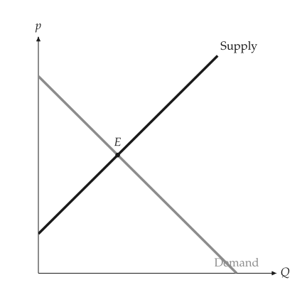

# Figures

<span id="sec-figures"></span>

Every figure in this manual is a `MarketFigure`, or a `mosaickit`
canvas built by a function such as `ppf_canvas()`. Both have a square plot
area and arrowed axes with no ticks or grid. Curves are named at their ends,
areas inside them and values on the axes, and no text covers a line, a
point, an area or other text.

## MarketFigure

<!-- api: agora.principle_viz.guides_figures_1 -->

A market diagram on a `mosaickit` canvas, with axes from 0 to
`x_max` and `y_max`. Axis titles are LaTeX math unless they are words; an
empty `title` draws none.

<!-- api: agora.principle_viz.guides_figures_2 -->

Draw demand and supply from $Q = 0$ to `q_max`, each named at its end, and
mark an equilibrium with a filled point and its label.

Each topic adds its own methods, described in its chapter (see
[Topic methods of `MarketFigure`](figures.md#tab-figure-methods)).

<span id="tab-figure-methods"></span>

| Method | Section |
| --- | --- |
| `add_comparative_statics` | [Comparative statics](markets.md#sec-shifts) |
| `add_discrete_curves`, `add_discrete_equilibrium` | [Discrete markets](discrete.md#sec-discrete) |
| `add_welfare`, `add_welfare_transition` | [Welfare](welfare.md#sec-welfare) |
| `add_tax_transform`, `add_tax_comparison`, `add_subsidy_comparison` | [Taxes and subsidies](taxes.md#sec-taxes) |
| `add_price_control` | [Price controls](controls.md#sec-controls) |
| `add_trade` | [International trade](trade.md#sec-trade) |
| `add_externality`, `add_common_resource` | [Market failures](failures.md#sec-failures) |
| `add_minimum_wage`, `add_loanable_funds` | [Labor and loanable funds](factor-markets.md#sec-factor) |

<!-- api: agora.principle_viz.guides_figures_3 -->

`finalize()` hides guide lines that would cut a shaded welfare region in
two (the value stays marked on its axis) and, only with `legend=True`,
adds a legend. `save()` writes PNG, SVG or PDF according to the extension
and creates missing directories. `close()` is a no-op kept for
compatibility.

<!-- api: agora.principle_viz.guides_figures_4 -->

Add any `mosaickit` layer, for annotations the topic methods do not
provide. An axis mark replaces an earlier mark at the same value. The
finished scene is available as `fig.scene`.

<!-- api: agora.principle_viz.guides_figures_5 -->

A text box of name--value pairs, for notebooks and debugging. Teaching
figures leave it out: the numbers belong in the text.

## Labels and layers

<span id="sec-labels"></span>

Every line, point, area and piece of text in a figure is a layer with a
stable id, such as `market.demand`, `market.demand.label` or
`market.welfare.dwl`. The ids follow the structure of the figure:
`axes.*` for the axes, `market.<part>` for each element, and a `.label`
suffix for the text that names it. `fig.layer_ids` lists every layer;
`fig.label_ids` lists the configurable text (labels, axis marks and
braces).

<!-- api: agora.principle_viz.guides_figures_6 -->

An override for one built-in label. Fields left as `None` keep the
package's default. An `offset` in points opts the label out of automatic
placement and moves it by exactly that much. `top`, `bottom`, `left` and
`right` instead move the label after it has been placed, so principle-viz
still picks the spot and you only fine-tune it.

<!-- api: agora.principle_viz.guides_figures_7 -->

Rename, hide or move one label (the id may omit its final `.label`), or
show or hide any layer. `hide(*ids)` and `show(*ids)` toggle several at
once. Each returns the figure.

The same overrides can be passed when the figure is created, as `labels=`
and `visibility=` mappings; they then apply to layers added later as well.
Aggregation figures and the canvas functions (`ppf_canvas()`,
`public_good_canvas()`, ...) accept the same two arguments. See
[Renamed curves and equilibrium](figures.md#fig-labels):

```python
from principle_viz import Label, MarketFigure

fig = MarketFigure(
    x_max=12,
    y_max=12,
    labels={
        "market.demand.label": Label(text="Demand"),
        "market.supply.label": Label(text="Supply"),
    },
)
fig.add_curves(demand, supply, q_max=10)
fig.add_equilibrium(eq)
fig.configure_label("market.equilibrium", text="$e^*$")
fig.hide("axes.origin.label")
fig.finalize()
```

<span id="fig-labels"></span>

<figure class="ev-fig" markdown>

{ .ev-figure-sm }

<div class="ev-downloads"><a class="ev-download" href="../../assets/principle-viz/agora/figures/figures.py" download aria-label="Download the source"><svg viewBox="0 0 24 24" aria-hidden="true"><path d="M12 4v11m0 0-4.5-4.5M12 15l4.5-4.5M5 20h14" fill="none" stroke="currentColor" stroke-width="2" stroke-linecap="round" stroke-linejoin="round"/></svg><span>Download the source</span></a></div>

<figcaption markdown>Renamed curves and equilibrium</figcaption>

</figure>

### Nudging a label

A length is a number of points or a string with a unit: `"10pt"`, `"0.5em"`
(the label's font size) or `"2mm"`. `top` and `bottom` combine, as do
`right` and `left`. A nudge applies after automatic placement, or after an
`offset`; later labels still avoid the moved one, and figures without
nudges are unchanged. Axis tick labels do not take nudges. The equilibrium
label's id is `market.equilibrium`:

```python
from principle_viz import Label, MarketFigure

fig = MarketFigure(
    labels={"market.equilibrium": Label(top="4pt")}
)
fig.configure_label("market.supply", Label(right="8pt"))
fig.configure_label("market.demand", text="$D_0$", left="0.5em")
```

## Palettes and themes

<span id="sec-palettes"></span>

A `ColorModel` assigns a colour to each economic role; a `PlotTheme` adds line
widths and axis options and compiles both into a `mosaickit` theme.
The built-in colour models are the themes every EconViz package shares
([Built-in colour models](figures.md#tab-palettes)): the same name gives the same look in utility-viz and
principle-viz.

<!-- api: agora.principle_viz.guides_figures_8 -->

Named colour roles: `axis_color`, `label_color`, `demand_color`,
`supply_color`, `baseline_color`, `shifted_color`, `tax_color`,
`control_color`, `cs_color`, `ps_color`, `tax_revenue_color`, `dwl_color`
and `arrow_color`. Each is `"#hex"` or a `mosaickit` palette name
such as `"blue"`.

<span id="tab-palettes"></span>

| Name | Character and use |
| --- | --- |
| `manual` | The greys of the EconViz manuals: black axes, supply and arrows, a grey demand curve, grey surplus regions. For print and handouts |
| `default` | Demand blue, supply green, deadweight loss red, taxes and controls orange; the surpluses follow the curves. The everyday choice |
| `colorblind` | The colours of `default` under an explicit name |
| `monochrome` | Black curves and a grey ladder for the regions, for black-and-white printing |
| `nord` | Cool colours of the Nord palette, for screens and slides |
| `paper` | Muted colours, for papers |
| `presentation` | Brighter colours, with lines 1.5 and the equilibrium dot 1.3 times as large, for projection |

A shared theme gives a colour to each role, and `principle_viz.visuals.roles`
says which role each element takes: the axis, labels, baseline and arrows
take ink, demand primary, supply secondary, shifted curves tertiary, taxes
and controls intervention, and consumer surplus, producer surplus,
deadweight loss and tax revenue the light, mid, dark and faint fills. The
theme's line and marker scales multiply principle-viz's own line widths and
equilibrium dot. There is no dark theme.

`list_color_models()` returns the names and `get_color_model(name)` the
model; `DEFAULT_COLOR_MODEL`, `COLORBLIND_COLOR_MODEL`, `NORD_COLOR_MODEL`
and `MONOCHROME_COLOR_MODEL` are also exported.

<!-- api: agora.principle_viz.guides_figures_9 -->

A colour model with line widths (`demand_linewidth`,
`supply_linewidth`, `shifted_linewidth`, `tax_linewidth`,
`arrow_linewidth`, `dashed_linewidth`), `equilibrium_marker_size`, and
the switches `show_grid`, `show_ticks`, `show_axis_arrows` and
`show_origin_label`. `from_palette()` starts from a built-in colour model
and sets any of these fields.

Fonts take three fields. `font` is `"sans"` (the default), `"serif"` or
`"mono"`; an installed family name such as `"Arial"` is an error. `fonts` is a
`mosaickit.TextFonts` that replaces any of the three with font files, the rest
keeping `mosaickit`'s DejaVu defaults. `math_font` is a `MathFont` or
the path of an OpenType math font, and sets `$...$` through `glyphkit`.
`font_roles` maps a style role to a generic font, for example
`{"axes": "mono"}`. Nothing searches the system for fonts, so pass the paths.

```python
from mosaickit import TextFonts
from principle_viz import MarketFigure, PlotTheme

theme = PlotTheme(
    font="serif",
    fonts=TextFonts(
        serif=[
            "fonts/Pagella-Regular.otf",
            "fonts/Pagella-Bold.otf",
        ]
    ),
    math_font="fonts/Pagella-Math.otf",
)
fig = MarketFigure(x_max=12, y_max=12, theme=theme)
```

The `palette` argument selects a colour model (see [The `monochrome` palette](figures.md#fig-monochrome)):

```python
fig = MarketFigure(x_max=12, y_max=12, palette="monochrome")
```

<span id="fig-monochrome"></span>

<figure class="ev-fig" markdown>

{ .ev-figure-sm }

<div class="ev-downloads"><a class="ev-download" href="../../assets/principle-viz/agora/figures/figures.py" download aria-label="Download the source"><svg viewBox="0 0 24 24" aria-hidden="true"><path d="M12 4v11m0 0-4.5-4.5M12 15l4.5-4.5M5 20h14" fill="none" stroke="currentColor" stroke-width="2" stroke-linecap="round" stroke-linejoin="round"/></svg><span>Download the source</span></a></div>

<figcaption markdown>The `monochrome` palette</figcaption>

</figure>

## Settings file

<span id="sec-settings"></span>

principle-viz reads `econ-viz.toml`, the settings file every EconViz package
shares; `mosaickit` reads and checks it. The top level sets what every
package shares: the starting theme (`base`, one of [Built-in colour models](figures.md#tab-palettes)), the fonts
and the axis and label colours. principle-viz's own settings live in the
`[principle]` table; the tables of other packages, such as `[utility]`, are
skipped.

```toml
base = "manual"      # a shared theme: manual, default, colorblind,
                     # monochrome, nord, paper or presentation

[font]
text = "serif"
math = "fonts/texgyrepagella-math.otf"

[fonts]
serif = ["fonts/NotoSerifTC-Regular.otf", "fonts/NotoSerifTC-Bold.otf"]

[principle]
language = "zh-TW"   # built-in figure text

[principle.color]    # a colour-model role, without "_color"
demand = "#8c8c8c"

[principle.stroke]   # line widths in points
demand = 3.5

[principle.marker]
equilibrium = 6.5    # equilibrium dot diameter in points
```

`base = "manual"` gives the black-and-white look of this manual, so its
colours and widths need not be spelled out. `[principle] palette` still
sets the colours for principle-viz alone and wins over `base`;
`[principle.color]` sets one element. Relative paths are read from the
folder of the file.

<!-- api: agora.principle_viz.guides_figures_10 -->

`Config.load()` reads the file and `use()` makes it the default: figures
made without `theme=` or `palette=` then use it, and `default_theme()`
returns the theme they get. A `theme=` or `palette=` passed to a figure
still wins. `mosaickit.econ_toml.use("econ-viz.toml")` loads the file for
every installed EconViz package at once.

A mistake raises `mosaickit.ConfigurationError` naming the file and the
table, with the closest key when one is close:

```text
econ-viz.toml: [principle.color] unknown key 'demnad'; did you mean 'demand'?
```

## Canvases

<!-- api: agora.principle_viz.guides_figures_11 -->

The `mosaickit` `Canvas` with the same `labels=`, `visibility=`,
`configure_label()`, `configure_layer()`, `hide()`, `show()`,
`layer_ids` and `label_ids` as `MarketFigure`. The canvas functions of
the PPF, public-good and revenue chapters return it; save it with
`save()`, or combine several with `mosaickit.CanvasGrid`.
