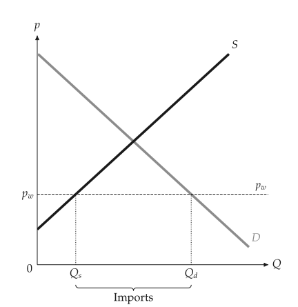
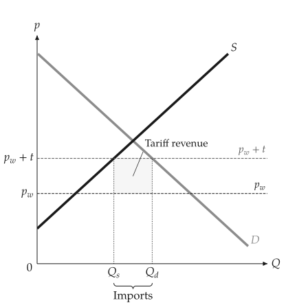
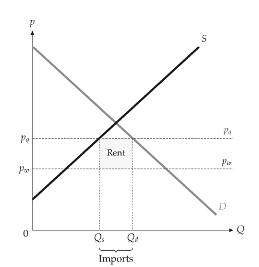

# International trade

<span id="sec-trade"></span>

A small open economy takes the world price $p_w$ as given. Below the autarky
price it imports the gap between domestic demand and supply; above it, it
exports. A tariff or an import quota raises the domestic price and shrinks
imports.

<!-- api: agora.principle_viz.guides_trade_1 -->

The world price and at most one policy: a per-unit `tariff` or an
`import_quota`, not both (`PolicyError`).

<!-- api: agora.principle_viz.guides_trade_2 -->

Compare autarky, free trade and the policy. The `TradeComparisonResult`
holds three `TradeOutcome`s, `autarky`, `free_trade` and `policy`, and
the `deadweight_loss` of the policy relative to free trade.

```python
from principle_viz import TradeScenario, analyze_trade

# autarky price 7
demand = line_from_inverse(12.0, -1.0)
scenario = TradeScenario(world_price=4, tariff=2)
result = analyze_trade(demand, supply, scenario)
print(result.free_trade.imports, result.policy.imports)
# 6.0 2.0
print(result.policy.government_revenue, result.deadweight_loss)
# 4.0 4.0
```

With the tariff of 2, the domestic price is 6 and government revenue is
$2 \times 2 = 4$. An import quota of 2 units gives the same price; the rent
of 4 goes to the party named by `quota_rent_recipient`.

<!-- api: agora.principle_viz.guides_trade_3 -->

Draw the world price line, named $p_w$, the policy price ($p_w + t$ or
$p_q$), $Q_s$ and $Q_d$ on the quantity axis with an "Imports" or "Exports"
brace beneath, and the tariff revenue or quota rent as a named rectangle
(see [Free trade with imports.](trade.md#fig-free-trade), [An import tariff.](trade.md#fig-tariff) and [A binding import quota.](trade.md#fig-quota)).

<span id="fig-free-trade"></span>

<figure class="ev-fig" markdown>

{ .ev-figure-sm }

<div class="ev-downloads"><a class="ev-download" href="../../assets/principle-viz/agora/trade/free_trade_import.svg" download aria-label="Download the image"><svg viewBox="0 0 24 24" aria-hidden="true"><path d="M4 5h16v14H4zM4 16l5-5 4 4 3-3 4 4M15 9.5h.01" fill="none" stroke="currentColor" stroke-width="2" stroke-linecap="round" stroke-linejoin="round"/></svg><span>Download the image</span></a></div>

<figcaption markdown>Free trade with imports.</figcaption>

</figure>

<span id="fig-tariff"></span>

<figure class="ev-fig" markdown>

{ .ev-figure-sm }

<div class="ev-downloads"><a class="ev-download" href="../../assets/principle-viz/agora/trade/tariff.svg" download aria-label="Download the image"><svg viewBox="0 0 24 24" aria-hidden="true"><path d="M4 5h16v14H4zM4 16l5-5 4 4 3-3 4 4M15 9.5h.01" fill="none" stroke="currentColor" stroke-width="2" stroke-linecap="round" stroke-linejoin="round"/></svg><span>Download the image</span></a></div>

<figcaption markdown>An import tariff.</figcaption>

</figure>

<span id="fig-quota"></span>

<figure class="ev-fig" markdown>

{ .ev-figure-sm }

<div class="ev-downloads"><a class="ev-download" href="../../assets/principle-viz/agora/trade/quota.svg" download aria-label="Download the image"><svg viewBox="0 0 24 24" aria-hidden="true"><path d="M4 5h16v14H4zM4 16l5-5 4 4 3-3 4 4M15 9.5h.01" fill="none" stroke="currentColor" stroke-width="2" stroke-linecap="round" stroke-linejoin="round"/></svg><span>Download the image</span></a></div>

<figcaption markdown>A binding import quota.</figcaption>

</figure>
