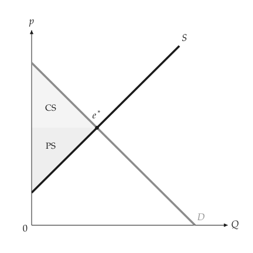

# Welfare

<span id="sec-welfare"></span>

Welfare analysis compares a market outcome with its alternatives: consumer
surplus, producer surplus, government revenue and deadweight loss.

## Market outcomes

<!-- api: agora.principle_viz.guides_welfare_1 -->

A quantity with the price buyers pay and the price sellers receive. The
two prices differ under a tax or a subsidy; the gap times the quantity is
government revenue (negative for a subsidy). It lives in
`principle_viz.welfare.surplus`, together with constructors from each
kind of result:

## Surplus

<!-- api: agora.principle_viz.guides_welfare_2 -->

The welfare decomposition at `outcome`. With a `baseline_outcome`, the
deadweight loss is measured against it. The `SurplusResult` has these
fields:

```python
from principle_viz import compute_surplus, solve_equilibrium
from principle_viz.welfare.surplus import outcome_from_equilibrium

eq = solve_equilibrium(demand, supply)
outcome = outcome_from_equilibrium(eq)
surplus = compute_surplus(demand, supply, outcome)
print(surplus.consumer_surplus, surplus.producer_surplus)  # 8.0 8.0
```

$(10 - 6) \times 4 / 2 = (6 - 2) \times 4 / 2 = 8$; the free market
has no deadweight loss.

<!-- api: agora.principle_viz.guides_welfare_3 -->

Both decompositions and the changes between them: `baseline`, `policy`,
`delta_consumer_surplus`, `delta_producer_surplus`, `delta_tax_revenue`,
`delta_total_surplus` and `deadweight_loss`. [Taxes and subsidies](taxes.md#sec-taxes) uses it for a
tax.

## Figures

<!-- api: agora.principle_viz.guides_welfare_4 -->

Shade consumer surplus, producer surplus, tax revenue and deadweight loss,
and name each region: inside it when the name fits, by its short name
(CS, PS, Tax, DWL) when only that fits, otherwise by a callout that covers
no line, point or other text.

```python
fig = MarketFigure(x_max=12, y_max=12)
fig.add_curves(demand, supply, q_max=10)
fig.add_welfare(surplus)
fig.add_equilibrium(eq)
fig.finalize()
```

The output is shown in [Surplus at equilibrium](welfare.md#fig-welfare).

<span id="fig-welfare"></span>

<figure class="ev-fig" markdown>

{ .ev-figure-sm }

<div class="ev-downloads"><a class="ev-download" href="../../assets/principle-viz/agora/welfare/welfare.py" download aria-label="Download the source"><svg viewBox="0 0 24 24" aria-hidden="true"><path d="M12 4v11m0 0-4.5-4.5M12 15l4.5-4.5M5 20h14" fill="none" stroke="currentColor" stroke-width="2" stroke-linecap="round" stroke-linejoin="round"/></svg><span>Download the source</span></a></div>

<figcaption markdown>Surplus at equilibrium</figcaption>

</figure>

<!-- api: agora.principle_viz.guides_welfare_5 -->

The same regions together with guide lines at the baseline and policy
quantities and prices, for comparing before and after.

## Deadweight-loss reports

<!-- api: agora.principle_viz.guides_welfare_6 -->

Turn `(name, baseline, policy)` triples of `SurplusResult`s into report
rows (`DWLScenarioRow`) with the change in quantity, in each surplus and
the deadweight loss. `save_dwl_report_csv()` and `save_dwl_report_json()`
in `principle_viz.welfare.report` write them to a file.
