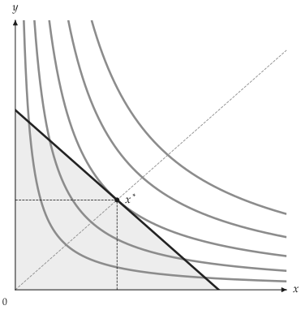

# Quick start

<span id="sec-quickstart"></span>

## A minimal example

This chapter uses the complete Cobb-Douglas consumer problem:

$$
\begin{aligned}\max_{x, y} & u(x, y) = x^{1/2} y^{1/2} \\ \text{s.t.} & 2x + 3y = 30\end{aligned}
$$

The script solves the optimum and draws the indifference map, budget set,
and equilibrium shown in [The consumer-equilibrium diagram](quickstart.md#fig-quickstart).

```python
from utility_viz import Canvas, Config, levels, solve
from utility_viz.models import CobbDouglas

# figure settings
Config.load("manual.toml").use()

model = CobbDouglas(alpha=0.5, beta=0.5)
eq = solve(model, px=2.0, py=3.0, income=30.0)

# italic x and y
cvs = Canvas(x_max=20, y_max=15, x_label="$x$", y_label="$y$")
# five curves and one through the optimum
lvls = levels.around(eq.utility, n=5)
cvs.add_utility(model, levels=lvls)
# the line and its feasible set
cvs.add_budget(2.0, 3.0, 30.0, fill=True)
# with the expansion path
cvs.add_equilibrium(eq, show_ray=True)
cvs.save("cobb_douglas.png")
```

<span id="fig-quickstart"></span>

<figure class="ev-fig" markdown>

{ .ev-figure-sm }

<div class="ev-downloads"><a class="ev-download" href="../../assets/utility-viz/agora/models/cobb_douglas.py" download aria-label="Download the source"><svg viewBox="0 0 24 24" aria-hidden="true"><path d="M12 4v11m0 0-4.5-4.5M12 15l4.5-4.5M5 20h14" fill="none" stroke="currentColor" stroke-width="2" stroke-linecap="round" stroke-linejoin="round"/></svg><span>Download the source</span></a></div>

<figcaption markdown>The consumer-equilibrium diagram</figcaption>

</figure>

Running `main.py` writes `cobb_douglas.png` to the current working directory.
The optimum is $x^* = 7.5$, $y^* = 5$; spending is
$2 \times 7.5 + 3 \times 5 = 30$, exactly the income. The budget line meets
the axes at $I / p_x = 15$ and $I / p_y = 10$.

## Step by step

Every diagram follows the same steps: build a model, solve for the
equilibrium, pick utility levels, create a canvas, add layers and export.

<!-- api: agora.utility_viz.getting_started_quickstart_1 -->

Pick a utility function. [Core models](../models/index.md#sec-models) lists every built-in model; any
Python function can also be wrapped as a model ([Advanced models](../models/advanced.md#sec-advanced)).

<!-- api: agora.utility_viz.getting_started_quickstart_2 -->

Solve the consumer's problem and return an immutable `Equilibrium`.

```python
from utility_viz import solve

eq = solve(model, px=2.0, py=3.0, income=30.0)
print(eq.x, eq.y, round(eq.utility, 3))

# 7.5 5.0 6.124
```

<!-- api: agora.utility_viz.getting_started_quickstart_3 -->

Generate $n$ utility levels centred on a given utility. [The consumer-equilibrium diagram](quickstart.md#fig-quickstart)
uses `n=5`, so it draws five indifference curves.

`levels.around()` keeps the given utility among the levels, so the
equilibrium lies on one of the curves. Passing `levels=5` instead lets the
canvas pick levels from the sampled utility range, which need not include
the equilibrium utility. To compare the same preferences across several
figures, compute `lvls` once and pass it to each figure.

<!-- api: agora.utility_viz.getting_started_quickstart_4 -->

Create the canvas and set the axis ranges; the other options are
described in [Canvas](../guides/canvas.md#sec-canvas).

The axis ranges only control what is shown; they play no part in
`solve()`. If the equilibrium is missing from the figure, check whether
`eq.x` or `eq.y` lies outside the range and raise the axis limits.

<!-- api: agora.utility_viz.getting_started_quickstart_5 -->

Add indifference curves, a budget line or the equilibrium to the same
canvas. The calls can be chained ([Method chaining](../guides/canvas.md#sec-chaining)). `add_equilibrium()` uses
an existing solution and does not solve again; after changing prices,
income or the model, call `solve()` again and build a new figure.

<!-- api: agora.utility_viz.getting_started_quickstart_6 -->

`save()` writes the file in the format given by its extension
([Export](../guides/export.md#sec-export)); `show()` opens a `matplotlib` window. Output paths are
relative to the working directory of the script; create any subdirectory
beforehand.

### Checking inputs and failed solves

Prices and income must be positive; otherwise `solve()` raises
`InvalidParameterError` (Smooth models are solved with sequential least squares programming (SLSQP).).

When the solver does not converge, `solve()` raises `OptimizationError`
rather than returning an invalid equilibrium.

```python
from utility_viz import (
    InvalidParameterError,
    OptimizationError,
    solve,
)

try:
    eq = solve(model, px=2.0, py=3.0, income=30.0)
except (InvalidParameterError, OptimizationError) as error:
    print(error)
else:
    print(round(eq.x, 3), round(eq.y, 3), eq.bundle_type)
```

Every exception the package raises derives from `UtilityVizError`;
catch it to handle all of them at once. `EconVizError`, its 1.x name, is
the same class.

Numerical solutions carry small errors: a result may be close to, but not
exactly, `7.5`. Compare with a tolerance when checking results, and round
with `round()` only for display, so early rounding does not distort later
calculations.
