# Animation

<span id="sec-animation"></span>

`Animator` calls a drawing function over a sequence of parameter values and
exports the returned `Canvas` or `Figure` objects as a GIF. It needs the
`animation` extra ([Optional dependencies](../getting-started/installation.md#sec-extras)). Import it from
`utility_viz.core.animation`; it was `econ_viz.animation` in 1.x.

<!-- api: agora.utility_viz.guides_animation_1 -->

Call `draw(value)` for every value in `frames` and write the canvases as
the frames of a GIF.

- `save()` uses `Pillow`, so no `ffmpeg` dependency is required.
- Frames are composited onto white before export, which prevents
  frame-stacking artefacts.
- `fps`, `dpi` and `loop` set the frame rate, resolution and loop count.

```python
import numpy as np

from utility_viz import Canvas, levels, solve
from utility_viz.core.animation import Animator
from utility_viz.models import CobbDouglas


def draw(px: float) -> Canvas:
    model = CobbDouglas(alpha=0.5, beta=0.5)
    eq = solve(model, px=px, py=2.0, income=20.0)
    lvls = levels.around(eq.utility, n=5)

    return (
        Canvas(
            x_max=14,
            y_max=12,
            x_label="X_1",
            y_label="X_2",
            title="Price sweep",
        )
        .add_utility(model, levels=lvls)
        .add_budget(px=px, py=2.0, income=20.0, fill=True)
        .add_equilibrium(eq, show_ray=True, drop_dashes=True)
    )


Animator(draw, frames=np.linspace(1.0, 6.0, 45)).save(
    "price_sweep.gif",
    fps=12,
    dpi=120,
)
```

`examples/scripts/animation.py` provides four examples (Each example covers Cobb-Douglas, CES, perfect substitutes and perfect complements.):

- Parameter sweep: prices and income fixed, a utility-function parameter
  varies.
- Price sweep: utility function and $p_y$ fixed, $p_x$ varies and the
  budget line rotates, as in the example above.
- Income sweep: utility function and prices fixed, income varies and the
  budget line shifts.
- Budget-only sweep: the budget line alone, without the utility layers.

The four differ only in which values `draw()` holds fixed and which one it
varies. For the parameter sweep, let the `draw()` above take `alpha` and fix
the price at $p_x = 2$:

```python
def draw(alpha: float) -> Canvas:
    model = CobbDouglas(alpha=alpha, beta=1.0 - alpha)
    eq = solve(model, px=2.0, py=2.0, income=20.0)
    ...


Animator(draw, frames=np.linspace(0.1, 0.9, 45)).save(
    "parameter_sweep.gif"
)
```

For the income sweep, `draw()` takes `income` and passes it to
`add_budget()` and `solve()`. For the budget line alone, leave out
`add_utility()` and `add_equilibrium()`.

[Parameter sweep: $\alpha$ varies with $\beta = 1 - \alpha$.](animation.md#fig-sweep-param) to [Income sweep with $p_x = p_y = 2$ fixed.](animation.md#fig-sweep-income) each show four frames.

```python
import numpy as np

from utility_viz import Canvas, Config, levels, solve
from utility_viz.core.animation import Animator
from utility_viz.models import CobbDouglas

# the settings behind this manual's figures
Config.load("manual.toml").use()


def draw(alpha: float) -> Canvas:
    """One frame: the weight on x is alpha, the weight on y is 1 - alpha."""
    model = CobbDouglas(alpha=alpha, beta=1.0 - alpha)
    eq = solve(model, px=2.0, py=2.0, income=20.0)
    cvs = Canvas(
        x_max=14, y_max=12, x_label="$x_1$", y_label="$x_2$"
    )
    cvs.add_utility(
        model, levels=levels.around(eq.utility, n=5)
    )
    cvs.add_budget(2.0, 2.0, 20.0, fill=True)
    cvs.add_equilibrium(eq, show_ray=True)
    return cvs


Animator(draw, frames=np.linspace(0.1, 0.9, 45)).save(
    "parameter_sweep.gif", fps=12, dpi=120
)
```

<span id="fig-sweep-param"></span>

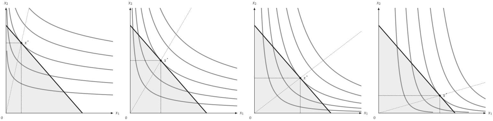{ .ev-figure-lg }

Each figure below shows four frames of its GIF, which has 45.

```python
import numpy as np

from utility_viz import Canvas, Config, levels, solve
from utility_viz.core.animation import Animator
from utility_viz.models import CobbDouglas

# the settings behind this manual's figures
Config.load("manual.toml").use()

model = CobbDouglas(alpha=0.5, beta=0.5)
# same curves in every frame
fixed = levels.around(
    solve(model, px=2.0, py=2.0, income=20.0).utility, n=5
)


def draw(px: float) -> Canvas:
    """One frame: the price of x is px."""
    eq = solve(model, px=px, py=2.0, income=20.0)
    cvs = Canvas(
        x_max=14, y_max=12, x_label="$x_1$", y_label="$x_2$"
    )
    cvs.add_utility(model, levels=fixed)
    cvs.add_budget(px, 2.0, 20.0, fill=True)
    cvs.add_equilibrium(eq, show_ray=True)
    return cvs


Animator(draw, frames=np.linspace(1.0, 6.0, 45)).save(
    "price_sweep.gif", fps=12, dpi=120
)
```

<span id="fig-sweep-price"></span>

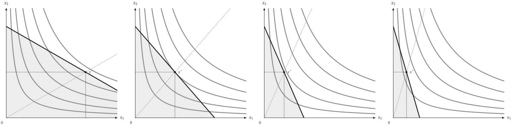{ .ev-figure-lg }

```python
import numpy as np

from utility_viz import Canvas, Config, levels, solve
from utility_viz.core.animation import Animator
from utility_viz.models import CobbDouglas

# the settings behind this manual's figures
Config.load("manual.toml").use()

model = CobbDouglas(alpha=0.5, beta=0.5)
# same curves in every frame
fixed = levels.around(
    solve(model, px=2.0, py=2.0, income=20.0).utility, n=5
)


def draw(income: float) -> Canvas:
    """One frame: income is `income`."""
    eq = solve(model, px=2.0, py=2.0, income=income)
    cvs = Canvas(
        x_max=14, y_max=12, x_label="$x_1$", y_label="$x_2$"
    )
    cvs.add_utility(model, levels=fixed)
    cvs.add_budget(2.0, 2.0, income, fill=True)
    cvs.add_equilibrium(eq, show_ray=True)
    return cvs


Animator(draw, frames=np.linspace(8.0, 36.0, 45)).save(
    "income_sweep.gif", fps=12, dpi=120
)
```

<span id="fig-sweep-income"></span>

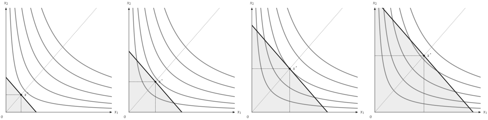{ .ev-figure-lg }

## Sweep gallery

The GIFs below are drawn by `scripts/animation_figures.py` in the docs repository, with the settings of `manual.toml`. They cover the same four sweeps: parameter, price, income and budget-only.

### Parameter sweeps

Vary utility-function parameters to see how the shape of the preference map changes.

<table class="gif-table">
  <tbody>
    <tr>
      <td>
  <figure class="gif-card">
    <span class="gif-card__title">Cobb-Douglas</span>
    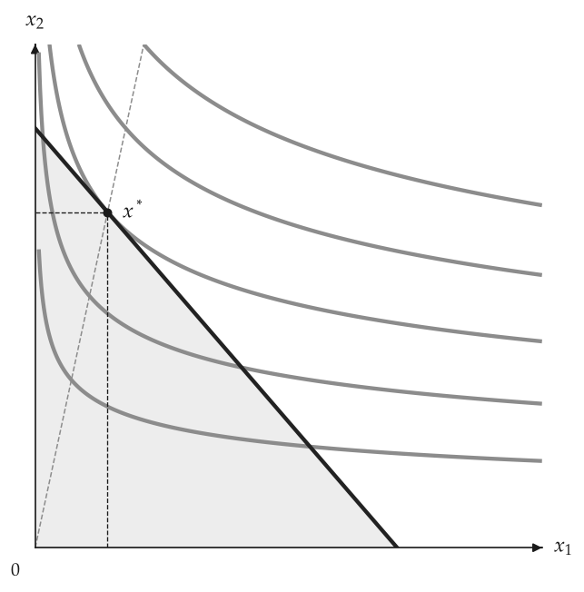
    <figcaption>Vary \(\alpha\) while \(\beta = 1 - \alpha\)</figcaption>
  </figure>
      </td>
      <td>
  <figure class="gif-card">
    <span class="gif-card__title">CES</span>
    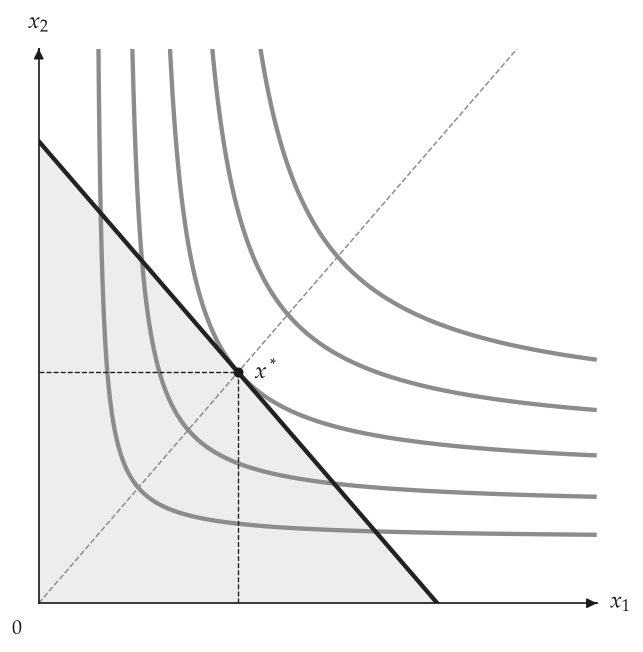
    <figcaption>Vary \(\rho\) to change curvature and substitutability</figcaption>
  </figure>
      </td>
    </tr>
    <tr>
      <td>
  <figure class="gif-card">
    <span class="gif-card__title">Perfect substitutes</span>
    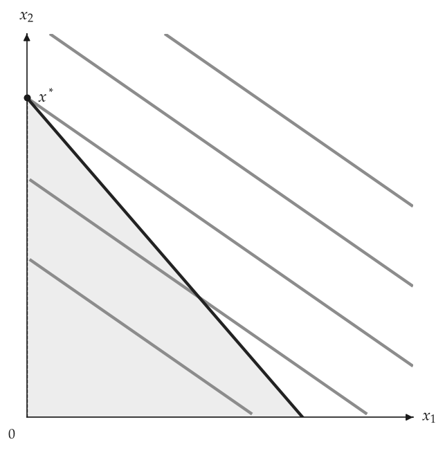
    <figcaption>Vary \(a\) with \(b\) fixed</figcaption>
  </figure>
      </td>
      <td>
  <figure class="gif-card">
    <span class="gif-card__title">Leontief</span>
    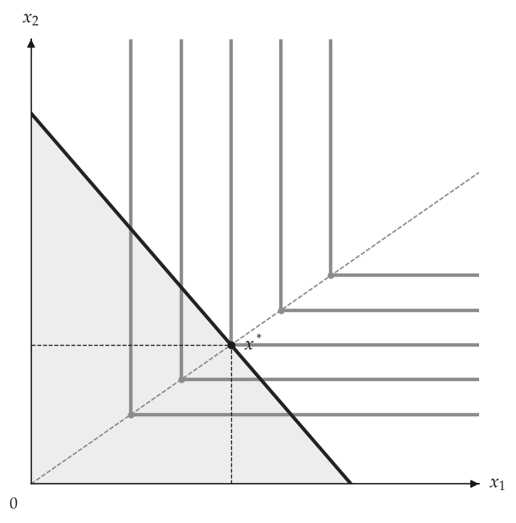
    <figcaption>Vary \(a\) with \(b\) fixed to move the kink path</figcaption>
  </figure>
      </td>
    </tr>
  </tbody>
</table>

### Price sweeps

Hold the utility function and background indifference-curve levels fixed, then vary one good's price to trace equilibrium as the budget line rotates.

<table class="gif-table">
  <tbody>
    <tr>
      <td>
  <figure class="gif-card">
    <span class="gif-card__title">Cobb-Douglas</span>
    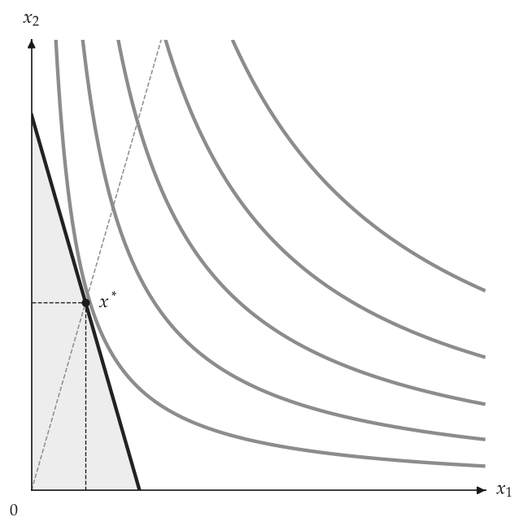
    <figcaption>Price sweep with \(p_y\) fixed</figcaption>
  </figure>
      </td>
      <td>
  <figure class="gif-card">
    <span class="gif-card__title">CES</span>
    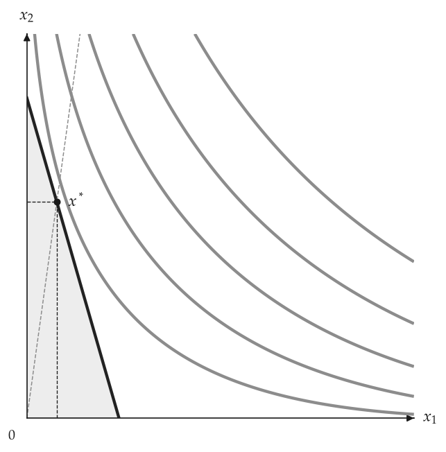
    <figcaption>Price sweep with a fixed utility surface</figcaption>
  </figure>
      </td>
    </tr>
    <tr>
      <td>
  <figure class="gif-card">
    <span class="gif-card__title">Perfect substitutes</span>
    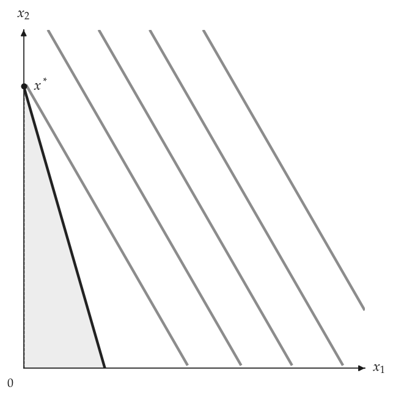
    <figcaption>Under a rotating budget line</figcaption>
  </figure>
      </td>
      <td>
  <figure class="gif-card">
    <span class="gif-card__title">Leontief</span>
    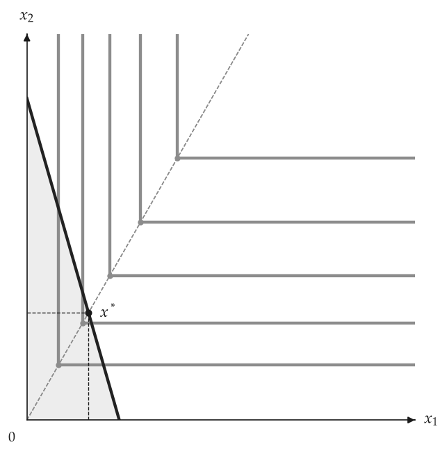
    <figcaption>Price sweep with fixed right-angle indifference curves</figcaption>
  </figure>
      </td>
    </tr>
    <tr>
      <td>
  <figure class="gif-card">
    <span class="gif-card__title">Budget only</span>
    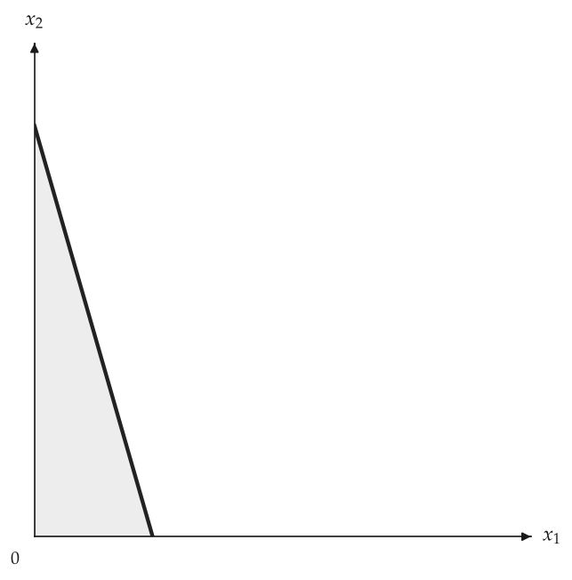
    <figcaption>Price sweep for isolating pure rotation of the constraint</figcaption>
  </figure>
      </td>
      <td class="gif-table__empty" aria-hidden="true"></td>
    </tr>
  </tbody>
</table>

### Income sweeps

Hold the utility function and prices fixed, then vary income to trace equilibrium as the budget line shifts in parallel.

<table class="gif-table">
  <tbody>
    <tr>
      <td>
  <figure class="gif-card">
    <span class="gif-card__title">Cobb-Douglas</span>
    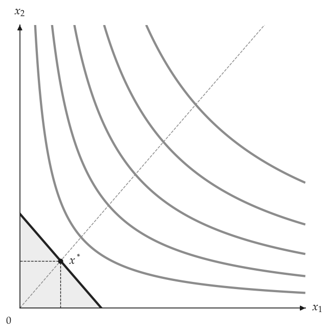
    <figcaption>Income sweep with fixed prices</figcaption>
  </figure>
      </td>
      <td>
  <figure class="gif-card">
    <span class="gif-card__title">CES</span>
    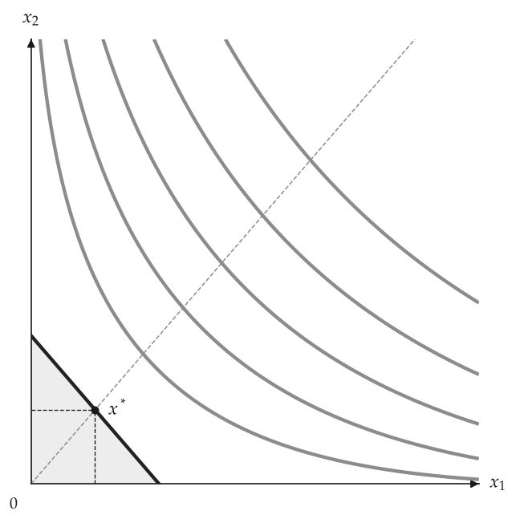
    <figcaption>Income sweep with fixed prices and fixed utility function</figcaption>
  </figure>
      </td>
    </tr>
    <tr>
      <td>
  <figure class="gif-card">
    <span class="gif-card__title">Perfect substitutes</span>
    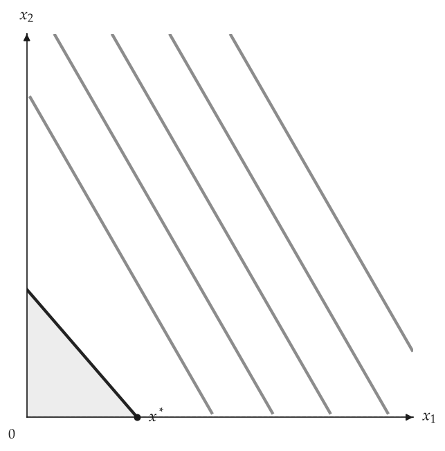
    <figcaption>Income sweep</figcaption>
  </figure>
      </td>
      <td>
  <figure class="gif-card">
    <span class="gif-card__title">Leontief</span>
    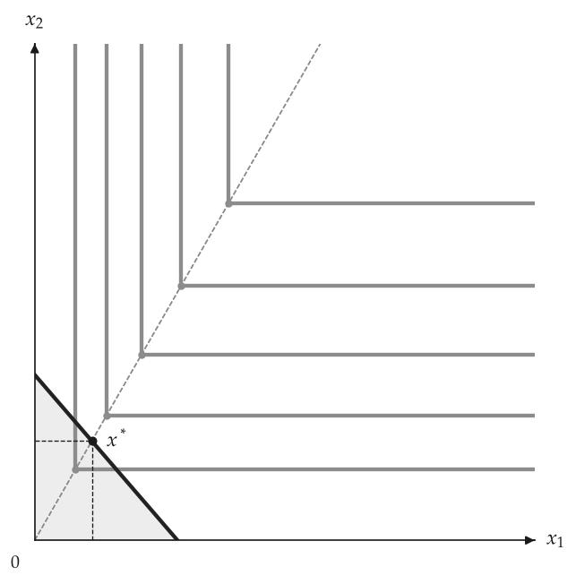
    <figcaption>Income sweep with fixed prices</figcaption>
  </figure>
      </td>
    </tr>
    <tr>
      <td>
  <figure class="gif-card">
    <span class="gif-card__title">Budget only</span>
    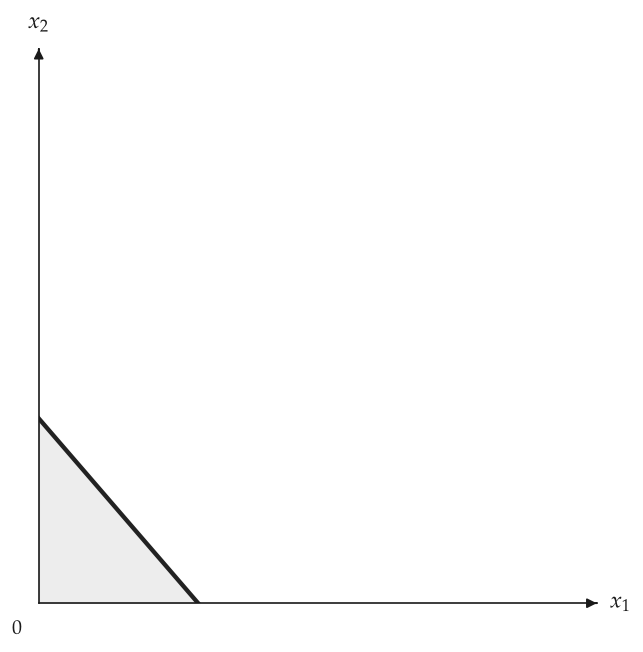
    <figcaption>Income sweep for isolating parallel shifts in the constraint</figcaption>
  </figure>
      </td>
      <td class="gif-table__empty" aria-hidden="true"></td>
    </tr>
  </tbody>
</table>
