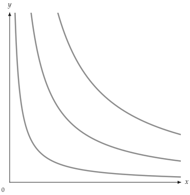
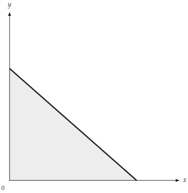
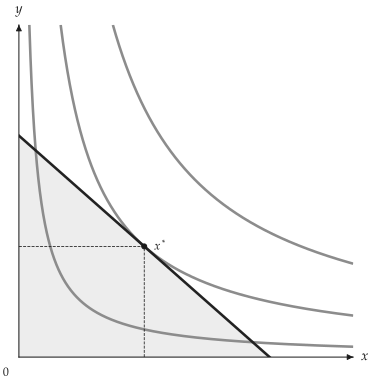
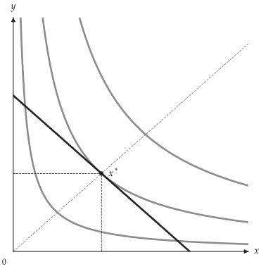
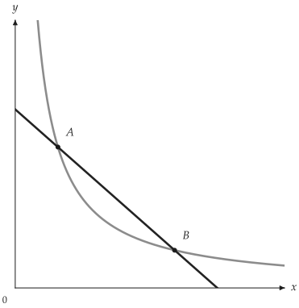
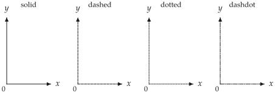
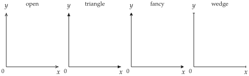

# Canvas

<span id="sec-canvas"></span>

`Canvas` builds on a `matplotlib` `Figure` and `Axes` and provides
layers for indifference curves, budget lines, equilibria and more.

## Constructor

<!-- api: agora.utility_viz.guides_canvas_1 -->

Create a canvas and set its axis ranges, axis labels, fonts, line styles and
theme. Visual settings not passed explicitly come from the active `Config`
and `Theme`.

<span id="tab-x-label-pos"></span>

| Value | Position |
| --- | --- |
| `"top"` | Above the arrow |
| `"right"` | Right of the arrow |
| `"bottom"` | Below the arrow |

<span id="tab-y-label-pos"></span>

| Value | Position |
| --- | --- |
| `"left"` | Left of the arrow |
| `"top"` | Above the arrow |
| `"right"` | Right of the arrow |

## Drawing methods

The `add_*` methods add a layer to the canvas and return the same `Canvas`,
so calls can be chained ([Method chaining](canvas.md#sec-chaining)).

<!-- api: agora.utility_viz.guides_canvas_2 -->

Draw indifference curves for a utility model.

```python
lvls = levels.around(eq.utility, n=5)
cvs.add_utility(
    model,
    levels=lvls,
    highlight_level=eq.utility,
    show_ic_labels=True,
    label_style="ordinal",
)
```

```python
from utility_viz import Canvas, Config, levels, solve
from utility_viz.models import CobbDouglas

# the settings behind this manual's figures
Config.load("manual.toml").use()

model = CobbDouglas(alpha=0.5, beta=0.5)
eq = solve(model, px=2.0, py=3.0, income=30.0)

# italic x and y
cvs = Canvas(x_max=20, y_max=15, x_label="$x$", y_label="$y$")
# three curves around the optimum
cvs.add_utility(model, levels=levels.around(eq.utility, n=3))
cvs.save("add_utility.png")
```

<span id="fig-add-utility"></span>

{ .ev-figure-sm }

<!-- api: agora.utility_viz.guides_canvas_3 -->

Draw the budget line $p_x x + p_y y = I$.

```python
from utility_viz import Canvas, Config

# the settings behind this manual's figures
Config.load("manual.toml").use()

# italic x and y
cvs = Canvas(x_max=20, y_max=15, x_label="$x$", y_label="$y$")
# the line and its feasible set
cvs.add_budget(2.0, 3.0, 30.0, fill=True)
cvs.save("add_budget.png")
```

{ .ev-figure-sm }

<!-- api: agora.utility_viz.guides_canvas_4 -->

Mark the optimal bundle returned by `solve()`.

```python
from utility_viz import Canvas, Config, levels, solve
from utility_viz.models import CobbDouglas

# the settings behind this manual's figures
Config.load("manual.toml").use()

model = CobbDouglas(alpha=0.5, beta=0.5)
eq = solve(model, px=2.0, py=3.0, income=30.0)

# italic x and y
cvs = Canvas(x_max=20, y_max=15, x_label="$x$", y_label="$y$")
cvs.add_utility(model, levels=levels.around(eq.utility, n=3))
cvs.add_budget(2.0, 3.0, 30.0, fill=True)
# the optimum and dashed guides
cvs.add_equilibrium(eq)
cvs.save("add_equilibrium.png")
```

{ .ev-figure-sm }

<!-- api: agora.utility_viz.guides_canvas_5 -->

Draw a ray from the origin with slope `slope` ($\mathrm{d} y / \mathrm{d} x$), for an
expansion path or a fixed consumption ratio.

```python
from utility_viz import Canvas, Config, levels, solve
from utility_viz.models import CobbDouglas

# the settings behind this manual's figures
Config.load("manual.toml").use()

model = CobbDouglas(alpha=0.5, beta=0.5)
eq = solve(model, px=2.0, py=3.0, income=30.0)

# italic x and y
cvs = Canvas(x_max=20, y_max=15, x_label="$x$", y_label="$y$")
cvs.add_utility(model, levels=levels.around(eq.utility, n=3))
cvs.add_budget(2.0, 3.0, 30.0)
cvs.add_equilibrium(eq)
# a ray through the optimum
cvs.add_ray(eq.y / eq.x)
cvs.save("add_ray.png")
```

{ .ev-figure-sm }

<!-- api: agora.utility_viz.guides_canvas_6 -->

Mark any point, such as a bundle to compare with the optimum.

```python
from utility_viz import Canvas, Config, Label, levels, solve
from utility_viz.models import CobbDouglas

# the settings behind this manual's figures
Config.load("manual.toml").use()

model = CobbDouglas(alpha=0.5, beta=0.5)
eq = solve(model, px=2.0, py=3.0, income=30.0)

# italic x and y
cvs = Canvas(x_max=20, y_max=15, x_label="$x$", y_label="$y$")
# one indifference curve u = 5
cvs.add_utility(model, levels=[5.0])
cvs.add_budget(2.0, 3.0, 30.0)
# it cuts the budget line twice
# a Label puts text by the point
cvs.add_point(
    3.17, 7.89, label=Label(text="A", position="top-right")
)
cvs.add_point(
    11.83, 2.11, label=Label(text="B", position="top-right")
)
cvs.save("add_point.png")
```

{ .ev-figure-sm }

<!-- api: agora.utility_viz.guides_canvas_7 -->

`show()` opens an interactive window. `save()` writes the file in the
format given by its extension ([Export](export.md#sec-export)) and releases the
`matplotlib` figure, so call it last.

```python
from utility_viz import Canvas, Config, levels, solve
from utility_viz.models import CobbDouglas

# the settings behind this manual's figures
Config.load("manual.toml").use()

model = CobbDouglas(alpha=0.5, beta=0.5)
eq = solve(model, px=2.0, py=3.0, income=30.0)

# italic x and y
cvs = Canvas(x_max=20, y_max=15, x_label="$x$", y_label="$y$")
cvs.add_utility(model, levels=levels.around(eq.utility, n=3))
cvs.add_budget(2.0, 3.0, 30.0, fill=True)
# equilibrium with the expansion path
cvs.add_equilibrium(eq, show_ray=True)
cvs.save("show_save.png")
```

<span id="fig-show-save"></span>

{ .ev-figure-sm }

## Styles

<span id="sec-styles"></span>

`LineStyle` defines line patterns, `ArrowStyle` arrowheads, and `Stroke`
bundles width, pattern, colour and arrowhead for axes, budget lines, paths
and drop lines.

### Line styles

<!-- api: agora.utility_viz.guides_canvas_8 -->

Solid, dashed, dotted and dash-dot lines ([The four line styles.](canvas.md#fig-line-styles)). Axes accept
the enum or the matching string; other lines use `Stroke(style=...)`.
`LineStyle` is MosaicKit's `DashStyle` under its old name.

```python
import matplotlib.pyplot as plt

from utility_viz import Canvas, Config, LineStyle

# the settings behind this manual's figures
Config.load("manual.toml").use()

styles = [
    LineStyle.SOLID,
    LineStyle.DASHED,
    LineStyle.DOTTED,
    LineStyle.DASHDOT,
]

fig, axes = plt.subplots(1, 4, figsize=(7.6, 2.0))
for ax, style in zip(axes, styles):
    Canvas(
        title=style.value,
        x_label="$x$",
        y_label="$y$",
        x_line_style=style,
        y_line_style=style,
        fig=fig,
        ax=ax,
    )

# leave room for axis labels
fig.subplots_adjust(wspace=0.62)
fig.savefig("line_styles.png", dpi=160)
```

<span id="fig-line-styles"></span>

{ .ev-figure-sm }

### Arrow styles

<!-- api: agora.utility_viz.guides_canvas_9 -->

Four arrowhead styles ([The four arrow styles.](canvas.md#fig-arrow-styles)). Axes use `x_arrow_style` and
`y_arrow_style`; other lines use `Stroke(arrow=...)`.
`ArrowStyle` is MosaicKit's; `SIMPLE` is its `OPEN`, and `"->"` and `"-|>"` are still accepted.

```python
import matplotlib.pyplot as plt

from utility_viz import ArrowStyle, Canvas, Config

# the settings behind this manual's figures
Config.load("manual.toml").use()

styles = [
    ArrowStyle.SIMPLE,
    ArrowStyle.TRIANGLE,
    ArrowStyle.FANCY,
    ArrowStyle.WEDGE,
]

fig, axes = plt.subplots(1, 4, figsize=(7.6, 2.0))
for ax, style in zip(axes, styles):
    Canvas(
        title=style.name,
        x_label="$x$",
        y_label="$y$",
        x_arrow_style=style,
        y_arrow_style=style,
        fig=fig,
        ax=ax,
    )

# leave room for axis labels
fig.subplots_adjust(wspace=0.62)
fig.savefig("arrow_styles.png", dpi=160)
```

<span id="fig-arrow-styles"></span>

{ .ev-figure-sm }

### Stroke

<!-- api: agora.utility_viz.guides_canvas_10 -->

Width, pattern, colour, arrowhead and opacity of one line. Fields left
unset inherit from the active theme. `opacity` ranges from 0 to 1.

### Axis

<!-- api: agora.utility_viz.guides_canvas_11 -->

Label, label position and line of one axis in one object. `Canvas`,
`Figure`, `DemandDiagram` and `EdgeworthBox` all accept `x_axis` and
`y_axis`. When shorthand arguments are passed as well, fields set in the
`Axis` win.

```python
from utility_viz import Axis, Canvas, Label, Stroke

cvs = Canvas(
    x_axis=Axis(
        label=Label(text="x_1", fontsize=16),
        label_position="bottom",
        stroke=Stroke(width=1.2),
    ),
    y_axis=Axis(label="x_2"),
)
```

### Marker and Label

<!-- api: agora.utility_viz.guides_canvas_12 -->

Colour, size, shape and opacity of a point marker. `shape` takes a
`matplotlib` marker string such as `"o"`, `"s"`, `"^"`, `"D"` or
`"*"`.

<!-- api: agora.utility_viz.guides_canvas_13 -->

Text, position, offset, colour, size, visibility and opacity of a label.
The position is a side or a corner; `Label(visible=False)` hides the text.

```python
from utility_viz import Label, Marker

cvs.add_equilibrium(
    eq,
    marker=Marker(shape="s", size=8),
    label=Label(position="bottom-left", offset=8),
)
cvs.add_point(
    12,
    2,
    marker=Marker(color="black", shape="D"),
    label=Label(text="A", position="left", fontsize=14),
)
```

### Fill

<!-- api: agora.utility_viz.guides_canvas_14 -->

Colour and opacity of a shaded area. `alpha` is a compatible shorthand for
`opacity`; one call must not pass different values for both.

```python
from utility_viz import Fill

cvs.add_budget(
    2,
    3,
    30,
    fill=Fill(color="lightgrey", opacity=0.4),
)
```

## Method chaining

<span id="sec-chaining"></span>

The `add_*` methods can be chained, ending with `save()`:

```python
Canvas(x_max=20, y_max=15).add_utility(
    model, levels=lvls
).add_budget(2.0, 3.0, 30.0, fill=True).add_equilibrium(
    eq, show_ray=True
).save(
    "figure.png"
)
```
