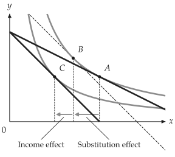

# Figures and demand diagrams

<span id="sec-figures"></span>

On top of `Canvas`, `utility-viz` builds these larger diagrams:

- `Figure` for multi-panel layouts;
- `PricePath` and `IncomePath` for budget and equilibrium sweeps;
- `DemandDiagram` for linked goods-space and Marshallian-demand views;
- `decompose_price_effect` for the Hicks and Slutsky decompositions;
- `EdgeworthBox` for two-consumer exchange diagrams.

## Multi-panel figures

<!-- api: agora.utility_viz.guides_consumer_1 -->

Compose several canvases into one figure, for before-and-after
comparisons, decompositions or classroom slides. It takes the same
styling arguments as `Canvas`. `fig[idx]` returns the panel `Canvas`, so
the drawing API is unchanged once the layout exists.

```python
from utility_viz import Config, Figure, Layout, levels, solve
from utility_viz.models import CobbDouglas

# figure settings
Config.load("manual.toml").use()

fig = Figure(
    Layout.SIDE_BY_SIDE,
    x_max=20,
    y_max=15,
    x_label="$x$",
    y_label="$y$",
)

# before and after x doubles
cases = [
    (CobbDouglas(alpha=0.5, beta=0.5), 2.0, 3.0, 30.0),
    (CobbDouglas(alpha=0.3, beta=0.7), 4.0, 3.0, 30.0),
]
for idx, (model, px, py, income) in enumerate(cases):
    eq = solve(model, px=px, py=py, income=income)
    # each panel is a Canvas
    panel = fig[idx]
    panel.add_utility(
        model, levels=levels.around(eq.utility, n=5)
    )
    panel.add_budget(px, py, income, fill=True)
    panel.add_equilibrium(eq, show_ray=True)
fig.save("side_by_side.png")
```

<figure class="ev-fig" markdown>

{ .ev-figure-lg }

<div class="ev-downloads"><a class="ev-download" href="../../assets/utility-viz/agora/consumer/side_by_side.py" download aria-label="Download the source"><svg viewBox="0 0 24 24" aria-hidden="true"><path d="M8 7l-5 5 5 5M16 7l5 5-5 5M14 4l-4 16" fill="none" stroke="currentColor" stroke-width="2" stroke-linecap="round" stroke-linejoin="round"/></svg><span>Download the source</span></a><a class="ev-download" href="../../assets/utility-viz/agora/consumer/side_by_side.svg" download aria-label="Download the image"><svg viewBox="0 0 24 24" aria-hidden="true"><path d="M4 5h16v14H4zM4 16l5-5 4 4 3-3 4 4M15 9.5h.01" fill="none" stroke="currentColor" stroke-width="2" stroke-linecap="round" stroke-linejoin="round"/></svg><span>Download the image</span></a></div>

<figcaption markdown>Price change before and after</figcaption>

</figure>

<!-- api: agora.utility_viz.guides_consumer_2 -->

The available layouts:
`SINGLE`, `STACKED`, `SIDE_BY_SIDE`, `TOP_TWO_BOTTOM_ONE`,
`TOP_ONE_BOTTOM_TWO`, `GRID_2X2` and `GRID_3X3`.

## Paths

<!-- api: agora.utility_viz.guides_consumer_3 -->

Sweep one budget parameter while repeatedly solving the consumer's
problem. Use a path to draw price- and income-consumption curves with
`Canvas.add_path`, to feed a `DemandDiagram`, or to inspect how bundles
move as prices or income vary.

<!-- api: agora.utility_viz.guides_consumer_4 -->

Draw a path directly on a canvas when a full demand diagram is not
needed. For Cobb-Douglas preferences the price-consumption curve is
horizontal ([The price-consumption curve as $p_x$ varies](consumer.md#fig-price-path)): spending on $y$ does not depend on $p_x$.

```python
from utility_viz import (
    Canvas,
    Config,
    LinearBudget,
    PricePath,
    levels,
)
from utility_viz.models import CobbDouglas

# figure settings
Config.load("manual.toml").use()

model = CobbDouglas(alpha=0.5, beta=0.5)
budget = LinearBudget(px=2.0, py=2.0, income=40.0)
path = PricePath(
    model,
    budget=budget,
    price="px",
    price_range=(0.8, 6.0),
    n=40,
)

# curves around the middle optimum
eq = path.equilibria[len(path.equilibria) // 2]

cvs = Canvas(x_max=25, y_max=20, x_label="$x$", y_label="$y$")
cvs.add_utility(model, levels=levels.around(eq.utility, n=5))
# the price-consumption curve
cvs.add_path(path)
cvs.save("price_path.png")
```

<span id="fig-price-path"></span>

<figure class="ev-fig" markdown>

{ .ev-figure-sm }

<div class="ev-downloads"><a class="ev-download" href="../../assets/utility-viz/agora/consumer/price_path.py" download aria-label="Download the source"><svg viewBox="0 0 24 24" aria-hidden="true"><path d="M8 7l-5 5 5 5M16 7l5 5-5 5M14 4l-4 16" fill="none" stroke="currentColor" stroke-width="2" stroke-linecap="round" stroke-linejoin="round"/></svg><span>Download the source</span></a><a class="ev-download" href="../../assets/utility-viz/agora/consumer/price_path.svg" download aria-label="Download the image"><svg viewBox="0 0 24 24" aria-hidden="true"><path d="M4 5h16v14H4zM4 16l5-5 4 4 3-3 4 4M15 9.5h.01" fill="none" stroke="currentColor" stroke-width="2" stroke-linecap="round" stroke-linejoin="round"/></svg><span>Download the image</span></a></div>

<figcaption markdown>The price-consumption curve as $p_x$ varies</figcaption>

</figure>

## Demand diagrams

<!-- api: agora.utility_viz.guides_consumer_5 -->

A stacked two-panel figure: indifference curves, budget lines and
equilibria in the top panel, the corresponding Marshallian demand curve
in the bottom one ([Demand curve at the optima](consumer.md#fig-demand)).

- `DemandDiagram` expects a `PricePath`.
- Smooth, kinked and corner demand are handled differently, so that the
  bottom panel stays economically meaningful.
- `show_pcc=True` overlays the price-consumption curve in goods space.

```python
from utility_viz import DemandDiagram, LinearBudget, PricePath
from utility_viz.models import CobbDouglas

model = CobbDouglas(alpha=0.5, beta=0.5)
budget = LinearBudget(px=2.0, py=2.0, income=40.0)
path = PricePath(
    model,
    budget=budget,
    price="px",
    price_range=(0.8, 6.0),
    n=40,
)

fig = DemandDiagram(path, title="Demand: Cobb-Douglas")
fig.add_marshallian_panel(
    price_markers=[1.5, 4.0],
    show_pcc=False,
    show_demand_guides=True,
)
fig.save("demand_cobb_douglas.png")
```

The figure below is drawn from MosaicKit layers, so each label can be placed by hand.

<span id="fig-demand"></span>

<figure class="ev-fig" markdown>

{ .ev-figure-lg }

<div class="ev-downloads"><a class="ev-download" href="../../assets/utility-viz/agora/consumer/demand.py" download aria-label="Download the source"><svg viewBox="0 0 24 24" aria-hidden="true"><path d="M8 7l-5 5 5 5M16 7l5 5-5 5M14 4l-4 16" fill="none" stroke="currentColor" stroke-width="2" stroke-linecap="round" stroke-linejoin="round"/></svg><span>Download the source</span></a><a class="ev-download" href="../../assets/utility-viz/agora/consumer/demand.svg" download aria-label="Download the image"><svg viewBox="0 0 24 24" aria-hidden="true"><path d="M4 5h16v14H4zM4 16l5-5 4 4 3-3 4 4M15 9.5h.01" fill="none" stroke="currentColor" stroke-width="2" stroke-linecap="round" stroke-linejoin="round"/></svg><span>Download the image</span></a></div>

<figcaption markdown>Demand curve at the optima</figcaption>

</figure>

## Price-effect decomposition

<!-- api: agora.utility_viz.guides_consumer_6 -->

Separate a price change into substitution and income effects. Choose
`DecompositionMethod.HICKS` to hold the original utility fixed
[Hicks (1939)](../project/references.md#hicks1939), or `SLUTSKY` [Slutsky (1915)](../project/references.md#slutsky1915) to keep the original bundle affordable. The result has these
fields:

<!-- api: agora.utility_viz.guides_consumer_7 -->

How the compensated bundle B is chosen.

<!-- api: agora.utility_viz.guides_consumer_8 -->

Draw the three bundles A, B and C, the budget lines, the indifference
curves and the effect arrows. A Hicks decomposition draws the curves
through A and C; a Slutsky decomposition also draws the one through B.

<!-- api: agora.utility_viz.guides_consumer_9 -->

Colour, height of the arrow below the horizontal axis, label and opacity
of the substitution or income effect. The line itself can still be
overridden with `substitution_stroke` or `income_stroke`.

<!-- api: agora.utility_viz.guides_consumer_10 -->

`"auto"` picks the inner corner that hides the least of the plot; when
all four corners overlap it, the legend moves to the right. Inner corners
such as `"upper left"` and outer positions `"top"`, `"bottom"`, `"left"`
and `"right"` can also be given. `Legend(visible=False)` hides the legend.

```python
from utility_viz import (
    Canvas,
    DecompositionMethod,
    Effect,
    Label,
    Legend,
    decompose_price_effect,
)
from utility_viz.models import CobbDouglas

model = CobbDouglas(alpha=0.5, beta=0.5)
result = decompose_price_effect(
    model,
    px=(2.0, 4.0),
    py=3.0,
    income=60.0,
    method=DecompositionMethod.HICKS,
)

(
    Canvas(x_max=25, y_max=25, title="Hicks decomposition")
    .add_decomposition(
        result,
        show_arrows=True,
        label_effects=True,
        show_x_projections=True,
        substitution=Effect(label="SE"),
        income=Effect(label="IE", opacity=0.8),
        curve_label=Label(position="right"),
        legend=Legend(position="bottom"),
    )
    .save("hicks.png")
)
```

The figure below is also drawn from MosaicKit layers; the two effects are named under the axis.

<figure class="ev-fig" markdown>

{ .ev-figure-lg }

<div class="ev-downloads"><a class="ev-download" href="../../assets/utility-viz/agora/consumer/hicks.py" download aria-label="Download the source"><svg viewBox="0 0 24 24" aria-hidden="true"><path d="M8 7l-5 5 5 5M16 7l5 5-5 5M14 4l-4 16" fill="none" stroke="currentColor" stroke-width="2" stroke-linecap="round" stroke-linejoin="round"/></svg><span>Download the source</span></a><a class="ev-download" href="../../assets/utility-viz/agora/consumer/hicks.svg" download aria-label="Download the image"><svg viewBox="0 0 24 24" aria-hidden="true"><path d="M4 5h16v14H4zM4 16l5-5 4 4 3-3 4 4M15 9.5h.01" fill="none" stroke="currentColor" stroke-width="2" stroke-linecap="round" stroke-linejoin="round"/></svg><span>Download the image</span></a></div>

<figcaption markdown>Hicks decomposition</figcaption>

</figure>

## Edgeworth box

<!-- api: agora.utility_viz.guides_consumer_11 -->

A two-consumer exchange economy [Edgeworth (1881)](../project/references.md#edgeworth1881). Consumer $A$ is measured from the
lower-left origin and consumer $B$ from the upper-right origin. Layers
are added with `add_endowment`, `add_contract_curve`, `add_core`,
`add_price_line` and `add_walrasian_equilibrium`.

Use `method="mrs"` for the contract curve of smooth preferences, and
`method="pareto"` for models with kinks, corners or custom piecewise
utility functions.

```python
from utility_viz import EdgeworthBox
from utility_viz.models import CobbDouglas

box = EdgeworthBox(
    CobbDouglas(alpha=0.8, beta=0.2),
    CobbDouglas(alpha=0.2, beta=0.8),
    total_x=12.0,
    total_y=10.0,
    title="Asymmetric Cobb-Douglas",
)

(
    box.add_endowment(5.0, 4.0)
    .add_contract_curve(n=100, method="mrs")
    .add_core()
    .add_price_line(px=1.2, py=1.0)
    .add_walrasian_equilibrium(px=1.2, py=1.0)
    .show_legend(loc="center left", bbox_to_anchor=(1.02, 0.5))
    .save("edgeworth.png")
)
```

The figure below is drawn from MosaicKit layers after a textbook figure, with both consumers' indifference curves.

<figure class="ev-fig" markdown>

{ .ev-figure-lg }

<div class="ev-downloads"><a class="ev-download" href="../../assets/utility-viz/agora/consumer/edgeworth.py" download aria-label="Download the source"><svg viewBox="0 0 24 24" aria-hidden="true"><path d="M8 7l-5 5 5 5M16 7l5 5-5 5M14 4l-4 16" fill="none" stroke="currentColor" stroke-width="2" stroke-linecap="round" stroke-linejoin="round"/></svg><span>Download the source</span></a><a class="ev-download" href="../../assets/utility-viz/agora/consumer/edgeworth.svg" download aria-label="Download the image"><svg viewBox="0 0 24 24" aria-hidden="true"><path d="M4 5h16v14H4zM4 16l5-5 4 4 3-3 4 4M15 9.5h.01" fill="none" stroke="currentColor" stroke-width="2" stroke-linecap="round" stroke-linejoin="round"/></svg><span>Download the image</span></a></div>

<figcaption markdown>Edgeworth box indifference curves</figcaption>

</figure>
