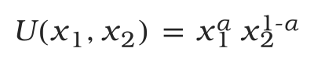

# 文字与数学式排版

<span id="sec-layout-math"></span>

## 段落与测量

<!-- api: agora.glyphkit.guides_layout_math_1 -->

处理每个文本片段的字形，按照 Unicode 合法换行位置分行，再返回不可变的 `TextLayout`。

<!-- api: agora.glyphkit.guides_layout_math_2 -->

不必实际绘图，就能取得逻辑与墨迹范围、基线、行数及溢出。

<!-- api: agora.glyphkit.guides_layout_math_3 -->

一行的排版结果，包括字形组、基线、前进宽度、范围、原文区段与是否明确换行。

`TextStyle` 包含字体族、字号、字重、斜体、语言、方向、字距与 OpenType 功能。同一段可以混用样式和书写系统。设置 `max_width` 时，会在 Unicode 换行算法定义的合法位置换行 [{Unicode Consortium} (2026)](../project/references.md#unicode-linebreak2026)；不设置则排成不受宽度限制的单行。

## 结构化数学式

```python
from glyphkit import FontLibrary, FontSource
from glyphkit.math import MathStyle, parse_math

library = FontLibrary.from_sources(
    (FontSource.path("fonts/STIXTwoMath-Regular.otf"),)
)
formula = parse_math(r"U(x_1, x_2) = x_1^\alpha x_2^{1-\alpha}")
box = library.layout_math(formula, style=MathStyle(18, ("STIX Two Math",)))
print(box.bounds)
```

<!-- api: agora.glyphkit.guides_layout_math_4 -->

把支持的类 LaTeX 输入解析成结构化语法树，涵盖符号、上下标、分数、根号、定界符号、矩阵、重音与上下限。

<!-- api: agora.glyphkit.guides_layout_math_5 -->

控制数学字体族、字号、上下标层级、英文字母斜体、上下标比例与 OpenType MATH 常量的自定义值。

<!-- api: agora.glyphkit.guides_layout_math_6 -->

数学排版树中的一个节点，包含范围、基线、子节点原点、字形排版与可绘制线条。

这是一套定义清楚的类 LaTeX 输入子集，不是 TeX 直译器。字体专用的常数与字形变体来自 OpenType MATH 表 [{Microsoft} (2025)](../project/references.md#opentype-math2025)。不认得的指令或错误群组会抛出 `MathSyntaxError`。从 1.0.0b2 起，`MathStyle` 可覆写上下标缩放、具名数学常数，以及英文字母使用的斜体样式。

<span id="fig-glyph-math"></span>

<figure class="ev-fig" markdown>

{ .ev-figure-sm }

<figcaption markdown>使用 OpenType MATH 度量和精确字形轮廓排出的 Cobb–Douglas 效用函数</figcaption>

</figure>
